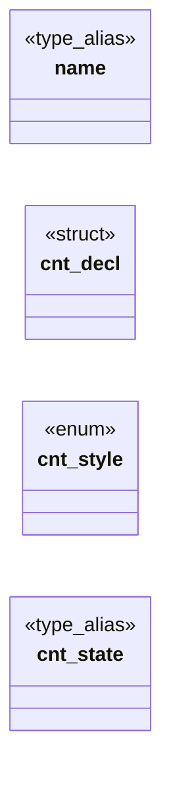

# `include/css_counter.h`

> Source: [include/css_counter.h:1](../../include/css_counter.h#L1) | language `h` | coverage 36.8% | [API index](../index.md)

## Contents

- **Structs:** [`cnt_decl`](#cnt_decl)
- **Enums:** [`cnt_style`](#cnt_style)
- **Type Aliases:** [`name`](#name), [`cnt_state`](#cnt_state)
- **Functions:** [`cnt_hash`](#cnt_hash), [`written`](#written), [`cnt_parse_content`](#cnt_parse_content), [`cnt_is_marker`](#cnt_is_marker), [`cnt_format`](#cnt_format), [`cnt_state_new`](#cnt_state_new), [`cnt_state_free`](#cnt_state_free), [`cnt_reset`](#cnt_reset), [`cnt_increment`](#cnt_increment), [`cnt_leave`](#cnt_leave), [`cnt_resolve`](#cnt_resolve)
- **Macros:** [`CNT_MAX_DECL`](#cnt_max_decl), [`CNT_MAX_INSTANCES`](#cnt_max_instances), [`CNT_NAME_MAX`](#cnt_name_max)

## Type Diagram



## Structs

<a id="cnt_decl"></a>

### `cnt_decl`

`struct` | [include/css_counter.h:21](../../include/css_counter.h#L21)

```c
typedef struct cnt_decl
```

---

## Enums

<a id="cnt_style"></a>

### `cnt_style`

`enum` | [include/css_counter.h:26](../../include/css_counter.h#L26)

```c
typedef enum cnt_style
```

---

## Type Aliases

<a id="name"></a>

### `name`

`type_alias` | [include/css_counter.h:20](../../include/css_counter.h#L20)

```c
typedef struct cnt_decl { unsigned name;
```

define CNT_MAX_DECL       4 define CNT_MAX_INSTANCES  1024 define CNT_NAME_MAX       64

---

<a id="cnt_state"></a>

### `cnt_state`

`type_alias` | [include/css_counter.h:50](../../include/css_counter.h#L50)

```c
typedef struct cnt_state cnt_state;
```

---

## Functions

<a id="cnt_hash"></a>

### `cnt_hash`

`function` | [include/css_counter.h:34](../../include/css_counter.h#L34)

```c
unsigned cnt_hash(const char *name, size_t len);
```

FNV-1a over `len` bytes of an identifier, ASCII case preserved (identifiers are case-sensitive).

Never 0.

**Parameters**

| Name | Type | Default | Description |
|---|---|---|---|
| `name` | `char *` |  |  |
| `len` | `size_t` |  |  |

**Returns:** `unsigned`

---

<a id="written"></a>

### `written`

`function` | [include/css_counter.h:37](../../include/css_counter.h#L37)

```c
* written (0 for `none`) or -1 when invalid. `dflt` is the value of an entry with no * integer: 0 for reset, 1 for increment. */ int cnt_parse_decls(const char *val, int dflt, cnt_decl out[CNT_MAX_DEC
```

**Parameters**

| Name | Type | Default | Description |
|---|---|---|---|
| `none` | `` 0 for ` ` `` |  |  |

**Returns:** `*`

---

<a id="cnt_parse_content"></a>

### `cnt_parse_content`

`function` | [include/css_counter.h:44](../../include/css_counter.h#L44)

```c
int cnt_parse_content(const char *val, char *out, size_t cap);
```

Parses a `content` value that uses counter()/counters().

Writes a marker into `out` and returns 1; returns 0 when the value has no counter function (not this module's), -1 when it is malformed or does not fit in [`cap`](src.css.c.md#cap).

**Parameters**

| Name | Type | Default | Description |
|---|---|---|---|
| `val` | `char *` |  |  |
| `out` | `char *` |  |  |
| `cap` | `size_t` |  |  |

**Returns:** `int`

---

<a id="cnt_is_marker"></a>

### `cnt_is_marker`

`function` | [include/css_counter.h:45](../../include/css_counter.h#L45)

```c
int cnt_is_marker(const char *s);
```

**Parameters**

| Name | Type | Default | Description |
|---|---|---|---|
| `s` | `char *` |  |  |

**Returns:** `int`

---

<a id="cnt_format"></a>

### `cnt_format`

`function` | [include/css_counter.h:49](../../include/css_counter.h#L49)

```c
size_t cnt_format(int style, long value, char *out, size_t cap);
```

Formats `value` in `style` (unknown or unrepresentable falls back to decimal).

Returns the length written; always NUL-terminated when cap > 0.

**Parameters**

| Name | Type | Default | Description |
|---|---|---|---|
| `style` | `int` |  |  |
| `value` | `long` |  |  |
| `out` | `char *` |  |  |
| `cap` | `size_t` |  |  |

**Returns:** `size_t`

---

<a id="cnt_state_new"></a>

### `cnt_state_new`

`function` | [include/css_counter.h:52](../../include/css_counter.h#L52)

```c
cnt_state *cnt_state_new(void);
```

**Returns:** `cnt_state *`

---

<a id="cnt_state_free"></a>

### `cnt_state_free`

`function` | [include/css_counter.h:53](../../include/css_counter.h#L53)

```c
void cnt_state_free(cnt_state *s);
```

**Parameters**

| Name | Type | Default | Description |
|---|---|---|---|
| `s` | `cnt_state *` |  |  |

---

<a id="cnt_reset"></a>

### `cnt_reset`

`function` | [include/css_counter.h:56](../../include/css_counter.h#L56)

```c
void cnt_reset(cnt_state *s, int depth, const cnt_decl *d, int n);
```

An element at tree depth [`depth`](src.tab.c.md#depth) runs these in order: reset, then increment.

**Parameters**

| Name | Type | Default | Description |
|---|---|---|---|
| `s` | `cnt_state *` |  |  |
| `depth` | `int` |  |  |
| `d` | `cnt_decl *` |  |  |
| `n` | `int` |  |  |

---

<a id="cnt_increment"></a>

### `cnt_increment`

`function` | [include/css_counter.h:57](../../include/css_counter.h#L57)

```c
void cnt_increment(cnt_state *s, int depth, const cnt_decl *d, int n);
```

**Parameters**

| Name | Type | Default | Description |
|---|---|---|---|
| `s` | `cnt_state *` |  |  |
| `depth` | `int` |  |  |
| `d` | `cnt_decl *` |  |  |
| `n` | `int` |  |  |

---

<a id="cnt_leave"></a>

### `cnt_leave`

`function` | [include/css_counter.h:60](../../include/css_counter.h#L60)

```c
void cnt_leave(cnt_state *s, int depth);
```

The children of an element have all been walked: drop what they created (instances created at depth >= [`depth`](src.tab.c.md#depth), i.e. the children's depth).

**Parameters**

| Name | Type | Default | Description |
|---|---|---|---|
| `s` | `cnt_state *` |  |  |
| `depth` | `int` |  |  |

---

<a id="cnt_resolve"></a>

### `cnt_resolve`

`function` | [include/css_counter.h:67](../../include/css_counter.h#L67)

```c
size_t cnt_resolve(const cnt_state *s, const char *marker, cnt_attr_fn attr, void *ctx, char *out, size_t cap);
```

Expands a marker against the live state.

A string that is not a marker is copied verbatim. Returns the length written, NUL-terminated, never beyond [`cap`](src.css.c.md#cap).

**Parameters**

| Name | Type | Default | Description |
|---|---|---|---|
| `s` | `cnt_state *` |  |  |
| `marker` | `char *` |  |  |
| `attr` | `cnt_attr_fn` |  |  |
| `ctx` | `void *` |  |  |
| `out` | `char *` |  |  |
| `cap` | `size_t` |  |  |

**Returns:** `size_t`

---

## Macros

<a id="cnt_max_decl"></a>

### `CNT_MAX_DECL`

`macro` | [include/css_counter.h:17](../../include/css_counter.h#L17)

```c
#define CNT_MAX_DECL
```

---

<a id="cnt_max_instances"></a>

### `CNT_MAX_INSTANCES`

`macro` | [include/css_counter.h:18](../../include/css_counter.h#L18)

```c
#define CNT_MAX_INSTANCES
```

---

<a id="cnt_name_max"></a>

### `CNT_NAME_MAX`

`macro` | [include/css_counter.h:19](../../include/css_counter.h#L19)

```c
#define CNT_NAME_MAX
```

---
