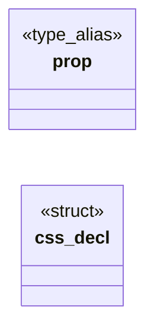

# `include/css_decl.h`

> Source: [include/css_decl.h:1](../../include/css_decl.h#L1) | language `h` | coverage 14.3% | [API index](../index.md)

## Contents

- **Structs:** [`css_decl`](#css_decl)
- **Type Aliases:** [`prop`](#prop)
- **Functions:** [`order`](#order), [`contiguous`](#contiguous)
- **Macros:** [`CSS_POOL_INIT`](#css_pool_init), [`CSS_POOL_HEADROOM`](#css_pool_headroom), [`CSS_MAX_BG_URLS`](#css_max_bg_urls), [`CSS_MAX_CONTENT_URLS`](#css_max_content_urls), [`CSS_MAX_KEYFRAMES`](#css_max_keyframes), [`CSS_MAX_KEYFRAME_STOPS`](#css_max_keyframe_stops), [`CSS_MAX_KEYFRAME_DECLS`](#css_max_keyframe_decls), [`CSS_INLINE_BG_URLS`](#css_inline_bg_urls), [`CSS_WIDE_PROBE_DECLS`](#css_wide_probe_decls)

## Type Diagram



## Structs

<a id="css_decl"></a>

### `css_decl`

`struct` | [include/css_decl.h:220](../../include/css_decl.h#L220)

```c
typedef struct css_decl
```

---

## Type Aliases

<a id="prop"></a>

### `prop`

`type_alias` | [include/css_decl.h:219](../../include/css_decl.h#L219)

```c
typedef struct css_decl { int prop;
```

---

## Functions

<a id="order"></a>

### `order`

`function` | [include/css_decl.h:50](../../include/css_decl.h#L50)

```c
* The four margin slots are contiguous in CSS shorthand order (top,right,bottom, * left);
```

**Parameters**

| Name | Type | Default | Description |
|---|---|---|---|
| `left` |  |  |  |

**Returns:** `* The four margin slots are contiguous in CSS shorthand`

---

<a id="contiguous"></a>

### `contiguous`

`function` | [include/css_decl.h:65](../../include/css_decl.h#L65)

```c
* contiguous (dx,dy,color) so expand_shadow writes them as a group. */ P_FONTFAMILY, P_TEXTTRANSFORM, P_LETTERSPACING, P_WORDSPACING, P_SHADOW_DX, P_SHADOW_DY, P_SHADOW_COLOR, P_OPACITY, P_VALIGN, P_T
```

**Returns:** `*`

---

## Macros

<a id="css_pool_init"></a>

### `CSS_POOL_INIT`

`macro` | [include/css_decl.h:20](../../include/css_decl.h#L20)

```c
#define CSS_POOL_INIT
```

The sheet's two string pools -- background url()s, and the ::before/::after content strings that font-family names and grid-area rows share -- live on the heap and grow by doubling from CSS_POOL_INIT slots, so a sheet only pays for what it holds.

They were fixed at 256 slots, and a page reaches that: an icon font ships hundreds of one-glyph `content` rules (slashdot ~350), and every rule past the cap lost its string in silence. The hard caps below are the anti-DoS bound (4096 x CSS_URL_MAX = 4 MiB per pool at worst). CSS_POOL_HEADROOM free slots are guaranteed before each rule's declarations are interpreted, more than one declaration block can consume.

---

<a id="css_pool_headroom"></a>

### `CSS_POOL_HEADROOM`

`macro` | [include/css_decl.h:21](../../include/css_decl.h#L21)

```c
#define CSS_POOL_HEADROOM
```

---

<a id="css_max_bg_urls"></a>

### `CSS_MAX_BG_URLS`

`macro` | [include/css_decl.h:22](../../include/css_decl.h#L22)

```c
#define CSS_MAX_BG_URLS
```

---

<a id="css_max_content_urls"></a>

### `CSS_MAX_CONTENT_URLS`

`macro` | [include/css_decl.h:23](../../include/css_decl.h#L23)

```c
#define CSS_MAX_CONTENT_URLS
```

---

<a id="css_max_keyframes"></a>

### `CSS_MAX_KEYFRAMES`

`macro` | [include/css_decl.h:25](../../include/css_decl.h#L25)

```c
#define CSS_MAX_KEYFRAMES
```

---

<a id="css_max_keyframe_stops"></a>

### `CSS_MAX_KEYFRAME_STOPS`

`macro` | [include/css_decl.h:26](../../include/css_decl.h#L26)

```c
#define CSS_MAX_KEYFRAME_STOPS
```

---

<a id="css_max_keyframe_decls"></a>

### `CSS_MAX_KEYFRAME_DECLS`

`macro` | [include/css_decl.h:27](../../include/css_decl.h#L27)

```c
#define CSS_MAX_KEYFRAME_DECLS
```

---

<a id="css_inline_bg_urls"></a>

### `CSS_INLINE_BG_URLS`

`macro` | [include/css_decl.h:28](../../include/css_decl.h#L28)

```c
#define CSS_INLINE_BG_URLS
```

---

<a id="css_wide_probe_decls"></a>

### `CSS_WIDE_PROBE_DECLS`

`macro` | [include/css_decl.h:35](../../include/css_decl.h#L35)

```c
#define CSS_WIDE_PROBE_DECLS
```

Scratch size for the CSS-wide-keyword probe (wide_claim).

Bounds the widest shorthand expansion in the dispatch: the four-side length shorthands emit a px and a percentage slot per side (8), grid-template-columns emits one slot per track plus the count (9), matrix() emits seven, and box-shadow writes its whole layer group (7 + 6 per extra layer = 25).

---
