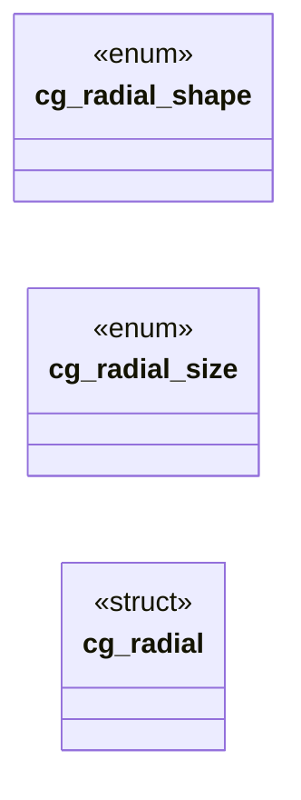

# `include/css_gradient.h`

> Source: [include/css_gradient.h:1](../../include/css_gradient.h#L1) | language `h` | coverage 30.8% | [API index](../index.md)

## Contents

- **Structs:** [`cg_radial`](#cg_radial)
- **Enums:** [`cg_radial_shape`](#cg_radial_shape), [`cg_radial_size`](#cg_radial_size)
- **Functions:** [`cg_expand_bg_image`](#cg_expand_bg_image), [`cg_expand_background`](#cg_expand_background), [`width`](#width), [`out`](#out), [`cg_radial_len_px`](#cg_radial_len_px), [`zero`](#zero), [`cg_parse_linear`](#cg_parse_linear)
- **Macros:** [`CG_LEN_UNSET`](#cg_len_unset)

## Type Diagram



## Structs

<a id="cg_radial"></a>

### `cg_radial`

`struct` | [include/css_gradient.h:24](../../include/css_gradient.h#L24)

```c
typedef struct cg_radial
```

**Members**

| Member | Kind | Summary |
|---|---|---|
| [`shape`](#cg_radial-shape) | type_alias |  |

<a id="cg_radial-shape"></a>

#### `cg_radial.shape`

`type_alias` | [include/css_gradient.h:24](../../include/css_gradient.h#L24)

```c
typedef struct cg_radial { int shape;
```

---

## Enums

<a id="cg_radial_shape"></a>

### `cg_radial_shape`

`enum` | [include/css_gradient.h:19](../../include/css_gradient.h#L19)

```c
typedef enum cg_radial_shape { CG_RAD_ELLIPSE = 0, CG_RAD_CIRCLE = 1 } cg_radial_shape;
```

Radial-gradient geometry (spec/css_gradient.md 3b).

Lengths: >= 0 is per-mille of the box * width (x, rx) or height (y, ry); < 0 is -(px) - 1; CG_LEN_UNSET = not given. define CG_LEN_UNSET (-2147483647 - 1)

---

<a id="cg_radial_size"></a>

### `cg_radial_size`

`enum` | [include/css_gradient.h:20](../../include/css_gradient.h#L20)

```c
typedef enum cg_radial_size
```

---

## Functions

<a id="cg_expand_bg_image"></a>

### `cg_expand_bg_image`

`function` | [include/css_gradient.h:11](../../include/css_gradient.h#L11)

```c
int cg_expand_bg_image(const char *val, css_decl *dst, int cap, char (*urltab)[CSS_URL_MAX], size_t *nurl, size_t urlcap);
```

**Parameters**

| Name | Type | Default | Description |
|---|---|---|---|
| `val` | `char *` |  |  |
| `dst` | `css_decl *` |  |  |
| `cap` | `int` |  |  |
| `CSS_URL_MAX` | `char (*urltab)[ ]` |  |  |
| `nurl` | `size_t *` |  |  |
| `urlcap` | `size_t` |  |  |

**Returns:** `int`

*Called by:* [`downstream`](src.css_gradient.c.md#downstream)

---

<a id="cg_expand_background"></a>

### `cg_expand_background`

`function` | [include/css_gradient.h:13](../../include/css_gradient.h#L13)

```c
int cg_expand_background(const char *val, css_decl *dst, int cap, char (*urltab)[CSS_URL_MAX], size_t *nurl, size_t urlcap);
```

**Parameters**

| Name | Type | Default | Description |
|---|---|---|---|
| `val` | `char *` |  |  |
| `dst` | `css_decl *` |  |  |
| `cap` | `int` |  |  |
| `CSS_URL_MAX` | `char (*urltab)[ ]` |  |  |
| `nurl` | `size_t *` |  |  |
| `urlcap` | `size_t` |  |  |

**Returns:** `int`

---

<a id="width"></a>

### `width`

`function` | [include/css_gradient.h:17](../../include/css_gradient.h#L17)

```c
* width (x, rx) or height (y, ry);
```

**Returns:** `*`

---

<a id="out"></a>

### `out`

`function` | [include/css_gradient.h:32](../../include/css_gradient.h#L32)

```c
* Returns 1 and fills *out (defaults first) when seg is a valid prelude, 0 when seg is not * one (it is a colour stop), -1 when it is malformed (the caller drops the gradient). Pure. */ int cg_parse_r
```

**Parameters**

| Name | Type | Default | Description |
|---|---|---|---|
| `first` | `defaults` |  |  |

**Returns:** `* Returns 1 and fills *`

---

<a id="cg_radial_len_px"></a>

### `cg_radial_len_px`

`function` | [include/css_gradient.h:37](../../include/css_gradient.h#L37)

```c
double cg_radial_len_px(int enc, double dim);
```

A radial length resolved against a box dimension in px.

**Parameters**

| Name | Type | Default | Description |
|---|---|---|---|
| `enc` | `int` |  |  |
| `dim` | `double` |  |  |

**Returns:** `double`

---

<a id="zero"></a>

### `zero`

`function` | [include/css_gradient.h:41](../../include/css_gradient.h#L41)

```c
* floored at a hair above zero (the spec paints the last colour for a degenerate size) and * never non-finite. Pure. */ void cg_radial_geometry(const cg_radial *r, double w, double h, double *cx, doub
```

**Parameters**

| Name | Type | Default | Description |
|---|---|---|---|
| `size` | `the spec paints the last colour for a degenerate` |  |  |

**Returns:** `* floored at a hair above`

---

<a id="cg_parse_linear"></a>

### `cg_parse_linear`

`function` | [include/css_gradient.h:51](../../include/css_gradient.h#L51)

```c
int cg_parse_linear(const char *fn, int *angle, int *colors, int *positions);
```

Parses one `linear-gradient(...)` function (the whole text, nothing around it) into its angle (CSS degrees), packed stop colours (alpha rides bits 24..30 as TRANSPARENCY, 0 opaque ..

127 clear) and stop positions (per-mille, -1 = evenly spaced); both arrays hold CSS_GRAD_STOPS_MAX entries and the caller initialises positions to -1. Returns the stop count, 0 when the text is not a valid linear gradient. Used by the mask parser, which wants the alpha of each stop.

**Parameters**

| Name | Type | Default | Description |
|---|---|---|---|
| `fn` | `char *` |  |  |
| `angle` | `int *` |  |  |
| `colors` | `int *` |  |  |
| `positions` | `int *` |  |  |

**Returns:** `int`

---

## Macros

<a id="cg_len_unset"></a>

### `CG_LEN_UNSET`

`macro` | [include/css_gradient.h:18](../../include/css_gradient.h#L18)

```c
#define CG_LEN_UNSET
```

Radial-gradient geometry (spec/css_gradient.md 3b).

Lengths: >= 0 is per-mille of the box width (x, rx) or height (y, ry); < 0 is -(px) - 1; CG_LEN_UNSET = not given.

---
