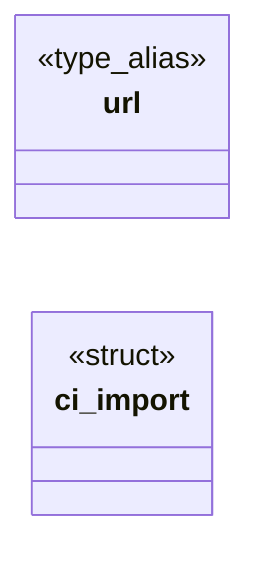

# `include/css_import.h`

> Source: [include/css_import.h:1](../../include/css_import.h#L1) | language `h` | coverage 66.7% | [API index](../index.md)

## Contents

- **Structs:** [`ci_import`](#ci_import)
- **Type Aliases:** [`url`](#url)
- **Functions:** [`ci_scan`](#ci_scan), [`ci_wrap`](#ci_wrap), [`ci_balanced`](#ci_balanced), [`url`](#url)
- **Macros:** [`CI_URL_MAX`](#ci_url_max), [`CI_COND_MAX`](#ci_cond_max), [`CI_MAX_DEPTH`](#ci_max_depth), [`CI_MAX_PER_PAGE`](#ci_max_per_page), [`CI_MAX_PER_SHEET`](#ci_max_per_sheet)

## Type Diagram



## Structs

<a id="ci_import"></a>

### `ci_import`

`struct` | [include/css_import.h:25](../../include/css_import.h#L25)

```c
typedef struct ci_import
```

---

## Type Aliases

<a id="url"></a>

### `url`

`type_alias` | [include/css_import.h:24](../../include/css_import.h#L24)

```c
typedef struct ci_import { char url[CI_URL_MAX];
```

caller: imports read from one sheet

---

## Functions

<a id="ci_scan"></a>

### `ci_scan`

`function` | [include/css_import.h:36](../../include/css_import.h#L36)

```c
size_t ci_scan(const char *css, size_t len, ci_import *out, size_t cap);
```

Reads the leading @import rules of css[0,len) into out (at most cap).

Skips whitespace, comments, @charset and @layer statements; stops at the first other rule. A malformed or oversized import is ignored. NULL/0 args => 0.

**Parameters**

| Name | Type | Default | Description |
|---|---|---|---|
| `css` | `char *` |  |  |
| `len` | `size_t` |  |  |
| `out` | `ci_import *` |  |  |
| `cap` | `size_t` |  |  |

**Returns:** `size_t`

---

<a id="ci_wrap"></a>

### `ci_wrap`

`function` | [include/css_import.h:41](../../include/css_import.h#L41)

```c
int ci_wrap(const ci_import *im, char *open, size_t ocap, char *close, size_t ccap);
```

Builds the wrapper for one import: open = "@layer N {@supports (S) {@media M {" (only the parts present) and close = the matching braces.

No condition => both empty. Returns 0, or -1 when an argument is NULL or a buffer is too small.

**Parameters**

| Name | Type | Default | Description |
|---|---|---|---|
| `im` | `ci_import *` |  |  |
| `open` | `char *` |  |  |
| `ocap` | `size_t` |  |  |
| `close` | `char *` |  |  |
| `ccap` | `size_t` |  |  |

**Returns:** `int`

---

<a id="ci_balanced"></a>

### `ci_balanced`

`function` | [include/css_import.h:45](../../include/css_import.h#L45)

```c
int ci_balanced(const char *css, size_t len);
```

1 iff every comment and string in css[0,len) terminates and the braces outside them never go negative and end at zero; else 0.

NULL => 0 (empty text => 1).

**Parameters**

| Name | Type | Default | Description |
|---|---|---|---|
| `css` | `char *` |  |  |
| `len` | `size_t` |  |  |

**Returns:** `int`

---

<a id="url"></a>

### `url`

`function` | [include/css_import.h:55](../../include/css_import.h#L55)

```c
* rewritten to url("ABS"), ABS = resolve(base, ref) (spec/css_import.md, "Rebase"). * Fragment-only, schemed, empty, escaped, unterminated or unresolvable references * are emitted unchanged. Returns 0
```

**Parameters**

| Name | Type | Default | Description |
|---|---|---|---|
| `ABS` |  |  |  |

**Returns:** `* rewritten to`

---

## Macros

<a id="ci_url_max"></a>

### `CI_URL_MAX`

`macro` | [include/css_import.h:19](../../include/css_import.h#L19)

```c
#define CI_URL_MAX
```

---

<a id="ci_cond_max"></a>

### `CI_COND_MAX`

`macro` | [include/css_import.h:20](../../include/css_import.h#L20)

```c
#define CI_COND_MAX
```

longest import URL kept (raw, unresolved)

---

<a id="ci_max_depth"></a>

### `CI_MAX_DEPTH`

`macro` | [include/css_import.h:21](../../include/css_import.h#L21)

```c
#define CI_MAX_DEPTH
```

longest layer name / supports() / media list

---

<a id="ci_max_per_page"></a>

### `CI_MAX_PER_PAGE`

`macro` | [include/css_import.h:22](../../include/css_import.h#L22)

```c
#define CI_MAX_PER_PAGE
```

caller: nesting bound (breaks a -> b -> a)

---

<a id="ci_max_per_sheet"></a>

### `CI_MAX_PER_SHEET`

`macro` | [include/css_import.h:23](../../include/css_import.h#L23)

```c
#define CI_MAX_PER_SHEET
```

caller: imports followed per load

---
