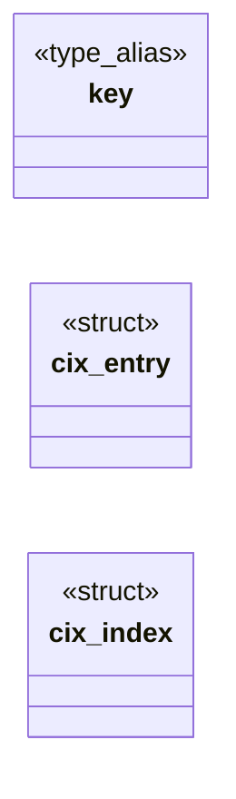

# `include/css_index.h`

> Source: [include/css_index.h:1](../../include/css_index.h#L1) | language `h` | coverage 50.0% | [API index](../index.md)

## Contents

- **Structs:** [`cix_entry`](#cix_entry), [`cix_index`](#cix_index)
- **Type Aliases:** [`key`](#key)
- **Functions:** [`cix_build`](#cix_build), [`cix_build_ptrs`](#cix_build_ptrs), [`cix_free`](#cix_free), [`index`](#index)

## Type Diagram



## Structs

<a id="cix_entry"></a>

### `cix_entry`

`struct` | [include/css_index.h:18](../../include/css_index.h#L18)

```c
typedef struct cix_entry
```

---

<a id="cix_index"></a>

### `cix_index`

`struct` | [include/css_index.h:23](../../include/css_index.h#L23)

```c
typedef struct cix_index
```

---

## Type Aliases

<a id="key"></a>

### `key`

`type_alias` | [include/css_index.h:17](../../include/css_index.h#L17)

```c
typedef struct cix_entry { uint64_t key;
```

include <stddef.h> include <stdint.h>

---

## Functions

<a id="cix_build"></a>

### `cix_build`

`function` | [include/css_index.h:34](../../include/css_index.h#L34)

```c
void cix_build(const css_sel *sels, size_t n, cix_index *idx);
```

Builds the index over sels[0,n) into *idx, overwriting it (a built index must be cix_free'd first).

On OOM leaves *idx invalid (valid == 0).

**Parameters**

| Name | Type | Default | Description |
|---|---|---|---|
| `sels` | `css_sel *` |  |  |
| `n` | `size_t` |  |  |
| `idx` | `cix_index *` |  |  |

---

<a id="cix_build_ptrs"></a>

### `cix_build_ptrs`

`function` | [include/css_index.h:37](../../include/css_index.h#L37)

```c
void cix_build_ptrs(css_sel *const *sels, size_t n, cix_index *idx);
```

Same over a table of pointers (a sheet keeps its selectors compact, one allocation each).

**Parameters**

| Name | Type | Default | Description |
|---|---|---|---|
| `sels` | `css_sel *const *` |  |  |
| `n` | `size_t` |  |  |
| `idx` | `cix_index *` |  |  |

---

<a id="cix_free"></a>

### `cix_free`

`function` | [include/css_index.h:40](../../include/css_index.h#L40)

```c
void cix_free(cix_index *idx);
```

Releases the index; idempotent.

Leaves it invalid.

**Parameters**

| Name | Type | Default | Description |
|---|---|---|---|
| `idx` | `cix_index *` |  |  |

---

<a id="index"></a>

### `index`

`function` | [include/css_index.h:44](../../include/css_index.h#L44)

```c
* index (the caller then scans linearly). */ size_t cix_candidates(const cix_index *idx, const css_element *el, uint32_t **buf, size_t *cap);
```

**Parameters**

| Name | Type | Default | Description |
|---|---|---|---|
| `linearly` | `the caller then scans` |  |  |

**Returns:** `*`

---
