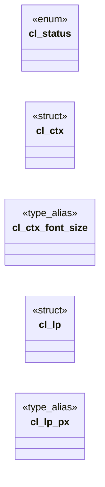

# `include/css_length.h`

> Source: [include/css_length.h:1](../../include/css_length.h#L1) | language `h` | coverage 55.0% | [API index](../index.md)

## Contents

- **Structs:** [`cl_ctx`](#cl_ctx), [`cl_lp`](#cl_lp)
- **Enums:** [`cl_status`](#cl_status)
- **Functions:** [`prelude`](#prelude), [`cl_unit_is_font_relative`](#cl_unit_is_font_relative), [`cl_unit_font_ratio`](#cl_unit_font_ratio), [`here`](#here), [`length`](#length), [`cl_number`](#cl_number), [`cl_is_length_unit`](#cl_is_length_unit)
- **Macros:** [`CL_MAX_TOKEN`](#cl_max_token), [`CL_INITIAL_FONT_SIZE`](#cl_initial_font_size), [`CL_NORMAL_LINE_RATIO`](#cl_normal_line_ratio), [`CL_FALLBACK_EX_RATIO`](#cl_fallback_ex_ratio), [`CL_FALLBACK_CH_RATIO`](#cl_fallback_ch_ratio), [`CL_FALLBACK_CAP_RATIO`](#cl_fallback_cap_ratio), [`CL_FALLBACK_IC_RATIO`](#cl_fallback_ic_ratio)

## Type Diagram



## Structs

<a id="cl_ctx"></a>

### `cl_ctx`

`struct` | [include/css_length.h:84](../../include/css_length.h#L84)

```c
typedef struct cl_ctx
```

The state a <length> is measured against.

A CSS length is a number PLUS its context; making that context an explicit argument is what keeps the conversion factors out of the call sites.

Anti-fingerprinting doctrine: viewport_w/viewport_h default to the NORMALIZED
desktop (CSS_MEDIA_DEFAULT_WIDTH/HEIGHT), never the real window. A computed
length must never leak real window geometry to hostile content. Only @media
width queries see the render width.

The four font-metric fields are <= 0 until a font has actually been measured,
in which case the spec-named fallbacks above apply. They exist so text_shape
(trusted side, local fonts) can supply real metrics later without this module
changing at all.

**Members**

| Member | Kind | Summary |
|---|---|---|
| [`font_size`](#cl_ctx-font_size) | type_alias | The state a <length> is measured against. |

<a id="cl_ctx-font_size"></a>

#### `cl_ctx.font_size`

`type_alias` | [include/css_length.h:84](../../include/css_length.h#L84)

```c
typedef struct cl_ctx { double font_size;
```

The state a <length> is measured against.

A CSS length is a number PLUS its context; making that context an explicit argument is what keeps the conversion factors out of the call sites.

Anti-fingerprinting doctrine: viewport_w/viewport_h default to the NORMALIZED
desktop (CSS_MEDIA_DEFAULT_WIDTH/HEIGHT), never the real window. A computed
length must never leak real window geometry to hostile content. Only @media
width queries see the render width.

The four font-metric fields are <= 0 until a font has actually been measured,
in which case the spec-named fallbacks above apply. They exist so text_shape
(trusted side, local fonts) can supply real metrics later without this module
changing at all.

---

<a id="cl_lp"></a>

### `cl_lp`

`struct` | [include/css_length.h:132](../../include/css_length.h#L132)

```c
typedef struct cl_lp
```

A resolved <length-percentage> (CSS Values 4 section 5.3): the absolute px component and the percentage component, kept SEPARATE because only the caller knows the containing block the percentage measures against.

The two coexist rather than being alternatives: `calc(100% - 10px)` is one
computed value with px == -10 and pct == 100 (CSS Values 4 section 10.3), so
a union or an "either/or" enum could not represent it.

pct is in PERCENT units (50% -> 50.0), not a fraction: it is what the author
wrote. The engine's wire format stores per-mille integers, but that is the
IPC codec's convention, not this type's.

**Members**

| Member | Kind | Summary |
|---|---|---|
| [`px`](#cl_lp-px) | type_alias | A resolved <length-percentage> (CSS Values 4 section 5.3): the absolute px component and the percentage component, kept SEPARATE because only the caller knows... |

<a id="cl_lp-px"></a>

#### `cl_lp.px`

`type_alias` | [include/css_length.h:132](../../include/css_length.h#L132)

```c
typedef struct cl_lp { double px;
```

A resolved <length-percentage> (CSS Values 4 section 5.3): the absolute px component and the percentage component, kept SEPARATE because only the caller knows the containing block the percentage measures against.

The two coexist rather than being alternatives: `calc(100% - 10px)` is one
computed value with px == -10 and pct == 100 (CSS Values 4 section 10.3), so
a union or an "either/or" enum could not represent it.

pct is in PERCENT units (50% -> 50.0), not a fraction: it is what the author
wrote. The engine's wire format stores per-mille integers, but that is the
IPC codec's convention, not this type's.

---

## Enums

<a id="cl_status"></a>

### `cl_status`

`enum` | [include/css_length.h:61](../../include/css_length.h#L61)

```c
typedef enum cl_status
```

---

## Functions

<a id="prelude"></a>

### `prelude`

`function` | [include/css_length.h:99](../../include/css_length.h#L99)

```c
* correct context for a media query prelude (whose `em` is defined to use the * initial font size, never the author's root) and the conservative default * everywhere else. */ cl_ctx cl_ctx_initial(voi
```

**Parameters**

| Name | Type | Default | Description |
|---|---|---|---|
| `size` | `` whose `em` is defined to use the * initial font `` |  |  |
| `root` | `never the author's` |  |  |

**Returns:** `* correct context for a media query`

---

<a id="cl_unit_is_font_relative"></a>

### `cl_unit_is_font_relative`

`function` | [include/css_length.h:157](../../include/css_length.h#L157)

```c
* cl_unit_is_font_relative() draws. */ /* * Re-fits a resolved length to a different font-size: * * used = px + em * (font_size - from_font_size) * * This is the whole rule and the only place the deri
```

**Returns:** `*`

---

<a id="cl_unit_font_ratio"></a>

### `cl_unit_font_ratio`

`function` | [include/css_length.h:182](../../include/css_length.h#L182)

```c
double cl_unit_font_ratio(const char *unit, size_t unit_len);
```

How many px one of `unit` is worth per 1px of font-size -- the per-unit derivative behind cl_lp.em.

`em` answers 1, `ex` its 0.5 fallback ratio, and every non-font-relative unit (px, pt, vw, and rem/rlh) answers 0.

Read out of the cl_unit_scale table rather than written by hand, so a unit
added to section 6.1 gets its coefficient automatically and the two can never
disagree. Exported for calc(), which tokenizes its own dimensions and needs
the derivative of each term to sum them.

**Parameters**

| Name | Type | Default | Description |
|---|---|---|---|
| `unit` | `char *` |  |  |
| `unit_len` | `size_t` |  |  |

**Returns:** `double`

---

<a id="here"></a>

### `here`

`function` | [include/css_length.h:186](../../include/css_length.h#L186)

```c
* Every input cl_resolve accepts resolves identically here (with has_pct 0);
```

**Parameters**

| Name | Type | Default | Description |
|---|---|---|---|
| `has_pct` | `with 0` |  |  |

**Returns:** `* Every input cl_resolve accepts resolves identically`

---

<a id="length"></a>

### `length`

`function` | [include/css_length.h:206](../../include/css_length.h#L206)

```c
* * A basis that is not a usable length (negative, zero, non-finite) contributes * nothing, but the absolute component still survives: dropping it would throw * away a length the author did state. */
```

**Parameters**

| Name | Type | Default | Description |
|---|---|---|---|
| `finite` | `non-` |  |  |

**Returns:** `* * A basis that is not a usable`

---

<a id="cl_number"></a>

### `cl_number`

`function` | [include/css_length.h:230](../../include/css_length.h#L230)

```c
int cl_number(const char *s, double *out, const char **endp);
```

Parses a CSS <number> at the start of `s` (CSS Syntax Level 3, 4.3.12):

[+-]?  ( digit+ ('.' digit*)?  |  '.' digit+ )  ( [eE] [+-]? digit+ )?

Returns 1 on success, writing *out and pointing *endp at the first
unconsumed character; 0 if there is no number there.

Exported because it is the same grammar for a length, a colour channel, an
opacity and a transform argument, and having one implementation is what
prevents them from disagreeing. The previous private parser required a digit
BEFORE the decimal point, so the extremely common `.5` spelling -- as in
`rgba(0,0,0,.5)`, `opacity:.75` or `padding:0 28px 0 .75em` -- was rejected
and the whole declaration dropped.

Locale-independent by construction: it never calls strtod, so a locale whose
decimal separator is ',' cannot truncate "1.5px" to 1px.

**Parameters**

| Name | Type | Default | Description |
|---|---|---|---|
| `s` | `char *` |  |  |
| `out` | `double *` |  |  |
| `endp` | `char **` |  |  |

**Returns:** `int`

*Called by:* [`ct_interp_aspect_ratio`](src.css_text.c.md#ct_interp_aspect_ratio), [`ct_interp_tabsize`](src.css_text.c.md#ct_interp_tabsize)

---

<a id="cl_is_length_unit"></a>

### `cl_is_length_unit`

`function` | [include/css_length.h:246](../../include/css_length.h#L246)

```c
int cl_is_length_unit(const char *unit, size_t unit_len);
```

Non-zero when `unit` names a <length> unit at all (any of the three families plus px).

Used to tell "unsupported unit" apart from "not a length".

**Parameters**

| Name | Type | Default | Description |
|---|---|---|---|
| `unit` | `char *` |  |  |
| `unit_len` | `size_t` |  |  |

**Returns:** `int`

---

## Macros

<a id="cl_max_token"></a>

### `CL_MAX_TOKEN`

`macro` | [include/css_length.h:33](../../include/css_length.h#L33)

```c
#define CL_MAX_TOKEN
```

Longest value accepted.

A <length> token is a number plus at most a handful of ASCII unit characters; anything longer is not a length and fails closed rather than being scanned. Also bounds a value that is missing its NUL.

---

<a id="cl_initial_font_size"></a>

### `CL_INITIAL_FONT_SIZE`

`macro` | [include/css_length.h:39](../../include/css_length.h#L39)

```c
#define CL_INITIAL_FONT_SIZE
```

CSS initial value of `font-size` (the `medium` absolute-size keyword mapped to px).

Not a Freedom convention: it is what every UA uses as the initial computed font-size, and it is the value against which a media query's `em` is defined to resolve.

---

<a id="cl_normal_line_ratio"></a>

### `CL_NORMAL_LINE_RATIO`

`macro` | [include/css_length.h:45](../../include/css_length.h#L45)

```c
#define CL_NORMAL_LINE_RATIO
```

Ratio used for `line_height` in cl_ctx_initial: `line-height: normal` is the font's natural line box.

The engine measures that box for real during layout (see gui/bui_theme.c line_spacing) and passes it in; this is only the value used when no font has been measured yet.

---

<a id="cl_fallback_ex_ratio"></a>

### `CL_FALLBACK_EX_RATIO`

`macro` | [include/css_length.h:56](../../include/css_length.h#L56)

```c
#define CL_FALLBACK_EX_RATIO
```

Spec-named fallbacks for font metrics the caller has not supplied.

CSS Values 4: 6.1.1 ex  -- "a value of 0.5em should be used" when x-height is unknown. 6.1.2 ch  -- the `0` glyph "must be assumed to be 0.5em wide" when unknown. 6.1.3 cap -- falls back to the font's ascent metric; 0.7em approximates the cap-height of the default serif/sans faces. 6.1.4 ic  -- the CJK water ideograph "must be assumed to be 1em" when unknown. These are ratios of the element's font-size, never absolute px.

---

<a id="cl_fallback_ch_ratio"></a>

### `CL_FALLBACK_CH_RATIO`

`macro` | [include/css_length.h:57](../../include/css_length.h#L57)

```c
#define CL_FALLBACK_CH_RATIO
```

---

<a id="cl_fallback_cap_ratio"></a>

### `CL_FALLBACK_CAP_RATIO`

`macro` | [include/css_length.h:58](../../include/css_length.h#L58)

```c
#define CL_FALLBACK_CAP_RATIO
```

---

<a id="cl_fallback_ic_ratio"></a>

### `CL_FALLBACK_IC_RATIO`

`macro` | [include/css_length.h:59](../../include/css_length.h#L59)

```c
#define CL_FALLBACK_IC_RATIO
```

---
