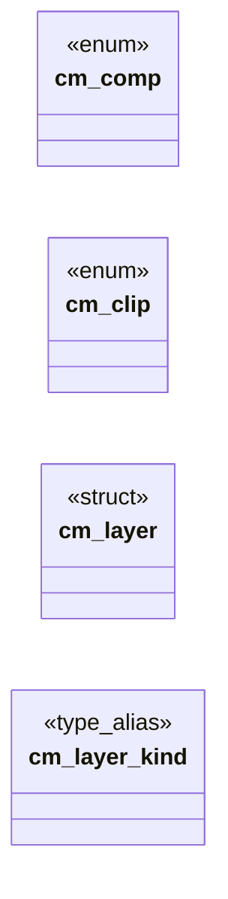

# `include/css_mask.h`

> Source: [include/css_mask.h:1](../../include/css_mask.h#L1) | language `h` | coverage 50.0% | [API index](../index.md)

CSS Masking 1, alpha gradients only (spec/css_mask.md).

Pure: no I/O, a mask can never fetch.

## Contents

- **Structs:** [`cm_layer`](#cm_layer)
- **Enums:** [`cm_comp`](#cm_comp), [`cm_clip`](#cm_clip)
- **Functions:** [`cm_is_mask_prop`](#cm_is_mask_prop), [`malformed`](#malformed), [`cm_encode_layer`](#cm_encode_layer), [`cm_decode_layer`](#cm_decode_layer)
- **Macros:** [`CM_LAYERS`](#cm_layers)

## Type Diagram



## Structs

<a id="cm_layer"></a>

### `cm_layer`

`struct` | [include/css_mask.h:19](../../include/css_mask.h#L19)

```c
typedef struct cm_layer
```

One decoded layer. angle is CSS degrees; alpha[] is 0..255; pos[] is per-mille, -1 = evenly spaced. kind 0 = no layer.

**Members**

| Member | Kind | Summary |
|---|---|---|
| [`kind`](#cm_layer-kind) | type_alias | One decoded layer. angle is CSS degrees; alpha[] is 0..255; pos[] is per-mille, -1 = evenly spaced. kind 0 = no layer. |

<a id="cm_layer-kind"></a>

#### `cm_layer.kind`

`type_alias` | [include/css_mask.h:19](../../include/css_mask.h#L19)

```c
typedef struct cm_layer { int kind;
```

One decoded layer. angle is CSS degrees; alpha[] is 0..255; pos[] is per-mille, -1 = evenly spaced. kind 0 = no layer.

---

## Enums

<a id="cm_comp"></a>

### `cm_comp`

`enum` | [include/css_mask.h:14](../../include/css_mask.h#L14)

```c
typedef enum cm_comp { CM_COMP_ADD = 0, CM_COMP_SUBTRACT, CM_COMP_INTERSECT, CM_COMP_EXCLUDE } cm_comp;
```

---

<a id="cm_clip"></a>

### `cm_clip`

`enum` | [include/css_mask.h:15](../../include/css_mask.h#L15)

```c
typedef enum cm_clip { CM_CLIP_BORDER = 0, CM_CLIP_PADDING, CM_CLIP_CONTENT } cm_clip;
```

---

## Functions

<a id="cm_is_mask_prop"></a>

### `cm_is_mask_prop`

`function` | [include/css_mask.h:28](../../include/css_mask.h#L28)

```c
int cm_is_mask_prop(const char *prop);
```

True for every property name this module owns (after the vendor prefix is removed).

**Parameters**

| Name | Type | Default | Description |
|---|---|---|---|
| `prop` | `char *` |  |  |

**Returns:** `int`

---

<a id="malformed"></a>

### `malformed`

`function` | [include/css_mask.h:31](../../include/css_mask.h#L31)

```c
* the value is unsupported or malformed (the caller drops the declaration). */ int cm_expand(const char *prop, const char *val, css_decl *dst, int cap, int webkit_vocab);
```

**Parameters**

| Name | Type | Default | Description |
|---|---|---|---|
| `declaration` | `the caller drops the` |  |  |

**Returns:** `* the value is unsupported or`

---

<a id="cm_encode_layer"></a>

### `cm_encode_layer`

`function` | [include/css_mask.h:35](../../include/css_mask.h#L35)

```c
void cm_encode_layer(const cm_layer *l, int *meta, int *alphas, int *poss);
```

The three compact words of a layer, and back.

**Parameters**

| Name | Type | Default | Description |
|---|---|---|---|
| `l` | `cm_layer *` |  |  |
| `meta` | `int *` |  |  |
| `alphas` | `int *` |  |  |
| `poss` | `int *` |  |  |

---

<a id="cm_decode_layer"></a>

### `cm_decode_layer`

`function` | [include/css_mask.h:36](../../include/css_mask.h#L36)

```c
void cm_decode_layer(int meta, int alphas, int poss, cm_layer *out);
```

**Parameters**

| Name | Type | Default | Description |
|---|---|---|---|
| `meta` | `int` |  |  |
| `alphas` | `int` |  |  |
| `poss` | `int` |  |  |
| `out` | `cm_layer *` |  |  |

---

## Macros

<a id="cm_layers"></a>

### `CM_LAYERS`

`macro` | [include/css_mask.h:12](../../include/css_mask.h#L12)

```c
#define CM_LAYERS
```

---
