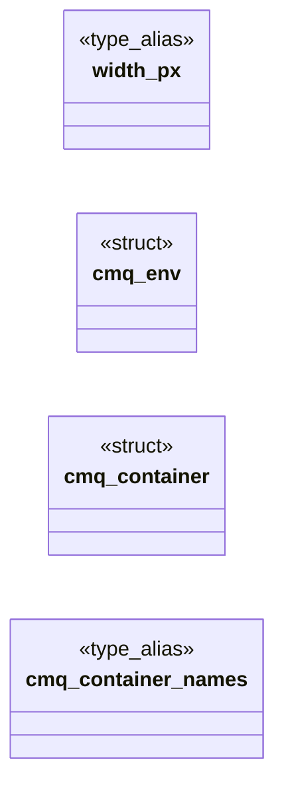

# `include/css_mq.h`

> Source: [include/css_mq.h:1](../../include/css_mq.h#L1) | language `h` | coverage 75.0% | [API index](../index.md)

## Contents

- **Structs:** [`cmq_env`](#cmq_env), [`cmq_container`](#cmq_container)
- **Type Aliases:** [`width_px`](#width_px)
- **Functions:** [`cmq_matches`](#cmq_matches), [`cmq_container_surely`](#cmq_container_surely), [`cmq_name_hash`](#cmq_name_hash), [`cmq_container_decl`](#cmq_container_decl)
- **Macros:** [`CMQ_MAX_DEPTH`](#cmq_max_depth), [`CMQ_TOK_MAX`](#cmq_tok_max), [`CMQ_CONTAINER_NAMES`](#cmq_container_names)

## Type Diagram



## Structs

<a id="cmq_env"></a>

### `cmq_env`

`struct` | [include/css_mq.h:19](../../include/css_mq.h#L19)

```c
typedef struct cmq_env
```

---

<a id="cmq_container"></a>

### `cmq_container`

`struct` | [include/css_mq.h:41](../../include/css_mq.h#L41)

```c
typedef struct cmq_container
```

One ancestor of the element being resolved, nearest first through `parent`.

**Members**

| Member | Kind | Summary |
|---|---|---|
| [`names`](#cmq_container-names) | type_alias | One ancestor of the element being resolved, nearest first through `parent`. |

<a id="cmq_container-names"></a>

#### `cmq_container.names`

`type_alias` | [include/css_mq.h:41](../../include/css_mq.h#L41)

```c
typedef struct cmq_container { unsigned names[CMQ_CONTAINER_NAMES];
```

One ancestor of the element being resolved, nearest first through `parent`.

---

## Type Aliases

<a id="width_px"></a>

### `width_px`

`type_alias` | [include/css_mq.h:18](../../include/css_mq.h#L18)

```c
typedef struct cmq_env { int width_px;
```

bytes of one feature name or value

---

## Functions

<a id="cmq_matches"></a>

### `cmq_matches`

`function` | [include/css_mq.h:28](../../include/css_mq.h#L28)

```c
int cmq_matches(const char *s, size_t len, const cmq_env *env);
```

1 iff the media query list s[0,len) matches env; malformed/unknown parts fail closed.

An empty list matches (all). NULL s or env -> 0.

**Parameters**

| Name | Type | Default | Description |
|---|---|---|---|
| `s` | `char *` |  |  |
| `len` | `size_t` |  |  |
| `env` | `cmq_env *` |  |  |

**Returns:** `int`

---

<a id="cmq_container_surely"></a>

### `cmq_container_surely`

`function` | [include/css_mq.h:34](../../include/css_mq.h#L34)

```c
int cmq_container_surely(const char *s, size_t len, int max_width);
```

@container condition s[0,len) (optionally led by a container name) is SURELY true for every container no wider than max_width: it must be a pure width interval (width/inline-size comparisons joined by `and`) true at width 0 and at max_width.

Anything else -- or, not, height, style(), unknown -- is 0. spec/css_mq.md.

**Parameters**

| Name | Type | Default | Description |
|---|---|---|---|
| `s` | `char *` |  |  |
| `len` | `size_t` |  |  |
| `max_width` | `int` |  |  |

**Returns:** `int`

---

<a id="cmq_name_hash"></a>

### `cmq_name_hash`

`function` | [include/css_mq.h:50](../../include/css_mq.h#L50)

```c
unsigned cmq_name_hash(const char *s, size_t n);
```

Case-sensitive hash of a container name (custom-ident); never 0 for a non-empty name, 0 for NULL/empty.

**Parameters**

| Name | Type | Default | Description |
|---|---|---|---|
| `s` | `char *` |  |  |
| `n` | `size_t` |  |  |

**Returns:** `unsigned`

---

<a id="cmq_container_decl"></a>

### `cmq_container_decl`

`function` | [include/css_mq.h:63](../../include/css_mq.h#L63)

```c
int cmq_container_decl(const char *prop, const char *val, int *type, unsigned names[CMQ_CONTAINER_NAMES], int *has_type, int *has_names);
```

Interprets a `container-type`, `container-name` or `container` declaration value. *type (CMQ_CT_*) is written when the property carries a type, names[] (hashes, 0 = unused) when it carries names; *has_type / *has_names say which.

Returns 1 when the value is valid for the property, 0 otherwise (nothing written is meaningful then). `container: a b / inline-size` sets both; without a `/` the type is normal.

**Parameters**

| Name | Type | Default | Description |
|---|---|---|---|
| `prop` | `char *` |  |  |
| `val` | `char *` |  |  |
| `type` | `int *` |  |  |
| `CMQ_CONTAINER_NAMES` | `unsigned names[ ]` |  |  |
| `has_type` | `int *` |  |  |
| `has_names` | `int *` |  |  |

**Returns:** `int`

---

## Macros

<a id="cmq_max_depth"></a>

### `CMQ_MAX_DEPTH`

`macro` | [include/css_mq.h:16](../../include/css_mq.h#L16)

```c
#define CMQ_MAX_DEPTH
```

---

<a id="cmq_tok_max"></a>

### `CMQ_TOK_MAX`

`macro` | [include/css_mq.h:17](../../include/css_mq.h#L17)

```c
#define CMQ_TOK_MAX
```

nested parentheses in one condition

---

<a id="cmq_container_names"></a>

### `CMQ_CONTAINER_NAMES`

`macro` | [include/css_mq.h:37](../../include/css_mq.h#L37)

```c
#define CMQ_CONTAINER_NAMES
```

Query containers known to the engine (spec/css_mq.md, "Container queries con layout").

---
