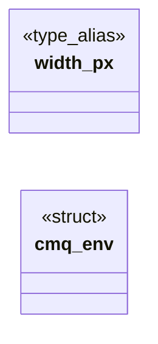

# `include/css_mq.h`

> Source: [include/css_mq.h:1](../../include/css_mq.h#L1) | language `h` | coverage 50.0% | [API index](../index.md)

## Contents

- **Structs:** [`cmq_env`](#cmq_env)
- **Type Aliases:** [`width_px`](#width_px)
- **Functions:** [`cmq_matches`](#cmq_matches)
- **Macros:** [`CMQ_MAX_DEPTH`](#cmq_max_depth), [`CMQ_TOK_MAX`](#cmq_tok_max)

## Type Diagram



## Structs

<a id="cmq_env"></a>

### `cmq_env`

`struct` | [include/css_mq.h:19](../../include/css_mq.h#L19)

```c
typedef struct cmq_env
```

---

## Type Aliases

<a id="width_px"></a>

### `width_px`

`type_alias` | [include/css_mq.h:18](../../include/css_mq.h#L18)

```c
typedef struct cmq_env { int width_px;
```

bytes of one feature name or value

---

## Functions

<a id="cmq_matches"></a>

### `cmq_matches`

`function` | [include/css_mq.h:28](../../include/css_mq.h#L28)

```c
int cmq_matches(const char *s, size_t len, const cmq_env *env);
```

1 iff the media query list s[0,len) matches env; malformed/unknown parts fail closed.

An empty list matches (all). NULL s or env -> 0.

**Parameters**

| Name | Type | Default | Description |
|---|---|---|---|
| `s` | `char *` |  |  |
| `len` | `size_t` |  |  |
| `env` | `cmq_env *` |  |  |

**Returns:** `int`

---

## Macros

<a id="cmq_max_depth"></a>

### `CMQ_MAX_DEPTH`

`macro` | [include/css_mq.h:16](../../include/css_mq.h#L16)

```c
#define CMQ_MAX_DEPTH
```

---

<a id="cmq_tok_max"></a>

### `CMQ_TOK_MAX`

`macro` | [include/css_mq.h:17](../../include/css_mq.h#L17)

```c
#define CMQ_TOK_MAX
```

nested parentheses in one condition

---
