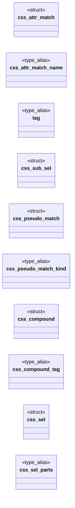
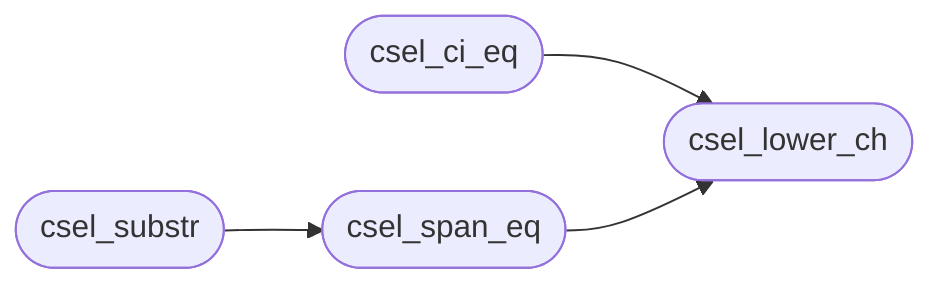

# `include/css_select.h`

> Source: [include/css_select.h:1](../../include/css_select.h#L1) | language `h` | coverage 61.8% | [API index](../index.md)

## Contents

- **Structs:** [`css_attr_match`](#css_attr_match), [`css_sub_sel`](#css_sub_sel), [`css_pseudo_match`](#css_pseudo_match), [`css_compound`](#css_compound), [`css_sel`](#css_sel)
- **Type Aliases:** [`tag`](#tag)
- **Functions:** [`csel_parse`](#csel_parse), [`csel_matches`](#csel_matches), [`identifier`](#identifier), [`csel_emit_utf8`](#csel_emit_utf8), [`csel_unescape`](#csel_unescape), [`csel_escape_len`](#csel_escape_len), [`csel_ident_fold`](#csel_ident_fold), [`csel_ident_eq`](#csel_ident_eq), [`csel_read_ident`](#csel_read_ident), [`csel_decl_end`](#csel_decl_end), [`csel_lower_ch`](#csel_lower_ch), [`csel_ci_eq`](#csel_ci_eq), [`csel_span_eq`](#csel_span_eq), [`csel_substr`](#csel_substr), [`csel_ident_ch`](#csel_ident_ch)
- **Macros:** [`CSS_TOK_MAX`](#css_tok_max), [`CSS_MAX_CLASSES_PER_SEL`](#css_max_classes_per_sel), [`CSS_MAX_SUB_SELS`](#css_max_sub_sels), [`CSS_SUB_MAX_ATTRS`](#css_sub_max_attrs), [`CSS_SUB_MAX_PSEUDOS`](#css_sub_max_pseudos), [`CSEL_FOLD_PREFIX`](#csel_fold_prefix), [`CSEL_FOLD_MARK`](#csel_fold_mark), [`CSEL_IDENT_SCRATCH`](#csel_ident_scratch)

## Type Diagram



## Call Graph

Solid arrows stay in this module, dashed arrows leave it.



## Structs

<a id="css_attr_match"></a>

### `css_attr_match`

`struct` | [include/css_select.h:88](../../include/css_select.h#L88)

```c
typedef struct css_attr_match
```

One attribute selector inside a compound: name OP value, with a case flag.

**Members**

| Member | Kind | Summary |
|---|---|---|
| [`name`](#css_attr_match-name) | type_alias | One attribute selector inside a compound: name OP value, with a case flag. |

<a id="css_attr_match-name"></a>

#### `css_attr_match.name`

`type_alias` | [include/css_select.h:88](../../include/css_select.h#L88)

```c
typedef struct css_attr_match { char name[CSS_TOK_MAX];
```

One attribute selector inside a compound: name OP value, with a case flag.

---

<a id="css_sub_sel"></a>

### `css_sub_sel`

`struct` | [include/css_select.h:95](../../include/css_select.h#L95)

```c
typedef struct css_sub_sel
```

---

<a id="css_pseudo_match"></a>

### `css_pseudo_match`

`struct` | [include/css_select.h:112](../../include/css_select.h#L112)

```c
typedef struct css_pseudo_match
```

One pseudo-class inside a compound. a/b are the An+B coefficients of the nth-child family (unused otherwise). sub_first/sub_count index into the parent css_sel.subs[] for :not/:is/:where, or -1/0 for no sub-selectors.

**Members**

| Member | Kind | Summary |
|---|---|---|
| [`kind`](#css_pseudo_match-kind) | type_alias | One pseudo-class inside a compound. a/b are the An+B coefficients of the nth-child family (unused otherwise). sub_first/sub_count index into the parent... |

<a id="css_pseudo_match-kind"></a>

#### `css_pseudo_match.kind`

`type_alias` | [include/css_select.h:112](../../include/css_select.h#L112)

```c
typedef struct css_pseudo_match { int kind;
```

One pseudo-class inside a compound. a/b are the An+B coefficients of the nth-child family (unused otherwise). sub_first/sub_count index into the parent css_sel.subs[] for :not/:is/:where, or -1/0 for no sub-selectors.

---

<a id="css_compound"></a>

### `css_compound`

`struct` | [include/css_select.h:122](../../include/css_select.h#L122)

```c
typedef struct css_compound
```

One compound selector: optional type, optional id, zero+ classes, zero+ [attr], zero+ pseudo-classes.

**Members**

| Member | Kind | Summary |
|---|---|---|
| [`tag`](#css_compound-tag) | type_alias | One compound selector: optional type, optional id, zero+ classes, zero+ [attr], zero+ pseudo-classes. |

<a id="css_compound-tag"></a>

#### `css_compound.tag`

`type_alias` | [include/css_select.h:122](../../include/css_select.h#L122)

```c
typedef struct css_compound { char tag[CSS_TOK_MAX];
```

One compound selector: optional type, optional id, zero+ classes, zero+ [attr], zero+ pseudo-classes.

---

<a id="css_sel"></a>

### `css_sel`

`struct` | [include/css_select.h:139](../../include/css_select.h#L139)

```c
typedef struct css_sel
```

A complex selector: a chain of compounds, parts[nparts-1] being the subject (the element a rule styles). comb[k] (k>=1) is the combinator to the LEFT of parts[k]; comb[0] is unused.

A single compound is nparts == 1. subs[] holds sub-selectors for :not()/:is()/:where() pseudo-classes, indexed by css_pseudo_match.sub_first.

**Members**

| Member | Kind | Summary |
|---|---|---|
| [`parts`](#css_sel-parts) | type_alias | A complex selector: a chain of compounds, parts[nparts-1] being the subject (the element a rule styles). comb[k] (k>=1) is the combinator to the LEFT of... |

<a id="css_sel-parts"></a>

#### `css_sel.parts`

`type_alias` | [include/css_select.h:139](../../include/css_select.h#L139)

```c
typedef struct css_sel { css_compound parts[CSS_MAX_COMPOUNDS];
```

A complex selector: a chain of compounds, parts[nparts-1] being the subject (the element a rule styles). comb[k] (k>=1) is the combinator to the LEFT of parts[k]; comb[0] is unused.

A single compound is nparts == 1. subs[] holds sub-selectors for :not()/:is()/:where() pseudo-classes, indexed by css_pseudo_match.sub_first.

---

## Type Aliases

<a id="tag"></a>

### `tag`

`type_alias` | [include/css_select.h:94](../../include/css_select.h#L94)

```c
typedef struct css_sub_sel { char tag[CSS_TOK_MAX];
```

---

## Functions

<a id="csel_parse"></a>

### `csel_parse`

`function` | [include/css_select.h:153](../../include/css_select.h#L153)

```c
int csel_parse(const char *s, size_t a, size_t b, css_sel *sel);
```

Parses the complex selector s[a,b) into *sel (spec computed; order/rule left to the caller).

Returns 1 if supported, 0 to drop the selector (fail closed).

**Parameters**

| Name | Type | Default | Description |
|---|---|---|---|
| `s` | `char *` |  |  |
| `a` | `size_t` |  |  |
| `b` | `size_t` |  |  |
| `sel` | `css_sel *` |  |  |

**Returns:** `int`

*Called by:* [`selector`](src.css_select.c.md#selector)

---

<a id="csel_matches"></a>

### `csel_matches`

`function` | [include/css_select.h:162](../../include/css_select.h#L162)

```c
int csel_matches(const css_sel *sel, const css_element *el, const char *target_id, int allow_pseudo_el, int *pseudo_kind);
```

True if *sel matches element *el against its ancestor chain. target_id (optional) is the URL fragment for :target matching; NULL -> never matches. allow_pseudo_el: 1 = CSS cascade mode (::before/::after match), 0 = DOM query mode (pseudo-elements never match real elements). pseudo_kind (optional, may be NULL): when non-NULL and the subject compound matched via PSEUDO_BEFORE or PSEUDO_AFTER, *pseudo_kind is set to that pseudo-element kind; otherwise set to -1.

**Parameters**

| Name | Type | Default | Description |
|---|---|---|---|
| `sel` | `css_sel *` |  |  |
| `el` | `css_element *` |  |  |
| `target_id` | `char *` |  |  |
| `allow_pseudo_el` | `int` |  |  |
| `pseudo_kind` | `int *` |  |  |

**Returns:** `int`

*Called by:* [`cch_element_matches`](src.css_chain.c.md#cch_element_matches)

---

<a id="identifier"></a>

### `identifier`

`function` | [include/css_select.h:166](../../include/css_select.h#L166)

```c
* A selector identifier (tag, .class, #id) is read with CSS escapes decoded * (`.md\:flex` is the class "md:flex") and stored in a CSS_TOK_MAX slot. One that * does not fit is FOLDED: its first CSEL_F
```

**Parameters**

| Name | Type | Default | Description |
|---|---|---|---|
| `class` |  |  |  |
| `id` |  |  |  |

**Returns:** `* A selector`

---

<a id="csel_emit_utf8"></a>

### `csel_emit_utf8`

`function` | [include/css_select.h:178](../../include/css_select.h#L178)

```c
size_t csel_emit_utf8(unsigned int cp, char *out);
```

**Parameters**

| Name | Type | Default | Description |
|---|---|---|---|
| `cp` | `unsigned int` |  |  |
| `out` | `char *` |  |  |

**Returns:** `size_t`

---

<a id="csel_unescape"></a>

### `csel_unescape`

`function` | [include/css_select.h:180](../../include/css_select.h#L180)

```c
void csel_unescape(char *dst, size_t cap, const char *src, size_t n);
```

Decodes CSS escapes in src[0,n) into dst (cap bytes, NUL-terminated, truncates).

**Parameters**

| Name | Type | Default | Description |
|---|---|---|---|
| `dst` | `char *` |  |  |
| `cap` | `size_t` |  |  |
| `src` | `char *` |  |  |
| `n` | `size_t` |  |  |

*Called by:* [`CSS_ATTR_SEP`](src.css.c.md#css_attr_sep)

---

<a id="csel_escape_len"></a>

### `csel_escape_len`

`function` | [include/css_select.h:182](../../include/css_select.h#L182)

```c
size_t csel_escape_len(const char *s, size_t i, size_t b);
```

Bytes the escape starting at s[i] occupies (0 when s[i] does not start one).

**Parameters**

| Name | Type | Default | Description |
|---|---|---|---|
| `s` | `char *` |  |  |
| `i` | `size_t` |  |  |
| `b` | `size_t` |  |  |

**Returns:** `size_t`

---

<a id="csel_ident_fold"></a>

### `csel_ident_fold`

`function` | [include/css_select.h:184](../../include/css_select.h#L184)

```c
void csel_ident_fold(const char *src, size_t len, char *dst);
```

dst (CSS_TOK_MAX bytes) receives src[0,len) as-is, or folded when too long.

**Parameters**

| Name | Type | Default | Description |
|---|---|---|---|
| `src` | `char *` |  |  |
| `len` | `size_t` |  |  |
| `dst` | `char *` |  |  |

---

<a id="csel_ident_eq"></a>

### `csel_ident_eq`

`function` | [include/css_select.h:186](../../include/css_select.h#L186)

```c
int csel_ident_eq(const char *stored, const char *tok, size_t tlen);
```

A stored (possibly folded) identifier against an element token of tlen bytes.

**Parameters**

| Name | Type | Default | Description |
|---|---|---|---|
| `stored` | `char *` |  |  |
| `tok` | `char *` |  |  |
| `tlen` | `size_t` |  |  |

**Returns:** `int`

---

<a id="csel_read_ident"></a>

### `csel_read_ident`

`function` | [include/css_select.h:189](../../include/css_select.h#L189)

```c
int csel_read_ident(const char *s, size_t *ip, size_t b, char *dst, int lower);
```

Reads an identifier at s[*ip] (escapes decoded, non-ASCII kept, lowercased when lower != 0) into dst (CSS_TOK_MAX).

Returns 0, *ip untouched, when none.

**Parameters**

| Name | Type | Default | Description |
|---|---|---|---|
| `s` | `char *` |  |  |
| `ip` | `size_t *` |  |  |
| `b` | `size_t` |  |  |
| `dst` | `char *` |  |  |
| `lower` | `int` |  |  |

**Returns:** `int`

---

<a id="csel_decl_end"></a>

### `csel_decl_end`

`function` | [include/css_select.h:194](../../include/css_select.h#L194)

```c
size_t csel_decl_end(const char *s, size_t i, size_t b, int stop_brace);
```

Index of the ';' ending the declaration that starts at s[i] (or of a '}' when stop_brace), or b: separators inside quotes, inside (...) such as url(data:a;b), or escaped, are not separators (CSS Syntax 5 section 5.4.4).

**Parameters**

| Name | Type | Default | Description |
|---|---|---|---|
| `s` | `char *` |  |  |
| `i` | `size_t` |  |  |
| `b` | `size_t` |  |  |
| `stop_brace` | `int` |  |  |

**Returns:** `size_t`

*Called by:* [`cvr_collect_decls`](src.css_vars.c.md#cvr_collect_decls)

---

<a id="csel_lower_ch"></a>

### `csel_lower_ch`

`function` `inline` `static` | [include/css_select.h:198](../../include/css_select.h#L198)

```c
static inline char csel_lower_ch(char c)
```

**Parameters**

| Name | Type | Default | Description |
|---|---|---|---|
| `c` | `char` |  |  |

**Returns:** `char`

*Called by:* [`csel_ci_eq`](#csel_ci_eq), [`csel_span_eq`](#csel_span_eq), [`CG_RAD_PX_MAX`](src.css_gradient.c.md#cg_rad_px_max), [`gradient`](src.css_gradient.c.md#gradient), [`csel_read_ident`](src.css_select.c.md#csel_read_ident), [`cv_bg_alpha_of`](src.css_values.c.md#cv_bg_alpha_of)

---

<a id="csel_ci_eq"></a>

### `csel_ci_eq`

`function` `inline` `static` | [include/css_select.h:202](../../include/css_select.h#L202)

```c
static inline int csel_ci_eq(const char *a, const char *b)
```

**Parameters**

| Name | Type | Default | Description |
|---|---|---|---|
| `a` | `char *` |  |  |
| `b` | `char *` |  |  |

**Returns:** `int`

*Calls:* [`csel_lower_ch`](#csel_lower_ch)

*Called by:* [`CSS_WIDE_RESET`](src.css.c.md#css_wide_reset), [`axis`](src.css.c.md#axis), [`blur`](src.css.c.md#blur), [`declaration`](src.css.c.md#declaration), [`function`](src.css.c.md#function), [`shorthand`](src.css.c.md#shorthand), [`AUTO_RESET_NONE`](src.css_box.c.md#auto_reset_none), [`cb_expand_grid_template_cols`](src.css_box.c.md#cb_expand_grid_template_cols), [`cb_expand_grid_template_rows`](src.css_box.c.md#cb_expand_grid_template_rows), [`cb_interp_align`](src.css_box.c.md#cb_interp_align), [`cb_interp_display`](src.css_box.c.md#cb_interp_display), [`cb_interp_fontsize_ex`](src.css_box.c.md#cb_interp_fontsize_ex) and 19 more

---

<a id="csel_span_eq"></a>

### `csel_span_eq`

`function` `inline` `static` | [include/css_select.h:211](../../include/css_select.h#L211)

```c
static inline int csel_span_eq(const char *a, const char *b, size_t n, int ci)
```

True if a[0,n) equals b[0,n) up to n chars (b NUL-terminated), case-folded when ci.

**Parameters**

| Name | Type | Default | Description |
|---|---|---|---|
| `a` | `char *` |  |  |
| `b` | `char *` |  |  |
| `n` | `size_t` |  |  |
| `ci` | `int` |  |  |

**Returns:** `int`

*Calls:* [`csel_lower_ch`](#csel_lower_ch)

*Called by:* [`csel_substr`](#csel_substr), [`function`](src.css.c.md#function), [`AUTO_RESET_NONE`](src.css_box.c.md#auto_reset_none)

---

<a id="csel_substr"></a>

### `csel_substr`

`function` `inline` `static` | [include/css_select.h:222](../../include/css_select.h#L222)

```c
static inline int csel_substr(const char *hay, const char *needle, int ci)
```

Substring test (used both to drop any value carrying url() — always ci — and by the attribute `*=` operator).

A non-empty needle only; an empty one never matches.

**Parameters**

| Name | Type | Default | Description |
|---|---|---|---|
| `hay` | `char *` |  |  |
| `needle` | `char *` |  |  |
| `ci` | `int` |  |  |

**Returns:** `int`

*Calls:* [`csel_span_eq`](#csel_span_eq)

*Called by:* [`cb_expand_grid_template_cols`](src.css_box.c.md#cb_expand_grid_template_cols), [`cb_expand_grid_template_rows`](src.css_box.c.md#cb_expand_grid_template_rows), [`ct_expand_shadow`](src.css_text.c.md#ct_expand_shadow), [`ct_interp_fontfamily`](src.css_text.c.md#ct_interp_fontfamily), [`ct_interp_liststyle`](src.css_text.c.md#ct_interp_liststyle)

---

<a id="csel_ident_ch"></a>

### `csel_ident_ch`

`function` `inline` `static` | [include/css_select.h:230](../../include/css_select.h#L230)

```c
static inline int csel_ident_ch(char c)
```

**Parameters**

| Name | Type | Default | Description |
|---|---|---|---|
| `c` | `char` |  |  |

**Returns:** `int`

*Called by:* [`csel_read_ident`](src.css_select.c.md#csel_read_ident), [`cvr_collect_decls`](src.css_vars.c.md#cvr_collect_decls)

---

## Macros

<a id="css_tok_max"></a>

### `CSS_TOK_MAX`

`macro` | [include/css_select.h:27](../../include/css_select.h#L27)

```c
#define CSS_TOK_MAX
```

Bounds shared with the cascade side (css.c token buffers reuse CSS_TOK_MAX).

---

<a id="css_max_classes_per_sel"></a>

### `CSS_MAX_CLASSES_PER_SEL`

`macro` | [include/css_select.h:28](../../include/css_select.h#L28)

```c
#define CSS_MAX_CLASSES_PER_SEL
```

---

<a id="css_max_sub_sels"></a>

### `CSS_MAX_SUB_SELS`

`macro` | [include/css_select.h:83](../../include/css_select.h#L83)

```c
#define CSS_MAX_SUB_SELS
```

Sub-selector for :not()/:is()/:where(): a simple compound with only tag/.class/#id/[attr] (no combinators, no pseudo-classes inside sub-selectors).

Bounded: CSS_MAX_SUB_SELS per selector, one level deep.

---

<a id="css_sub_max_attrs"></a>

### `CSS_SUB_MAX_ATTRS`

`macro` | [include/css_select.h:84](../../include/css_select.h#L84)

```c
#define CSS_SUB_MAX_ATTRS
```

---

<a id="css_sub_max_pseudos"></a>

### `CSS_SUB_MAX_PSEUDOS`

`macro` | [include/css_select.h:85](../../include/css_select.h#L85)

```c
#define CSS_SUB_MAX_PSEUDOS
```

---

<a id="csel_fold_prefix"></a>

### `CSEL_FOLD_PREFIX`

`macro` | [include/css_select.h:173](../../include/css_select.h#L173)

```c
#define CSEL_FOLD_PREFIX
```

--- Identifiers: escapes and long names (spec/css_select.md, 2026-09-29) ---
A selector identifier (tag, .class, #id) is read with CSS escapes decoded
(`.md\:flex` is the class "md:flex") and stored in a CSS_TOK_MAX slot. One that
does not fit is FOLDED: its first CSEL_FOLD_PREFIX bytes, CSEL_FOLD_MARK (a byte
no identifier contains) and 16 hex digits of a 64-bit hash of the whole name.
csel_ident_eq folds the element's token the same way, so a CSS Modules name such
as `Primer_Brand__LogoSuite-module__...___bUhyS` (72 bytes) matches exactly
instead of being truncated and never matching.

---

<a id="csel_fold_mark"></a>

### `CSEL_FOLD_MARK`

`macro` | [include/css_select.h:174](../../include/css_select.h#L174)

```c
#define CSEL_FOLD_MARK
```

---

<a id="csel_ident_scratch"></a>

### `CSEL_IDENT_SCRATCH`

`macro` | [include/css_select.h:175](../../include/css_select.h#L175)

```c
#define CSEL_IDENT_SCRATCH
```

---
