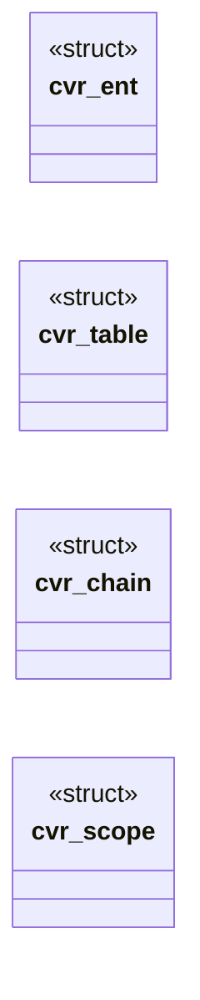

# `include/css_vars.h`

> Source: [include/css_vars.h:1](../../include/css_vars.h#L1) | language `h` | coverage 73.7% | [API index](../index.md)

## Contents

- **Structs:** [`cvr_ent`](#cvr_ent), [`cvr_table`](#cvr_table), [`cvr_chain`](#cvr_chain), [`cvr_scope`](#cvr_scope)
- **Functions:** [`name`](#name), [`cvr_get`](#cvr_get), [`cvr_count`](#cvr_count), [`cvr_reset`](#cvr_reset), [`cvr_free`](#cvr_free), [`cvr_collect_decls`](#cvr_collect_decls), [`declaration`](#declaration), [`cvr_lookup`](#cvr_lookup)
- **Macros:** [`CVR_NAME_MAX`](#cvr_name_max), [`CVR_VALUE_MAX`](#cvr_value_max), [`CVR_MAX_ENTRIES`](#cvr_max_entries), [`CVR_MAX_DEPTH`](#cvr_max_depth), [`CVR_MAX_LOOKUPS`](#cvr_max_lookups), [`CVR_CHAIN_MAX`](#cvr_chain_max)

## Type Diagram



## Structs

<a id="cvr_ent"></a>

### `cvr_ent`

`struct` | [include/css_vars.h:28](../../include/css_vars.h#L28)

```c
typedef struct cvr_ent
```

---

<a id="cvr_table"></a>

### `cvr_table`

`struct` | [include/css_vars.h:35](../../include/css_vars.h#L35)

```c
typedef struct cvr_table
```

Zero-initialise ({0}) before first use.

Open-addressed hash index over ent[]: slot[] holds entry index + 1, 0 = empty; nslot is a power of two >= 2 * cap.

---

<a id="cvr_chain"></a>

### `cvr_chain`

`struct` | [include/css_vars.h:46](../../include/css_vars.h#L46)

```c
typedef struct cvr_chain
```

An element's INHERITED custom properties (spec/css_vars.md, "Alcance por elemento"): one node per ancestor that declares any, nearest first.

Walks are * bounded by CVR_CHAIN_MAX nodes. define CVR_CHAIN_MAX 256

---

<a id="cvr_scope"></a>

### `cvr_scope`

`struct` | [include/css_vars.h:54](../../include/css_vars.h#L54)

```c
typedef struct cvr_scope
```

Lookup order for one substitution: first, then the inherited chain, then second (the sheet's page-global table), then initial (@property initial-value).

Any may be NULL; `first` wins a name collision.

---

## Functions

<a id="name"></a>

### `name`

`function` | [include/css_vars.h:62](../../include/css_vars.h#L62)

```c
* name (last declaration wins). Returns 1 when stored, 0 when dropped: a name that * is not "--" + at least one byte, a name or value at/over its bound, an empty * value, the entry bound reached, or O
```

**Parameters**

| Name | Type | Default | Description |
|---|---|---|---|
| `wins` | `last declaration` |  |  |

**Returns:** `*`

---

<a id="cvr_get"></a>

### `cvr_get`

`function` `const` | [include/css_vars.h:69](../../include/css_vars.h#L69)

```c
const char *cvr_get(const cvr_table *t, const char *name, size_t nlen);
```

The stored value for name[0,nlen), or NULL.

Case-sensitive (custom property names are). t may be NULL.

**Parameters**

| Name | Type | Default | Description |
|---|---|---|---|
| `t` | `cvr_table *` |  |  |
| `name` | `char *` |  |  |
| `nlen` | `size_t` |  |  |

**Returns:** `char *`

---

<a id="cvr_count"></a>

### `cvr_count`

`function` | [include/css_vars.h:71](../../include/css_vars.h#L71)

```c
size_t cvr_count(const cvr_table *t);
```

**Parameters**

| Name | Type | Default | Description |
|---|---|---|---|
| `t` | `cvr_table *` |  |  |

**Returns:** `size_t`

---

<a id="cvr_reset"></a>

### `cvr_reset`

`function` | [include/css_vars.h:75](../../include/css_vars.h#L75)

```c
void cvr_reset(cvr_table *t);
```

Frees every stored string and empties the table, keeping its arrays for reuse.

NULL-safe.

**Parameters**

| Name | Type | Default | Description |
|---|---|---|---|
| `t` | `cvr_table *` |  |  |

---

<a id="cvr_free"></a>

### `cvr_free`

`function` | [include/css_vars.h:78](../../include/css_vars.h#L78)

```c
void cvr_free(cvr_table *t);
```

Releases everything; the table is left zeroed and reusable.

Idempotent.

**Parameters**

| Name | Type | Default | Description |
|---|---|---|---|
| `t` | `cvr_table *` |  |  |

---

<a id="cvr_collect_decls"></a>

### `cvr_collect_decls`

`function` | [include/css_vars.h:83](../../include/css_vars.h#L83)

```c
void cvr_collect_decls(cvr_table *t, const char *s, size_t a, size_t b);
```

Scans the declaration span s[a,b) for `--ident : value` pairs and stores each (a trailing !important is stripped).

A name is recognised only where it cannot be the tail of a longer identifier.

**Parameters**

| Name | Type | Default | Description |
|---|---|---|---|
| `t` | `cvr_table *` |  |  |
| `s` | `char *` |  |  |
| `a` | `size_t` |  |  |
| `b` | `size_t` |  |  |

---

<a id="declaration"></a>

### `declaration`

`function` | [include/css_vars.h:91](../../include/css_vars.h#L91)

```c
* then drops the whole declaration (CSS Variables 1: invalid at computed time). */ int cvr_resolve(const char *val, char *out, size_t outcap, const cvr_scope *sc);
```

**Parameters**

| Name | Type | Default | Description |
|---|---|---|---|
| `time` | `CSS Variables 1: invalid at computed` |  |  |

**Returns:** `* then drops the whole`

---

<a id="cvr_lookup"></a>

### `cvr_lookup`

`function` `const` | [include/css_vars.h:96](../../include/css_vars.h#L96)

```c
const char *cvr_lookup(const cvr_scope *sc, const char *name, size_t nlen);
```

The value name[0,nlen) has in scope sc (same lookup order as cvr_resolve), or NULL.

Not substituted: the stored text.

**Parameters**

| Name | Type | Default | Description |
|---|---|---|---|
| `sc` | `cvr_scope *` |  |  |
| `name` | `char *` |  |  |
| `nlen` | `size_t` |  |  |

**Returns:** `char *`

---

## Macros

<a id="cvr_name_max"></a>

### `CVR_NAME_MAX`

`macro` | [include/css_vars.h:19](../../include/css_vars.h#L19)

```c
#define CVR_NAME_MAX
```

css_vars -- the custom-property table and var() substitution (CSS Variables 1), extracted from css.c.

Pure: no I/O, no DOM; every allocation is owned by the table and released by cvr_reset/cvr_free. See spec/css_vars.md.

Bounds (anti-DoS). They sit above what real design systems ship -- measured on
github.com's Primer: 2443 distinct names, values past 64 bytes, 4-hop chains --
because a bound an ordinary page reaches is a render bug, not a defence.

---

<a id="cvr_value_max"></a>

### `CVR_VALUE_MAX`

`macro` | [include/css_vars.h:20](../../include/css_vars.h#L20)

```c
#define CVR_VALUE_MAX
```

bytes of "--name", NUL excluded, exclusive

---

<a id="cvr_max_entries"></a>

### `CVR_MAX_ENTRIES`

`macro` | [include/css_vars.h:21](../../include/css_vars.h#L21)

```c
#define CVR_MAX_ENTRIES
```

bytes of a stored value, exclusive (== CSS_URL_MAX)

---

<a id="cvr_max_depth"></a>

### `CVR_MAX_DEPTH`

`macro` | [include/css_vars.h:22](../../include/css_vars.h#L22)

```c
#define CVR_MAX_DEPTH
```

distinct names per table

---

<a id="cvr_max_lookups"></a>

### `CVR_MAX_LOOKUPS`

`macro` | [include/css_vars.h:26](../../include/css_vars.h#L26)

```c
#define CVR_MAX_LOOKUPS
```

Total var() lookups one substitution may perform.

Depth alone does not bound the work once an unresolvable reference falls back: `--a: var(--a, var(--a))` retries both branches at every level, 2^depth lookups.

---

<a id="cvr_chain_max"></a>

### `CVR_CHAIN_MAX`

`macro` | [include/css_vars.h:45](../../include/css_vars.h#L45)

```c
#define CVR_CHAIN_MAX
```

An element's INHERITED custom properties (spec/css_vars.md, "Alcance por elemento"): one node per ancestor that declares any, nearest first.

Walks are bounded by CVR_CHAIN_MAX nodes.

---
