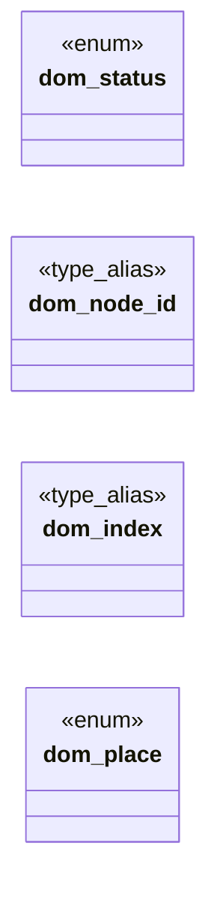

# `include/dom.h`

> Source: [include/dom.h:1](../../include/dom.h#L1) | language `h` | coverage 64.3% | [API index](../index.md)

## Contents

- **Enums:** [`dom_status`](#dom_status), [`dom_place`](#dom_place)
- **Type Aliases:** [`dom_node_id`](#dom_node_id), [`dom_index`](#dom_index)
- **Functions:** [`dom_free`](#dom_free), [`dom_node_count`](#dom_node_count), [`count`](#count), [`dom_get_by_class`](#dom_get_by_class), [`dom_matches`](#dom_matches), [`dom_document_position`](#dom_document_position), [`dom_precedes`](#dom_precedes), [`dom_tag_name`](#dom_tag_name), [`dom_get_attribute`](#dom_get_attribute), [`dom_attribute_names`](#dom_attribute_names), [`dom_text_content`](#dom_text_content), [`dom_document_title`](#dom_document_title), [`cycle`](#cycle), [`parent`](#parent), [`dom_node_kind`](#dom_node_kind), [`index`](#index), [`length`](#length)
- **Macros:** [`DOM_NODE_NONE`](#dom_node_none), [`DOM_KIND_NONE`](#dom_kind_none), [`DOM_KIND_ELEMENT`](#dom_kind_element), [`DOM_KIND_TEXT`](#dom_kind_text), [`DOM_KIND_COMMENT`](#dom_kind_comment), [`DOM_MAX_HANDLES`](#dom_max_handles)

## Type Diagram



## Enums

<a id="dom_status"></a>

### `dom_status`

`enum` | [include/dom.h:26](../../include/dom.h#L26)

```c
typedef enum dom_status
```

---

<a id="dom_place"></a>

### `dom_place`

`enum` | [include/dom.h:182](../../include/dom.h#L182)

```c
typedef enum dom_place
```

Where dom_move_children places the moved nodes (insertAdjacent* needs all four: "after this node" and "first" cannot be expressed by an element-only reference).

---

## Type Aliases

<a id="dom_node_id"></a>

### `dom_node_id`

`type_alias` | [include/dom.h:34](../../include/dom.h#L34)

```c
typedef uint32_t dom_node_id;
```

Integer node handle.

Assigned in document order at build time.

---

<a id="dom_index"></a>

### `dom_index`

`type_alias` | [include/dom.h:40](../../include/dom.h#L40)

```c
typedef struct dom_index dom_index;
```

Opaque queryable index.

---

## Functions

<a id="dom_free"></a>

### `dom_free`

`function` | [include/dom.h:48](../../include/dom.h#L48)

```c
void dom_free(dom_index *idx);
```

Idempotent; safe on NULL and safe to call twice.

Does not free the tree.

**Parameters**

| Name | Type | Default | Description |
|---|---|---|---|
| `idx` | `dom_index *` |  |  |

*Called by:* [`LLVMFuzzerTestOneInput`](fuzz.fuzz_js_dom.c.md#llvmfuzzertestoneinput), [`run_js`](src.tab.c.md#run_js)

---

<a id="dom_node_count"></a>

### `dom_node_count`

`function` | [include/dom.h:51](../../include/dom.h#L51)

```c
size_t dom_node_count(const dom_index *idx);
```

Number of element nodes indexed.

NULL idx => 0.

**Parameters**

| Name | Type | Default | Description |
|---|---|---|---|
| `idx` | `dom_index *` |  |  |

**Returns:** `size_t`

*Called by:* [`LLVMFuzzerTestOneInput`](fuzz.fuzz_js_dom.c.md#llvmfuzzertestoneinput)

---

<a id="count"></a>

### `count`

`function` | [include/dom.h:59](../../include/dom.h#L59)

```c
* match count (which may exceed cap, so the caller can size a buffer). */ size_t dom_get_by_tag(const dom_index *idx, const char *tag, dom_node_id *out, size_t cap);
```

**Parameters**

| Name | Type | Default | Description |
|---|---|---|---|
| `cap` | `which may exceed` |  |  |
| `buffer` | `so the caller can size a` |  |  |

**Returns:** `* match`

---

<a id="dom_get_by_class"></a>

### `dom_get_by_class`

`function` | [include/dom.h:62](../../include/dom.h#L62)

```c
size_t dom_get_by_class(const dom_index *idx, const char *cls, dom_node_id *out, size_t cap);
```

**Parameters**

| Name | Type | Default | Description |
|---|---|---|---|
| `idx` | `dom_index *` |  |  |
| `cls` | `char *` |  |  |
| `out` | `dom_node_id *` |  |  |
| `cap` | `size_t` |  |  |

**Returns:** `size_t`

---

<a id="dom_matches"></a>

### `dom_matches`

`function` | [include/dom.h:91](../../include/dom.h#L91)

```c
int dom_matches(const dom_index *idx, dom_node_id node, const char *selector);
```

Nonzero iff node itself matches the selector list (Element.matches).

**Parameters**

| Name | Type | Default | Description |
|---|---|---|---|
| `idx` | `dom_index *` |  |  |
| `node` | `dom_node_id` |  |  |
| `selector` | `char *` |  |  |

**Returns:** `int`

*Called by:* [`LLVMFuzzerTestOneInput`](fuzz.fuzz_dom.c.md#llvmfuzzertestoneinput)

---

<a id="dom_document_position"></a>

### `dom_document_position`

`function` | [include/dom.h:101](../../include/dom.h#L101)

```c
size_t dom_document_position(const dom_index *idx, dom_node_id node);
```

0-based document-order position of node, or 0 if node is invalid.

**Parameters**

| Name | Type | Default | Description |
|---|---|---|---|
| `idx` | `dom_index *` |  |  |
| `node` | `dom_node_id` |  |  |

**Returns:** `size_t`

---

<a id="dom_precedes"></a>

### `dom_precedes`

`function` | [include/dom.h:104](../../include/dom.h#L104)

```c
int dom_precedes(const dom_index *idx, dom_node_id a, dom_node_id b);
```

Nonzero iff a precedes b in document order.

**Parameters**

| Name | Type | Default | Description |
|---|---|---|---|
| `idx` | `dom_index *` |  |  |
| `a` | `dom_node_id` |  |  |
| `b` | `dom_node_id` |  |  |

**Returns:** `int`

---

<a id="dom_tag_name"></a>

### `dom_tag_name`

`function` `const` | [include/dom.h:118](../../include/dom.h#L118)

```c
const char *dom_tag_name(const dom_index *idx, dom_node_id node, size_t *len);
```

Lowercase qualified tag name, or NULL. *len (optional) excludes the NUL.

**Parameters**

| Name | Type | Default | Description |
|---|---|---|---|
| `idx` | `dom_index *` |  |  |
| `node` | `dom_node_id` |  |  |
| `len` | `size_t *` |  |  |

**Returns:** `char *`

*Called by:* [`jd_process_iframes`](src.js_embed.c.md#jd_process_iframes)

---

<a id="dom_get_attribute"></a>

### `dom_get_attribute`

`function` `const` | [include/dom.h:121](../../include/dom.h#L121)

```c
const char *dom_get_attribute(const dom_index *idx, dom_node_id node, const char *name, size_t *len);
```

Attribute value by name, or NULL if absent. *len (optional) excludes NUL.

**Parameters**

| Name | Type | Default | Description |
|---|---|---|---|
| `idx` | `dom_index *` |  |  |
| `node` | `dom_node_id` |  |  |
| `name` | `char *` |  |  |
| `len` | `size_t *` |  |  |

**Returns:** `char *`

*Called by:* [`jd_process_iframes`](src.js_embed.c.md#jd_process_iframes), [`run`](src.tab.c.md#run)

---

<a id="dom_attribute_names"></a>

### `dom_attribute_names`

`function` | [include/dom.h:128](../../include/dom.h#L128)

```c
size_t dom_attribute_names(const dom_index *idx, dom_node_id node, const char **names, size_t *lens, size_t cap);
```

Qualified names of node's attributes, in document order, written to names[] (borrowed, valid while idx/doc are alive) with matching lens[] (excluding NUL).

Writes at most cap entries; returns the total attribute count (which may exceed cap, so the caller can tell it truncated). node without attributes returns 0.

**Parameters**

| Name | Type | Default | Description |
|---|---|---|---|
| `idx` | `dom_index *` |  |  |
| `node` | `dom_node_id` |  |  |
| `names` | `char **` |  |  |
| `lens` | `size_t *` |  |  |
| `cap` | `size_t` |  |  |

**Returns:** `size_t`

---

<a id="dom_text_content"></a>

### `dom_text_content`

`function` `const` | [include/dom.h:133](../../include/dom.h#L133)

```c
const char *dom_text_content(const dom_index *idx, dom_node_id node, size_t *len);
```

Concatenated text content of node's subtree (borrowed, valid while idx/doc are alive), or NULL. *len (optional) excludes the NUL.

**Parameters**

| Name | Type | Default | Description |
|---|---|---|---|
| `idx` | `dom_index *` |  |  |
| `node` | `dom_node_id` |  |  |
| `len` | `size_t *` |  |  |

**Returns:** `char *`

---

<a id="dom_document_title"></a>

### `dom_document_title`

`function` `const` | [include/dom.h:136](../../include/dom.h#L136)

```c
const char *dom_document_title(const dom_index *idx, size_t *len);
```

Current document <title> text (borrowed), or NULL. *len excludes the NUL.

**Parameters**

| Name | Type | Default | Description |
|---|---|---|---|
| `idx` | `dom_index *` |  |  |
| `len` | `size_t *` |  |  |

**Returns:** `char *`

---

<a id="cycle"></a>

### `cycle`

`function` | [include/dom.h:164](../../include/dom.h#L164)

```c
* Rejects a cycle (child being an ancestor of parent). Invalid handle / self / cycle * => DOM_ERR_NULL_ARG. */ dom_status dom_append_child(dom_index *idx, dom_node_id parent, dom_node_id child);
```

**Parameters**

| Name | Type | Default | Description |
|---|---|---|---|
| `parent` | `child being an ancestor of` |  |  |

**Returns:** `* Rejects a`

---

<a id="parent"></a>

### `parent`

`function` | [include/dom.h:191](../../include/dom.h#L191)

```c
* child of parent (for the *_REF places) or an invalid handle => DOM_ERR_NULL_ARG. */ dom_status dom_move_children(dom_index *idx, dom_node_id src, dom_node_id parent, dom_place where, dom_node_id ref
```

**Parameters**

| Name | Type | Default | Description |
|---|---|---|---|
| `places` | `for the *_REF` |  |  |

**Returns:** `* child of`

---

<a id="dom_node_kind"></a>

### `dom_node_kind`

`function` | [include/dom.h:207](../../include/dom.h#L207)

```c
int dom_node_kind(const dom_index *idx, dom_node_id node);
```

DOM_KIND_* of node, DOM_KIND_NONE for an invalid handle.

**Parameters**

| Name | Type | Default | Description |
|---|---|---|---|
| `idx` | `dom_index *` |  |  |
| `node` | `dom_node_id` |  |  |

**Returns:** `int`

---

<a id="index"></a>

### `index`

`function` | [include/dom.h:223](../../include/dom.h#L223)

```c
* stays valid in the index (not freed). Invalid handle / not-a-child => DOM_ERR_NULL_ARG. */ dom_status dom_remove_child(dom_index *idx, dom_node_id parent, dom_node_id child);
```

**Parameters**

| Name | Type | Default | Description |
|---|---|---|---|
| `freed` | `not` |  |  |

**Returns:** `* stays valid in the`

---

<a id="length"></a>

### `length`

`function` | [include/dom.h:248](../../include/dom.h#L248)

```c
* length (no children => an owned empty string). Uses a chain of fixed-size * blocks internally so there is no hard cap — OOM from malloc is the only limit. * Invalid handle / NULL out => DOM_ERR_NULL
```

**Parameters**

| Name | Type | Default | Description |
|---|---|---|---|
| `string` | `no children => an owned empty` |  |  |

**Returns:** `*`

---

## Macros

<a id="dom_node_none"></a>

### `DOM_NODE_NONE`

`macro` | [include/dom.h:37](../../include/dom.h#L37)

```c
#define DOM_NODE_NONE
```

"No such node" sentinel returned by lookups and navigation.

---

<a id="dom_kind_none"></a>

### `DOM_KIND_NONE`

`macro` | [include/dom.h:198](../../include/dom.h#L198)

```c
#define DOM_KIND_NONE
```

--- text and comment nodes (spec/dom.md 9) ---
Character-data nodes get LAZY handles in the same arena: registered the first time
node-level navigation or creation reaches them. Element-only functions reject them.

---

<a id="dom_kind_element"></a>

### `DOM_KIND_ELEMENT`

`macro` | [include/dom.h:199](../../include/dom.h#L199)

```c
#define DOM_KIND_ELEMENT
```

---

<a id="dom_kind_text"></a>

### `DOM_KIND_TEXT`

`macro` | [include/dom.h:200](../../include/dom.h#L200)

```c
#define DOM_KIND_TEXT
```

the DOM nodeType numbers

---

<a id="dom_kind_comment"></a>

### `DOM_KIND_COMMENT`

`macro` | [include/dom.h:201](../../include/dom.h#L201)

```c
#define DOM_KIND_COMMENT
```

---

<a id="dom_max_handles"></a>

### `DOM_MAX_HANDLES`

`macro` | [include/dom.h:204](../../include/dom.h#L204)

```c
#define DOM_MAX_HANDLES
```

Upper bound of the handle arena (elements + lazy text/comment handles).

---
