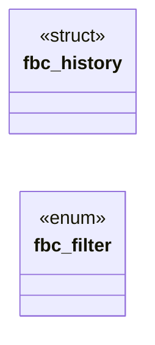

# `include/fb_cmdline.h`

> Source: [include/fb_cmdline.h:1](../../include/fb_cmdline.h#L1) | language `h` | coverage 61.1% | [API index](../index.md)

## Contents

- **Structs:** [`fbc_history`](#fbc_history)
- **Enums:** [`fbc_filter`](#fbc_filter)
- **Functions:** [`fbc_history_init`](#fbc_history_init), [`fbc_history_free`](#fbc_history_free), [`fbc_history_push`](#fbc_history_push), [`fbc_history_prev`](#fbc_history_prev), [`fbc_history_next`](#fbc_history_next), [`fbc_complete_split`](#fbc_complete_split), [`fbc_names_expr`](#fbc_names_expr), [`fbc_complete_pick`](#fbc_complete_pick), [`fbc_filter_passes`](#fbc_filter_passes), [`fbc_filter_next`](#fbc_filter_next), [`fbc_filter_label`](#fbc_filter_label)
- **Macros:** [`FBC_HIST_MAX`](#fbc_hist_max), [`FBC_ENTRY_MAX`](#fbc_entry_max), [`FBC_BASE_MAX`](#fbc_base_max), [`FBC_LIST_NAMES`](#fbc_list_names)

## Type Diagram



## Structs

<a id="fbc_history"></a>

### `fbc_history`

`struct` | [include/fb_cmdline.h:20](../../include/fb_cmdline.h#L20)

```c
typedef struct fbc_history
```

---

## Enums

<a id="fbc_filter"></a>

### `fbc_filter`

`enum` | [include/fb_cmdline.h:54](../../include/fb_cmdline.h#L54)

```c
typedef enum fbc_filter
```

---

## Functions

<a id="fbc_history_init"></a>

### `fbc_history_init`

`function` | [include/fb_cmdline.h:27](../../include/fb_cmdline.h#L27)

```c
void fbc_history_init(fbc_history *h);
```

**Parameters**

| Name | Type | Default | Description |
|---|---|---|---|
| `h` | `fbc_history *` |  |  |

---

<a id="fbc_history_free"></a>

### `fbc_history_free`

`function` | [include/fb_cmdline.h:28](../../include/fb_cmdline.h#L28)

```c
void fbc_history_free(fbc_history *h);
```

**Parameters**

| Name | Type | Default | Description |
|---|---|---|---|
| `h` | `fbc_history *` |  |  |

---

<a id="fbc_history_push"></a>

### `fbc_history_push`

`function` | [include/fb_cmdline.h:31](../../include/fb_cmdline.h#L31)

```c
int fbc_history_push(fbc_history *h, const char *text, size_t len);
```

0 stored/ignored-benign (empty, same as the newest), -1 too long or out of memory.

Returns to the live line.

**Parameters**

| Name | Type | Default | Description |
|---|---|---|---|
| `h` | `fbc_history *` |  |  |
| `text` | `char *` |  |  |
| `len` | `size_t` |  |  |

**Returns:** `int`

---

<a id="fbc_history_prev"></a>

### `fbc_history_prev`

`function` `const` | [include/fb_cmdline.h:35](../../include/fb_cmdline.h#L35)

```c
const char *fbc_history_prev(fbc_history *h, const char *cur, size_t curlen);
```

Older entry (saves cur as the draft when leaving the live line), or NULL when there is none.

The pointer is valid until the next call on h.

**Parameters**

| Name | Type | Default | Description |
|---|---|---|---|
| `h` | `fbc_history *` |  |  |
| `cur` | `char *` |  |  |
| `curlen` | `size_t` |  |  |

**Returns:** `char *`

---

<a id="fbc_history_next"></a>

### `fbc_history_next`

`function` `const` | [include/fb_cmdline.h:38](../../include/fb_cmdline.h#L38)

```c
const char *fbc_history_next(fbc_history *h);
```

Newer entry; past the newest, the draft ("" when none).

NULL when already on the live line.

**Parameters**

| Name | Type | Default | Description |
|---|---|---|---|
| `h` | `fbc_history *` |  |  |

**Returns:** `char *`

---

<a id="fbc_complete_split"></a>

### `fbc_complete_split`

`function` | [include/fb_cmdline.h:42](../../include/fb_cmdline.h#L42)

```c
long fbc_complete_split(const char *text, size_t n, char *base, size_t cap, size_t *prefix_off);
```

Splits the trailing property path of text[0,n): base ("a.b" of "a.b.c", "" = global) into base[cap], *prefix_off = where the prefix starts.

Returns the prefix length, or -1 when nothing is completable.

**Parameters**

| Name | Type | Default | Description |
|---|---|---|---|
| `text` | `char *` |  |  |
| `n` | `size_t` |  |  |
| `base` | `char *` |  |  |
| `cap` | `size_t` |  |  |
| `prefix_off` | `size_t *` |  |  |

**Returns:** `long`

---

<a id="fbc_names_expr"></a>

### `fbc_names_expr`

`function` | [include/fb_cmdline.h:46](../../include/fb_cmdline.h#L46)

```c
size_t fbc_names_expr(const char *base, char *out, size_t cap);
```

JS expression returning the newline-joined property names reachable from the path `base` (no getter is run).

Returns its length, 0 on a bad path or small cap.

**Parameters**

| Name | Type | Default | Description |
|---|---|---|---|
| `base` | `char *` |  |  |
| `out` | `char *` |  |  |
| `cap` | `size_t` |  |  |

**Returns:** `size_t`

---

<a id="fbc_complete_pick"></a>

### `fbc_complete_pick`

`function` | [include/fb_cmdline.h:51](../../include/fb_cmdline.h#L51)

```c
size_t fbc_complete_pick(const char *names, const char *prefix, size_t plen, char *ins, size_t ins_cap, char *list, size_t list_cap, size_t *count);
```

From the newline-separated `names`, those starting with prefix[0,plen): `ins` gets the longest common extension beyond the prefix, [`list`](include.render_doc.h.md#list) the candidates space-separated; *count how many matched.

Returns the length of the insertion.

**Parameters**

| Name | Type | Default | Description |
|---|---|---|---|
| `names` | `char *` |  |  |
| `prefix` | `char *` |  |  |
| `plen` | `size_t` |  |  |
| `ins` | `char *` |  |  |
| `ins_cap` | `size_t` |  |  |
| `list` | `char *` |  |  |
| `list_cap` | `size_t` |  |  |
| `count` | `size_t *` |  |  |

**Returns:** `size_t`

---

<a id="fbc_filter_passes"></a>

### `fbc_filter_passes`

`function` | [include/fb_cmdline.h:62](../../include/fb_cmdline.h#L62)

```c
int fbc_filter_passes(int filter, int level);
```

**Parameters**

| Name | Type | Default | Description |
|---|---|---|---|
| `filter` | `int` |  |  |
| `level` | `int` |  |  |

**Returns:** `int`

---

<a id="fbc_filter_next"></a>

### `fbc_filter_next`

`function` | [include/fb_cmdline.h:63](../../include/fb_cmdline.h#L63)

```c
int fbc_filter_next(int filter);
```

level is an fb_level

**Parameters**

| Name | Type | Default | Description |
|---|---|---|---|
| `filter` | `int` |  |  |

**Returns:** `int`

---

<a id="fbc_filter_label"></a>

### `fbc_filter_label`

`function` `const` | [include/fb_cmdline.h:64](../../include/fb_cmdline.h#L64)

```c
const char *fbc_filter_label(int filter);
```

cyclic; an invalid filter counts as ALL

**Parameters**

| Name | Type | Default | Description |
|---|---|---|---|
| `filter` | `int` |  |  |

**Returns:** `char *`

---

## Macros

<a id="fbc_hist_max"></a>

### `FBC_HIST_MAX`

`macro` | [include/fb_cmdline.h:15](../../include/fb_cmdline.h#L15)

```c
#define FBC_HIST_MAX
```

---

<a id="fbc_entry_max"></a>

### `FBC_ENTRY_MAX`

`macro` | [include/fb_cmdline.h:16](../../include/fb_cmdline.h#L16)

```c
#define FBC_ENTRY_MAX
```

entries kept; the oldest falls off

---

<a id="fbc_base_max"></a>

### `FBC_BASE_MAX`

`macro` | [include/fb_cmdline.h:17](../../include/fb_cmdline.h#L17)

```c
#define FBC_BASE_MAX
```

bytes of one history entry

---

<a id="fbc_list_names"></a>

### `FBC_LIST_NAMES`

`macro` | [include/fb_cmdline.h:18](../../include/fb_cmdline.h#L18)

```c
#define FBC_LIST_NAMES
```

bytes of a completion base path

---
