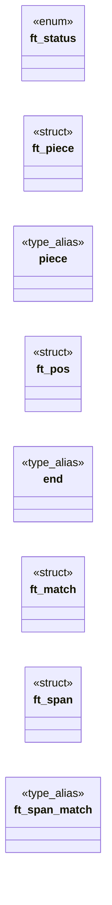

# `include/find_text.h`

> Source: [include/find_text.h:1](../../include/find_text.h#L1) | language `h` | coverage 44.4% | [API index](../index.md)

## Contents

- **Structs:** [`ft_piece`](#ft_piece), [`ft_pos`](#ft_pos), [`ft_match`](#ft_match), [`ft_span`](#ft_span)
- **Enums:** [`ft_status`](#ft_status)
- **Type Aliases:** [`piece`](#piece), [`end`](#end)
- **Functions:** [`find_text`](#find_text), [`ft_fold`](#ft_fold), [`written`](#written), [`ft_compile`](#ft_compile), [`exist`](#exist), [`ft_spans`](#ft_spans), [`ft_step`](#ft_step)
- **Macros:** [`FT_QUERY_MAX`](#ft_query_max), [`FT_MATCH_MAX`](#ft_match_max)

## Type Diagram



## Structs

<a id="ft_piece"></a>

### `ft_piece`

`struct` | [include/find_text.h:24](../../include/find_text.h#L24)

```c
typedef struct ft_piece
```

One laid-out text piece. gap_before = 1: white space separates it from the previous piece (another line or block, or a pen gap between words).

---

<a id="ft_pos"></a>

### `ft_pos`

`struct` | [include/find_text.h:30](../../include/find_text.h#L30)

```c
typedef struct ft_pos { size_t piece; size_t off; } ft_pos;
```

---

<a id="ft_match"></a>

### `ft_match`

`struct` | [include/find_text.h:31](../../include/find_text.h#L31)

```c
typedef struct ft_match { ft_pos start, end; } ft_match; /* end exclusive */
```

---

<a id="ft_span"></a>

### `ft_span`

`struct` | [include/find_text.h:32](../../include/find_text.h#L32)

```c
typedef struct ft_span { size_t piece, start, end, match; } ft_span;
```

end exclusive

**Members**

| Member | Kind | Summary |
|---|---|---|
| [`match`](#ft_span-match) | type_alias | end exclusive |

<a id="ft_span-match"></a>

#### `ft_span.match`

`type_alias` | [include/find_text.h:32](../../include/find_text.h#L32)

```c
typedef struct ft_span { size_t piece, start, end, match;
```

end exclusive

---

## Enums

<a id="ft_status"></a>

### `ft_status`

`enum` | [include/find_text.h:20](../../include/find_text.h#L20)

```c
typedef enum ft_status { FT_OK = 0, FT_EINVAL = -1 } ft_status;
```

---

## Type Aliases

<a id="piece"></a>

### `piece`

`type_alias` | [include/find_text.h:29](../../include/find_text.h#L29)

```c
typedef struct ft_pos { size_t piece;
```

---

<a id="end"></a>

### `end`

`type_alias` | [include/find_text.h:31](../../include/find_text.h#L31)

```c
typedef struct ft_match { ft_pos start, end;
```

---

## Functions

<a id="find_text"></a>

### `find_text`

`function` | [include/find_text.h:2](../../include/find_text.h#L2)

```c
* find_text (ft_) -- find in page over the rendered text (spec/find_text.md). * * Pure: no I/O, no global state, reentrant. The text is hostile UTF-8 (never read * outside [text, text + len));
```

**Returns:** `*`

---

<a id="ft_fold"></a>

### `ft_fold`

`function` | [include/find_text.h:35](../../include/find_text.h#L35)

```c
uint32_t ft_fold(uint32_t cp);
```

Case- and (Latin) diacritic-insensitive fold of one code point.

**Parameters**

| Name | Type | Default | Description |
|---|---|---|---|
| `cp` | `uint32_t` |  |  |

**Returns:** `uint32_t`

---

<a id="written"></a>

### `written`

`function` | [include/find_text.h:38](../../include/find_text.h#L38)

```c
* number of code points written (<= cap, <= FT_QUERY_MAX);
```

**Parameters**

| Name | Type | Default | Description |
|---|---|---|---|
| `<` |  | `cap, <= FT_QUERY_MAX` |  |

**Returns:** `* number of code points`

---

<a id="ft_compile"></a>

### `ft_compile`

`function` | [include/find_text.h:39](../../include/find_text.h#L39)

```c
size_t ft_compile(const char *q, size_t qlen, uint32_t *out, size_t cap);
```

Folds the query, trims it and collapses white space to one ' ' (U+0020).

Returns the number of code points written (<= cap, <= FT_QUERY_MAX); 0 for an empty query.

**Parameters**

| Name | Type | Default | Description |
|---|---|---|---|
| `q` | `char *` |  |  |
| `qlen` | `size_t` |  |  |
| `out` | `uint32_t *` |  |  |
| `cap` | `size_t` |  |  |

**Returns:** `size_t`

*Called by:* [`LLVMFuzzerTestOneInput`](fuzz.fuzz_find_text.c.md#llvmfuzzertestoneinput)

---

<a id="exist"></a>

### `exist`

`function` | [include/find_text.h:42](../../include/find_text.h#L42)

```c
* cap matches exist (truncated may be NULL). */ ft_status ft_search(const ft_piece *pieces, size_t n, const uint32_t *q, size_t qn, ft_match *out, size_t cap, size_t *nout, int *truncated);
```

**Parameters**

| Name | Type | Default | Description |
|---|---|---|---|
| `NULL` | `truncated may be` |  |  |

**Returns:** `* cap matches`

---

<a id="ft_spans"></a>

### `ft_spans`

`function` | [include/find_text.h:48](../../include/find_text.h#L48)

```c
size_t ft_spans(const ft_piece *pieces, size_t n, const ft_match *m, size_t nm, ft_span *out, size_t cap);
```

Splits matches into per-piece spans (one per piece a match touches, empty spans dropped), in order.

Returns the number written (<= cap).

**Parameters**

| Name | Type | Default | Description |
|---|---|---|---|
| `pieces` | `ft_piece *` |  |  |
| `n` | `size_t` |  |  |
| `m` | `ft_match *` |  |  |
| `nm` | `size_t` |  |  |
| `out` | `ft_span *` |  |  |
| `cap` | `size_t` |  |  |

**Returns:** `size_t`

*Called by:* [`LLVMFuzzerTestOneInput`](fuzz.fuzz_find_text.c.md#llvmfuzzertestoneinput)

---

<a id="ft_step"></a>

### `ft_step`

`function` | [include/find_text.h:53](../../include/find_text.h#L53)

```c
long ft_step(long cur, size_t n, int dir);
```

Next (dir > 0) or previous (dir < 0) match index with wrap-around; -1 when n == 0.

A cur outside [0, n) starts at the first (dir > 0) or last (dir < 0) match.

**Parameters**

| Name | Type | Default | Description |
|---|---|---|---|
| `cur` | `long` |  |  |
| `n` | `size_t` |  |  |
| `dir` | `int` |  |  |

**Returns:** `long`

*Called by:* [`LLVMFuzzerTestOneInput`](fuzz.fuzz_find_text.c.md#llvmfuzzertestoneinput)

---

## Macros

<a id="ft_query_max"></a>

### `FT_QUERY_MAX`

`macro` | [include/find_text.h:17](../../include/find_text.h#L17)

```c
#define FT_QUERY_MAX
```

---

<a id="ft_match_max"></a>

### `FT_MATCH_MAX`

`macro` | [include/find_text.h:18](../../include/find_text.h#L18)

```c
#define FT_MATCH_MAX
```

folded code points kept from the query

---
