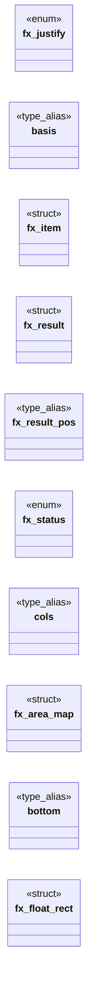

# `include/flex_layout.h`

> Source: [include/flex_layout.h:1](../../include/flex_layout.h#L1) | language `h` | coverage 53.5% | [API index](../index.md)

## Contents

- **Structs:** [`fx_item`](#fx_item), [`fx_result`](#fx_result), [`fx_area_map`](#fx_area_map), [`fx_float_rect`](#fx_float_rect)
- **Enums:** [`fx_justify`](#fx_justify), [`fx_status`](#fx_status)
- **Type Aliases:** [`basis`](#basis), [`cols`](#cols), [`bottom`](#bottom)
- **Functions:** [`size`](#size), [`out`](#out), [`fx_grid_cell`](#fx_grid_cell), [`number`](#number), [`fx_grid_line_parse`](#fx_grid_line_parse), [`fx_grid_line_resolve`](#fx_grid_line_resolve), [`fx_autofill_count`](#fx_autofill_count), [`fx_grid_area_hash`](#fx_grid_area_hash), [`offset`](#offset), [`required`](#required), [`widths`](#widths), [`FX_ERR_NULL_ARG`](#fx_err_null_arg), [`space`](#space), [`fx_auto_min_size`](#fx_auto_min_size), [`fx_justify_name`](#fx_justify_name), [`height`](#height), [`it`](#it), [`win`](#win), [`fx_cross_offset`](#fx_cross_offset)
- **Macros:** [`FX_MAX_ITEMS`](#fx_max_items), [`FX_GL_AUTO`](#fx_gl_auto), [`FX_GL_SPAN_BASE`](#fx_gl_span_base), [`FX_GL_SPAN_MAX`](#fx_gl_span_max), [`FX_GL_LINE_MAX`](#fx_gl_line_max), [`FX_AREA_MAX_ROWS`](#fx_area_max_rows), [`FX_AREA_MAX_COLS`](#fx_area_max_cols), [`FX_AREA_MAX_CELLS`](#fx_area_max_cells), [`FX_AREA_NAME_MAX`](#fx_area_name_max), [`FX_FLOAT_MIN_LINE`](#fx_float_min_line), [`FX_MAX_COLUMNS`](#fx_max_columns), [`FX_MAUTO_TOP`](#fx_mauto_top), [`FX_MAUTO_BOTTOM`](#fx_mauto_bottom)

## Type Diagram



## Structs

<a id="fx_item"></a>

### `fx_item`

`struct` | [include/flex_layout.h:40](../../include/flex_layout.h#L40)

```c
typedef struct fx_item
```

One flex item, all sizes in px.

Negative fields are treated as 0.

---

<a id="fx_result"></a>

### `fx_result`

`struct` | [include/flex_layout.h:48](../../include/flex_layout.h#L48)

```c
typedef struct fx_result
```

One resolved item: main-axis offset from the container content start, and size.

**Members**

| Member | Kind | Summary |
|---|---|---|
| [`pos`](#fx_result-pos) | type_alias | One resolved item: main-axis offset from the container content start, and size. |

<a id="fx_result-pos"></a>

#### `fx_result.pos`

`type_alias` | [include/flex_layout.h:48](../../include/flex_layout.h#L48)

```c
typedef struct fx_result { double pos;
```

One resolved item: main-axis offset from the container content start, and size.

---

<a id="fx_area_map"></a>

### `fx_area_map`

`struct` | [include/flex_layout.h:144](../../include/flex_layout.h#L144)

```c
typedef struct fx_area_map
```

A parsed grid-template-areas: a rows x cols grid of NAME HASHES in row-major order.

0 is the null cell token (`.`), never a name. rows == 0 means "no valid template" -- the only state fx_grid_areas_parse leaves behind on failure.

---

<a id="fx_float_rect"></a>

### `fx_float_rect`

`struct` | [include/flex_layout.h:214](../../include/flex_layout.h#L214)

```c
typedef struct fx_float_rect
```

One float exclusion (v3, spec/float.md §6b.2): the vertical band a float occupies and the INNER content edge it steals.

`edge` is measured from the content start: for side 0 (left) it is the x just past the float's right margin; for side 1 (right) it is the x of the float's left margin.

---

## Enums

<a id="fx_justify"></a>

### `fx_justify`

`enum` | [include/flex_layout.h:30](../../include/flex_layout.h#L30)

```c
typedef enum fx_justify
```

---

<a id="fx_status"></a>

### `fx_status`

`enum` | [include/flex_layout.h:53](../../include/flex_layout.h#L53)

```c
typedef enum fx_status
```

---

## Type Aliases

<a id="basis"></a>

### `basis`

`type_alias` | [include/flex_layout.h:40](../../include/flex_layout.h#L40)

```c
typedef struct fx_item { double basis;
```

One flex item, all sizes in px.

Negative fields are treated as 0.

---

<a id="cols"></a>

### `cols`

`type_alias` | [include/flex_layout.h:144](../../include/flex_layout.h#L144)

```c
typedef struct fx_area_map { int rows, cols;
```

A parsed grid-template-areas: a rows x cols grid of NAME HASHES in row-major order.

0 is the null cell token (`.`), never a name. rows == 0 means "no valid template" -- the only state fx_grid_areas_parse leaves behind on failure.

---

<a id="bottom"></a>

### `bottom`

`type_alias` | [include/flex_layout.h:214](../../include/flex_layout.h#L214)

```c
typedef struct fx_float_rect { double top, bottom;
```

One float exclusion (v3, spec/float.md §6b.2): the vertical band a float occupies and the INNER content edge it steals.

`edge` is measured from the content start: for side 0 (left) it is the x just past the float's right margin; for side 1 (right) it is the x of the float's left margin.

---

## Functions

<a id="size"></a>

### `size`

`function` | [include/flex_layout.h:60](../../include/flex_layout.h#L60)

```c
* content size (px);
```

**Returns:** `* content`

---

<a id="out"></a>

### `out`

`function` | [include/flex_layout.h:62](../../include/flex_layout.h#L62)

```c
* fx_result to out (caller-owned). n == 0 is a no-op (out may be NULL). */ fx_status fx_flex_line(const fx_item *items, size_t n, double avail, double gap, fx_justify justify, fx_result *out);
```

**Parameters**

| Name | Type | Default | Description |
|---|---|---|---|
| `owned` | `caller-` |  |  |

**Returns:** `* fx_result to`

---

<a id="fx_grid_cell"></a>

### `fx_grid_cell`

`function` | [include/flex_layout.h:74](../../include/flex_layout.h#L74)

```c
void fx_grid_cell(size_t index, size_t ncols, size_t *row, size_t *col);
```

Row and column of the index-th item placed row-major into ncols columns. ncols == 0 yields row = col = 0 (defensive; no divide-by-zero).

**Parameters**

| Name | Type | Default | Description |
|---|---|---|---|
| `index` | `size_t` |  |  |
| `ncols` | `size_t` |  |  |
| `row` | `size_t *` |  |  |
| `col` | `size_t *` |  |  |

---

<a id="number"></a>

### `number`

`function` | [include/flex_layout.h:106](../../include/flex_layout.h#L106)

```c
* line number (negative counts from the end). */ #define FX_GL_AUTO 0 #define FX_GL_SPAN_BASE (1 << 20) #define FX_GL_SPAN_MAX 1000 /* == CSS_GRID_SPAN_MAX (checked in css.c) */ #define FX_GL_LINE_MAX
```

**Parameters**

| Name | Type | Default | Description |
|---|---|---|---|
| `end` | `negative counts from the` |  |  |

**Returns:** `* line`

---

<a id="fx_grid_line_parse"></a>

### `fx_grid_line_parse`

`function` | [include/flex_layout.h:117](../../include/flex_layout.h#L117)

```c
int fx_grid_line_parse(const char *v, int *start, int *end);
```

The shorthand `<side> [ / <side> ]` (no slash => end is auto).

1 or 0 (both outputs untouched on 0).

**Parameters**

| Name | Type | Default | Description |
|---|---|---|---|
| `v` | `char *` |  |  |
| `start` | `int *` |  |  |
| `end` | `int *` |  |  |

**Returns:** `int`

---

<a id="fx_grid_line_resolve"></a>

### `fx_grid_line_resolve`

`function` | [include/flex_layout.h:122](../../include/flex_layout.h#L122)

```c
void fx_grid_line_resolve(int start, int end, int ntracks, int *pos0, int *span);
```

Resolves a start/end pair against ntracks explicit tracks: *pos0 = 0-based start track or -1 (auto-place), *span >= 1.

Never fails: anything unresolvable falls back to auto placement.

**Parameters**

| Name | Type | Default | Description |
|---|---|---|---|
| `start` | `int` |  |  |
| `end` | `int` |  |  |
| `ntracks` | `int` |  |  |
| `pos0` | `int *` |  |  |
| `span` | `int *` |  |  |

*Called by:* [`walk`](src.page_view.c.md#walk)

---

<a id="fx_autofill_count"></a>

### `fx_autofill_count`

`function` | [include/flex_layout.h:129](../../include/flex_layout.h#L129)

```c
size_t fx_autofill_count(double avail, double gap, double minw);
```

repeat(auto-fill, minmax(min, max)): how many min-wide tracks fit in avail (CSS Grid 1 7.2.3.2; one gap between tracks).

Pure: floor((avail+gap)/(min+gap)) clamped to [1, FX_MAX_ITEMS]. Non-positive/NaN inputs fail safe to 1 (never 0: a grid with zero columns places nothing). The caller still caps to its own BT_MAX_CHILDREN. See spec/css.md (2026-10-09).

**Parameters**

| Name | Type | Default | Description |
|---|---|---|---|
| `avail` | `double` |  |  |
| `gap` | `double` |  |  |
| `minw` | `double` |  |  |

**Returns:** `size_t`

---

<a id="fx_grid_area_hash"></a>

### `fx_grid_area_hash`

`function` | [include/flex_layout.h:153](../../include/flex_layout.h#L153)

```c
unsigned fx_grid_area_hash(const char *name);
```

FNV-1a of a trimmed, case-sensitive CSS identifier; never returns 0 for a non-empty name (0 is reserved for "unnamed").

NULL/empty/blank -> 0. Comparing hashes rather than strings is what lets an item's area name cross the IPC codec as one int; see spec/grid_areas.md section 2 on collisions.

**Parameters**

| Name | Type | Default | Description |
|---|---|---|---|
| `name` | `char *` |  |  |

**Returns:** `unsigned`

---

<a id="offset"></a>

### `offset`

`function` | [include/flex_layout.h:171](../../include/flex_layout.h#L171)

```c
* offset (from the content start, clamped to >= 0) to out_x[n]. The band does NOT wrap * (v1): an item that would overflow still gets a clamped position. Pure, no allocation. * n == 0 is a no-op (poin
```

**Parameters**

| Name | Type | Default | Description |
|---|---|---|---|
| `start` | `from the content` |  |  |
| `to` | `clamped >` | `0` |  |

**Returns:** `*`

---

<a id="required"></a>

### `required`

`function` | [include/flex_layout.h:184](../../include/flex_layout.h#L184)

```c
* out_row is required (NULL with n > 0 yields FX_ERR_NULL_ARG);
```

**Parameters**

| Name | Type | Default | Description |
|---|---|---|---|
| `FX_ERR_NULL_ARG` | `NULL with n > 0 yields` |  |  |

**Returns:** `* out_row is`

---

<a id="widths"></a>

### `widths`

`function` | [include/flex_layout.h:194](../../include/flex_layout.h#L194)

```c
* the OUTER widths (width + ml + mr, clamped >= 0, so a negative margin narrows * the slot and a positive one widens it) with the wrap cursor discipline, then * reports the BORDER x (packed outer posi
```

**Parameters**

| Name | Type | Default | Description |
|---|---|---|---|
| `mr` | `width + ml +` |  |  |
| `clamped` |  | `0` |  |
| `it` | `so a negative margin narrows * the slot and a positive one widens` |  |  |

**Returns:** `* the OUTER`

---

<a id="fx_err_null_arg"></a>

### `FX_ERR_NULL_ARG`

`function` | [include/flex_layout.h:228](../../include/flex_layout.h#L228)

```c
* Returns FX_ERR_NULL_ARG (a required pointer NULL with n > 0), FX_ERR_RANGE * (negative h/avail, or n > FX_MAX_ITEMS);
```

**Parameters**

| Name | Type | Default | Description |
|---|---|---|---|
| `n` | `a required pointer NULL with > 0` |  |  |

**Returns:** `* Returns`

---

<a id="space"></a>

### `space`

`function` | [include/flex_layout.h:234](../../include/flex_layout.h#L234)

```c
* line order: positive free space (avail - sizes - gaps) is split equally among every * auto margin (auto_l[i]/auto_r[i] non-zero), which overrides justify-content. With no * auto margin or no positiv
```

**Parameters**

| Name | Type | Default | Description |
|---|---|---|---|
| `gaps` | `avail - sizes -` |  |  |

**Returns:** `* line order: positive free`

---

<a id="fx_auto_min_size"></a>

### `fx_auto_min_size`

`function` | [include/flex_layout.h:265](../../include/flex_layout.h#L265)

```c
double fx_auto_min_size(double min_content, double basis, double author_min, int scroll_container);
```

Automatic minimum size of a flex item along the main axis (CSS Flexbox 4.5), in px.

This is what `min-width: auto` -- the INITIAL value, so the case for almost every item on the web -- resolves to. It is the floor fx_flex_line must not shrink an item below, and getting it wrong is visible everywhere: with a floor of zero an overflowing line grinds every item down to a sliver and its text falls to one character per line.

min_content  the item's min-content size (its longest unbreakable word, or a
               replaced element's intrinsic size), in the same border-box+margin
               units as fx_item.basis. Negative is treated as 0.
  basis        the item's SPECIFIED size (its declared `width`, in the same units),
               the "specified size suggestion": the content-based minimum is clamped
               by it, so an item the author sized small is not inflated by one long
               word. Negative means no specified size and leaves the minimum at
               min-content; a flex-basis is NOT a specified size.
  author_min   the author's own `min-width` in px when they set one (min-width is
               then NOT `auto` and wins outright, larger OR smaller), or < 0 when
               unset.
  scroll_container  non-zero when the item's [`overflow`](gui.browser_ui.c.md#overflow) is anything but `visible`.
               Such an item has an automatic minimum size of ZERO -- this is what
               makes the near-universal `overflow:hidden` truncation idiom work.

Pure, total, no allocation. The result is never negative.

**Parameters**

| Name | Type | Default | Description |
|---|---|---|---|
| `min_content` | `double` |  |  |
| `basis` | `double` |  |  |
| `author_min` | `double` |  |  |
| `scroll_container` | `int` |  |  |

**Returns:** `double`

---

<a id="fx_justify_name"></a>

### `fx_justify_name`

`function` `const` | [include/flex_layout.h:321](../../include/flex_layout.h#L321)

```c
const char *fx_justify_name(fx_justify j);
```

Stable, short English name of a justify mode for structured/agent output.

Never NULL; an unknown enum value yields "start".

**Parameters**

| Name | Type | Default | Description |
|---|---|---|---|
| `j` | `fx_justify` |  |  |

**Returns:** `char *`

---

<a id="height"></a>

### `height`

`function` | [include/flex_layout.h:327](../../include/flex_layout.h#L327)

```c
* used height (h_out);
```

**Returns:** `* used`

---

<a id="it"></a>

### `it`

`function` | [include/flex_layout.h:344](../../include/flex_layout.h#L344)

```c
* children that claim it (spec/flex_layout.md, tanda 44): proportionally to * grow[i] (x100) when any grows, else equally among the auto margins in * mauto[i] (FX_MAUTO_TOP -> before[i], FX_MAUTO_BOTT
```

**Parameters**

| Name | Type | Default | Description |
|---|---|---|---|
| `md` | `spec/flex_layout.` |  |  |
| `tanda` |  |  |  |

**Returns:** `proportionally to * grow[i] (x100) when any grows, else equally among the auto margins in * mauto[i] (FX_MAUTO_TOP -> before[i], FX_MAUTO_BOTT`

---

<a id="win"></a>

### `win`

`function` | [include/flex_layout.h:352](../../include/flex_layout.h#L352)

```c
* margins win (both = centre, left only = end);
```

**Parameters**

| Name | Type | Default | Description |
|---|---|---|---|
| `only` | `left` | `end` |  |

**Returns:** `* margins`

---

<a id="fx_cross_offset"></a>

### `fx_cross_offset`

`function` | [include/flex_layout.h:354](../../include/flex_layout.h#L354)

```c
double fx_cross_offset(double avail, double w, int align, int mauto_l, int mauto_r);
```

Cross-axis (horizontal) offset of a column item of width w in avail px. auto margins win (both = centre, left only = end); else align (BT-style 0 start, 1 center, 2 end, 3 stretch) places it.

Never negative.

**Parameters**

| Name | Type | Default | Description |
|---|---|---|---|
| `avail` | `double` |  |  |
| `w` | `double` |  |  |
| `align` | `int` |  |  |
| `mauto_l` | `int` |  |  |
| `mauto_r` | `int` |  |  |

**Returns:** `double`

---

## Macros

<a id="fx_max_items"></a>

### `FX_MAX_ITEMS`

`macro` | [include/flex_layout.h:28](../../include/flex_layout.h#L28)

```c
#define FX_MAX_ITEMS
```

Upper bound on items per flex line / grid columns.

Caps the O(n) shrink loop and keeps the fixed-size scratch buffers bounded (anti-DoS; no VLAs).

---

<a id="fx_gl_auto"></a>

### `FX_GL_AUTO`

`macro` | [include/flex_layout.h:107](../../include/flex_layout.h#L107)

```c
#define FX_GL_AUTO
```

--- grid-column / grid-row line placement (CSS Grid 1 8.3) --------------------
Full contract and resolution table: spec/grid_areas.md section 6. One SIDE of a
placement is one int: FX_GL_AUTO, FX_GL_SPAN_BASE + n for `span n`, or a non-zero
line number (negative counts from the end).

---

<a id="fx_gl_span_base"></a>

### `FX_GL_SPAN_BASE`

`macro` | [include/flex_layout.h:108](../../include/flex_layout.h#L108)

```c
#define FX_GL_SPAN_BASE
```

---

<a id="fx_gl_span_max"></a>

### `FX_GL_SPAN_MAX`

`macro` | [include/flex_layout.h:109](../../include/flex_layout.h#L109)

```c
#define FX_GL_SPAN_MAX
```

---

<a id="fx_gl_line_max"></a>

### `FX_GL_LINE_MAX`

`macro` | [include/flex_layout.h:110](../../include/flex_layout.h#L110)

```c
#define FX_GL_LINE_MAX
```

== CSS_GRID_SPAN_MAX (checked in css.c)

---

<a id="fx_area_max_rows"></a>

### `FX_AREA_MAX_ROWS`

`macro` | [include/flex_layout.h:136](../../include/flex_layout.h#L136)

```c
#define FX_AREA_MAX_ROWS
```

Bounds on a parsed area template.

The template is author CSS -- i.e. attacker chosen -- so every one of these is checked BEFORE anything is written.

---

<a id="fx_area_max_cols"></a>

### `FX_AREA_MAX_COLS`

`macro` | [include/flex_layout.h:137](../../include/flex_layout.h#L137)

```c
#define FX_AREA_MAX_COLS
```

---

<a id="fx_area_max_cells"></a>

### `FX_AREA_MAX_CELLS`

`macro` | [include/flex_layout.h:138](../../include/flex_layout.h#L138)

```c
#define FX_AREA_MAX_CELLS
```

---

<a id="fx_area_name_max"></a>

### `FX_AREA_NAME_MAX`

`macro` | [include/flex_layout.h:139](../../include/flex_layout.h#L139)

```c
#define FX_AREA_NAME_MAX
```

---

<a id="fx_float_min_line"></a>

### `FX_FLOAT_MIN_LINE`

`macro` | [include/flex_layout.h:208](../../include/flex_layout.h#L208)

```c
#define FX_FLOAT_MIN_LINE
```

Minimum room a line box keeps beside a float, in px.

A float wider than its container must still leave a usable line rather than a zero/negative one.

---

<a id="fx_max_columns"></a>

### `FX_MAX_COLUMNS`

`macro` | [include/flex_layout.h:270](../../include/flex_layout.h#L270)

```c
#define FX_MAX_COLUMNS
```

Maximum columns a multi-column container is laid out with (anti-DoS).

A larger `column-count` is clamped to it; real stylesheets ask for two to four.

---

<a id="fx_mauto_top"></a>

### `FX_MAUTO_TOP`

`macro` | [include/flex_layout.h:337](../../include/flex_layout.h#L337)

```c
#define FX_MAUTO_TOP
```

As fx_column_place, plus each item's main-axis auto margins (mauto[i]: bits FX_MAUTO_TOP / FX_MAUTO_BOTTOM, NULL = none): after grow, any free space is split equally among the auto margins and justify-content is moot (Flexbox 8.1).

---

<a id="fx_mauto_bottom"></a>

### `FX_MAUTO_BOTTOM`

`macro` | [include/flex_layout.h:338](../../include/flex_layout.h#L338)

```c
#define FX_MAUTO_BOTTOM
```

---
