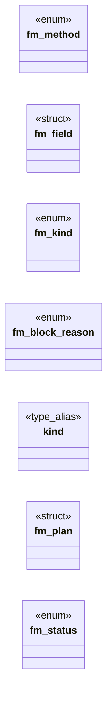

# `include/form.h`

> Source: [include/form.h:1](../../include/form.h#L1) | language `h` | coverage 27.3% | [API index](../index.md)

## Contents

- **Structs:** [`fm_field`](#fm_field), [`fm_plan`](#fm_plan)
- **Enums:** [`fm_method`](#fm_method), [`fm_kind`](#fm_kind), [`fm_block_reason`](#fm_block_reason), [`fm_status`](#fm_status)
- **Type Aliases:** [`kind`](#kind)
- **Macros:** [`FM_URL_MAX`](#fm_url_max), [`FM_BODY_MAX`](#fm_body_max), [`FM_MAX_FIELDS`](#fm_max_fields)
- **Variables:** [`FM_CONTENT_TYPE_URLENCODED`](#fm_content_type_urlencoded)

## Type Diagram



## Structs

<a id="fm_field"></a>

### `fm_field`

`struct` `const` | [include/form.h:37](../../include/form.h#L37)

```c
typedef struct fm_field { const char *name; const char *value; } fm_field;
```

One named control. value == NULL is treated as the empty value; name == NULL is skipped by fm_encode and rejected (FM_BLOCK_INVALID) by fm_build.

---

<a id="fm_plan"></a>

### `fm_plan`

`struct` | [include/form.h:52](../../include/form.h#L52)

```c
typedef struct fm_plan
```

---

## Enums

<a id="fm_method"></a>

### `fm_method`

`enum` | [include/form.h:33](../../include/form.h#L33)

```c
typedef enum fm_method { FM_GET = 0, FM_POST } fm_method;
```

---

<a id="fm_kind"></a>

### `fm_kind`

`enum` | [include/form.h:39](../../include/form.h#L39)

```c
typedef enum fm_kind
```

---

<a id="fm_block_reason"></a>

### `fm_block_reason`

`enum` | [include/form.h:45](../../include/form.h#L45)

```c
typedef enum fm_block_reason
```

---

<a id="fm_status"></a>

### `fm_status`

`enum` | [include/form.h:61](../../include/form.h#L61)

```c
typedef enum fm_status
```

---

## Type Aliases

<a id="kind"></a>

### `kind`

`type_alias` | [include/form.h:51](../../include/form.h#L51)

```c
typedef struct fm_plan { fm_kind kind;
```

---

## Macros

<a id="fm_url_max"></a>

### `FM_URL_MAX`

`macro` | [include/form.h:29](../../include/form.h#L29)

```c
#define FM_URL_MAX
```

---

<a id="fm_body_max"></a>

### `FM_BODY_MAX`

`macro` | [include/form.h:30](../../include/form.h#L30)

```c
#define FM_BODY_MAX
```

2048; bound on the resulting URL

---

<a id="fm_max_fields"></a>

### `FM_MAX_FIELDS`

`macro` | [include/form.h:31](../../include/form.h#L31)

```c
#define FM_MAX_FIELDS
```

bound on the POST body / encoded GET query

---

## Variables

<a id="fm_content_type_urlencoded"></a>

### `FM_CONTENT_TYPE_URLENCODED`

`variable` `const` `extern` | [include/form.h:68](../../include/form.h#L68)

```c
extern const char FM_CONTENT_TYPE_URLENCODED[];
```

Static content type used for FM_POST_REQUEST plans.

---
