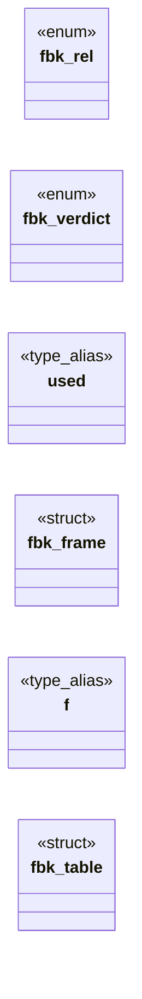

# `include/frame_broker.h`

> Source: [include/frame_broker.h:1](../../include/frame_broker.h#L1) | language `h` | coverage 29.4% | [API index](../index.md)

## Contents

- **Structs:** [`fbk_frame`](#fbk_frame), [`fbk_table`](#fbk_table)
- **Enums:** [`fbk_rel`](#fbk_rel), [`fbk_verdict`](#fbk_verdict)
- **Type Aliases:** [`used`](#used), [`f`](#f)
- **Functions:** [`fbk_origin_of`](#fbk_origin_of), [`fbk_init`](#fbk_init), [`fbk_add`](#fbk_add), [`fbk_remove`](#fbk_remove), [`fbk_origin`](#fbk_origin)
- **Macros:** [`FBK_MAX_FRAMES`](#fbk_max_frames), [`FBK_MAX_DEPTH`](#fbk_max_depth), [`FBK_MAX_MSG`](#fbk_max_msg), [`FBK_ORIGIN_MAX`](#fbk_origin_max), [`FBK_URL_MAX`](#fbk_url_max)

## Type Diagram



## Structs

<a id="fbk_frame"></a>

### `fbk_frame`

`struct` | [include/frame_broker.h:31](../../include/frame_broker.h#L31)

```c
typedef struct fbk_frame
```

---

<a id="fbk_table"></a>

### `fbk_table`

`struct` | [include/frame_broker.h:38](../../include/frame_broker.h#L38)

```c
typedef struct fbk_table { fbk_frame f[FBK_MAX_FRAMES]; } fbk_table;
```

---

## Enums

<a id="fbk_rel"></a>

### `fbk_rel`

`enum` | [include/frame_broker.h:22](../../include/frame_broker.h#L22)

```c
typedef enum fbk_rel { FBK_REL_PARENT = 0, FBK_REL_TOP, FBK_REL_CHILD } fbk_rel;
```

---

<a id="fbk_verdict"></a>

### `fbk_verdict`

`enum` | [include/frame_broker.h:24](../../include/frame_broker.h#L24)

```c
typedef enum fbk_verdict
```

---

## Type Aliases

<a id="used"></a>

### `used`

`type_alias` | [include/frame_broker.h:30](../../include/frame_broker.h#L30)

```c
typedef struct fbk_frame { int used;
```

---

<a id="f"></a>

### `f`

`type_alias` | [include/frame_broker.h:37](../../include/frame_broker.h#L37)

```c
typedef struct fbk_table { fbk_frame f[FBK_MAX_FRAMES];
```

---

## Functions

<a id="fbk_origin_of"></a>

### `fbk_origin_of`

`function` | [include/frame_broker.h:42](../../include/frame_broker.h#L42)

```c
int fbk_origin_of(const char *url, char *out, size_t cap);
```

Serialized origin ("https://host[:port]", lowercase) or "null" for opaque/non-https/unparseable.

0 on success, -1 if out does not fit or args are NULL.

**Parameters**

| Name | Type | Default | Description |
|---|---|---|---|
| `url` | `char *` |  |  |
| `out` | `char *` |  |  |
| `cap` | `size_t` |  |  |

**Returns:** `int`

---

<a id="fbk_init"></a>

### `fbk_init`

`function` | [include/frame_broker.h:45](../../include/frame_broker.h#L45)

```c
int fbk_init(fbk_table *t, const char *top_url);
```

Resets t and registers the top document (frame 0) for top_url.

0 / -1.

**Parameters**

| Name | Type | Default | Description |
|---|---|---|---|
| `t` | `fbk_table *` |  |  |
| `top_url` | `char *` |  |  |

**Returns:** `int`

*Called by:* [`fh_new`](src.frame_host.c.md#fh_new)

---

<a id="fbk_add"></a>

### `fbk_add`

`function` | [include/frame_broker.h:49](../../include/frame_broker.h#L49)

```c
int fbk_add(fbk_table *t, int parent, const char *url, int *out_id);
```

Adds a child of `parent` for url.

Writes its id. 0 on success; -1 on a bad parent, depth over FBK_MAX_DEPTH, full table or NULL args (fail closed).

**Parameters**

| Name | Type | Default | Description |
|---|---|---|---|
| `t` | `fbk_table *` |  |  |
| `parent` | `int` |  |  |
| `url` | `char *` |  |  |
| `out_id` | `int *` |  |  |

**Returns:** `int`

---

<a id="fbk_remove"></a>

### `fbk_remove`

`function` | [include/frame_broker.h:52](../../include/frame_broker.h#L52)

```c
void fbk_remove(fbk_table *t, int id);
```

Removes frame id and its whole subtree.

The top (0) cannot be removed. Idempotent.

**Parameters**

| Name | Type | Default | Description |
|---|---|---|---|
| `t` | `fbk_table *` |  |  |
| `id` | `int` |  |  |

---

<a id="fbk_origin"></a>

### `fbk_origin`

`function` `const` | [include/frame_broker.h:55](../../include/frame_broker.h#L55)

```c
const char *fbk_origin(const fbk_table *t, int id);
```

Origin of a live frame or NULL.

**Parameters**

| Name | Type | Default | Description |
|---|---|---|---|
| `t` | `fbk_table *` |  |  |
| `id` | `int` |  |  |

**Returns:** `char *`

*Called by:* [`fh_tick`](src.frame_host.c.md#fh_tick)

---

## Macros

<a id="fbk_max_frames"></a>

### `FBK_MAX_FRAMES`

`macro` | [include/frame_broker.h:16](../../include/frame_broker.h#L16)

```c
#define FBK_MAX_FRAMES
```

---

<a id="fbk_max_depth"></a>

### `FBK_MAX_DEPTH`

`macro` | [include/frame_broker.h:17](../../include/frame_broker.h#L17)

```c
#define FBK_MAX_DEPTH
```

---

<a id="fbk_max_msg"></a>

### `FBK_MAX_MSG`

`macro` | [include/frame_broker.h:18](../../include/frame_broker.h#L18)

```c
#define FBK_MAX_MSG
```

---

<a id="fbk_origin_max"></a>

### `FBK_ORIGIN_MAX`

`macro` | [include/frame_broker.h:19](../../include/frame_broker.h#L19)

```c
#define FBK_ORIGIN_MAX
```

---

<a id="fbk_url_max"></a>

### `FBK_URL_MAX`

`macro` | [include/frame_broker.h:20](../../include/frame_broker.h#L20)

```c
#define FBK_URL_MAX
```

---
