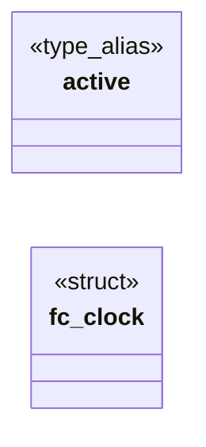

# `include/frame_clock.h`

> Source: [include/frame_clock.h:1](../../include/frame_clock.h#L1) | language `h` | coverage 14.3% | [API index](../index.md)

## Contents

- **Structs:** [`fc_clock`](#fc_clock)
- **Type Aliases:** [`active`](#active)
- **Functions:** [`fc_init`](#fc_init), [`fc_set_active`](#fc_set_active), [`fc_needs_tick`](#fc_needs_tick), [`fc_interval_ms`](#fc_interval_ms)

## Type Diagram



## Structs

<a id="fc_clock"></a>

### `fc_clock`

`struct` | [include/frame_clock.h:15](../../include/frame_clock.h#L15)

```c
typedef struct fc_clock
```

---

## Type Aliases

<a id="active"></a>

### `active`

`type_alias` | [include/frame_clock.h:14](../../include/frame_clock.h#L14)

```c
typedef struct fc_clock { int active;
```

frame_clock (fc_) — pure animation frame scheduler.

Phase R1a. Tracks whether a steady repaint clock should be active. The actual timerfd lives in the trusted-side GUI. No I/O, no allocation. See spec/frame_clock.md.

---

## Functions

<a id="fc_init"></a>

### `fc_init`

`function` | [include/frame_clock.h:20](../../include/frame_clock.h#L20)

```c
void fc_init(fc_clock *c);
```

**Parameters**

| Name | Type | Default | Description |
|---|---|---|---|
| `c` | `fc_clock *` |  |  |

*Called by:* [`FC_DEFAULT_INTERVAL_MS`](src.frame_clock.c.md#fc_default_interval_ms)

---

<a id="fc_set_active"></a>

### `fc_set_active`

`function` | [include/frame_clock.h:21](../../include/frame_clock.h#L21)

```c
void fc_set_active(fc_clock *c, int active);
```

**Parameters**

| Name | Type | Default | Description |
|---|---|---|---|
| `c` | `fc_clock *` |  |  |
| `active` | `int` |  |  |

---

<a id="fc_needs_tick"></a>

### `fc_needs_tick`

`function` | [include/frame_clock.h:22](../../include/frame_clock.h#L22)

```c
int fc_needs_tick(const fc_clock *c);
```

**Parameters**

| Name | Type | Default | Description |
|---|---|---|---|
| `c` | `fc_clock *` |  |  |

**Returns:** `int`

---

<a id="fc_interval_ms"></a>

### `fc_interval_ms`

`function` | [include/frame_clock.h:23](../../include/frame_clock.h#L23)

```c
int fc_interval_ms(const fc_clock *c);
```

**Parameters**

| Name | Type | Default | Description |
|---|---|---|---|
| `c` | `fc_clock *` |  |  |

**Returns:** `int`

---
