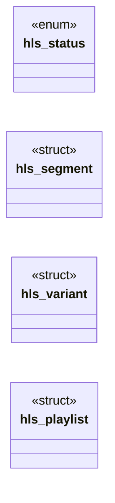

# `include/hls.h`

> Source: [include/hls.h:1](../../include/hls.h#L1) | language `h` | coverage 62.5% | [API index](../index.md)

## Contents

- **Structs:** [`hls_segment`](#hls_segment), [`hls_variant`](#hls_variant), [`hls_playlist`](#hls_playlist)
- **Enums:** [`hls_status`](#hls_status)
- **Functions:** [`hls_select_variant`](#hls_select_variant), [`resolved`](#resolved), [`hls_playlist_free`](#hls_playlist_free)

## Type Diagram



## Structs

<a id="hls_segment"></a>

### `hls_segment`

`struct` | [include/hls.h:29](../../include/hls.h#L29)

```c
typedef struct hls_segment
```

One segment in the playlist.

---

<a id="hls_variant"></a>

### `hls_variant`

`struct` | [include/hls.h:36](../../include/hls.h#L36)

```c
typedef struct hls_variant
```

One variant (quality tier) in a multi-variant (master) playlist.

---

<a id="hls_playlist"></a>

### `hls_playlist`

`struct` | [include/hls.h:45](../../include/hls.h#L45)

```c
typedef struct hls_playlist
```

Parsed playlist.

---

## Enums

<a id="hls_status"></a>

### `hls_status`

`enum` | [include/hls.h:21](../../include/hls.h#L21)

```c
typedef enum hls_status
```

---

## Functions

<a id="hls_select_variant"></a>

### `hls_select_variant`

`function` | [include/hls.h:65](../../include/hls.h#L65)

```c
size_t hls_select_variant(const hls_playlist *pl, int max_w, int max_h);
```

Selects the best variant from a multi-variant playlist.

Returns the index of the chosen variant, or (size_t)-1 on failure (empty variant list). Prefers the variant with the highest bandwidth that fits within `max_w` x `max_h` (0 = no resolution limit). Pure, no I/O.

**Parameters**

| Name | Type | Default | Description |
|---|---|---|---|
| `pl` | `hls_playlist *` |  |  |
| `max_w` | `int` |  |  |
| `max_h` | `int` |  |  |

**Returns:** `size_t`

---

<a id="resolved"></a>

### `resolved`

`function` | [include/hls.h:68](../../include/hls.h#L68)

```c
* Writes the absolute URL into resolved (bounded by resolved_sz). Returns the * written length, or 0 on failure. */ size_t hls_resolve_url(const char *base_url, const char *segment_url, char *resolved
```

**Parameters**

| Name | Type | Default | Description |
|---|---|---|---|
| `resolved_sz` | `bounded by` |  |  |

**Returns:** `* Writes the absolute URL into`

---

<a id="hls_playlist_free"></a>

### `hls_playlist_free`

`function` | [include/hls.h:74](../../include/hls.h#L74)

```c
void hls_playlist_free(hls_playlist *pl);
```

Frees a parsed playlist.

Safe on NULL.

**Parameters**

| Name | Type | Default | Description |
|---|---|---|---|
| `pl` | `hls_playlist *` |  |  |

---
