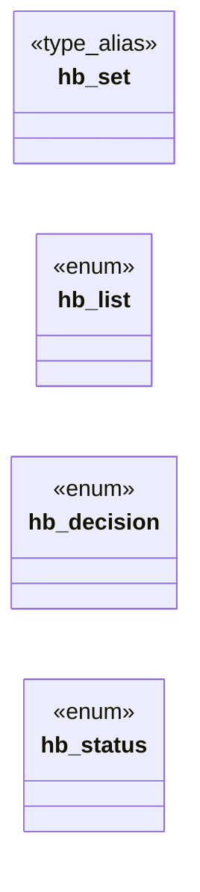

# `include/hostblock.h`

> Source: [include/hostblock.h:1](../../include/hostblock.h#L1) | language `h` | coverage 50.0% | [API index](../index.md)

## Contents

- **Enums:** [`hb_list`](#hb_list), [`hb_decision`](#hb_decision), [`hb_status`](#hb_status)
- **Type Aliases:** [`hb_set`](#hb_set)
- **Functions:** [`hb_new`](#hb_new), [`hb_free`](#hb_free), [`walked`](#walked), [`hb_is_allowlisted`](#hb_is_allowlisted), [`hb_count`](#hb_count)

## Type Diagram



## Enums

<a id="hb_list"></a>

### `hb_list`

`enum` | [include/hostblock.h:32](../../include/hostblock.h#L32)

```c
typedef enum hb_list
```

---

<a id="hb_decision"></a>

### `hb_decision`

`enum` | [include/hostblock.h:37](../../include/hostblock.h#L37)

```c
typedef enum hb_decision
```

---

<a id="hb_status"></a>

### `hb_status`

`enum` | [include/hostblock.h:42](../../include/hostblock.h#L42)

```c
typedef enum hb_status
```

---

## Type Aliases

<a id="hb_set"></a>

### `hb_set`

`type_alias` | [include/hostblock.h:29](../../include/hostblock.h#L29)

```c
typedef struct hb_set hb_set;
```

hostblock — Privacy by Default: a host filter built from /etc/hosts-format lists (.conf files), with a blocklist and an allowlist.

Pure, I/O-free, no global mutable state (the directly auditable surface): the
caller reads the list files and passes their text in; this module parses them
into hash tables and decides whether a host is blocked. It opens no sockets and
reads no files. The orchestrator consults hb_check() BEFORE opening a socket.

A blocklist entry blocks a domain and all its subdomains; an allowlist entry
re-enables a domain and its subdomains, so a single subdomain can be seen even
when its parent domain is blocked. The allowlist wins over the blocklist.

This is an adblock-style filter, not the security boundary (that is the sandbox
and the network policy): on any doubt it fails OPEN (does not over-block), since
silently dropping content is worse here than letting one tracker through.

See spec/hostblock.md for the full contract.

---

## Functions

<a id="hb_new"></a>

### `hb_new`

`function` | [include/hostblock.h:49](../../include/hostblock.h#L49)

```c
hb_set *hb_new(void);
```

Allocates an empty set.

Returns NULL on OOM.

**Returns:** `hb_set *`

---

<a id="hb_free"></a>

### `hb_free`

`function` | [include/hostblock.h:52](../../include/hostblock.h#L52)

```c
void hb_free(hb_set *s);
```

Frees a set and every domain it owns.

Idempotent and safe on NULL.

**Parameters**

| Name | Type | Default | Description |
|---|---|---|---|
| `s` | `hb_set *` |  |  |

---

<a id="walked"></a>

### `walked`

`function` | [include/hostblock.h:65](../../include/hostblock.h#L65)

```c
* walked (the host, then without its first label, ...): any suffix on the allowlist * => HB_ALLOW (allow wins, covers subdomains);
```

**Parameters**

| Name | Type | Default | Description |
|---|---|---|---|
| `host` | `the` |  |  |
| `label` | `then without its first` |  |  |
| `...` |  |  |  |

**Returns:** `any suffix on the allowlist *`

---

<a id="hb_is_allowlisted"></a>

### `hb_is_allowlisted`

`function` | [include/hostblock.h:75](../../include/hostblock.h#L75)

```c
int hb_is_allowlisted(const hb_set *s, const char *host);
```

1 iff a domain suffix of host is explicitly on the allowlist (covers subdomains), else 0.

Distinct from hb_check: this reports an EXPLICIT allowlist entry, not the "allowed because nothing blocks it" default. The orchestrator uses it as the user's sovereign per-host override -- e.g. to navigate a site below Freedom's TLS standard. s/host NULL, empty, or longer than 253 chars => 0.

**Parameters**

| Name | Type | Default | Description |
|---|---|---|---|
| `s` | `hb_set *` |  |  |
| `host` | `char *` |  |  |

**Returns:** `int`

*Called by:* [`HL_JS_NAV_MAX`](src.freedom.c.md#hl_js_nav_max), [`gets`](src.freedom.c.md#gets)

---

<a id="hb_count"></a>

### `hb_count`

`function` | [include/hostblock.h:79](../../include/hostblock.h#L79)

```c
size_t hb_count(const hb_set *s, hb_list list);
```

Number of unique domains on the given list (for tests/diagnostics).

0 if s is NULL.

**Parameters**

| Name | Type | Default | Description |
|---|---|---|---|
| `s` | `hb_set *` |  |  |
| `list` | `hb_list` |  |  |

**Returns:** `size_t`

---
