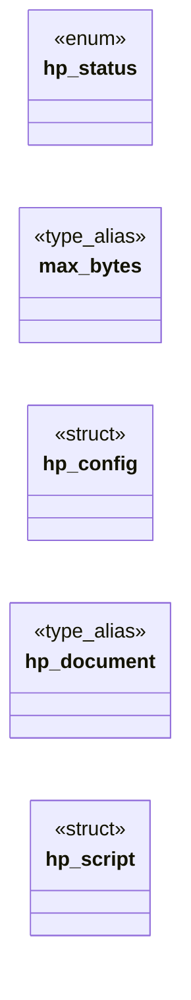

# `include/html_parse.h`

> Source: [include/html_parse.h:1](../../include/html_parse.h#L1) | language `h` | coverage 50.0% | [API index](../index.md)

## Contents

- **Structs:** [`hp_config`](#hp_config), [`hp_script`](#hp_script)
- **Enums:** [`hp_status`](#hp_status)
- **Type Aliases:** [`max_bytes`](#max_bytes), [`hp_document`](#hp_document)
- **Functions:** [`dropped`](#dropped), [`cfg`](#cfg), [`hp_element_count`](#hp_element_count), [`hp_script_count`](#hp_script_count), [`hp_event_handler_count`](#hp_event_handler_count), [`hp_extract_text`](#hp_extract_text), [`hp_get_title`](#hp_get_title), [`src`](#src), [`modules`](#modules), [`hp_free_scripts`](#hp_free_scripts), [`hp_extract_stylesheet_hrefs`](#hp_extract_stylesheet_hrefs), [`hp_free_stylesheet_hrefs`](#hp_free_stylesheet_hrefs), [`hp_free`](#hp_free), [`hp_document_free`](#hp_document_free), [`hp_document_root`](#hp_document_root)
- **Macros:** [`HP_DEFAULT_MAX_BYTES`](#hp_default_max_bytes), [`HP_MAX_SCRIPTS`](#hp_max_scripts), [`HP_MAX_STYLESHEETS`](#hp_max_stylesheets)

## Type Diagram



## Structs

<a id="hp_config"></a>

### `hp_config`

`struct` | [include/html_parse.h:32](../../include/html_parse.h#L32)

```c
typedef struct hp_config
```

---

<a id="hp_script"></a>

### `hp_script`

`struct` | [include/html_parse.h:76](../../include/html_parse.h#L76)

```c
typedef struct hp_script
```

One executable <script>.

Inline: text is a NUL-terminated buffer of `len` bytes (the NUL is not counted in len) and src == NULL. External: src is the RAW, unresolved value of the src attribute (hostile input; the parser never fetches) and text == NULL. Both buffers are owned by the hp_script array.

---

## Enums

<a id="hp_status"></a>

### `hp_status`

`enum` | [include/html_parse.h:22](../../include/html_parse.h#L22)

```c
typedef enum hp_status
```

---

## Type Aliases

<a id="max_bytes"></a>

### `max_bytes`

`type_alias` | [include/html_parse.h:31](../../include/html_parse.h#L31)

```c
typedef struct hp_config { size_t max_bytes;
```

---

<a id="hp_document"></a>

### `hp_document`

`type_alias` | [include/html_parse.h:39](../../include/html_parse.h#L39)

```c
typedef struct hp_document hp_document;
```

Opaque parsed document.

---

## Functions

<a id="dropped"></a>

### `dropped`

`function` | [include/html_parse.h:47](../../include/html_parse.h#L47)

```c
* dropped (not executed). */ #define HP_MAX_SCRIPTS ((size_t)4096) /* Returns a configuration with the secure defaults applied. */ hp_config hp_config_default(void);
```

**Parameters**

| Name | Type | Default | Description |
|---|---|---|---|
| `executed` | `not` |  |  |

**Returns:** `*`

*Called by:* [`window`](src.tab.c.md#window)

---

<a id="cfg"></a>

### `cfg`

`function` | [include/html_parse.h:57](../../include/html_parse.h#L57)

```c
* policy in cfg (cfg == NULL => secure defaults). No script is ever executed. * html == NULL or out == NULL => HP_ERR_NULL_ARG. * On HP_OK, *out is set and must be released with hp_document_free. */ h
```

**Parameters**

| Name | Type | Default | Description |
|---|---|---|---|
| `defaults` | `cfg == NULL => secure` |  |  |

**Returns:** `* policy in`

---

<a id="hp_element_count"></a>

### `hp_element_count`

`function` | [include/html_parse.h:63](../../include/html_parse.h#L63)

```c
size_t hp_element_count(const hp_document *doc);
```

Read-only queries over the (already sanitised) tree.

NULL doc => 0.

**Parameters**

| Name | Type | Default | Description |
|---|---|---|---|
| `doc` | `hp_document *` |  |  |

**Returns:** `size_t`

---

<a id="hp_script_count"></a>

### `hp_script_count`

`function` | [include/html_parse.h:64](../../include/html_parse.h#L64)

```c
size_t hp_script_count(const hp_document *doc);
```

**Parameters**

| Name | Type | Default | Description |
|---|---|---|---|
| `doc` | `hp_document *` |  |  |

**Returns:** `size_t`

---

<a id="hp_event_handler_count"></a>

### `hp_event_handler_count`

`function` | [include/html_parse.h:65](../../include/html_parse.h#L65)

```c
size_t hp_event_handler_count(const hp_document *doc);
```

**Parameters**

| Name | Type | Default | Description |
|---|---|---|---|
| `doc` | `hp_document *` |  |  |

**Returns:** `size_t`

---

<a id="hp_extract_text"></a>

### `hp_extract_text`

`function` | [include/html_parse.h:69](../../include/html_parse.h#L69)

```c
char *hp_extract_text(const hp_document *doc, size_t *out_len);
```

Owned, NUL-terminated buffers; release with hp_free. *out_len (optional) excludes the trailing NUL.

Returns NULL on allocation failure or NULL doc.

**Parameters**

| Name | Type | Default | Description |
|---|---|---|---|
| `doc` | `hp_document *` |  |  |
| `out_len` | `size_t *` |  |  |

**Returns:** `char *`

*Called by:* [`main`](gui.freedom_view.c.md#main)

---

<a id="hp_get_title"></a>

### `hp_get_title`

`function` | [include/html_parse.h:70](../../include/html_parse.h#L70)

```c
char *hp_get_title(const hp_document *doc, size_t *out_len);
```

**Parameters**

| Name | Type | Default | Description |
|---|---|---|---|
| `doc` | `hp_document *` |  |  |
| `out_len` | `size_t *` |  |  |

**Returns:** `char *`

*Called by:* [`main`](gui.freedom_view.c.md#main)

---

<a id="src"></a>

### `src`

`function` | [include/html_parse.h:90](../../include/html_parse.h#L90)

```c
* carry their raw src (a <script src> with an inline body lists ONLY the src -- * browser rule: when src is present the content is ignored). A script executes * only when its type is absent/empty or a
```

**Parameters**

| Name | Type | Default | Description |
|---|---|---|---|
| `ignored` | `a <script src> with an inline body lists ONLY the src -- * browser rule: when src is present the content is` |  |  |

**Returns:** `* carry their raw`

---

<a id="modules"></a>

### `modules`

`function` | [include/html_parse.h:94](../../include/html_parse.h#L94)

```c
* ES modules (import/export cannot run as a classic script), and template blocks * (text/x-jquery-tmpl, text/html, text/template), whose markup would throw a * SyntaxError if evaluated as JS. Each ent
```

**Parameters**

| Name | Type | Default | Description |
|---|---|---|---|
| `script` | `import/export cannot run as a classic` |  |  |

**Returns:** `* ES`

---

<a id="hp_free_scripts"></a>

### `hp_free_scripts`

`function` | [include/html_parse.h:111](../../include/html_parse.h#L111)

```c
void hp_free_scripts(hp_script *scripts, size_t count);
```

Releases an array returned by hp_extract_script_list (each text/src and the array).

Idempotent on NULL.

**Parameters**

| Name | Type | Default | Description |
|---|---|---|---|
| `scripts` | `hp_script *` |  |  |
| `count` | `size_t` |  |  |

---

<a id="hp_extract_stylesheet_hrefs"></a>

### `hp_extract_stylesheet_hrefs`

`function` | [include/html_parse.h:127](../../include/html_parse.h#L127)

```c
char **hp_extract_stylesheet_hrefs(const hp_document *doc, size_t *out_count);
```

Returns the RAW href of every applicable <link rel=stylesheet>, in document order, as an owned array of NUL-terminated strings; *out_count receives the number found.

The parser never fetches: whether those bytes may be requested at all is the tab worker's decision, gated by the trusted parent (spec/tab.md §8). Applicable means: rel contains the whitespace-separated token "stylesheet" (ASCII case-insensitive) and NOT the token "alternate"; href is present and non-empty; and media is absent/empty or mentions "screen"/"all" (anything else, e.g. print, is skipped -- fail closed). Returns NULL (with *out_count == 0) when there are none or on allocation failure. Release with hp_free_stylesheet_hrefs.

**Parameters**

| Name | Type | Default | Description |
|---|---|---|---|
| `doc` | `hp_document *` |  |  |
| `out_count` | `size_t *` |  |  |

**Returns:** `char **`

*Called by:* [`window`](src.tab.c.md#window)

---

<a id="hp_free_stylesheet_hrefs"></a>

### `hp_free_stylesheet_hrefs`

`function` | [include/html_parse.h:130](../../include/html_parse.h#L130)

```c
void hp_free_stylesheet_hrefs(char **hrefs, size_t count);
```

Releases an array returned by hp_extract_stylesheet_hrefs.

Idempotent on NULL.

**Parameters**

| Name | Type | Default | Description |
|---|---|---|---|
| `hrefs` | `char **` |  |  |
| `count` | `size_t` |  |  |

*Called by:* [`window`](src.tab.c.md#window)

---

<a id="hp_free"></a>

### `hp_free`

`function` | [include/html_parse.h:133](../../include/html_parse.h#L133)

```c
void hp_free(char *buf);
```

Release a buffer returned by hp_extract_text / hp_get_title.

**Parameters**

| Name | Type | Default | Description |
|---|---|---|---|
| `buf` | `char *` |  |  |

*Called by:* [`main`](gui.freedom_view.c.md#main)

---

<a id="hp_document_free"></a>

### `hp_document_free`

`function` | [include/html_parse.h:136](../../include/html_parse.h#L136)

```c
void hp_document_free(hp_document *doc);
```

Idempotent; safe on NULL and safe to call twice.

**Parameters**

| Name | Type | Default | Description |
|---|---|---|---|
| `doc` | `hp_document *` |  |  |

*Called by:* [`main`](gui.freedom_view.c.md#main), [`run_js`](src.tab.c.md#run_js)

---

<a id="hp_document_root"></a>

### `hp_document_root`

`function` `const` | [include/html_parse.h:142](../../include/html_parse.h#L142)

```c
const void *hp_document_root(const hp_document *doc);
```

Internal seam for the dom layer: returns the document's root node as an opaque handle (so html_parse.h stays free of backend types), or NULL.

The returned pointer is owned by doc and valid only while doc is alive. The dom module is the only intended consumer; general code should use the queries.

**Parameters**

| Name | Type | Default | Description |
|---|---|---|---|
| `doc` | `hp_document *` |  |  |

**Returns:** `void *`

*Called by:* [`dom_build`](src.dom.c.md#dom_build), [`pv_build_styled`](src.page_view.c.md#pv_build_styled)

---

## Macros

<a id="hp_default_max_bytes"></a>

### `HP_DEFAULT_MAX_BYTES`

`macro` | [include/html_parse.h:41](../../include/html_parse.h#L41)

```c
#define HP_DEFAULT_MAX_BYTES
```

---

<a id="hp_max_scripts"></a>

### `HP_MAX_SCRIPTS`

`macro` | [include/html_parse.h:48](../../include/html_parse.h#L48)

```c
#define HP_MAX_SCRIPTS
```

Upper bound on the number of executable <script> elements returned by hp_extract_script_list.

A real page has a handful; the cap is a fail-closed, anti-DoS limit so a hostile document (up to HP_DEFAULT_MAX_BYTES of tiny scripts) cannot force an unbounded eval loop. Scripts beyond the cap are dropped (not executed).

---

<a id="hp_max_stylesheets"></a>

### `HP_MAX_STYLESHEETS`

`macro` | [include/html_parse.h:115](../../include/html_parse.h#L115)

```c
#define HP_MAX_STYLESHEETS
```

Upper bound on external stylesheets reported per document (a real page uses a handful; extras are dropped, fail-closed anti-DoS).

---
