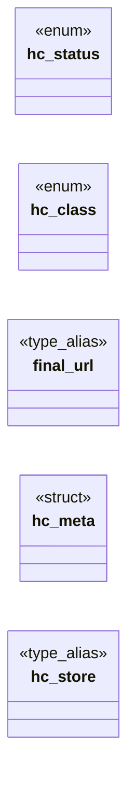

# `include/http_cache.h`

> Source: [include/http_cache.h:1](../../include/http_cache.h#L1) | language `h` | coverage 21.1% | [API index](../index.md)

## Contents

- **Structs:** [`hc_meta`](#hc_meta)
- **Enums:** [`hc_status`](#hc_status), [`hc_class`](#hc_class)
- **Type Aliases:** [`final_url`](#final_url), [`hc_store`](#hc_store)
- **Functions:** [`hc_parse_http_date`](#hc_parse_http_date), [`by`](#by), [`hc_lifetime`](#hc_lifetime), [`hc_close`](#hc_close), [`hc_body_free`](#hc_body_free), [`hc_clear`](#hc_clear)
- **Macros:** [`HC_VAL_MAX`](#hc_val_max), [`HC_URL_MAX`](#hc_url_max), [`HC_TYPE_MAX`](#hc_type_max), [`HC_MAX_ENTRY`](#hc_max_entry), [`HC_MAX_TOTAL`](#hc_max_total), [`HC_REDIRECT_TTL`](#hc_redirect_ttl), [`HC_HEURISTIC_CAP`](#hc_heuristic_cap)

## Type Diagram



## Structs

<a id="hc_meta"></a>

### `hc_meta`

`struct` | [include/http_cache.h:44](../../include/http_cache.h#L44)

```c
typedef struct hc_meta
```

---

## Enums

<a id="hc_status"></a>

### `hc_status`

`enum` | [include/http_cache.h:28](../../include/http_cache.h#L28)

```c
typedef enum hc_status
```

---

<a id="hc_class"></a>

### `hc_class`

`enum` | [include/http_cache.h:38](../../include/http_cache.h#L38)

```c
typedef enum hc_class
```

---

## Type Aliases

<a id="final_url"></a>

### `final_url`

`type_alias` | [include/http_cache.h:43](../../include/http_cache.h#L43)

```c
typedef struct hc_meta { char final_url[HC_URL_MAX];
```

---

<a id="hc_store"></a>

### `hc_store`

`type_alias` | [include/http_cache.h:66](../../include/http_cache.h#L66)

```c
typedef struct hc_store hc_store;
```

---

## Functions

<a id="hc_parse_http_date"></a>

### `hc_parse_http_date`

`function` | [include/http_cache.h:56](../../include/http_cache.h#L56)

```c
time_t hc_parse_http_date(const char *s);
```

RFC 9110 IMF-fixdate ("Sun, 06 Nov 1994 08:49:37 GMT") -> UTC epoch, or -1.

**Parameters**

| Name | Type | Default | Description |
|---|---|---|---|
| `s` | `char *` |  |  |

**Returns:** `time_t`

---

<a id="by"></a>

### `by`

`function` | [include/http_cache.h:59](../../include/http_cache.h#L59)

```c
* something to reuse it by (validator, max-age or Expires). */ int hc_storable(long http_code, const hc_meta *m, size_t body_len);
```

**Parameters**

| Name | Type | Default | Description |
|---|---|---|---|
| `Expires` | `max-age or` |  |  |

**Returns:** `* something to reuse it`

---

<a id="hc_lifetime"></a>

### `hc_lifetime`

`function` | [include/http_cache.h:63](../../include/http_cache.h#L63)

```c
long hc_lifetime(const hc_meta *m);
```

Freshness lifetime in seconds (>= 0), per the spec's order of rules.

**Parameters**

| Name | Type | Default | Description |
|---|---|---|---|
| `m` | `hc_meta *` |  |  |

**Returns:** `long`

---

<a id="hc_close"></a>

### `hc_close`

`function` | [include/http_cache.h:72](../../include/http_cache.h#L72)

```c
void hc_close(hc_store *s);
```

**Parameters**

| Name | Type | Default | Description |
|---|---|---|---|
| `s` | `hc_store *` |  |  |

---

<a id="hc_body_free"></a>

### `hc_body_free`

`function` | [include/http_cache.h:78](../../include/http_cache.h#L78)

```c
void hc_body_free(uint8_t *body, size_t len);
```

**Parameters**

| Name | Type | Default | Description |
|---|---|---|---|
| `body` | `uint8_t *` |  |  |
| `len` | `size_t` |  |  |

---

<a id="hc_clear"></a>

### `hc_clear`

`function` | [include/http_cache.h:84](../../include/http_cache.h#L84)

```c
void hc_clear(hc_store *s);
```

Removes every entry.

**Parameters**

| Name | Type | Default | Description |
|---|---|---|---|
| `s` | `hc_store *` |  |  |

---

## Macros

<a id="hc_val_max"></a>

### `HC_VAL_MAX`

`macro` | [include/http_cache.h:20](../../include/http_cache.h#L20)

```c
#define HC_VAL_MAX
```

---

<a id="hc_url_max"></a>

### `HC_URL_MAX`

`macro` | [include/http_cache.h:21](../../include/http_cache.h#L21)

```c
#define HC_URL_MAX
```

one validator / directive value

---

<a id="hc_type_max"></a>

### `HC_TYPE_MAX`

`macro` | [include/http_cache.h:22](../../include/http_cache.h#L22)

```c
#define HC_TYPE_MAX
```

---

<a id="hc_max_entry"></a>

### `HC_MAX_ENTRY`

`macro` | [include/http_cache.h:23](../../include/http_cache.h#L23)

```c
#define HC_MAX_ENTRY
```

---

<a id="hc_max_total"></a>

### `HC_MAX_TOTAL`

`macro` | [include/http_cache.h:24](../../include/http_cache.h#L24)

```c
#define HC_MAX_TOTAL
```

---

<a id="hc_redirect_ttl"></a>

### `HC_REDIRECT_TTL`

`macro` | [include/http_cache.h:25](../../include/http_cache.h#L25)

```c
#define HC_REDIRECT_TTL
```

---

<a id="hc_heuristic_cap"></a>

### `HC_HEURISTIC_CAP`

`macro` | [include/http_cache.h:26](../../include/http_cache.h#L26)

```c
#define HC_HEURISTIC_CAP
```

---
