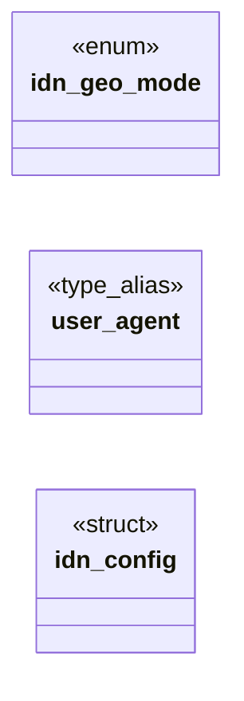

# `include/identity.h`

> Source: [include/identity.h:1](../../include/identity.h#L1) | language `h` | coverage 45.8% | [API index](../index.md)

## Contents

- **Structs:** [`idn_config`](#idn_config)
- **Enums:** [`idn_geo_mode`](#idn_geo_mode)
- **Type Aliases:** [`user_agent`](#user_agent)
- **Functions:** [`idn_defaults`](#idn_defaults), [`idn_is_default`](#idn_is_default), [`idn_set_user_agent`](#idn_set_user_agent), [`idn_set_languages`](#idn_set_languages), [`idn_set_geo`](#idn_set_geo), [`idn_clear_geo`](#idn_clear_geo), [`idn_user_agent`](#idn_user_agent), [`idn_accept_language`](#idn_accept_language), [`idn_primary_language`](#idn_primary_language), [`idn_serialize`](#idn_serialize), [`idn_parse`](#idn_parse), [`idn_apply_query`](#idn_apply_query), [`idn_render_page`](#idn_render_page)
- **Macros:** [`IDN_UA_MAX`](#idn_ua_max), [`IDN_LANG_MAX`](#idn_lang_max), [`IDN_LANG_TAGS_MAX`](#idn_lang_tags_max), [`IDN_SERIAL_MAX`](#idn_serial_max), [`IDN_PAGE_MAX`](#idn_page_max), [`IDN_GEO_ACC_MIN`](#idn_geo_acc_min), [`IDN_GEO_ACC_MAX`](#idn_geo_acc_max)

## Type Diagram



## Structs

<a id="idn_config"></a>

### `idn_config`

`struct` | [include/identity.h:37](../../include/identity.h#L37)

```c
typedef struct idn_config
```

---

## Enums

<a id="idn_geo_mode"></a>

### `idn_geo_mode`

`enum` | [include/identity.h:25](../../include/identity.h#L25)

```c
typedef enum idn_geo_mode
```

---

## Type Aliases

<a id="user_agent"></a>

### `user_agent`

`type_alias` | [include/identity.h:36](../../include/identity.h#L36)

```c
typedef struct idn_config { char user_agent[IDN_UA_MAX];
```

---

## Functions

<a id="idn_defaults"></a>

### `idn_defaults`

`function` | [include/identity.h:45](../../include/identity.h#L45)

```c
void idn_defaults(idn_config *c);
```

The anti_fp identity, geolocation off.

NULL-safe.

**Parameters**

| Name | Type | Default | Description |
|---|---|---|---|
| `c` | `idn_config *` |  |  |

---

<a id="idn_is_default"></a>

### `idn_is_default`

`function` | [include/identity.h:48](../../include/identity.h#L48)

```c
int idn_is_default(const idn_config *c);
```

1 when c carries no override at all (NULL counts as default).

**Parameters**

| Name | Type | Default | Description |
|---|---|---|---|
| `c` | `idn_config *` |  |  |

**Returns:** `int`

---

<a id="idn_set_user_agent"></a>

### `idn_set_user_agent`

`function` | [include/identity.h:51](../../include/identity.h#L51)

```c
int idn_set_user_agent(idn_config *c, const char *ua);
```

Validated setters: 0 on success, -1 (c untouched) when the value is not representable.

**Parameters**

| Name | Type | Default | Description |
|---|---|---|---|
| `c` | `idn_config *` |  |  |
| `ua` | `char *` |  |  |

**Returns:** `int`

---

<a id="idn_set_languages"></a>

### `idn_set_languages`

`function` | [include/identity.h:52](../../include/identity.h#L52)

```c
int idn_set_languages(idn_config *c, const char *list);
```

**Parameters**

| Name | Type | Default | Description |
|---|---|---|---|
| `c` | `idn_config *` |  |  |
| `list` | `char *` |  |  |

**Returns:** `int`

---

<a id="idn_set_geo"></a>

### `idn_set_geo`

`function` | [include/identity.h:53](../../include/identity.h#L53)

```c
int idn_set_geo(idn_config *c, double lat, double lon, double accuracy_m);
```

**Parameters**

| Name | Type | Default | Description |
|---|---|---|---|
| `c` | `idn_config *` |  |  |
| `lat` | `double` |  |  |
| `lon` | `double` |  |  |
| `accuracy_m` | `double` |  |  |

**Returns:** `int`

---

<a id="idn_clear_geo"></a>

### `idn_clear_geo`

`function` | [include/identity.h:54](../../include/identity.h#L54)

```c
void idn_clear_geo(idn_config *c);
```

**Parameters**

| Name | Type | Default | Description |
|---|---|---|---|
| `c` | `idn_config *` |  |  |

---

<a id="idn_user_agent"></a>

### `idn_user_agent`

`function` `const` | [include/identity.h:57](../../include/identity.h#L57)

```c
const char *idn_user_agent(const idn_config *c);
```

Effective values: the override, else the anti_fp default.

Never NULL / always terminated.

**Parameters**

| Name | Type | Default | Description |
|---|---|---|---|
| `c` | `idn_config *` |  |  |

**Returns:** `char *`

---

<a id="idn_accept_language"></a>

### `idn_accept_language`

`function` | [include/identity.h:58](../../include/identity.h#L58)

```c
size_t idn_accept_language(const idn_config *c, char *out, size_t cap);
```

**Parameters**

| Name | Type | Default | Description |
|---|---|---|---|
| `c` | `idn_config *` |  |  |
| `out` | `char *` |  |  |
| `cap` | `size_t` |  |  |

**Returns:** `size_t`

---

<a id="idn_primary_language"></a>

### `idn_primary_language`

`function` | [include/identity.h:59](../../include/identity.h#L59)

```c
size_t idn_primary_language(const idn_config *c, char *out, size_t cap);
```

**Parameters**

| Name | Type | Default | Description |
|---|---|---|---|
| `c` | `idn_config *` |  |  |
| `out` | `char *` |  |  |
| `cap` | `size_t` |  |  |

**Returns:** `size_t`

---

<a id="idn_serialize"></a>

### `idn_serialize`

`function` | [include/identity.h:63](../../include/identity.h#L63)

```c
size_t idn_serialize(const idn_config *c, char *out, size_t cap);
```

One-line text form for prefs and the worker IPC.

Returns the length (0 on cap overflow, out then "").

**Parameters**

| Name | Type | Default | Description |
|---|---|---|---|
| `c` | `idn_config *` |  |  |
| `out` | `char *` |  |  |
| `cap` | `size_t` |  |  |

**Returns:** `size_t`

---

<a id="idn_parse"></a>

### `idn_parse`

`function` | [include/identity.h:67](../../include/identity.h#L67)

```c
void idn_parse(idn_config *c, const char *text);
```

Parses idn_serialize output field by field; an invalid field keeps its default.

Always leaves c valid.

**Parameters**

| Name | Type | Default | Description |
|---|---|---|---|
| `c` | `idn_config *` |  |  |
| `text` | `char *` |  |  |

---

<a id="idn_apply_query"></a>

### `idn_apply_query`

`function` | [include/identity.h:70](../../include/identity.h#L70)

```c
unsigned idn_apply_query(idn_config *c, const char *query);
```

Applies a GET-form query (spec/identity.md).

Returns the IDN_REJ_* mask.

**Parameters**

| Name | Type | Default | Description |
|---|---|---|---|
| `c` | `idn_config *` |  |  |
| `query` | `char *` |  |  |

**Returns:** `unsigned`

*Called by:* [`arrives`](gui.browser_ui.c.md#arrives)

---

<a id="idn_render_page"></a>

### `idn_render_page`

`function` | [include/identity.h:73](../../include/identity.h#L73)

```c
size_t idn_render_page(const idn_config *c, char *out, size_t cap);
```

Writes the about:config HTML.

Returns its length (0 when cap is too small, out "").

**Parameters**

| Name | Type | Default | Description |
|---|---|---|---|
| `c` | `idn_config *` |  |  |
| `out` | `char *` |  |  |
| `cap` | `size_t` |  |  |

**Returns:** `size_t`

*Called by:* [`arrives`](gui.browser_ui.c.md#arrives)

---

## Macros

<a id="idn_ua_max"></a>

### `IDN_UA_MAX`

`macro` | [include/identity.h:16](../../include/identity.h#L16)

```c
#define IDN_UA_MAX
```

---

<a id="idn_lang_max"></a>

### `IDN_LANG_MAX`

`macro` | [include/identity.h:17](../../include/identity.h#L17)

```c
#define IDN_LANG_MAX
```

user_agent buffer, terminator included

---

<a id="idn_lang_tags_max"></a>

### `IDN_LANG_TAGS_MAX`

`macro` | [include/identity.h:18](../../include/identity.h#L18)

```c
#define IDN_LANG_TAGS_MAX
```

languages buffer, terminator included

---

<a id="idn_serial_max"></a>

### `IDN_SERIAL_MAX`

`macro` | [include/identity.h:19](../../include/identity.h#L19)

```c
#define IDN_SERIAL_MAX
```

---

<a id="idn_page_max"></a>

### `IDN_PAGE_MAX`

`macro` | [include/identity.h:20](../../include/identity.h#L20)

```c
#define IDN_PAGE_MAX
```

longest idn_serialize output, terminator included

---

<a id="idn_geo_acc_min"></a>

### `IDN_GEO_ACC_MIN`

`macro` | [include/identity.h:22](../../include/identity.h#L22)

```c
#define IDN_GEO_ACC_MIN
```

---

<a id="idn_geo_acc_max"></a>

### `IDN_GEO_ACC_MAX`

`macro` | [include/identity.h:23](../../include/identity.h#L23)

```c
#define IDN_GEO_ACC_MAX
```

---
