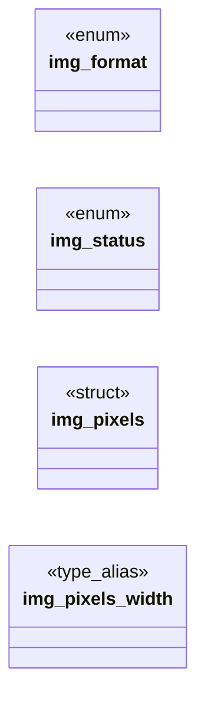

# `include/image_decode.h`

> Source: [include/image_decode.h:1](../../include/image_decode.h#L1) | language `h` | coverage 46.2% | [API index](../index.md)

## Contents

- **Structs:** [`img_pixels`](#img_pixels)
- **Enums:** [`img_format`](#img_format), [`img_status`](#img_status)
- **Functions:** [`guards`](#guards), [`img_dimensions_ok`](#img_dimensions_ok), [`inputs`](#inputs), [`decode`](#decode), [`img_pixels_free`](#img_pixels_free), [`img_format_name`](#img_format_name)
- **Macros:** [`IMG_MAX_DIM`](#img_max_dim), [`IMG_MAX_PIXELS`](#img_max_pixels)

## Type Diagram



## Structs

<a id="img_pixels"></a>

### `img_pixels`

`struct` | [include/image_decode.h:56](../../include/image_decode.h#L56)

```c
typedef struct img_pixels
```

A decoded bitmap that owns its pixel buffer.

The pixel format is Cairo's native premultiplied ARGB32: each pixel is a uint32_t 0xAARRGGBB, i.e. bytes B,G,R,A in little-endian memory, colour premultiplied by alpha. stride == width*4 (tightly packed). This module never includes cairo.h; it only honours that layout so the parent can wrap data in a cairo_surface_t without re-encoding.

**Members**

| Member | Kind | Summary |
|---|---|---|
| [`width`](#img_pixels-width) | type_alias | A decoded bitmap that owns its pixel buffer. |

<a id="img_pixels-width"></a>

#### `img_pixels.width`

`type_alias` | [include/image_decode.h:56](../../include/image_decode.h#L56)

```c
typedef struct img_pixels { uint32_t width;
```

A decoded bitmap that owns its pixel buffer.

The pixel format is Cairo's native premultiplied ARGB32: each pixel is a uint32_t 0xAARRGGBB, i.e. bytes B,G,R,A in little-endian memory, colour premultiplied by alpha. stride == width*4 (tightly packed). This module never includes cairo.h; it only honours that layout so the parent can wrap data in a cairo_surface_t without re-encoding.

---

## Enums

<a id="img_format"></a>

### `img_format`

`enum` | [include/image_decode.h:33](../../include/image_decode.h#L33)

```c
typedef enum img_format
```

---

<a id="img_status"></a>

### `img_status`

`enum` | [include/image_decode.h:41](../../include/image_decode.h#L41)

```c
typedef enum img_status
```

---

## Functions

<a id="guards"></a>

### `guards`

`function` | [include/image_decode.h:25](../../include/image_decode.h#L25)

```c
* guards (in-memory source only, longjmp error manager so a bad stream never * calls exit(), dimension caps before decode);
```

**Parameters**

| Name | Type | Default | Description |
|---|---|---|---|
| `only` | `in-memory source` |  |  |
| `exit` | `longjmp error manager so a bad stream never * calls ()` |  |  |
| `decode` | `dimension caps before` |  |  |

**Returns:** `*`

---

<a id="img_dimensions_ok"></a>

### `img_dimensions_ok`

`function` | [include/image_decode.h:78](../../include/image_decode.h#L78)

```c
int img_dimensions_ok(uint32_t w, uint32_t h);
```

1 iff (w,h) is non-zero and fits the anti-DoS caps (per-side and area, no overflow of width*height*4); 0 otherwise.

**Parameters**

| Name | Type | Default | Description |
|---|---|---|---|
| `w` | `uint32_t` |  |  |
| `h` | `uint32_t` |  |  |

**Returns:** `int`

---

<a id="inputs"></a>

### `inputs`

`function` | [include/image_decode.h:81](../../include/image_decode.h#L81)

```c
* Degenerate inputs (<= 0) yield (0,0). Pure. */ void img_fit(uint32_t iw, uint32_t ih, double box_w, double box_h, double *out_w, double *out_h);
```

**Parameters**

| Name | Type | Default | Description |
|---|---|---|---|
| `<` |  | `0` |  |

**Returns:** `* Degenerate`

---

<a id="decode"></a>

### `decode`

`function` | [include/image_decode.h:92](../../include/image_decode.h#L92)

```c
* the declared dimensions BEFORE the full decode (anti-bomb), decodes to RGB and * expands to BGRA. Rejects non-JPEG (IMG_ERR_FORMAT), out-of-bounds dimensions, CMYK/ * YCCK and corrupt streams (IMG_E
```

**Parameters**

| Name | Type | Default | Description |
|---|---|---|---|
| `bomb` | `anti-` |  |  |

**Returns:** `* the declared dimensions BEFORE the full`

---

<a id="img_pixels_free"></a>

### `img_pixels_free`

`function` | [include/image_decode.h:121](../../include/image_decode.h#L121)

```c
void img_pixels_free(img_pixels *p);
```

Releases data and zeroes the struct.

Idempotent; safe on NULL and on a zeroed struct.

**Parameters**

| Name | Type | Default | Description |
|---|---|---|---|
| `p` | `img_pixels *` |  |  |

---

<a id="img_format_name"></a>

### `img_format_name`

`function` `const` | [include/image_decode.h:124](../../include/image_decode.h#L124)

```c
const char *img_format_name(img_format f);
```

Stable, short English name of a format for structured/agent output.

Never NULL.

**Parameters**

| Name | Type | Default | Description |
|---|---|---|---|
| `f` | `img_format` |  |  |

**Returns:** `char *`

---

## Macros

<a id="img_max_dim"></a>

### `IMG_MAX_DIM`

`macro` | [include/image_decode.h:65](../../include/image_decode.h#L65)

```c
#define IMG_MAX_DIM
```

Anti-DoS bounds.

A tiny compressed PNG can declare huge dimensions (a decompression bomb); dimensions are checked against these BEFORE decoding.

---

<a id="img_max_pixels"></a>

### `IMG_MAX_PIXELS`

`macro` | [include/image_decode.h:66](../../include/image_decode.h#L66)

```c
#define IMG_MAX_PIXELS
```

---
