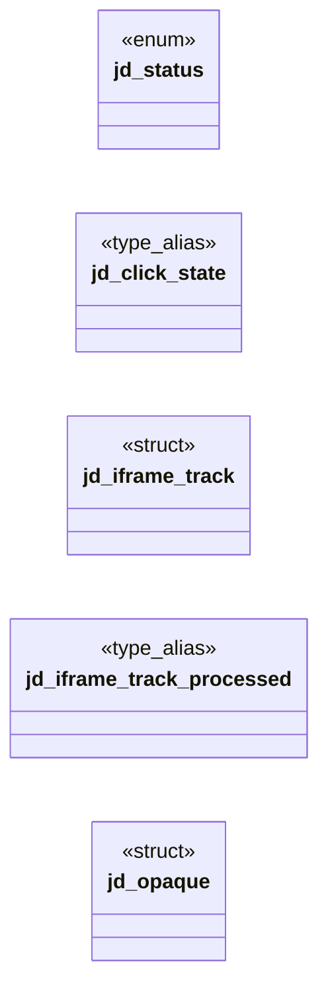

# `include/js_dom.h`

> Source: [include/js_dom.h:1](../../include/js_dom.h#L1) | language `h` | coverage 35.3% | [API index](../index.md)

## Contents

- **Structs:** [`jd_iframe_track`](#jd_iframe_track), [`jd_opaque`](#jd_opaque)
- **Enums:** [`jd_status`](#jd_status)
- **Type Aliases:** [`jd_click_state`](#jd_click_state)
- **Functions:** [`opaque`](#opaque), [`jd_click_state_free`](#jd_click_state_free), [`run`](#run), [`preventDefault`](#preventdefault), [`host`](#host), [`jd_get_cookies`](#jd_get_cookies), [`out_status`](#out_status), [`jd_process_iframes`](#jd_process_iframes), [`URLs`](#urls), [`jd_video_from_scripts`](#jd_video_from_scripts)
- **Macros:** [`JD_IFRAME_TRACK_MAX`](#jd_iframe_track_max)

## Type Diagram



## Structs

<a id="jd_iframe_track"></a>

### `jd_iframe_track`

`struct` | [include/js_dom.h:41](../../include/js_dom.h#L41)

```c
typedef struct jd_iframe_track
```

Tracks iframes already processed by jd_process_iframes, to avoid re-fetching the same iframe on repeated calls.

Lives in jd_opaque (caller's stack), not * in a static — eliminates cross-page state leaks. Zero-init => fresh state. define JD_IFRAME_TRACK_MAX 16

**Members**

| Member | Kind | Summary |
|---|---|---|
| [`processed`](#jd_iframe_track-processed) | type_alias | Tracks iframes already processed by jd_process_iframes, to avoid re-fetching the same iframe on repeated calls. |

<a id="jd_iframe_track-processed"></a>

#### `jd_iframe_track.processed`

`type_alias` | [include/js_dom.h:41](../../include/js_dom.h#L41)

```c
typedef struct jd_iframe_track { dom_node_id processed[JD_IFRAME_TRACK_MAX];
```

Tracks iframes already processed by jd_process_iframes, to avoid re-fetching the same iframe on repeated calls.

Lives in jd_opaque (caller's stack), not * in a static — eliminates cross-page state leaks. Zero-init => fresh state. define JD_IFRAME_TRACK_MAX 16

---

<a id="jd_opaque"></a>

### `jd_opaque`

`struct` | [include/js_dom.h:46](../../include/js_dom.h#L46)

```c
typedef struct jd_opaque
```

---

## Enums

<a id="jd_status"></a>

### `jd_status`

`enum` | [include/js_dom.h:25](../../include/js_dom.h#L25)

```c
typedef enum jd_status
```

---

## Type Aliases

<a id="jd_click_state"></a>

### `jd_click_state`

`type_alias` | [include/js_dom.h:35](../../include/js_dom.h#L35)

```c
typedef struct jd_click_state jd_click_state;
```

Per-context state shared between the binding layer and the trusted caller.

Lives in the caller's stack (or struct) and must outlive ctx. The caller zero-initialises it; jd_install wires it into the engine's context opaque.

---

## Functions

<a id="opaque"></a>

### `opaque`

`function` | [include/js_dom.h:64](../../include/js_dom.h#L64)

```c
* the engine runtime opaque (unreachable from script);
```

**Parameters**

| Name | Type | Default | Description |
|---|---|---|---|
| `script` | `unreachable from` |  |  |

**Returns:** `* the engine runtime`

---

<a id="jd_click_state_free"></a>

### `jd_click_state_free`

`function` | [include/js_dom.h:78](../../include/js_dom.h#L78)

```c
* jd_click_state_free(). Bound to one context via jd_install_events(). */ jd_click_state *jd_click_state_new(void);
```

**Returns:** `*`

*Called by:* [`run_js`](src.tab.c.md#run_js)

---

<a id="run"></a>

### `run`

`function` | [include/js_dom.h:87](../../include/js_dom.h#L87)

```c
* run (no handler registered, or handlers ran without calling preventDefault()), * and 0 if a handler called preventDefault(). ctx == NULL => 1 (fail-open for the * default action, since no script can
```

**Parameters**

| Name | Type | Default | Description |
|---|---|---|---|
| `registered` | `no handler` |  |  |
| `preventDefault` | `or handlers ran without calling ()` |  |  |

**Returns:** `*`

---

<a id="preventdefault"></a>

### `preventDefault`

`function` | [include/js_dom.h:94](../../include/js_dom.h#L94)

```c
* preventDefault() was called, 1 if the default (form submission) should proceed. * ctx == NULL or no form found => 1 (fail-open: submission proceeds). */ int jd_fire_submit(js_context *ctx, dom_node_
```

**Returns:** `*`

---

<a id="host"></a>

### `host`

`function` | [include/js_dom.h:123](../../include/js_dom.h#L123)

```c
* for a trusted host (allow.conf AND js.conf);
```

**Parameters**

| Name | Type | Default | Description |
|---|---|---|---|
| `conf` | `allow.conf AND js.` |  |  |

**Returns:** `* for a trusted`

---

<a id="jd_get_cookies"></a>

### `jd_get_cookies`

`function` | [include/js_dom.h:134](../../include/js_dom.h#L134)

```c
int jd_get_cookies(js_context *ctx, char *buf, size_t bufsz);
```

Serialises the page's current cookie jar ("name=value; ...") into buf (bounded, NUL-terminated) and returns its length, so the trusted parent can fold JS-set cookies back into its ephemeral network jar.

Returns 0 when the jar is disabled/empty or on any error. Never throws into the page.

**Parameters**

| Name | Type | Default | Description |
|---|---|---|---|
| `ctx` | `js_context *` |  |  |
| `buf` | `char *` |  |  |
| `bufsz` | `size_t` |  |  |

**Returns:** `int`

---

<a id="out_status"></a>

### `out_status`

`function` | [include/js_dom.h:142](../../include/js_dom.h#L142)

```c
* On success returns 0 and sets *out_status (HTTP status, 0 if unknown), *out_body / * *out_body_len (response bytes, malloc'd -- the bridge frees with free()), and * *out_ctype (Content-Type, malloc'
```

**Parameters**

| Name | Type | Default | Description |
|---|---|---|---|
| `status` | `HTTP` |  |  |
| `unknown` | `0 if` |  |  |

**Returns:** `* On success returns 0 and sets *`

---

<a id="jd_process_iframes"></a>

### `jd_process_iframes`

`function` | [include/js_dom.h:163](../../include/js_dom.h#L163)

```c
* BEFORE jd_process_iframes() (so iframes are in the DOM for it to process). * ctx == NULL => JD_ERR_NULL_ARG. */ jd_status jd_inject_video_shim(js_context *ctx);
```

**Returns:** `* BEFORE`

---

<a id="urls"></a>

### `URLs`

`function` | [include/js_dom.h:170](../../include/js_dom.h#L170)

```c
* video URLs (.m3u8 then .mp4 patterns), and creates <video> elements in the document for * any found. Does NOT re-process iframes already processed (tracks them by node_id in * jd_opaque.iframe_track
```

**Parameters**

| Name | Type | Default | Description |
|---|---|---|---|
| `patterns` | `.m3u8 then .mp4` |  |  |

**Returns:** `* video`

---

<a id="jd_video_from_scripts"></a>

### `jd_video_from_scripts`

`function` | [include/js_dom.h:184](../../include/js_dom.h#L184)

```c
size_t jd_video_from_scripts(dom_index *idx, const char *const *script_texts, const size_t *script_lens, size_t nscripts, const char *page_url);
```

Creates <iframe> elements in the DOM from video data (`video[N]` / `video_data`) found in inline script text, WITHOUT executing JS.

Runs before the pre-script preserve_view snapshot so video elements survive jQuery corruption fallback. Scans each script for patterns matching video array/data assignments, extracts the iframe src URL, and creates an <iframe> in the DOM. page_url resolves relative URLs (may be NULL). Returns the number of iframes created (0 if none/error).

**Parameters**

| Name | Type | Default | Description |
|---|---|---|---|
| `idx` | `dom_index *` |  |  |
| `script_texts` | `char *const *` |  |  |
| `script_lens` | `size_t *` |  |  |
| `nscripts` | `size_t` |  |  |
| `page_url` | `char *` |  |  |

**Returns:** `size_t`

---

## Macros

<a id="jd_iframe_track_max"></a>

### `JD_IFRAME_TRACK_MAX`

`macro` | [include/js_dom.h:40](../../include/js_dom.h#L40)

```c
#define JD_IFRAME_TRACK_MAX
```

Tracks iframes already processed by jd_process_iframes, to avoid re-fetching the same iframe on repeated calls.

Lives in jd_opaque (caller's stack), not in a static — eliminates cross-page state leaks. Zero-init => fresh state.

---
