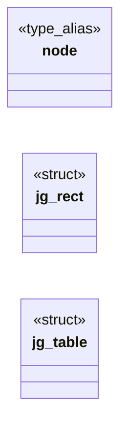
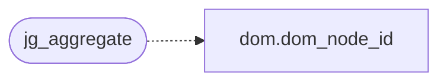

# `include/js_geom.h`

> Source: [include/js_geom.h:1](../../include/js_geom.h#L1) | language `h` | coverage 78.9% | [API index](../index.md)

## Contents

- **Structs:** [`jg_rect`](#jg_rect), [`jg_table`](#jg_table)
- **Type Aliases:** [`node`](#node)
- **Functions:** [`jg_init`](#jg_init), [`jg_free`](#jg_free), [`jg_add`](#jg_add), [`jg_finish`](#jg_finish), [`jg_find`](#jg_find), [`jg_aggregate`](#jg_aggregate), [`jg_wire_len`](#jg_wire_len), [`jg_encode`](#jg_encode), [`jg_decode`](#jg_decode), [`jg_hash`](#jg_hash)
- **Macros:** [`JG_MAX_RECTS`](#jg_max_rects), [`JG_MAX_DEPTH`](#jg_max_depth), [`JG_COORD_MAX`](#jg_coord_max), [`JG_HEADER_N`](#jg_header_n), [`JG_RECT_N`](#jg_rect_n)

## Type Diagram



## Call Graph

Solid arrows stay in this module, dashed arrows leave it.



## Structs

<a id="jg_rect"></a>

### `jg_rect`

`struct` | [include/js_geom.h:30](../../include/js_geom.h#L30)

```c
typedef struct jg_rect
```

---

<a id="jg_table"></a>

### `jg_table`

`struct` | [include/js_geom.h:35](../../include/js_geom.h#L35)

```c
typedef struct jg_table
```

---

## Type Aliases

<a id="node"></a>

### `node`

`type_alias` | [include/js_geom.h:29](../../include/js_geom.h#L29)

```c
typedef struct jg_rect { dom_node_id node;
```

node, x, y, w, h

---

## Functions

<a id="jg_init"></a>

### `jg_init`

`function` | [include/js_geom.h:44](../../include/js_geom.h#L44)

```c
void jg_init(jg_table *t);
```

Empty table.

**Parameters**

| Name | Type | Default | Description |
|---|---|---|---|
| `t` | `jg_table *` |  |  |

*Called by:* [`LLVMFuzzerTestOneInput`](fuzz.fuzz_js_dom.c.md#llvmfuzzertestoneinput), [`LLVMFuzzerTestOneInput`](fuzz.fuzz_js_geom.c.md#llvmfuzzertestoneinput)

---

<a id="jg_free"></a>

### `jg_free`

`function` | [include/js_geom.h:47](../../include/js_geom.h#L47)

```c
void jg_free(jg_table *t);
```

Frees the rect array and resets to empty.

Idempotent; NULL is a no-op.

**Parameters**

| Name | Type | Default | Description |
|---|---|---|---|
| `t` | `jg_table *` |  |  |

*Called by:* [`LLVMFuzzerTestOneInput`](fuzz.fuzz_js_dom.c.md#llvmfuzzertestoneinput), [`LLVMFuzzerTestOneInput`](fuzz.fuzz_js_geom.c.md#llvmfuzzertestoneinput)

---

<a id="jg_add"></a>

### `jg_add`

`function` | [include/js_geom.h:52](../../include/js_geom.h#L52)

```c
int jg_add(jg_table *t, dom_node_id node, double x, double y, double w, double h);
```

Appends one rect.

DOM_NODE_NONE or a non-finite value is ignored (returns 0); coordinates are clamped to +-JG_COORD_MAX and a negative size becomes 0. Returns -1 on NULL or when JG_MAX_RECTS is reached (the table stays valid).

**Parameters**

| Name | Type | Default | Description |
|---|---|---|---|
| `t` | `jg_table *` |  |  |
| `node` | `dom_node_id` |  |  |
| `x` | `double` |  |  |
| `y` | `double` |  |  |
| `w` | `double` |  |  |
| `h` | `double` |  |  |

**Returns:** `int`

*Called by:* [`LLVMFuzzerTestOneInput`](fuzz.fuzz_js_dom.c.md#llvmfuzzertestoneinput), [`LLVMFuzzerTestOneInput`](fuzz.fuzz_js_geom.c.md#llvmfuzzertestoneinput)

---

<a id="jg_finish"></a>

### `jg_finish`

`function` | [include/js_geom.h:56](../../include/js_geom.h#L56)

```c
int jg_finish(jg_table *t);
```

Sorts by node and merges rects of the same node into their bounding box.

Returns 0, or -1 on NULL.

**Parameters**

| Name | Type | Default | Description |
|---|---|---|---|
| `t` | `jg_table *` |  |  |

**Returns:** `int`

*Called by:* [`LLVMFuzzerTestOneInput`](fuzz.fuzz_js_geom.c.md#llvmfuzzertestoneinput)

---

<a id="jg_find"></a>

### `jg_find`

`function` `const` | [include/js_geom.h:59](../../include/js_geom.h#L59)

```c
const jg_rect *jg_find(const jg_table *t, dom_node_id node);
```

The rect of node in a finished table, or NULL.

**Parameters**

| Name | Type | Default | Description |
|---|---|---|---|
| `t` | `jg_table *` |  |  |
| `node` | `dom_node_id` |  |  |

**Returns:** `jg_rect *`

*Called by:* [`LLVMFuzzerTestOneInput`](fuzz.fuzz_js_geom.c.md#llvmfuzzertestoneinput)

---

<a id="jg_aggregate"></a>

### `jg_aggregate`

`function` | [include/js_geom.h:65](../../include/js_geom.h#L65)

```c
int jg_aggregate(jg_table *t, dom_node_id (*parent)(void *ctx, dom_node_id node), void *ctx);
```

Unions every rect into each of its ancestors (parent(ctx, n) until DOM_NODE_NONE, at most JG_MAX_DEPTH steps, so a cyclic parent function terminates), then finishes the table.

Returns 0, or -1 on NULL / exhaustion of JG_MAX_RECTS (the table then holds every rect it could fit, finished).

**Parameters**

| Name | Type | Default | Description |
|---|---|---|---|
| `t` | `jg_table *` |  |  |
| `node` | `dom_node_id (*parent)(void *ctx, dom_node_id )` |  |  |
| `ctx` | `void *` |  |  |

**Returns:** `int`

*Calls:* [`dom_node_id`](include.dom.h.md#dom_node_id)

*Called by:* [`LLVMFuzzerTestOneInput`](fuzz.fuzz_js_dom.c.md#llvmfuzzertestoneinput), [`LLVMFuzzerTestOneInput`](fuzz.fuzz_js_geom.c.md#llvmfuzzertestoneinput)

---

<a id="jg_wire_len"></a>

### `jg_wire_len`

`function` | [include/js_geom.h:68](../../include/js_geom.h#L68)

```c
size_t jg_wire_len(const jg_table *t);
```

Number of int32 values jg_encode writes: JG_HEADER_N + 1 + n * JG_RECT_N.

**Parameters**

| Name | Type | Default | Description |
|---|---|---|---|
| `t` | `jg_table *` |  |  |

**Returns:** `size_t`

*Called by:* [`LLVMFuzzerTestOneInput`](fuzz.fuzz_js_geom.c.md#llvmfuzzertestoneinput)

---

<a id="jg_encode"></a>

### `jg_encode`

`function` | [include/js_geom.h:71](../../include/js_geom.h#L71)

```c
int jg_encode(const jg_table *t, int32_t *out, size_t cap);
```

Serializes into out (cap int32 values).

Returns 0, or -1 on NULL / too small.

**Parameters**

| Name | Type | Default | Description |
|---|---|---|---|
| `t` | `jg_table *` |  |  |
| `out` | `int32_t *` |  |  |
| `cap` | `size_t` |  |  |

**Returns:** `int`

*Called by:* [`LLVMFuzzerTestOneInput`](fuzz.fuzz_js_geom.c.md#llvmfuzzertestoneinput)

---

<a id="jg_decode"></a>

### `jg_decode`

`function` | [include/js_geom.h:77](../../include/js_geom.h#L77)

```c
int jg_decode(const int32_t *in, size_t n, jg_table *out);
```

Parses a wire array into out (which must be jg_init'ed or empty; previous contents are freed).

Validates the header, the count against n and JG_MAX_RECTS and every value's range; on any failure returns -1 and leaves out empty. The result is finished.

**Parameters**

| Name | Type | Default | Description |
|---|---|---|---|
| `in` | `int32_t *` |  |  |
| `n` | `size_t` |  |  |
| `out` | `jg_table *` |  |  |

**Returns:** `int`

*Called by:* [`LLVMFuzzerTestOneInput`](fuzz.fuzz_js_geom.c.md#llvmfuzzertestoneinput)

---

<a id="jg_hash"></a>

### `jg_hash`

`function` | [include/js_geom.h:80](../../include/js_geom.h#L80)

```c
uint64_t jg_hash(const jg_table *t);
```

FNV-1a over the header and every rect: equal tables hash equal.

**Parameters**

| Name | Type | Default | Description |
|---|---|---|---|
| `t` | `jg_table *` |  |  |

**Returns:** `uint64_t`

*Called by:* [`LLVMFuzzerTestOneInput`](fuzz.fuzz_js_geom.c.md#llvmfuzzertestoneinput)

---

## Macros

<a id="jg_max_rects"></a>

### `JG_MAX_RECTS`

`macro` | [include/js_geom.h:24](../../include/js_geom.h#L24)

```c
#define JG_MAX_RECTS
```

---

<a id="jg_max_depth"></a>

### `JG_MAX_DEPTH`

`macro` | [include/js_geom.h:25](../../include/js_geom.h#L25)

```c
#define JG_MAX_DEPTH
```

rects per table (memory / IPC bound)

---

<a id="jg_coord_max"></a>

### `JG_COORD_MAX`

`macro` | [include/js_geom.h:26](../../include/js_geom.h#L26)

```c
#define JG_COORD_MAX
```

ancestors walked per rect by jg_aggregate

---

<a id="jg_header_n"></a>

### `JG_HEADER_N`

`macro` | [include/js_geom.h:27](../../include/js_geom.h#L27)

```c
#define JG_HEADER_N
```

|coordinate| and size bound, px

---

<a id="jg_rect_n"></a>

### `JG_RECT_N`

`macro` | [include/js_geom.h:28](../../include/js_geom.h#L28)

```c
#define JG_RECT_N
```

scroll_x, scroll_y, view_w, view_h, doc_w, doc_h

---
