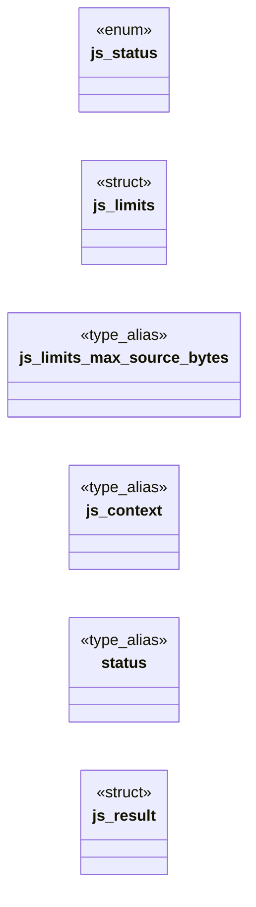

# `include/js_sandbox.h`

> Source: [include/js_sandbox.h:1](../../include/js_sandbox.h#L1) | language `h` | coverage 54.1% | [API index](../index.md)

## Contents

- **Structs:** [`js_limits`](#js_limits), [`js_result`](#js_result)
- **Enums:** [`js_status`](#js_status)
- **Type Aliases:** [`js_context`](#js_context), [`status`](#status)
- **Functions:** [`js_stack_limit_for`](#js_stack_limit_for), [`js_prime_stack_limit`](#js_prime_stack_limit), [`js_context_free`](#js_context_free), [`loaded`](#loaded), [`js_set_module_host`](#js_set_module_host), [`js_loc_from_stack`](#js_loc_from_stack), [`js_set_time_budget`](#js_set_time_budget), [`out`](#out), [`js_profile_enable`](#js_profile_enable), [`js_profile_report`](#js_profile_report), [`silently`](#silently), [`js_throws_report`](#js_throws_report), [`global`](#global), [`js_result_free`](#js_result_free), [`js_pump_jobs`](#js_pump_jobs), [`handle`](#handle), [`js_set_current_script`](#js_set_current_script)
- **Macros:** [`JS_LOC_FILE_MAX`](#js_loc_file_max), [`JS_DEFAULT_MAX_SOURCE`](#js_default_max_source), [`JS_DEFAULT_MEM_LIMIT`](#js_default_mem_limit), [`JS_MIN_STACK_LIMIT`](#js_min_stack_limit), [`JS_MAX_STACK_LIMIT`](#js_max_stack_limit), [`JS_DEFAULT_STACK_LIMIT`](#js_default_stack_limit), [`JS_DEFAULT_TIME_BUDGET`](#js_default_time_budget), [`JS_MODULE_MAX`](#js_module_max), [`JS_MODULE_BYTES_MAX`](#js_module_bytes_max), [`JS_PROFILE_PERIOD_MS`](#js_profile_period_ms), [`JS_THROW_SLOTS`](#js_throw_slots), [`JS_REALM_MAX`](#js_realm_max), [`JS_REJECT_MAX`](#js_reject_max)

## Type Diagram



## Structs

<a id="js_limits"></a>

### `js_limits`

`struct` | [include/js_sandbox.h:39](../../include/js_sandbox.h#L39)

```c
typedef struct js_limits
```

Per-evaluation resource limits.

A field set to 0 receives that field's default: "no limit" is deliberately not representable (secure by default).

**Members**

| Member | Kind | Summary |
|---|---|---|
| [`max_source_bytes`](#js_limits-max_source_bytes) | type_alias | Per-evaluation resource limits. |

<a id="js_limits-max_source_bytes"></a>

#### `js_limits.max_source_bytes`

`type_alias` | [include/js_sandbox.h:39](../../include/js_sandbox.h#L39)

```c
typedef struct js_limits { size_t max_source_bytes;
```

Per-evaluation resource limits.

A field set to 0 receives that field's default: "no limit" is deliberately not representable (secure by default).

---

<a id="js_result"></a>

### `js_result`

`struct` | [include/js_sandbox.h:49](../../include/js_sandbox.h#L49)

```c
typedef struct js_result
```

---

## Enums

<a id="js_status"></a>

### `js_status`

`enum` | [include/js_sandbox.h:24](../../include/js_sandbox.h#L24)

```c
typedef enum js_status
```

---

## Type Aliases

<a id="js_context"></a>

### `js_context`

`type_alias` | [include/js_sandbox.h:47](../../include/js_sandbox.h#L47)

```c
typedef struct js_context js_context;
```

Opaque isolated sandbox (owns one engine runtime + context).

---

<a id="status"></a>

### `status`

`type_alias` | [include/js_sandbox.h:48](../../include/js_sandbox.h#L48)

```c
typedef struct js_result { js_status status;
```

---

## Functions

<a id="js_stack_limit_for"></a>

### `js_stack_limit_for`

`function` | [include/js_sandbox.h:75](../../include/js_sandbox.h#L75)

```c
size_t js_stack_limit_for(size_t soft_stack);
```

Engine stack cap for a process whose soft stack limit is `soft_stack` bytes (0 = unknown): 75 % of it (the rest is for native frames), within [JS_MIN_STACK_LIMIT, JS_MAX_STACK_LIMIT].

Pure.

**Parameters**

| Name | Type | Default | Description |
|---|---|---|---|
| `soft_stack` | `size_t` |  |  |

**Returns:** `size_t`

---

<a id="js_prime_stack_limit"></a>

### `js_prime_stack_limit`

`function` | [include/js_sandbox.h:79](../../include/js_sandbox.h#L79)

```c
void js_prime_stack_limit(void);
```

Reads the process stack limit now.

A process that will confine itself with seccomp calls this first: getrlimit is not allowed afterwards, and js_limits_default() needs the value.

---

<a id="js_context_free"></a>

### `js_context_free`

`function` | [include/js_sandbox.h:96](../../include/js_sandbox.h#L96)

```c
void js_context_free(js_context *ctx);
```

Idempotent; safe on NULL and safe to call twice.

**Parameters**

| Name | Type | Default | Description |
|---|---|---|---|
| `ctx` | `js_context *` |  |  |

*Called by:* [`run_js`](src.tab.c.md#run_js)

---

<a id="loaded"></a>

### `loaded`

`function` | [include/js_sandbox.h:124](../../include/js_sandbox.h#L124)

```c
* NULL when it cannot be loaded (policy refusal, network error, not JavaScript). */ typedef char *(*js_module_fetch_fn)(void *host, const char *url, size_t *len);
```

**Parameters**

| Name | Type | Default | Description |
|---|---|---|---|
| `refusal` | `policy` |  |  |
| `error` | `network` |  |  |
| `JavaScript` | `not` |  |  |

**Returns:** `* NULL when it cannot be`

---

<a id="js_set_module_host"></a>

### `js_set_module_host`

`function` | [include/js_sandbox.h:129](../../include/js_sandbox.h#L129)

```c
void js_set_module_host(js_context *ctx, js_module_resolve_fn resolve, js_module_fetch_fn fetch, void *host);
```

Installs the host every static import and dynamic import() goes through. host must outlive ctx.

NULL functions uninstall it (every import then fails).

**Parameters**

| Name | Type | Default | Description |
|---|---|---|---|
| `ctx` | `js_context *` |  |  |
| `resolve` | `js_module_resolve_fn` |  |  |
| `fetch` | `js_module_fetch_fn` |  |  |
| `host` | `void *` |  |  |

---

<a id="js_loc_from_stack"></a>

### `js_loc_from_stack`

`function` | [include/js_sandbox.h:150](../../include/js_sandbox.h#L150)

```c
int js_loc_from_stack(const char *stack, char *file_out, size_t file_cap, int *line, int *col);
```

Pure parser: extracts the throw site (file, line, column) from the FIRST frame of a QuickJS .stack string.

Recognised frame forms: at <name> (<file>:<line>:<col>) at <file>:<line>:<col> Writes up to file_cap-1 bytes of <file> (NUL-terminated) into file_out and the numbers into *line / *col (*col is 0 when the frame carries only a line). Returns 1 when a line number was parsed, else 0 (file_out emptied, *line=*col=0). Tolerant of NULL/garbage input. No I/O, no allocation, reentrant.

**Parameters**

| Name | Type | Default | Description |
|---|---|---|---|
| `stack` | `char *` |  |  |
| `file_out` | `char *` |  |  |
| `file_cap` | `size_t` |  |  |
| `line` | `int *` |  |  |
| `col` | `int *` |  |  |

**Returns:** `int`

---

<a id="js_set_time_budget"></a>

### `js_set_time_budget`

`function` | [include/js_sandbox.h:158](../../include/js_sandbox.h#L158)

```c
void js_set_time_budget(js_context *ctx, uint64_t budget_ms);
```

Adjusts the wall-clock budget armed on each subsequent js_eval.

Used to enforce a single page-wide budget across a sequence of evaluations (e.g. a page's inline scripts run one by one): the caller lowers the budget to the time remaining before each call, so isolating scripts into separate evals does not multiply the cap. No-op on a NULL context. Does not affect an evaluation already in progress.

**Parameters**

| Name | Type | Default | Description |
|---|---|---|---|
| `ctx` | `js_context *` |  |  |
| `budget_ms` | `uint64_t` |  |  |

---

<a id="out"></a>

### `out`

`function` | [include/js_sandbox.h:163](../../include/js_sandbox.h#L163)

```c
* into out (NUL-terminated, truncated at cap);
```

**Parameters**

| Name | Type | Default | Description |
|---|---|---|---|
| `terminated` | `NUL-` |  |  |
| `cap` | `truncated at` |  |  |

**Returns:** `* into`

---

<a id="js_profile_enable"></a>

### `js_profile_enable`

`function` | [include/js_sandbox.h:166](../../include/js_sandbox.h#L166)

```c
void js_profile_enable(js_context *ctx);
```

Sampling profiler (FREEDOM_JS_PROFILE=2).

Once enabled, the interrupt handler samples the running JS stack at most once per JS_PROFILE_PERIOD_MS and counts the innermost two frames. js_profile_report writes "<percent>% <frame> <- <caller>" lines, hottest first, into out (NUL-terminated, truncated at cap); returns bytes written. Both are no-ops on a * NULL context; the table is fixed-size, so a hostile page cannot grow it. define JS_PROFILE_PERIOD_MS 1

**Parameters**

| Name | Type | Default | Description |
|---|---|---|---|
| `ctx` | `js_context *` |  |  |

---

<a id="js_profile_report"></a>

### `js_profile_report`

`function` | [include/js_sandbox.h:167](../../include/js_sandbox.h#L167)

```c
size_t js_profile_report(js_context *ctx, char *out, size_t cap, size_t top_n);
```

**Parameters**

| Name | Type | Default | Description |
|---|---|---|---|
| `ctx` | `js_context *` |  |  |
| `out` | `char *` |  |  |
| `cap` | `size_t` |  |  |
| `top_n` | `size_t` |  |  |

**Returns:** `size_t`

---

<a id="silently"></a>

### `silently`

`function` | [include/js_sandbox.h:171](../../include/js_sandbox.h#L171)

```c
* fails silently (an exception swallowed by a try/catch, a rejected promise nobody awaits) shows * its real first failure here. js_throws_report writes "<n>x <message> @ <frames>" lines, most * freque
```

**Parameters**

| Name | Type | Default | Description |
|---|---|---|---|
| `catch` | `an exception swallowed by a try/` |  |  |
| `awaits` | `a rejected promise nobody` |  |  |

**Returns:** `* fails`

---

<a id="js_throws_report"></a>

### `js_throws_report`

`function` | [include/js_sandbox.h:176](../../include/js_sandbox.h#L176)

```c
size_t js_throws_report(js_context *ctx, char *out, size_t cap, size_t top_n);
```

**Parameters**

| Name | Type | Default | Description |
|---|---|---|---|
| `ctx` | `js_context *` |  |  |
| `out` | `char *` |  |  |
| `cap` | `size_t` |  |  |
| `top_n` | `size_t` |  |  |

**Returns:** `size_t`

---

<a id="global"></a>

### `global`

`function` | [include/js_sandbox.h:181](../../include/js_sandbox.h#L181)

```c
* Freebug REPL installs: its shim takes them once and deletes them from the global (like * __netLog), because the report carries real timings a page must never read. */ void js_devtools_enable(js_cont
```

**Parameters**

| Name | Type | Default | Description |
|---|---|---|---|
| `__netLog` | `like *` |  |  |

**Returns:** `* Freebug REPL installs: its shim takes them once and deletes them from the`

---

<a id="js_result_free"></a>

### `js_result_free`

`function` | [include/js_sandbox.h:187](../../include/js_sandbox.h#L187)

```c
void js_result_free(js_result *res);
```

Idempotent; safe on a zero-initialised struct and safe to call twice.

**Parameters**

| Name | Type | Default | Description |
|---|---|---|---|
| `res` | `js_result *` |  |  |

---

<a id="js_pump_jobs"></a>

### `js_pump_jobs`

`function` | [include/js_sandbox.h:195](../../include/js_sandbox.h#L195)

```c
int js_pump_jobs(js_context *ctx, int max_jobs);
```

Runs up to max_jobs pending microtasks/jobs (promise reactions queued by the last eval), under the context's current time budget.

Job exceptions (rejected promises with no handler, etc.) are swallowed -- a job never aborts the caller. Returns the number of jobs run. Needed because js_eval does not drain the queue itself, so promise/.then/await continuations (e.g. from fetch) would otherwise never run. No-op (returns 0) on a NULL context.

**Parameters**

| Name | Type | Default | Description |
|---|---|---|---|
| `ctx` | `js_context *` |  |  |
| `max_jobs` | `int` |  |  |

**Returns:** `int`

---

<a id="handle"></a>

### `handle`

`function` | [include/js_sandbox.h:198](../../include/js_sandbox.h#L198)

```c
* as an opaque handle (so this header stays free of backend types), or NULL. * Valid only while ctx is alive. Binding modules are the intended consumers. */ void *js_context_raw(js_context *ctx);
```

**Parameters**

| Name | Type | Default | Description |
|---|---|---|---|
| `types` | `so this header stays free of backend` |  |  |

**Returns:** `* as an opaque`

---

<a id="js_set_current_script"></a>

### `js_set_current_script`

`function` | [include/js_sandbox.h:207](../../include/js_sandbox.h#L207)

```c
void js_set_current_script(js_context *ctx, const char *src, const char *type);
```

Sets document.currentScript on the global object so external scripts can read their own src / type / data-* attributes through getAttribute.

The script element is a fabricated plain object with {src, type, getAttribute} that answers these three keys. Pass src=NULL for an inline script (no src attribute). Call after the evaluation to restore currentScript to null.

**Parameters**

| Name | Type | Default | Description |
|---|---|---|---|
| `ctx` | `js_context *` |  |  |
| `src` | `char *` |  |  |
| `type` | `char *` |  |  |

---

## Macros

<a id="js_loc_file_max"></a>

### `JS_LOC_FILE_MAX`

`macro` | [include/js_sandbox.h:64](../../include/js_sandbox.h#L64)

```c
#define JS_LOC_FILE_MAX
```

Upper bound on a stack-parsed source name (file) length, NUL excluded.

---

<a id="js_default_max_source"></a>

### `JS_DEFAULT_MAX_SOURCE`

`macro` | [include/js_sandbox.h:66](../../include/js_sandbox.h#L66)

```c
#define JS_DEFAULT_MAX_SOURCE
```

---

<a id="js_default_mem_limit"></a>

### `JS_DEFAULT_MEM_LIMIT`

`macro` | [include/js_sandbox.h:67](../../include/js_sandbox.h#L67)

```c
#define JS_DEFAULT_MEM_LIMIT
```

---

<a id="js_min_stack_limit"></a>

### `JS_MIN_STACK_LIMIT`

`macro` | [include/js_sandbox.h:68](../../include/js_sandbox.h#L68)

```c
#define JS_MIN_STACK_LIMIT
```

---

<a id="js_max_stack_limit"></a>

### `JS_MAX_STACK_LIMIT`

`macro` | [include/js_sandbox.h:69](../../include/js_sandbox.h#L69)

```c
#define JS_MAX_STACK_LIMIT
```

---

<a id="js_default_stack_limit"></a>

### `JS_DEFAULT_STACK_LIMIT`

`macro` | [include/js_sandbox.h:70](../../include/js_sandbox.h#L70)

```c
#define JS_DEFAULT_STACK_LIMIT
```

---

<a id="js_default_time_budget"></a>

### `JS_DEFAULT_TIME_BUDGET`

`macro` | [include/js_sandbox.h:71](../../include/js_sandbox.h#L71)

```c
#define JS_DEFAULT_TIME_BUDGET
```

fallback when the process stack is unknown

---

<a id="js_module_max"></a>

### `JS_MODULE_MAX`

`macro` | [include/js_sandbox.h:115](../../include/js_sandbox.h#L115)

```c
#define JS_MODULE_MAX
```

---

<a id="js_module_bytes_max"></a>

### `JS_MODULE_BYTES_MAX`

`macro` | [include/js_sandbox.h:116](../../include/js_sandbox.h#L116)

```c
#define JS_MODULE_BYTES_MAX
```

modules per context

---

<a id="js_profile_period_ms"></a>

### `JS_PROFILE_PERIOD_MS`

`macro` | [include/js_sandbox.h:165](../../include/js_sandbox.h#L165)

```c
#define JS_PROFILE_PERIOD_MS
```

Sampling profiler (FREEDOM_JS_PROFILE=2).

Once enabled, the interrupt handler samples the running JS stack at most once per JS_PROFILE_PERIOD_MS and counts the innermost two frames. js_profile_report writes "<percent>% <frame> <- <caller>" lines, hottest first, into out (NUL-terminated, truncated at cap); returns bytes written. Both are no-ops on a NULL context; the table is fixed-size, so a hostile page cannot grow it.

---

<a id="js_throw_slots"></a>

### `JS_THROW_SLOTS`

`macro` | [include/js_sandbox.h:174](../../include/js_sandbox.h#L174)

```c
#define JS_THROW_SLOTS
```

Throw tracer: while enabled, EVERY thrown value -- caught or not -- is recorded as "<message> @ <innermost frames>" with a hit count (devtools "log on exception").

A page that fails silently (an exception swallowed by a try/catch, a rejected promise nobody awaits) shows its real first failure here. js_throws_report writes "<n>x <message> @ <frames>" lines, most frequent first. Fixed-size table (JS_THROW_SLOTS): a hostile page cannot grow it.

---

<a id="js_realm_max"></a>

### `JS_REALM_MAX`

`macro` | [include/js_sandbox.h:215](../../include/js_sandbox.h#L215)

```c
#define JS_REALM_MAX
```

--- realms (spec/js_sandbox.md 7c) ---
Extra global environments on this context's runtime (same heap cap, time budget and
interrupt handler): the substrate for dedicated Workers. Defines the natives
__realmNew / __realmEval / __realmClone on the global object, for a trusted shim
to capture and delete. Realms are freed with the context. ctx NULL =>
JS_ERR_NULL_ARG; OOM => JS_ERR_OOM.

---

<a id="js_reject_max"></a>

### `JS_REJECT_MAX`

`macro` | [include/js_sandbox.h:218](../../include/js_sandbox.h#L218)

```c
#define JS_REJECT_MAX
```

Unhandled promise rejections remembered per context between job checkpoints.

---
