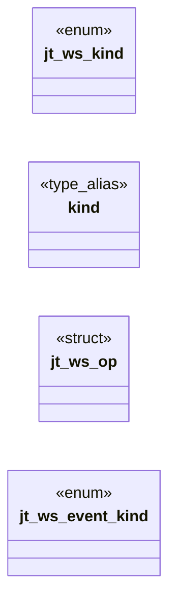

# `include/js_trusted.h`

> Source: [include/js_trusted.h:1](../../include/js_trusted.h#L1) | language `h` | coverage 37.5% | [API index](../index.md)

## Contents

- **Structs:** [`jt_ws_op`](#jt_ws_op)
- **Enums:** [`jt_ws_kind`](#jt_ws_kind), [`jt_ws_event_kind`](#jt_ws_event_kind)
- **Type Aliases:** [`kind`](#kind)
- **Functions:** [`null`](#null), [`jt_take_opens`](#jt_take_opens), [`parent`](#parent), [`jt_take_ws`](#jt_take_ws), [`jt_ws_ops_free`](#jt_ws_ops_free), [`jt_ws_event`](#jt_ws_event), [`jt_take_storage`](#jt_take_storage), [`realm`](#realm)
- **Macros:** [`JT_WS_MAX`](#jt_ws_max), [`JT_WS_MAX_OPS`](#jt_ws_max_ops), [`JT_WS_MAX_BYTES`](#jt_ws_max_bytes)

## Type Diagram



## Structs

<a id="jt_ws_op"></a>

### `jt_ws_op`

`struct` | [include/js_trusted.h:46](../../include/js_trusted.h#L46)

```c
typedef struct jt_ws_op
```

---

## Enums

<a id="jt_ws_kind"></a>

### `jt_ws_kind`

`enum` | [include/js_trusted.h:39](../../include/js_trusted.h#L39)

```c
typedef enum jt_ws_kind
```

---

<a id="jt_ws_event_kind"></a>

### `jt_ws_event_kind`

`enum` | [include/js_trusted.h:53](../../include/js_trusted.h#L53)

```c
typedef enum jt_ws_event_kind
```

---

## Type Aliases

<a id="kind"></a>

### `kind`

`type_alias` | [include/js_trusted.h:45](../../include/js_trusted.h#L45)

```c
typedef struct jt_ws_op { int kind;
```

---

## Functions

<a id="null"></a>

### `null`

`function` | [include/js_trusted.h:24](../../include/js_trusted.h#L24)

```c
* noopener semantics: it returns null (no cross-window reference, so no same-origin * channel) and only records up to 4 raw targets per operation for the parent, which * gates each like a navigation a
```

**Parameters**

| Name | Type | Default | Description |
|---|---|---|---|
| `reference` | `no cross-window` |  |  |
| `channel` | `so no same-origin *` |  |  |

**Returns:** `* noopener semantics: it returns`

---

<a id="jt_take_opens"></a>

### `jt_take_opens`

`function` | [include/js_trusted.h:31](../../include/js_trusted.h#L31)

```c
char *jt_take_opens(js_context *ctx);
```

Drains the recorded window.open targets as "url\n" lines, or NULL when none.

**Parameters**

| Name | Type | Default | Description |
|---|---|---|---|
| `ctx` | `js_context *` |  |  |

**Returns:** `char *`

*Called by:* [`LLVMFuzzerTestOneInput`](fuzz.fuzz_js_dom.c.md#llvmfuzzertestoneinput)

---

<a id="parent"></a>

### `parent`

`function` | [include/js_trusted.h:58](../../include/js_trusted.h#L58)

```c
* socket: the object records operations for the parent (jt_take_ws). */ jd_status jt_enable_ws(js_context *ctx);
```

**Returns:** `* socket: the object records operations for the`

---

<a id="jt_take_ws"></a>

### `jt_take_ws`

`function` | [include/js_trusted.h:64](../../include/js_trusted.h#L64)

```c
size_t jt_take_ws(js_context *ctx, jt_ws_op *ops, size_t cap);
```

Drains up to cap recorded operations into ops (each data owned; release with jt_ws_ops_free).

Returns the count. Operations past JT_WS_MAX_OPS/JT_WS_MAX_BYTES are dropped and their socket is errored+closed on the page side.

**Parameters**

| Name | Type | Default | Description |
|---|---|---|---|
| `ctx` | `js_context *` |  |  |
| `ops` | `jt_ws_op *` |  |  |
| `cap` | `size_t` |  |  |

**Returns:** `size_t`

*Called by:* [`LLVMFuzzerTestOneInput`](fuzz.fuzz_js_dom.c.md#llvmfuzzertestoneinput)

---

<a id="jt_ws_ops_free"></a>

### `jt_ws_ops_free`

`function` | [include/js_trusted.h:65](../../include/js_trusted.h#L65)

```c
void jt_ws_ops_free(jt_ws_op *ops, size_t n);
```

**Parameters**

| Name | Type | Default | Description |
|---|---|---|---|
| `ops` | `jt_ws_op *` |  |  |
| `n` | `size_t` |  |  |

*Called by:* [`LLVMFuzzerTestOneInput`](fuzz.fuzz_js_dom.c.md#llvmfuzzertestoneinput)

---

<a id="jt_ws_event"></a>

### `jt_ws_event`

`function` | [include/js_trusted.h:70](../../include/js_trusted.h#L70)

```c
int jt_ws_event(js_context *ctx, int id, int kind, int code, const char *data, size_t len);
```

Delivers a socket event from the parent: data enters JS as a VALUE (a string for text, an ArrayBuffer for binary, the reason for close), never as source.

Returns 1 when a live socket with that id received it.

**Parameters**

| Name | Type | Default | Description |
|---|---|---|---|
| `ctx` | `js_context *` |  |  |
| `id` | `int` |  |  |
| `kind` | `int` |  |  |
| `code` | `int` |  |  |
| `data` | `char *` |  |  |
| `len` | `size_t` |  |  |

**Returns:** `int`

*Called by:* [`LLVMFuzzerTestOneInput`](fuzz.fuzz_js_dom.c.md#llvmfuzzertestoneinput)

---

<a id="jt_take_storage"></a>

### `jt_take_storage`

`function` | [include/js_trusted.h:82](../../include/js_trusted.h#L82)

```c
int jt_take_storage(js_context *ctx, char **out, size_t *len);
```

When the store changed since the last call, returns 1 with an owned snapshot of the whole store in *out (length *len) and clears the dirty bit; 0 otherwise.

**Parameters**

| Name | Type | Default | Description |
|---|---|---|---|
| `ctx` | `js_context *` |  |  |
| `out` | `char **` |  |  |
| `len` | `size_t *` |  |  |

**Returns:** `int`

*Called by:* [`LLVMFuzzerTestOneInput`](fuzz.fuzz_js_dom.c.md#llvmfuzzertestoneinput)

---

<a id="realm"></a>

### `realm`

`function` | [include/js_trusted.h:85](../../include/js_trusted.h#L85)

```c
* runs in its own realm (js_install_realms) of this context's runtime, inside the * same confined process and budget. ctx NULL => JD_ERR_NULL_ARG. */ jd_status jt_enable_worker(js_context *ctx);
```

**Returns:** `* runs in its own`

---

## Macros

<a id="jt_ws_max"></a>

### `JT_WS_MAX`

`macro` | [include/js_trusted.h:35](../../include/js_trusted.h#L35)

```c
#define JT_WS_MAX
```

---

<a id="jt_ws_max_ops"></a>

### `JT_WS_MAX_OPS`

`macro` | [include/js_trusted.h:36](../../include/js_trusted.h#L36)

```c
#define JT_WS_MAX_OPS
```

sockets per page

---

<a id="jt_ws_max_bytes"></a>

### `JT_WS_MAX_BYTES`

`macro` | [include/js_trusted.h:37](../../include/js_trusted.h#L37)

```c
#define JT_WS_MAX_BYTES
```

ops per response

---
