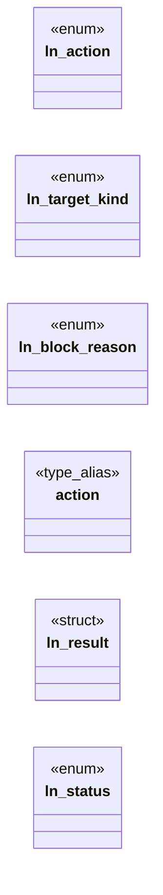
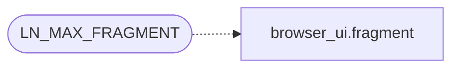

# `include/link_nav.h`

> Source: [include/link_nav.h:1](../../include/link_nav.h#L1) | language `h` | coverage 36.4% | [API index](../index.md)

## Contents

- **Structs:** [`ln_result`](#ln_result)
- **Enums:** [`ln_action`](#ln_action), [`ln_target_kind`](#ln_target_kind), [`ln_block_reason`](#ln_block_reason), [`ln_status`](#ln_status)
- **Type Aliases:** [`action`](#action)
- **Functions:** [`dropped`](#dropped), [`ln_block_reason_text`](#ln_block_reason_text)
- **Macros:** [`LN_MAX_TARGET`](#ln_max_target), [`LN_MAX_FRAGMENT`](#ln_max_fragment)

## Type Diagram



## Call Graph

Solid arrows stay in this module, dashed arrows leave it.



## Structs

<a id="ln_result"></a>

### `ln_result`

`struct` | [include/link_nav.h:62](../../include/link_nav.h#L62)

```c
typedef struct ln_result
```

---

## Enums

<a id="ln_action"></a>

### `ln_action`

`enum` | [include/link_nav.h:40](../../include/link_nav.h#L40)

```c
typedef enum ln_action
```

---

<a id="ln_target_kind"></a>

### `ln_target_kind`

`enum` | [include/link_nav.h:46](../../include/link_nav.h#L46)

```c
typedef enum ln_target_kind
```

---

<a id="ln_block_reason"></a>

### `ln_block_reason`

`enum` | [include/link_nav.h:54](../../include/link_nav.h#L54)

```c
typedef enum ln_block_reason
```

Why a reference was blocked, for a precise user-facing notice and for agent-friendly structured output.

LN_BLOCK_NONE unless action == LN_BLOCKED.

---

<a id="ln_status"></a>

### `ln_status`

`enum` | [include/link_nav.h:70](../../include/link_nav.h#L70)

```c
typedef enum ln_status
```

---

## Type Aliases

<a id="action"></a>

### `action`

`type_alias` | [include/link_nav.h:61](../../include/link_nav.h#L61)

```c
typedef struct ln_result { ln_action action;
```

---

## Functions

<a id="dropped"></a>

### `dropped`

`function` | [include/link_nav.h:36](../../include/link_nav.h#L36)

```c
* A longer fragment is dropped (stored as "");
```

**Parameters**

| Name | Type | Default | Description |
|---|---|---|---|
| `as` | `stored ""` |  |  |

**Returns:** `* A longer fragment is`

---

<a id="ln_block_reason_text"></a>

### `ln_block_reason_text`

`function` `const` | [include/link_nav.h:85](../../include/link_nav.h#L85)

```c
const char *ln_block_reason_text(ln_block_reason reason);
```

Stable, short English notice for a block reason (e.g. for a UI toast or agent output).

Never NULL; an unknown value yields "blocked".

**Parameters**

| Name | Type | Default | Description |
|---|---|---|---|
| `reason` | `ln_block_reason` |  |  |

**Returns:** `char *`

---

## Macros

<a id="ln_max_target"></a>

### `LN_MAX_TARGET`

`macro` | [include/link_nav.h:33](../../include/link_nav.h#L33)

```c
#define LN_MAX_TARGET
```

Fits an https URL (<= URL_MAX_LEN, now 8 KiB) or a local filesystem path (PATH_MAX).

Kept a slab above URL_MAX_LEN so a resolved absolute URL never clips at the ceiling.

---

<a id="ln_max_fragment"></a>

### `LN_MAX_FRAGMENT`

`macro` | [include/link_nav.h:38](../../include/link_nav.h#L38)

```c
#define LN_MAX_FRAGMENT
```

Fits a fragment identifier captured from a clicked href (the part after '#').

A longer fragment is dropped (stored as ""); it only feeds a future anchor scroll, never navigation, so losing it is non-fatal.

*Calls:* [`fragment`](gui.browser_ui.c.md#fragment)

---
