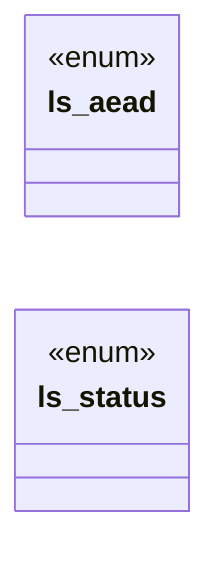

# `include/local_store.h`

> Source: [include/local_store.h:1](../../include/local_store.h#L1) | language `h` | coverage 18.2% | [API index](../index.md)

## Contents

- **Enums:** [`ls_aead`](#ls_aead), [`ls_status`](#ls_status)
- **Functions:** [`ls_free`](#ls_free)
- **Macros:** [`LS_KEY_LEN`](#ls_key_len), [`LS_SALT_LEN`](#ls_salt_len), [`LS_NONCE_LEN`](#ls_nonce_len), [`LS_TAG_LEN`](#ls_tag_len), [`LS_HEADER_LEN`](#ls_header_len), [`LS_OVERHEAD`](#ls_overhead), [`LS_MAX_PLAINTEXT`](#ls_max_plaintext)

## Type Diagram



## Enums

<a id="ls_aead"></a>

### `ls_aead`

`enum` | [include/local_store.h:34](../../include/local_store.h#L34)

```c
typedef enum ls_aead
```

---

<a id="ls_status"></a>

### `ls_status`

`enum` | [include/local_store.h:39](../../include/local_store.h#L39)

```c
typedef enum ls_status
```

---

## Functions

<a id="ls_free"></a>

### `ls_free`

`function` | [include/local_store.h:80](../../include/local_store.h#L80)

```c
void ls_free(uint8_t *buf, size_t len);
```

Secure free: OPENSSL_cleanse(buf, len) then free.

Safe on NULL.

**Parameters**

| Name | Type | Default | Description |
|---|---|---|---|
| `buf` | `uint8_t *` |  |  |
| `len` | `size_t` |  |  |

*Called by:* [`ds_free`](src.disk_store.c.md#ds_free), [`ds_read`](src.disk_store.c.md#ds_read), [`ds_write`](src.disk_store.c.md#ds_write)

---

## Macros

<a id="ls_key_len"></a>

### `LS_KEY_LEN`

`macro` | [include/local_store.h:26](../../include/local_store.h#L26)

```c
#define LS_KEY_LEN
```

---

<a id="ls_salt_len"></a>

### `LS_SALT_LEN`

`macro` | [include/local_store.h:27](../../include/local_store.h#L27)

```c
#define LS_SALT_LEN
```

---

<a id="ls_nonce_len"></a>

### `LS_NONCE_LEN`

`macro` | [include/local_store.h:28](../../include/local_store.h#L28)

```c
#define LS_NONCE_LEN
```

---

<a id="ls_tag_len"></a>

### `LS_TAG_LEN`

`macro` | [include/local_store.h:29](../../include/local_store.h#L29)

```c
#define LS_TAG_LEN
```

---

<a id="ls_header_len"></a>

### `LS_HEADER_LEN`

`macro` | [include/local_store.h:30](../../include/local_store.h#L30)

```c
#define LS_HEADER_LEN
```

---

<a id="ls_overhead"></a>

### `LS_OVERHEAD`

`macro` | [include/local_store.h:31](../../include/local_store.h#L31)

```c
#define LS_OVERHEAD
```

---

<a id="ls_max_plaintext"></a>

### `LS_MAX_PLAINTEXT`

`macro` | [include/local_store.h:32](../../include/local_store.h#L32)

```c
#define LS_MAX_PLAINTEXT
```

LS_HEADER_LEN + LS_TAG_LEN

---
