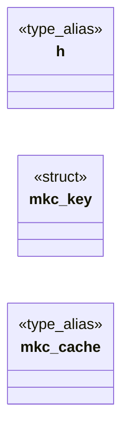

# `include/mask_cache.h`

> Source: [include/mask_cache.h:1](../../include/mask_cache.h#L1) | language `h` | coverage 81.8% | [API index](../index.md)

mask_cache (mkc_) -- 8-bit alpha masks retained across frames (spec/mask_cache.md).

## Contents

- **Structs:** [`mkc_key`](#mkc_key)
- **Type Aliases:** [`h`](#h), [`mkc_cache`](#mkc_cache)
- **Functions:** [`mkc_new`](#mkc_new), [`mkc_free`](#mkc_free), [`mkc_clear`](#mkc_clear), [`mkc_get`](#mkc_get), [`mkc_put`](#mkc_put), [`mkc_bytes`](#mkc_bytes), [`mkc_count`](#mkc_count)

## Type Diagram



## Structs

<a id="mkc_key"></a>

### `mkc_key`

`struct` | [include/mask_cache.h:17](../../include/mask_cache.h#L17)

```c
typedef struct mkc_key
```

Every input the cached mask is a function of.

Compared field by field (exact: no hash; a NaN never equals, so it never hits).

---

## Type Aliases

<a id="h"></a>

### `h`

`type_alias` | [include/mask_cache.h:17](../../include/mask_cache.h#L17)

```c
typedef struct mkc_key { int w, h;
```

Every input the cached mask is a function of.

Compared field by field (exact: no hash; a NaN never equals, so it never hits).

---

<a id="mkc_cache"></a>

### `mkc_cache`

`type_alias` | [include/mask_cache.h:24](../../include/mask_cache.h#L24)

```c
typedef struct mkc_cache mkc_cache;
```

---

## Functions

<a id="mkc_new"></a>

### `mkc_new`

`function` | [include/mask_cache.h:29](../../include/mask_cache.h#L29)

```c
mkc_cache *mkc_new(size_t byte_budget, size_t max_entries);
```

A cache holding at most byte_budget bytes of mask buffers in at most max_entries masks.

NULL when either bound is 0 or on allocation failure.

**Parameters**

| Name | Type | Default | Description |
|---|---|---|---|
| `byte_budget` | `size_t` |  |  |
| `max_entries` | `size_t` |  |  |

**Returns:** `mkc_cache *`

---

<a id="mkc_free"></a>

### `mkc_free`

`function` | [include/mask_cache.h:32](../../include/mask_cache.h#L32)

```c
void mkc_free(mkc_cache *c);
```

Releases the cache and every buffer.

NULL-safe.

**Parameters**

| Name | Type | Default | Description |
|---|---|---|---|
| `c` | `mkc_cache *` |  |  |

---

<a id="mkc_clear"></a>

### `mkc_clear`

`function` | [include/mask_cache.h:35](../../include/mask_cache.h#L35)

```c
void mkc_clear(mkc_cache *c);
```

Drops every retained mask (document change).

NULL-safe, idempotent.

**Parameters**

| Name | Type | Default | Description |
|---|---|---|---|
| `c` | `mkc_cache *` |  |  |

---

<a id="mkc_get"></a>

### `mkc_get`

`function` `const` | [include/mask_cache.h:39](../../include/mask_cache.h#L39)

```c
const unsigned char *mkc_get(mkc_cache *c, const mkc_key *k, int *stride);
```

The buffer retained for k (stride bytes per row) and makes it the most recent, or NULL.

Valid until the next mkc_put / mkc_clear / mkc_free.

**Parameters**

| Name | Type | Default | Description |
|---|---|---|---|
| `c` | `mkc_cache *` |  |  |
| `k` | `mkc_key *` |  |  |
| `stride` | `int *` |  |  |

**Returns:** `unsigned char *`

---

<a id="mkc_put"></a>

### `mkc_put`

`function` | [include/mask_cache.h:45](../../include/mask_cache.h#L45)

```c
unsigned char *mkc_put(mkc_cache *c, const mkc_key *k, int stride);
```

Reserves a zeroed buffer of stride * k->h bytes owned by the cache for k (replacing any entry for k), evicting least-recently-used masks until it fits, and returns it for the caller to fill.

NULL, cache untouched, when an argument is invalid (stride < w, a size <= 0, an overflowing or over-budget size) or the allocation fails.

**Parameters**

| Name | Type | Default | Description |
|---|---|---|---|
| `c` | `mkc_cache *` |  |  |
| `k` | `mkc_key *` |  |  |
| `stride` | `int` |  |  |

**Returns:** `unsigned char *`

---

<a id="mkc_bytes"></a>

### `mkc_bytes`

`function` | [include/mask_cache.h:48](../../include/mask_cache.h#L48)

```c
size_t mkc_bytes(const mkc_cache *c);
```

Bytes currently retained / number of masks retained (0 for NULL).

**Parameters**

| Name | Type | Default | Description |
|---|---|---|---|
| `c` | `mkc_cache *` |  |  |

**Returns:** `size_t`

---

<a id="mkc_count"></a>

### `mkc_count`

`function` | [include/mask_cache.h:49](../../include/mask_cache.h#L49)

```c
size_t mkc_count(const mkc_cache *c);
```

**Parameters**

| Name | Type | Default | Description |
|---|---|---|---|
| `c` | `mkc_cache *` |  |  |

**Returns:** `size_t`

---
