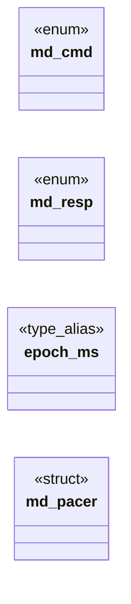

# `include/media_decoder.h`

> Source: [include/media_decoder.h:1](../../include/media_decoder.h#L1) | language `h` | coverage 75.0% | [API index](../index.md)

## Contents

- **Structs:** [`md_pacer`](#md_pacer)
- **Enums:** [`md_cmd`](#md_cmd), [`md_resp`](#md_resp)
- **Type Aliases:** [`epoch_ms`](#epoch_ms)
- **Functions:** [`md_pace_due_ms`](#md_pace_due_ms), [`media_decoder_run`](#media_decoder_run), [`media_decoder_spawn`](#media_decoder_spawn)
- **Macros:** [`MD_MAX_SEGMENT_BYTES`](#md_max_segment_bytes), [`MD_PACE_MAX_LAG_MS`](#md_pace_max_lag_ms), [`MD_PACE_MAX_STEP_MS`](#md_pace_max_step_ms), [`MD_MAX_CATCHUP_READS`](#md_max_catchup_reads)

## Type Diagram



## Structs

<a id="md_pacer"></a>

### `md_pacer`

`struct` | [include/media_decoder.h:67](../../include/media_decoder.h#L67)

```c
typedef struct md_pacer
```

---

## Enums

<a id="md_cmd"></a>

### `md_cmd`

`enum` | [include/media_decoder.h:29](../../include/media_decoder.h#L29)

```c
enum md_cmd
```

Remote command tags (parent → decoder).

---

<a id="md_resp"></a>

### `md_resp`

`enum` | [include/media_decoder.h:38](../../include/media_decoder.h#L38)

```c
enum md_resp
```

Response tags (decoder → parent).

Protocol v2: all PTS travel in MICROSECONDS (int64), computed with the time base of the segment being decoded. v1 sent whole seconds, useless for pacing.

---

## Type Aliases

<a id="epoch_ms"></a>

### `epoch_ms`

`type_alias` | [include/media_decoder.h:66](../../include/media_decoder.h#L66)

```c
typedef struct md_pacer { uint64_t epoch_ms;
```

A forward PTS jump larger than this is treated as a discontinuity and * re-anchors (a hostile PTS must never schedule a year-long sleep). #define MD_PACE_MAX_STEP_MS 5000u /* Frames drained per event-loop iteration when running behind. define MD_MAX_CATCHUP_READS 4

---

## Functions

<a id="md_pace_due_ms"></a>

### `md_pace_due_ms`

`function` `inline` `static` | [include/media_decoder.h:79](../../include/media_decoder.h#L79)

```c
static inline uint64_t md_pace_due_ms(md_pacer *p, uint64_t now_ms, int64_t pts_us)
```

Returns the wall-clock instant (ms) at which the frame carrying pts_us is due for display.

First frame (or any discontinuity: backwards PTS, absurd forward jump, or the consumer lagging past MD_PACE_MAX_LAG_MS) re-anchors the epoch to now_ms and is due immediately. NULL pacer fails open to "now". Hostile PTS values never cause UB: the delta is computed in unsigned arithmetic after the backwards-PTS branch has excluded wraparound.

**Parameters**

| Name | Type | Default | Description |
|---|---|---|---|
| `p` | `md_pacer *` |  |  |
| `now_ms` | `uint64_t` |  |  |
| `pts_us` | `int64_t` |  |  |

**Returns:** `uint64_t`

---

<a id="media_decoder_run"></a>

### `media_decoder_run`

`function` | [include/media_decoder.h:99](../../include/media_decoder.h#L99)

```c
void media_decoder_run(int out_fd, int cmd_fd);
```

Entry point for the decoder child process.

Called from main() when argv matches "--media-decoder <out_fd> <cmd_fd>". Reads commands from cmd_fd, writes responses to out_fd, never returns (_exit).

**Parameters**

| Name | Type | Default | Description |
|---|---|---|---|
| `out_fd` | `int` |  |  |
| `cmd_fd` | `int` |  |  |

*Called by:* [`main`](src.freedom.c.md#main)

---

<a id="media_decoder_spawn"></a>

### `media_decoder_spawn`

`function` | [include/media_decoder.h:104](../../include/media_decoder.h#L104)

```c
int media_decoder_spawn(pid_t *pid, int *out_fd, int *cmd_fd);
```

Spawns a media decoder child via fork+exec.

On success stores child pid in *pid, the read-end of the child's output pipe in *out_fd, and the write-end of the command pipe in *cmd_fd; returns 0. On failure returns -1.

**Parameters**

| Name | Type | Default | Description |
|---|---|---|---|
| `pid` | `pid_t *` |  |  |
| `out_fd` | `int *` |  |  |
| `cmd_fd` | `int *` |  |  |

**Returns:** `int`

---

## Macros

<a id="md_max_segment_bytes"></a>

### `MD_MAX_SEGMENT_BYTES`

`macro` | [include/media_decoder.h:46](../../include/media_decoder.h#L46)

```c
#define MD_MAX_SEGMENT_BYTES
```

---

<a id="md_pace_max_lag_ms"></a>

### `MD_PACE_MAX_LAG_MS`

`macro` | [include/media_decoder.h:58](../../include/media_decoder.h#L58)

```c
#define MD_PACE_MAX_LAG_MS
```

Consumer more than this far behind schedule re-anchors to "now" instead of replaying the backlog at fast-forward speed.

---

<a id="md_pace_max_step_ms"></a>

### `MD_PACE_MAX_STEP_MS`

`macro` | [include/media_decoder.h:62](../../include/media_decoder.h#L62)

```c
#define MD_PACE_MAX_STEP_MS
```

A forward PTS jump larger than this is treated as a discontinuity and re-anchors (a hostile PTS must never schedule a year-long sleep).

---

<a id="md_max_catchup_reads"></a>

### `MD_MAX_CATCHUP_READS`

`macro` | [include/media_decoder.h:65](../../include/media_decoder.h#L65)

```c
#define MD_MAX_CATCHUP_READS
```

Frames drained per event-loop iteration when running behind.

---
