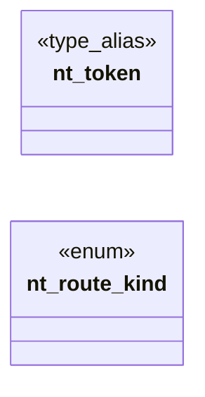

# `include/nav_token.h`

> Source: [include/nav_token.h:1](../../include/nav_token.h#L1) | language `h` | coverage 9.1% | [API index](../index.md)

## Contents

- **Enums:** [`nt_route_kind`](#nt_route_kind)
- **Type Aliases:** [`nt_token`](#nt_token)
- **Functions:** [`nt_new`](#nt_new), [`nt_ref`](#nt_ref), [`nt_unref`](#nt_unref), [`nt_cancel`](#nt_cancel), [`nt_cancelled`](#nt_cancelled), [`nt_set_foreground`](#nt_set_foreground), [`nt_foreground`](#nt_foreground), [`nt_id`](#nt_id)

## Type Diagram



## Enums

<a id="nt_route_kind"></a>

### `nt_route_kind`

`enum` | [include/nav_token.h:18](../../include/nav_token.h#L18)

```c
typedef enum nt_route_kind { NT_DROP = 0, NT_DELIVER, NT_PARK } nt_route_kind;
```

---

## Type Aliases

<a id="nt_token"></a>

### `nt_token`

`type_alias` | [include/nav_token.h:15](../../include/nav_token.h#L15)

```c
typedef struct nt_token nt_token;
```

include <stdint.h>

---

## Functions

<a id="nt_new"></a>

### `nt_new`

`function` | [include/nav_token.h:20](../../include/nav_token.h#L20)

```c
nt_token *nt_new(void);
```

**Returns:** `nt_token *`

*Called by:* [`LLVMFuzzerTestOneInput`](fuzz.fuzz_nav_token.c.md#llvmfuzzertestoneinput)

---

<a id="nt_ref"></a>

### `nt_ref`

`function` | [include/nav_token.h:21](../../include/nav_token.h#L21)

```c
nt_token *nt_ref(nt_token *t);
```

**Parameters**

| Name | Type | Default | Description |
|---|---|---|---|
| `t` | `nt_token *` |  |  |

**Returns:** `nt_token *`

*Called by:* [`LLVMFuzzerTestOneInput`](fuzz.fuzz_nav_token.c.md#llvmfuzzertestoneinput)

---

<a id="nt_unref"></a>

### `nt_unref`

`function` | [include/nav_token.h:22](../../include/nav_token.h#L22)

```c
void nt_unref(nt_token **t);
```

**Parameters**

| Name | Type | Default | Description |
|---|---|---|---|
| `t` | `nt_token **` |  |  |

*Called by:* [`LLVMFuzzerTestOneInput`](fuzz.fuzz_nav_token.c.md#llvmfuzzertestoneinput)

---

<a id="nt_cancel"></a>

### `nt_cancel`

`function` | [include/nav_token.h:23](../../include/nav_token.h#L23)

```c
void nt_cancel(nt_token *t);
```

**Parameters**

| Name | Type | Default | Description |
|---|---|---|---|
| `t` | `nt_token *` |  |  |

*Called by:* [`LLVMFuzzerTestOneInput`](fuzz.fuzz_nav_token.c.md#llvmfuzzertestoneinput)

---

<a id="nt_cancelled"></a>

### `nt_cancelled`

`function` | [include/nav_token.h:24](../../include/nav_token.h#L24)

```c
int nt_cancelled(const nt_token *t);
```

**Parameters**

| Name | Type | Default | Description |
|---|---|---|---|
| `t` | `nt_token *` |  |  |

**Returns:** `int`

*Called by:* [`LLVMFuzzerTestOneInput`](fuzz.fuzz_nav_token.c.md#llvmfuzzertestoneinput)

---

<a id="nt_set_foreground"></a>

### `nt_set_foreground`

`function` | [include/nav_token.h:25](../../include/nav_token.h#L25)

```c
void nt_set_foreground(nt_token *t, int on);
```

**Parameters**

| Name | Type | Default | Description |
|---|---|---|---|
| `t` | `nt_token *` |  |  |
| `on` | `int` |  |  |

*Called by:* [`LLVMFuzzerTestOneInput`](fuzz.fuzz_nav_token.c.md#llvmfuzzertestoneinput)

---

<a id="nt_foreground"></a>

### `nt_foreground`

`function` | [include/nav_token.h:26](../../include/nav_token.h#L26)

```c
int nt_foreground(const nt_token *t);
```

**Parameters**

| Name | Type | Default | Description |
|---|---|---|---|
| `t` | `nt_token *` |  |  |

**Returns:** `int`

*Called by:* [`LLVMFuzzerTestOneInput`](fuzz.fuzz_nav_token.c.md#llvmfuzzertestoneinput)

---

<a id="nt_id"></a>

### `nt_id`

`function` | [include/nav_token.h:27](../../include/nav_token.h#L27)

```c
uint64_t nt_id(const nt_token *t);
```

**Parameters**

| Name | Type | Default | Description |
|---|---|---|---|
| `t` | `nt_token *` |  |  |

**Returns:** `uint64_t`

---
