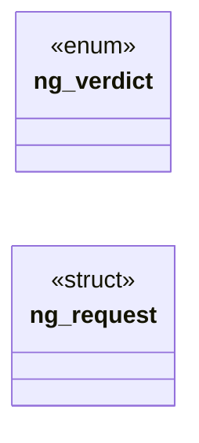

# `include/net_guard.h`

> Source: [include/net_guard.h:1](../../include/net_guard.h#L1) | language `h` | coverage 55.6% | [API index](../index.md)

## Contents

- **Structs:** [`ng_request`](#ng_request)
- **Enums:** [`ng_verdict`](#ng_verdict)
- **Functions:** [`ng_addr_is_private`](#ng_addr_is_private), [`ng_text_is_private`](#ng_text_is_private), [`ng_host_is_ip`](#ng_host_is_ip), [`ng_host_is_local`](#ng_host_is_local)
- **Macros:** [`NG_FAMILY_V4`](#ng_family_v4), [`NG_FAMILY_V6`](#ng_family_v6)

## Type Diagram



## Structs

<a id="ng_request"></a>

### `ng_request`

`struct` | [include/net_guard.h:26](../../include/net_guard.h#L26)

```c
typedef struct ng_request
```

Who is asking for a connection.

---

## Enums

<a id="ng_verdict"></a>

### `ng_verdict`

`enum` | [include/net_guard.h:20](../../include/net_guard.h#L20)

```c
typedef enum ng_verdict { NG_ALLOW = 0, NG_DENY = 1 } ng_verdict;
```

---

## Functions

<a id="ng_addr_is_private"></a>

### `ng_addr_is_private`

`function` | [include/net_guard.h:38](../../include/net_guard.h#L38)

```c
int ng_addr_is_private(int family, const unsigned char *addr, size_t len);
```

1 when the address is not globally routable (loopback, RFC 1918, link-local, CGNAT, documentation, multicast, reserved, IPv6 unique-local, and every IPv4-in-IPv6 embedding of those). family is NG_FAMILY_V4 (len 4) or NG_FAMILY_V6 (len 16), bytes in network order.

Anything else answers 1 (fail closed).

**Parameters**

| Name | Type | Default | Description |
|---|---|---|---|
| `family` | `int` |  |  |
| `addr` | `unsigned char *` |  |  |
| `len` | `size_t` |  |  |

**Returns:** `int`

---

<a id="ng_text_is_private"></a>

### `ng_text_is_private`

`function` | [include/net_guard.h:42](../../include/net_guard.h#L42)

```c
int ng_text_is_private(const char *ip_text);
```

As ng_addr_is_private over a textual IPv4/IPv6 address (optionally bracketed).

Text that is not exactly one address answers 1 (fail closed).

**Parameters**

| Name | Type | Default | Description |
|---|---|---|---|
| `ip_text` | `char *` |  |  |

**Returns:** `int`

---

<a id="ng_host_is_ip"></a>

### `ng_host_is_ip`

`function` | [include/net_guard.h:46](../../include/net_guard.h#L46)

```c
int ng_host_is_ip(const char *host);
```

1 when host is an IPv4/IPv6 literal (optionally bracketed), 0 for a name or NULL.

A registrable-domain comparison is meaningless for literals: compare them whole.

**Parameters**

| Name | Type | Default | Description |
|---|---|---|---|
| `host` | `char *` |  |  |

**Returns:** `int`

---

<a id="ng_host_is_local"></a>

### `ng_host_is_local`

`function` | [include/net_guard.h:50](../../include/net_guard.h#L50)

```c
int ng_host_is_local(const char *host);
```

1 when host names this machine or a private address without resolving anything: "localhost", any "*.localhost", or a private IP literal.

NULL/"" answers 0.

**Parameters**

| Name | Type | Default | Description |
|---|---|---|---|
| `host` | `char *` |  |  |

**Returns:** `int`

---

## Macros

<a id="ng_family_v4"></a>

### `NG_FAMILY_V4`

`macro` | [include/net_guard.h:22](../../include/net_guard.h#L22)

```c
#define NG_FAMILY_V4
```

---

<a id="ng_family_v6"></a>

### `NG_FAMILY_V6`

`macro` | [include/net_guard.h:23](../../include/net_guard.h#L23)

```c
#define NG_FAMILY_V6
```

---
