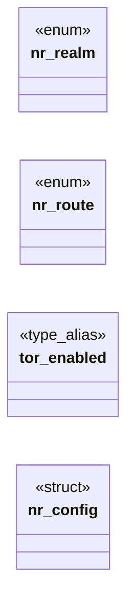

# `include/net_realm.h`

> Source: [include/net_realm.h:1](../../include/net_realm.h#L1) | language `h` | coverage 20.0% | [API index](../index.md)

## Contents

- **Structs:** [`nr_config`](#nr_config)
- **Enums:** [`nr_realm`](#nr_realm), [`nr_route`](#nr_route)
- **Type Aliases:** [`tor_enabled`](#tor_enabled)
- **Functions:** [`NR_ROUTE_BLOCKED`](#nr_route_blocked), [`address`](#address), [`nr_realm_allows_http`](#nr_realm_allows_http), [`nr_realm_name`](#nr_realm_name), [`nr_route_name`](#nr_route_name)

## Type Diagram



## Structs

<a id="nr_config"></a>

### `nr_config`

`struct` | [include/net_realm.h:42](../../include/net_realm.h#L42)

```c
typedef struct nr_config
```

---

## Enums

<a id="nr_realm"></a>

### `nr_realm`

`enum` | [include/net_realm.h:29](../../include/net_realm.h#L29)

```c
typedef enum nr_realm
```

---

<a id="nr_route"></a>

### `nr_route`

`enum` | [include/net_realm.h:35](../../include/net_realm.h#L35)

```c
typedef enum nr_route
```

---

## Type Aliases

<a id="tor_enabled"></a>

### `tor_enabled`

`type_alias` | [include/net_realm.h:41](../../include/net_realm.h#L41)

```c
typedef struct nr_config { int tor_enabled;
```

---

## Functions

<a id="nr_route_blocked"></a>

### `NR_ROUTE_BLOCKED`

`function` | [include/net_realm.h:57](../../include/net_realm.h#L57)

```c
* NR_ROUTE_BLOCKED (fail closed: never route what cannot be classified). A realm * whose proxy is not enabled => NR_ROUTE_BLOCKED. */ nr_route nr_route_for(const char *url, nr_config cfg);
```

**Parameters**

| Name | Type | Default | Description |
|---|---|---|---|
| `classified` | `fail closed: never route what cannot be` |  |  |

**Returns:** `*`

---

<a id="address"></a>

### `address`

`function` | [include/net_realm.h:62](../../include/net_realm.h#L62)

```c
* and encrypts by its address (the I2P destination / onion key), so http over it is * not a downgrade. Currently: NR_I2P => 1 (eepsites are http);
```

**Parameters**

| Name | Type | Default | Description |
|---|---|---|---|
| `key` | `the I2P destination / onion` |  |  |

**Returns:** `* and encrypts by its`

---

<a id="nr_realm_allows_http"></a>

### `nr_realm_allows_http`

`function` | [include/net_realm.h:66](../../include/net_realm.h#L66)

```c
int nr_realm_allows_http(nr_realm r);
```

1 iff plain http:// is acceptable for this realm.

An overlay realm authenticates and encrypts by its address (the I2P destination / onion key), so http over it is not a downgrade. Currently: NR_I2P => 1 (eepsites are http); NR_ONION => 0 (owner keeps .onion https-only); NR_CLEARNET => 0 (clearnet is always https). The caller must still route the request through the overlay proxy.

**Parameters**

| Name | Type | Default | Description |
|---|---|---|---|
| `r` | `nr_realm` |  |  |

**Returns:** `int`

*Called by:* [`HL_JS_NAV_MAX`](src.freedom.c.md#hl_js_nav_max)

---

<a id="nr_realm_name"></a>

### `nr_realm_name`

`function` `const` | [include/net_realm.h:69](../../include/net_realm.h#L69)

```c
const char *nr_realm_name(nr_realm r);
```

Stable short English names for structured/agent output and toasts.

Never NULL.

**Parameters**

| Name | Type | Default | Description |
|---|---|---|---|
| `r` | `nr_realm` |  |  |

**Returns:** `char *`

*Called by:* [`proceed`](gui.browser_ui.c.md#proceed), [`HL_JS_NAV_MAX`](src.freedom.c.md#hl_js_nav_max)

---

<a id="nr_route_name"></a>

### `nr_route_name`

`function` `const` | [include/net_realm.h:70](../../include/net_realm.h#L70)

```c
const char *nr_route_name(nr_route r);
```

**Parameters**

| Name | Type | Default | Description |
|---|---|---|---|
| `r` | `nr_route` |  |  |

**Returns:** `char *`

---
