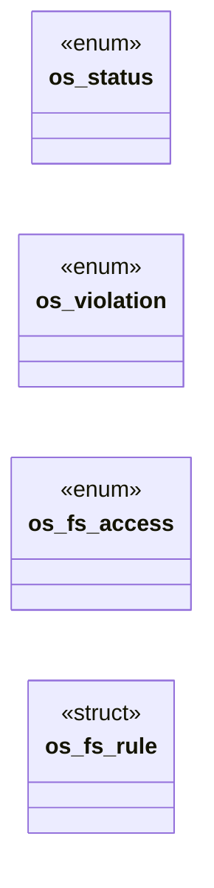

# `include/os_sandbox.h`

> Source: [include/os_sandbox.h:1](../../include/os_sandbox.h#L1) | language `h` | coverage 50.0% | [API index](../index.md)

## Contents

- **Structs:** [`os_fs_rule`](#os_fs_rule)
- **Enums:** [`os_status`](#os_status), [`os_violation`](#os_violation), [`os_fs_access`](#os_fs_access)
- **Functions:** [`flags`](#flags), [`os_policy_size`](#os_policy_size), [`os_prot_allowed`](#os_prot_allowed), [`denied`](#denied), [`namespace`](#namespace), [`os_namespace_flags`](#os_namespace_flags), [`os_landlock_abi`](#os_landlock_abi)

## Type Diagram



## Structs

<a id="os_fs_rule"></a>

### `os_fs_rule`

`struct` | [include/os_sandbox.h:108](../../include/os_sandbox.h#L108)

```c
typedef struct os_fs_rule
```

---

## Enums

<a id="os_status"></a>

### `os_status`

`enum` | [include/os_sandbox.h:21](../../include/os_sandbox.h#L21)

```c
typedef enum os_status
```

---

<a id="os_violation"></a>

### `os_violation`

`enum` | [include/os_sandbox.h:30](../../include/os_sandbox.h#L30)

```c
typedef enum os_violation
```

Action taken when a denied syscall is attempted.

---

<a id="os_fs_access"></a>

### `os_fs_access`

`enum` | [include/os_sandbox.h:102](../../include/os_sandbox.h#L102)

```c
typedef enum os_fs_access
```

What a Landlock rule permits at/below a path.

---

## Functions

<a id="flags"></a>

### `flags`

`function` | [include/os_sandbox.h:39](../../include/os_sandbox.h#L39)

```c
* permission also depends on the protection flags (see os_prot_allowed / W^X). */ int os_policy_allows(long syscall_nr);
```

**Parameters**

| Name | Type | Default | Description |
|---|---|---|---|
| `X` | `see os_prot_allowed / W^` |  |  |

**Returns:** `* permission also depends on the protection`

---

<a id="os_policy_size"></a>

### `os_policy_size`

`function` | [include/os_sandbox.h:43](../../include/os_sandbox.h#L43)

```c
size_t os_policy_size(void);
```

Number of syscalls on the allowlist.

**Returns:** `size_t`

---

<a id="os_prot_allowed"></a>

### `os_prot_allowed`

`function` | [include/os_sandbox.h:52](../../include/os_sandbox.h#L52)

```c
int os_prot_allowed(long syscall_nr, unsigned long prot);
```

Pure mirror of the BPF program's EFFECTIVE decision for memory syscalls (W^X).

Nonzero iff a call to syscall_nr with the given memory-protection flags would be permitted. For non-memory syscalls this is just os_policy_allows(syscall_nr); for mmap/mprotect it is additionally false when prot requests PROT_EXEC, because the worker is an interpreter over already-mapped code and never needs to create or flip executable pages. Denying PROT_EXEC removes the last step of native code injection even after a control-flow hijack. No side effects.

**Parameters**

| Name | Type | Default | Description |
|---|---|---|---|
| `syscall_nr` | `long` |  |  |
| `prot` | `unsigned long` |  |  |

**Returns:** `int`

---

<a id="denied"></a>

### `denied`

`function` | [include/os_sandbox.h:59](../../include/os_sandbox.h#L59)

```c
* request PROT_EXEC are denied (see os_prot_allowed). * Returns OS_ERR_UNSUPPORTED on platforms without seccomp-bpf x86_64. */ os_status os_harden(os_violation action);
```

**Parameters**

| Name | Type | Default | Description |
|---|---|---|---|
| `os_prot_allowed` | `see` |  |  |

**Returns:** `* request PROT_EXEC are`

---

<a id="namespace"></a>

### `namespace`

`function` | [include/os_sandbox.h:75](../../include/os_sandbox.h#L75)

```c
* namespace (the unprivileged enabler), network (the worker never needs the * network -- the parent fetches and passes bytes -- so it gets an empty stack), * IPC and UTS namespaces. Pure: returns the
```

**Parameters**

| Name | Type | Default | Description |
|---|---|---|---|
| `enabler` | `the unprivileged` |  |  |

**Returns:** `*`

---

<a id="os_namespace_flags"></a>

### `os_namespace_flags`

`function` | [include/os_sandbox.h:81](../../include/os_sandbox.h#L81)

```c
int os_namespace_flags(void);
```

The set of CLONE_* namespace flags the worker isolates into: a new user namespace (the unprivileged enabler), network (the worker never needs the network -- the parent fetches and passes bytes -- so it gets an empty stack), IPC and UTS namespaces.

Pure: returns the same constant the enforcer requests, the directly testable mirror of what os_isolate_namespaces applies. 0 on platforms without these namespaces. Mount and PID namespaces are out of scope (they need extra plumbing); see spec/os_sandbox.md.

**Returns:** `int`

---

<a id="os_landlock_abi"></a>

### `os_landlock_abi`

`function` | [include/os_sandbox.h:114](../../include/os_sandbox.h#L114)

```c
int os_landlock_abi(void);
```

Kernel Landlock ABI version (>=1), 0 if unsupported, <0 on query error.

**Returns:** `int`

---
