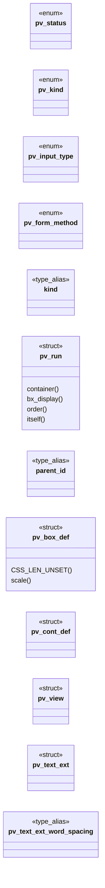

# `include/page_view.h`

> Source: [include/page_view.h:1](../../include/page_view.h#L1) | language `h` | coverage 61.1% | [API index](../index.md)

## Contents

- **Structs:** [`pv_run`](#pv_run), [`pv_box_def`](#pv_box_def), [`pv_cont_def`](#pv_cont_def), [`pv_view`](#pv_view), [`pv_text_ext`](#pv_text_ext)
- **Enums:** [`pv_status`](#pv_status), [`pv_kind`](#pv_kind), [`pv_input_type`](#pv_input_type), [`pv_form_method`](#pv_form_method)
- **Type Aliases:** [`kind`](#kind), [`parent_id`](#parent_id), [`parent_id`](#parent_id)
- **Functions:** [`nonzero`](#nonzero), [`resolved`](#resolved), [`policy`](#policy), [`cause`](#cause), [`pv_new`](#pv_new), [`form`](#form), [`pv_set_emphasis`](#pv_set_emphasis), [`default`](#default), [`pv_set_color`](#pv_set_color), [`pv_set_bgcolor`](#pv_set_bgcolor), [`pv_set_text_style`](#pv_set_text_style), [`pv_text_ext_reset`](#pv_text_ext_reset), [`ancestors`](#ancestors), [`pv_set_text_ext`](#pv_set_text_ext), [`pv_set_grad_text`](#pv_set_grad_text), [`run`](#run), [`pv_set_row_span`](#pv_set_row_span), [`pv_set_grid_area`](#pv_set_grid_area), [`pv_set_grid_rows`](#pv_set_grid_rows), [`pv_set_ua_tag`](#pv_set_ua_tag), [`pv_set_cont_box`](#pv_set_cont_box), [`pv_set_grid`](#pv_set_grid), [`pv_set_flex`](#pv_set_flex), [`pv_set_flex_mauto`](#pv_set_flex_mauto), [`pv_set_cont_item`](#pv_set_cont_item), [`pv_set_float`](#pv_set_float), [`pv_set_box`](#pv_set_box), [`pv_set_box_pct`](#pv_set_box_pct), [`pv_set_box_maxw`](#pv_set_box_maxw), [`pv_set_node_id`](#pv_set_node_id), [`pv_set_block_id`](#pv_set_block_id), [`pv_set_own_box`](#pv_set_own_box), [`pv_set_oof`](#pv_set_oof), [`pv_cont_count`](#pv_cont_count), [`pv_cont_at`](#pv_cont_at), [`pv_set_input_checked`](#pv_set_input_checked), [`pv_set_input_select_opts`](#pv_set_input_select_opts), [`pv_free`](#pv_free), [`pv_count`](#pv_count), [`pv_at`](#pv_at), [`pv_box_count`](#pv_box_count), [`pv_box_at`](#pv_box_at)
- **Macros:** [`PV_MAUTO_LEFT`](#pv_mauto_left), [`PV_MAUTO_RIGHT`](#pv_mauto_right), [`PV_MAUTO_TOP`](#pv_mauto_top), [`PV_MAUTO_BOTTOM`](#pv_mauto_bottom), [`PV_LEN_UNSET`](#pv_len_unset), [`PV_LEN_AUTO`](#pv_len_auto), [`PV_LEN_END`](#pv_len_end), [`PV_GRID_TRACKS`](#pv_grid_tracks), [`PV_CONT_DEPTH`](#pv_cont_depth), [`PV_BG_URL_MAX`](#pv_bg_url_max)

## Type Diagram



## Call Graph

Solid arrows stay in this module, dashed arrows leave it.


## Structs

<a id="pv_run"></a>

### `pv_run`

`struct` | [include/page_view.h:118](../../include/page_view.h#L118)

```c
typedef struct pv_run
```

One inline run in document order. text is owned, NUL-terminated, valid UTF-8 (the alt text for PV_IMAGE, possibly empty). href is owned and NUL-terminated for PV_LINK runs, NULL otherwise. src is owned and NUL-terminated for PV_IMAGE runs (the image URL, data with provenance, never fetched here), NULL otherwise; img_w/img_h carry the declared  dimensions in pixels, or -1 when unknown.

An image is never a link, so href and src are never both set. fg_rgb carries the author foreground color (nearest inline style "color:" or <font color>) packed as 0xRRGGBB, or -1 when none/unparseable; it is presentation data the renderer applies only when author CSS is enabled.

**Members**

| Member | Kind | Summary |
|---|---|---|
| [`container`](#pv_run-container) | method |  |
| [`bx_display`](#pv_run-bx_display) | method |  |
| [`order`](#pv_run-order) | method |  |
| [`itself`](#pv_run-itself) | method |  |

<a id="pv_run-container"></a>

#### `pv_run.container`

`method` | [include/page_view.h:220](../../include/page_view.h#L220)

```c
* cont_id groups runs of one container (-1 = none);
```

**Parameters**

| Name | Type | Default | Description |
|---|---|---|---|
| `-1` |  | `none` |  |

**Returns:** `* cont_id groups runs of one`

<a id="pv_run-bx_display"></a>

#### `pv_run.bx_display`

`method` | [include/page_view.h:221](../../include/page_view.h#L221)

```c
* bx_display (flex/grid);
```

**Parameters**

| Name | Type | Default | Description |
|---|---|---|---|
| `grid` | `flex/` |  |  |

**Returns:** `*`

*Called by:* [`form`](include.render_doc.h.md#form)

<a id="pv_run-order"></a>

#### `pv_run.order`

`method` | [include/page_view.h:285](../../include/page_view.h#L285)

```c
* groups the runs of ONE floated element in document order (-1 = not in a float);
```

**Parameters**

| Name | Type | Default | Description |
|---|---|---|---|
| `-1` |  | `not in a float` |  |

**Returns:** `* groups the runs of ONE floated element in document`

<a id="pv_run-itself"></a>

#### `pv_run.itself`

`method` | [include/page_view.h:336](../../include/page_view.h#L336)

```c
* by itself (bx_width_cap2);
```

**Returns:** `* by`

---

<a id="pv_box_def"></a>

### `pv_box_def`

`struct` | [include/page_view.h:409](../../include/page_view.h#L409)

```c
typedef struct pv_box_def
```

Box engine (Hito 23b-8 Step D): one entry of the box-definition TREE.

The box decoration and the parent link live here, not on each run, so a box is described once (extinguishing the Step A per-run duplication) and a TEXT-LESS wrapper box (one that owns no direct run, e.g. a card div whose only child is a body div) is still representable. A box's block_id IS its index in pv_view.boxes; a run carries only its block_id (which box it belongs to) and finds its parent via boxes[block_id].parent_id. parent_id is the block_id of the nearest box-carrying block ancestor, or -1 for a root box. The decoration fields mirror the Step A sentinels exactly (border widths/radius/outline width PV_LEN_UNSET, colors -1, the rest 0). The whole list is author presentation: render_doc copies it only with caps.css (empty otherwise -> default render byte-identical).

**Members**

| Member | Kind | Summary |
|---|---|---|
| [`CSS_LEN_UNSET`](#pv_box_def-css_len_unset) | method |  |
| [`scale`](#pv_box_def-scale) | method |  |

<a id="pv_box_def-css_len_unset"></a>

#### `pv_box_def.CSS_LEN_UNSET`

`method` | [include/page_view.h:482](../../include/page_view.h#L482)

```c
* CSS_LEN_UNSET (unset) / CSS_LEN_AUTO. z_index is signed, or CSS_LEN_UNSET. v1 * paints only position:relative (an in-flow offset, reader-safe);
```

**Returns:** `*`

*Called by:* [`form`](include.render_doc.h.md#form)

<a id="pv_box_def-scale"></a>

#### `pv_box_def.scale`

`method` | [include/page_view.h:557](../../include/page_view.h#L557)

```c
* scale(1)) and rotate in whole degrees (transform_rotate);
```

**Parameters**

| Name | Type | Default | Description |
|---|---|---|---|
| `1` |  |  |  |

**Returns:** `*`

*Called by:* [`function`](src.css.c.md#function)

---

<a id="pv_cont_def"></a>

### `pv_cont_def`

`struct` | [include/page_view.h:698](../../include/page_view.h#L698)

```c
typedef struct pv_cont_def
```

Flex/grid container descriptor (2026-07-31).

One entry per container element, its index IS the run's cont_id. Two reasons it exists instead of the container params riding every run:

1. NESTING. A run carries only its INNERMOST container. Laying out an outer
     container needs the outer container's own parameters, and there is a common
     case where no run carries them at all: a grid whose children are all flex
     containers (`.cards{display:grid}` holding `display:flex` cards) has no run
     with cont_id == the grid. parent_id/parent_item rebuild the whole chain.
  2. The parameters are per-container, not per-run: carrying them on every run of
     a container was pure duplication across the IPC.

parent_id is the id of the enclosing container (-1 = top level) and parent_item is
THIS container's item ordinal within that parent, so a nested container is one item
of its parent. Structure (like cont_id itself), carried regardless of caps.css.

---

<a id="pv_view"></a>

### `pv_view`

`struct` | [include/page_view.h:735](../../include/page_view.h#L735)

```c
typedef struct pv_view
```

---

<a id="pv_text_ext"></a>

### `pv_text_ext`

`struct` | [include/page_view.h:896](../../include/page_view.h#L896)

```c
typedef struct pv_text_ext
```

The author text-presentation extensions of one run, resolved from the nearest ancestor that sets each field (they all inherit in CSS).

The 20+ fields used to be positional parameters of pv_set_text_ext -- a signature that grew with every property batch; the struct is the contract now. list_style is resolved here too but is NOT a run field: page_view bakes the <li> marker into the run text (structure), so pv_set_text_ext ignores it. Initialise with pv_text_ext_reset (every field to its "unset" sentinel), then set what the caller resolved.

**Members**

| Member | Kind | Summary |
|---|---|---|
| [`word_spacing`](#pv_text_ext-word_spacing) | type_alias | The author text-presentation extensions of one run, resolved from the nearest ancestor that sets each field (they all inherit in CSS). |

<a id="pv_text_ext-word_spacing"></a>

#### `pv_text_ext.word_spacing`

`type_alias` | [include/page_view.h:896](../../include/page_view.h#L896)

```c
typedef struct pv_text_ext { int font_family, text_transform, letter_spacing, word_spacing;
```

The author text-presentation extensions of one run, resolved from the nearest ancestor that sets each field (they all inherit in CSS).

The 20+ fields used to be positional parameters of pv_set_text_ext -- a signature that grew with every property batch; the struct is the contract now. list_style is resolved here too but is NOT a run field: page_view bakes the <li> marker into the run text (structure), so pv_set_text_ext ignores it. Initialise with pv_text_ext_reset (every field to its "unset" sentinel), then set what the caller resolved.

---

## Enums

<a id="pv_status"></a>

### `pv_status`

`enum` | [include/page_view.h:34](../../include/page_view.h#L34)

```c
typedef enum pv_status
```

---

<a id="pv_kind"></a>

### `pv_kind`

`enum` | [include/page_view.h:68](../../include/page_view.h#L68)

```c
typedef enum pv_kind
```

---

<a id="pv_input_type"></a>

### `pv_input_type`

`enum` | [include/page_view.h:84](../../include/page_view.h#L84)

```c
typedef enum pv_input_type
```

Class of a PV_INPUT control.

Drives how the GUI paints and submits it. Unknown input types collapse to PV_IN_TEXT (a one-line editable box).

---

<a id="pv_form_method"></a>

### `pv_form_method`

`enum` | [include/page_view.h:104](../../include/page_view.h#L104)

```c
typedef enum pv_form_method
```

Form method carried on a PV_INPUT run (denormalised from the owning <form>).

---

## Type Aliases

<a id="kind"></a>

### `kind`

`type_alias` | [include/page_view.h:118](../../include/page_view.h#L118)

```c
typedef struct pv_run { pv_kind kind;
```

One inline run in document order. text is owned, NUL-terminated, valid UTF-8 (the alt text for PV_IMAGE, possibly empty). href is owned and NUL-terminated for PV_LINK runs, NULL otherwise. src is owned and NUL-terminated for PV_IMAGE runs (the image URL, data with provenance, never fetched here), NULL otherwise; img_w/img_h carry the declared  dimensions in pixels, or -1 when unknown.

An image is never a link, so href and src are never both set. fg_rgb carries the author foreground color (nearest inline style "color:" or <font color>) packed as 0xRRGGBB, or -1 when none/unparseable; it is presentation data the renderer applies only when author CSS is enabled.

---

<a id="parent_id"></a>

### `parent_id`

`type_alias` | [include/page_view.h:409](../../include/page_view.h#L409)

```c
typedef struct pv_box_def { int parent_id;
```

Box engine (Hito 23b-8 Step D): one entry of the box-definition TREE.

The box decoration and the parent link live here, not on each run, so a box is described once (extinguishing the Step A per-run duplication) and a TEXT-LESS wrapper box (one that owns no direct run, e.g. a card div whose only child is a body div) is still representable. A box's block_id IS its index in pv_view.boxes; a run carries only its block_id (which box it belongs to) and finds its parent via boxes[block_id].parent_id. parent_id is the block_id of the nearest box-carrying block ancestor, or -1 for a root box. The decoration fields mirror the Step A sentinels exactly (border widths/radius/outline width PV_LEN_UNSET, colors -1, the rest 0). The whole list is author presentation: render_doc copies it only with caps.css (empty otherwise -> default render byte-identical).

---

<a id="parent_id"></a>

### `parent_id`

`type_alias` | [include/page_view.h:698](../../include/page_view.h#L698)

```c
typedef struct pv_cont_def { int parent_id;
```

Flex/grid container descriptor (2026-07-31).

One entry per container element, its index IS the run's cont_id. Two reasons it exists instead of the container params riding every run:

1. NESTING. A run carries only its INNERMOST container. Laying out an outer
     container needs the outer container's own parameters, and there is a common
     case where no run carries them at all: a grid whose children are all flex
     containers (`.cards{display:grid}` holding `display:flex` cards) has no run
     with cont_id == the grid. parent_id/parent_item rebuild the whole chain.
  2. The parameters are per-container, not per-run: carrying them on every run of
     a container was pure duplication across the IPC.

parent_id is the id of the enclosing container (-1 = top level) and parent_item is
THIS container's item ordinal within that parent, so a nested container is one item
of its parent. Structure (like cont_id itself), carried regardless of caps.css.

---

## Functions

<a id="nonzero"></a>

### `nonzero`

`function` | [include/page_view.h:760](../../include/page_view.h#L760)

```c
* when nonzero (JS allowed for this page) the <noscript> subtree is suppressed. */ pv_status pv_build_ex(const hp_document *doc, int js_enabled, pv_view **out);
```

**Parameters**

| Name | Type | Default | Description |
|---|---|---|---|
| `page` | `JS allowed for this` |  |  |

**Returns:** `* when`

---

<a id="resolved"></a>

### `resolved`

`function` | [include/page_view.h:767](../../include/page_view.h#L767)

```c
* author CSS is still resolved (the presentation layer decides whether to apply it). * pv_build_ex is pv_build_full with reader == 0 and prefers_dark == 0. */ pv_status pv_build_full(const hp_document
```

**Parameters**

| Name | Type | Default | Description |
|---|---|---|---|
| `it` | `the presentation layer decides whether to apply` |  |  |

**Returns:** `* author CSS is still`

---

<a id="policy"></a>

### `policy`

`function` | [include/page_view.h:775](../../include/page_view.h#L775)

```c
* TRUSTED parent under full network policy (spec/tab.md §8) -- page_view stays * pure and never fetches. The external text precedes the document's own <style> * blocks in the parsed sheet (document-or
```

**Parameters**

| Name | Type | Default | Description |
|---|---|---|---|
| `md` | `spec/tab. §8` |  |  |

**Returns:** `* TRUSTED parent under full network`

*Called by:* [`EXIT_USAGE`](src.freedom.c.md#exit_usage)

---

<a id="cause"></a>

### `cause`

`function` | [include/page_view.h:793](../../include/page_view.h#L793)

```c
* cause (spec/css_drops.md). Builds no view and changes nothing -- it exists so * "what is this page's CSS losing?" is a measurement instead of a grep over the * dispatch, which sees property names on
```

**Parameters**

| Name | Type | Default | Description |
|---|---|---|---|
| `md` | `spec/css_drops.` |  |  |

**Returns:** `*`

---

<a id="pv_new"></a>

### `pv_new`

`function` | [include/page_view.h:805](../../include/page_view.h#L805)

```c
pv_view *pv_new(void);
```

Allocates an empty view (used by the IPC deserialiser to rebuild a view on the receiving side).

Returns NULL on allocation failure.

**Returns:** `pv_view *`

---

<a id="form"></a>

### `form`

`function` | [include/page_view.h:824](../../include/page_view.h#L824)

```c
* form (-1 if none);
```

**Parameters**

| Name | Type | Default | Description |
|---|---|---|---|
| `none` | `-1 if` |  |  |

**Returns:** `*`

---

<a id="pv_set_emphasis"></a>

### `pv_set_emphasis`

`function` | [include/page_view.h:856](../../include/page_view.h#L856)

```c
void pv_set_emphasis(pv_view *v, int bold, int italic);
```

Sets the inline emphasis flags (bold from <b>/<strong>/<th>, italic from <i>/<em>) on the most recently appended run.

No-op on an empty or NULL view. Both append helpers default a new run to bold=0, italic=0. Emphasis is structure (which glyph weight/slant), not author styling, so it is carried by default and is not gated by caps.css.

**Parameters**

| Name | Type | Default | Description |
|---|---|---|---|
| `v` | `pv_view *` |  |  |
| `bold` | `int` |  |  |
| `italic` | `int` |  |  |

---

<a id="default"></a>

### `default`

`function` | [include/page_view.h:861](../../include/page_view.h#L861)

```c
* structure is carried by default (not gated by caps.css). */ void pv_set_indent(pv_view *v, int indent);
```

**Parameters**

| Name | Type | Default | Description |
|---|---|---|---|
| `css` | `not gated by caps.` |  |  |

**Returns:** `* structure is carried by`

---

<a id="pv_set_color"></a>

### `pv_set_color`

`function` | [include/page_view.h:864](../../include/page_view.h#L864)

```c
void pv_set_color(pv_view *v, int fg_rgb);
```

**Parameters**

| Name | Type | Default | Description |
|---|---|---|---|
| `v` | `pv_view *` |  |  |
| `fg_rgb` | `int` |  |  |

---

<a id="pv_set_bgcolor"></a>

### `pv_set_bgcolor`

`function` | [include/page_view.h:871](../../include/page_view.h#L871)

```c
void pv_set_bgcolor(pv_view *v, int bg_rgb);
```

Sets the author background-color (packed 0xRRGGBB, or -1 for none) on the most recently appended run.

No-op when the view is empty or NULL. Both append helpers default a new run's bg_rgb to -1. background-color does not inherit in CSS; in this flat model pv_build resolves it from the nearest ancestor that sets one, so a block's background shows behind its text runs.

**Parameters**

| Name | Type | Default | Description |
|---|---|---|---|
| `v` | `pv_view *` |  |  |
| `bg_rgb` | `int` |  |  |

---

<a id="pv_set_text_style"></a>

### `pv_set_text_style`

`function` | [include/page_view.h:880](../../include/page_view.h#L880)

```c
void pv_set_text_style(pv_view *v, int text_align, int font_scale, int font_abs, int line_scale, int text_decoration);
```

Sets the author text presentation (text_align as a css_align, font_scale as a font-size percent or 0, font_abs as 1 when that percent is of the 16px root, line_scale as a line-height percent or 0, text_decoration as an OR of CSS_DECO_* / 0 none / -1 unset) on the most recently appended run.

No-op on an empty or NULL view. The append helpers default text_align/font_scale/ font_abs/line_scale to 0 and text_decoration to -1. Like author colors, render_doc applies these only with caps.css.

**Parameters**

| Name | Type | Default | Description |
|---|---|---|---|
| `v` | `pv_view *` |  |  |
| `text_align` | `int` |  |  |
| `font_scale` | `int` |  |  |
| `font_abs` | `int` |  |  |
| `line_scale` | `int` |  |  |
| `text_decoration` | `int` |  |  |

---

<a id="pv_text_ext_reset"></a>

### `pv_text_ext_reset`

`function` | [include/page_view.h:930](../../include/page_view.h#L930)

```c
void pv_text_ext_reset(pv_text_ext *e);
```

Initialises every field of *e to its "unset" sentinel.

NULL-safe.

**Parameters**

| Name | Type | Default | Description |
|---|---|---|---|
| `e` | `pv_text_ext *` |  |  |

---

<a id="ancestors"></a>

### `ancestors`

`function` | [include/page_view.h:935](../../include/page_view.h#L935)

```c
* itself by walking its ancestors (css_visibility, 0 = unset). * * An explicit value on the run WINS over the box stack in both directions: that is * what makes `visibility` inherited-but-overridable,
```

**Parameters**

| Name | Type | Default | Description |
|---|---|---|---|
| `0` |  | `unset` |  |

**Returns:** `* itself by walking its`

---

<a id="pv_set_text_ext"></a>

### `pv_set_text_ext`

`function` | [include/page_view.h:945](../../include/page_view.h#L945)

```c
void pv_set_text_ext(pv_view *v, const pv_text_ext *e);
```

**Parameters**

| Name | Type | Default | Description |
|---|---|---|---|
| `v` | `pv_view *` |  |  |
| `e` | `pv_text_ext *` |  |  |

---

<a id="pv_set_grad_text"></a>

### `pv_set_grad_text`

`function` | [include/page_view.h:951](../../include/page_view.h#L951)

```c
void pv_set_grad_text(pv_view *v, int n, int angle, const int *c4);
```

Sets the gradient-text fill (grad_text_*) verbatim on the most recently appended run. n < 2 is a no-op (no gradient).

Used by the IPC read path, which receives the already-resolved fields; the build path engages gradient text through pv_set_text_ext's bg-clip:text + transparent-fill rule.

**Parameters**

| Name | Type | Default | Description |
|---|---|---|---|
| `v` | `pv_view *` |  |  |
| `n` | `int` |  |  |
| `angle` | `int` |  |  |
| `c4` | `int *` |  |  |

---

<a id="run"></a>

### `run`

`function` | [include/page_view.h:954](../../include/page_view.h#L954)

```c
* run (cont_id, the bx_display, the parsed gap/justify/cols, plus flex-wrap/ * row-gap/align-items). No-op on an empty or NULL view. Both append helpers * default cont_id to -1 (no container), cont_wr
```

**Parameters**

| Name | Type | Default | Description |
|---|---|---|---|
| `bx_display` | `the` |  |  |
| `cols` | `the parsed gap/justify/` |  |  |
| `items` | `plus flex-wrap/ * row-gap/align-` |  |  |

**Returns:** `*`

---

<a id="pv_set_row_span"></a>

### `pv_set_row_span`

`function` | [include/page_view.h:967](../../include/page_view.h#L967)

```c
void pv_set_row_span(pv_view *v, int row_span);
```

Sets the container's grid track sizes and this run's ITEM column span on the most recently appended run (2026-07-11). col_w points at up to PV_GRID_TRACKS encoded sizes (0 auto / >0 px / <0 fr x100; NULL or n <= 0 leaves all-auto); col_span is the item's `grid-column: span N` (<= 0 = 1).

No-op on an empty or NULL view. The append helpers default everything to 0.

**Parameters**

| Name | Type | Default | Description |
|---|---|---|---|
| `v` | `pv_view *` |  |  |
| `row_span` | `int` |  |  |

---

<a id="pv_set_grid_area"></a>

### `pv_set_grid_area`

`function` | [include/page_view.h:971](../../include/page_view.h#L971)

```c
void pv_set_grid_area(pv_view *v, int row_start, int col_start);
```

Sets the last run's RESOLVED named-grid cell (-1, -1 = auto-placed).

See spec/grid_areas.md; the name matching happens in pv_build, never downstream.

**Parameters**

| Name | Type | Default | Description |
|---|---|---|---|
| `v` | `pv_view *` |  |  |
| `row_start` | `int` |  |  |
| `col_start` | `int` |  |  |

---

<a id="pv_set_grid_rows"></a>

### `pv_set_grid_rows`

`function` | [include/page_view.h:972](../../include/page_view.h#L972)

```c
void pv_set_grid_rows(pv_view *v, int grid_rows);
```

**Parameters**

| Name | Type | Default | Description |
|---|---|---|---|
| `v` | `pv_view *` |  |  |
| `grid_rows` | `int` |  |  |

---

<a id="pv_set_ua_tag"></a>

### `pv_set_ua_tag`

`function` | [include/page_view.h:977](../../include/page_view.h#L977)

```c
void pv_set_ua_tag(pv_view *v, int ua_tag);
```

Sets the last run's ua_tag (a bx_ua_tag code: the user-agent box identity of its nearest block-level ancestor).

Out-of-range values fail closed to BX_UA_NONE, i.e. no user-agent margin. No-op on an empty view. spec/box_style.md 4d.

**Parameters**

| Name | Type | Default | Description |
|---|---|---|---|
| `v` | `pv_view *` |  |  |
| `ua_tag` | `int` |  |  |

---

<a id="pv_set_cont_box"></a>

### `pv_set_cont_box`

`function` | [include/page_view.h:981](../../include/page_view.h#L981)

```c
void pv_set_cont_box(pv_view *v, int cont_box_id);
```

Sets the last run's cont_box_id (the box enclosing its container's items; -1 = none).

No-op on an empty view.

**Parameters**

| Name | Type | Default | Description |
|---|---|---|---|
| `v` | `pv_view *` |  |  |
| `cont_box_id` | `int` |  |  |

---

<a id="pv_set_grid"></a>

### `pv_set_grid`

`function` | [include/page_view.h:982](../../include/page_view.h#L982)

```c
void pv_set_grid(pv_view *v, const int *col_w, int n, int col_span);
```

**Parameters**

| Name | Type | Default | Description |
|---|---|---|---|
| `v` | `pv_view *` |  |  |
| `col_w` | `int *` |  |  |
| `n` | `int` |  |  |
| `col_span` | `int` |  |  |

---

<a id="pv_set_flex"></a>

### `pv_set_flex`

`function` | [include/page_view.h:990](../../include/page_view.h#L990)

```c
void pv_set_flex(pv_view *v, int flex_grow, int flex_shrink, int flex_basis, int flex_order, int flex_direction, int flex_align_self);
```

Stage 3: sets the flex per-item values on the most recently appended run — the ITEM's resolved grow/shrink (x100, -1 unset), basis (px / CSS_LEN_AUTO / CSS_LEN_UNSET), order (CSS_LEN_UNSET unset) and align-self (css_align_kw, 0 unset), plus the CONTAINER's flex-direction (css_flex_direction, 0 unset -> row).

No-op on an empty or NULL view. The append helpers default them to the unset sentinels.

**Parameters**

| Name | Type | Default | Description |
|---|---|---|---|
| `v` | `pv_view *` |  |  |
| `flex_grow` | `int` |  |  |
| `flex_shrink` | `int` |  |  |
| `flex_basis` | `int` |  |  |
| `flex_order` | `int` |  |  |
| `flex_direction` | `int` |  |  |
| `flex_align_self` | `int` |  |  |

---

<a id="pv_set_flex_mauto"></a>

### `pv_set_flex_mauto`

`function` | [include/page_view.h:993](../../include/page_view.h#L993)

```c
void pv_set_flex_mauto(pv_view *v, int mauto);
```

Stamps the last run's PV_MAUTO_* bits (other bits dropped).

**Parameters**

| Name | Type | Default | Description |
|---|---|---|---|
| `v` | `pv_view *` |  |  |
| `mauto` | `int` |  |  |

---

<a id="pv_set_cont_item"></a>

### `pv_set_cont_item`

`function` | [include/page_view.h:997](../../include/page_view.h#L997)

```c
void pv_set_cont_item(pv_view *v, int cont_item);
```

Sets the container-item ordinal on the most recently appended run (-1 = none).

No-op on an empty or NULL view; the append helpers default cont_item to -1.

**Parameters**

| Name | Type | Default | Description |
|---|---|---|---|
| `v` | `pv_view *` |  |  |
| `cont_item` | `int` |  |  |

---

<a id="pv_set_float"></a>

### `pv_set_float`

`function` | [include/page_view.h:1006](../../include/page_view.h#L1006)

```c
void pv_set_float(pv_view *v, int float_side, int float_id, int float_clear, int float_ml, int float_ml_pct, int float_mr, int float_mr_pct, int float_oid, int float_oside, int float_oml, int float_oml_pct, int float_omr, int float_omr_pct)
```

Float layout setter for the most recently appended run (spec/float.md): float_side (css_float), float_id (floated-element group id, -1 = none), float_clear (css_clear), plus the float FOUNDER's own horizontal margins (float_ml/ml_pct/mr/mr_pct, signed; spec/float.md §7c.1), plus the OUTERMOST founder (float_oid/oside/oml/oml_pct/ omr/omr_pct; float_oid -1 = nearest IS outermost; spec/float.md §7d.1).

No-op on an empty or NULL view; the append helpers default to 0 / -1 / 0 / 0 / 0 / 0 / 0 and -1 / 0 / 0 / 0 / 0 / 0.

**Parameters**

| Name | Type | Default | Description |
|---|---|---|---|
| `v` | `pv_view *` |  |  |
| `float_side` | `int` |  |  |
| `float_id` | `int` |  |  |
| `float_clear` | `int` |  |  |
| `float_ml` | `int` |  |  |
| `float_ml_pct` | `int` |  |  |
| `float_mr` | `int` |  |  |
| `float_mr_pct` | `int` |  |  |
| `float_oid` | `int` |  |  |
| `float_oside` | `int` |  |  |
| `float_oml` | `int` |  |  |
| `float_oml_pct` | `int` |  |  |
| `float_omr` | `int` |  |  |
| `float_omr_pct` | `int` |  |  |

---

<a id="pv_set_box"></a>

### `pv_set_box`

`function` | [include/page_view.h:1016](../../include/page_view.h#L1016)

```c
void pv_set_box(pv_view *v, int box_l, int box_r, int box_w, int box_center, int box_mt, int box_mb);
```

Sets the author box model on the most recently appended run (left/right insets, width cap, centered flag, and top/bottom margin overrides in px; box_mt/box_mb may be PV_LEN_UNSET).

No-op on an empty or NULL view. The append helpers default box_l/r/w/center to 0 and box_mt/box_mb to PV_LEN_UNSET.

**Parameters**

| Name | Type | Default | Description |
|---|---|---|---|
| `v` | `pv_view *` |  |  |
| `box_l` | `int` |  |  |
| `box_r` | `int` |  |  |
| `box_w` | `int` |  |  |
| `box_center` | `int` |  |  |
| `box_mt` | `int` |  |  |
| `box_mb` | `int` |  |  |

---

<a id="pv_set_box_pct"></a>

### `pv_set_box_pct`

`function` | [include/page_view.h:1022](../../include/page_view.h#L1022)

```c
void pv_set_box_pct(pv_view *v, int box_w_pct, int box_l_pct, int box_r_pct, int box_mt_pct, int box_mb_pct);
```

Sets the symbolic percentage width cap (per-mille, 0 = none; Hito 32) on the most recently appended run.

No-op on an empty or NULL view; the append helpers default box_w_pct to 0.

**Parameters**

| Name | Type | Default | Description |
|---|---|---|---|
| `v` | `pv_view *` |  |  |
| `box_w_pct` | `int` |  |  |
| `box_l_pct` | `int` |  |  |
| `box_r_pct` | `int` |  |  |
| `box_mt_pct` | `int` |  |  |
| `box_mb_pct` | `int` |  |  |

---

<a id="pv_set_box_maxw"></a>

### `pv_set_box_maxw`

`function` | [include/page_view.h:1027](../../include/page_view.h#L1027)

```c
void pv_set_box_maxw(pv_view *v, int box_mw, int box_mw_pct);
```

Sets the max-width cap (px half, 0 = none; per-mille half, 0 = none) on the most recently appended run.

No-op on an empty or NULL view; appends default to 0/0.

**Parameters**

| Name | Type | Default | Description |
|---|---|---|---|
| `v` | `pv_view *` |  |  |
| `box_mw` | `int` |  |  |
| `box_mw_pct` | `int` |  |  |

---

<a id="pv_set_node_id"></a>

### `pv_set_node_id`

`function` | [include/page_view.h:1032](../../include/page_view.h#L1032)

```c
void pv_set_node_id(pv_view *v, dom_node_id node_id);
```

Keystone (Stage 0) setter for the most recently appended run: the dom_node_id of the source element.

No-op on an empty or NULL view; the append helpers default node_id to DOM_NODE_NONE.

**Parameters**

| Name | Type | Default | Description |
|---|---|---|---|
| `v` | `pv_view *` |  |  |
| `node_id` | `dom_node_id` |  |  |

---

<a id="pv_set_block_id"></a>

### `pv_set_block_id`

`function` | [include/page_view.h:1037](../../include/page_view.h#L1037)

```c
void pv_set_block_id(pv_view *v, int block_id);
```

Box engine (Hito 23b-8) setter for the most recently appended run: the block_id of the box-carrying block it belongs to (-1 = none).

No-op on an empty or NULL view; the append helpers default block_id to -1. The box's decoration is on pv_box_def.

**Parameters**

| Name | Type | Default | Description |
|---|---|---|---|
| `v` | `pv_view *` |  |  |
| `block_id` | `int` |  |  |

---

<a id="pv_set_own_box"></a>

### `pv_set_own_box`

`function` | [include/page_view.h:1041](../../include/page_view.h#L1041)

```c
void pv_set_own_box(pv_view *v, int box_id);
```

Records the replaced element's own box def index on the last appended run.

See pv_run.own_box_id for why this is separate from pv_set_block_id.

**Parameters**

| Name | Type | Default | Description |
|---|---|---|---|
| `v` | `pv_view *` |  |  |
| `box_id` | `int` |  |  |

---

<a id="pv_set_oof"></a>

### `pv_set_oof`

`function` | [include/page_view.h:1045](../../include/page_view.h#L1045)

```c
void pv_set_oof(pv_view *v, int oof);
```

Records out-of-flow subtree membership on the last appended run (see pv_run.oof_subtree).

No-op on an empty or NULL view.

**Parameters**

| Name | Type | Default | Description |
|---|---|---|---|
| `v` | `pv_view *` |  |  |
| `oof` | `int` |  |  |

---

<a id="pv_cont_count"></a>

### `pv_cont_count`

`function` | [include/page_view.h:1060](../../include/page_view.h#L1060)

```c
size_t pv_cont_count(const pv_view *v);
```

pv_cont_count is v->ncont (0 when v is NULL); pv_cont_at returns conts[i] (i == a cont_id) or NULL when out of range / NULL view.

**Parameters**

| Name | Type | Default | Description |
|---|---|---|---|
| `v` | `pv_view *` |  |  |

**Returns:** `size_t`

*Called by:* [`blocks`](src.tab.c.md#blocks)

---

<a id="pv_cont_at"></a>

### `pv_cont_at`

`function` `const` | [include/page_view.h:1061](../../include/page_view.h#L1061)

```c
const pv_cont_def *pv_cont_at(const pv_view *v, size_t i);
```

**Parameters**

| Name | Type | Default | Description |
|---|---|---|---|
| `v` | `pv_view *` |  |  |
| `i` | `size_t` |  |  |

**Returns:** `pv_cont_def *`

*Called by:* [`blocks`](src.tab.c.md#blocks)

---

<a id="pv_set_input_checked"></a>

### `pv_set_input_checked`

`function` | [include/page_view.h:1065](../../include/page_view.h#L1065)

```c
void pv_set_input_checked(pv_view *v, int checked);
```

Sets the input's checked state (-1 n/a, 0 unchecked, 1 checked) on the most recently appended run.

No-op on an empty or NULL view.

**Parameters**

| Name | Type | Default | Description |
|---|---|---|---|
| `v` | `pv_view *` |  |  |
| `checked` | `int` |  |  |

---

<a id="pv_set_input_select_opts"></a>

### `pv_set_input_select_opts`

`function` | [include/page_view.h:1069](../../include/page_view.h#L1069)

```c
void pv_set_input_select_opts(pv_view *v, const char *select_opts);
```

Sets the <select> options string ("opt||label||opt||label") on the most recently appended run, taking an owned copy.

No-op on a NULL view or empty cap.

**Parameters**

| Name | Type | Default | Description |
|---|---|---|---|
| `v` | `pv_view *` |  |  |
| `select_opts` | `char *` |  |  |

---

<a id="pv_free"></a>

### `pv_free`

`function` | [include/page_view.h:1072](../../include/page_view.h#L1072)

```c
void pv_free(pv_view *v);
```

Idempotent; safe on NULL and safe to call twice.

**Parameters**

| Name | Type | Default | Description |
|---|---|---|---|
| `v` | `pv_view *` |  |  |

*Called by:* [`tab_load_full`](src.tab.c.md#tab_load_full), [`tab_page_free`](src.tab.c.md#tab_page_free)

---

<a id="pv_count"></a>

### `pv_count`

`function` | [include/page_view.h:1075](../../include/page_view.h#L1075)

```c
size_t pv_count(const pv_view *v);
```

Read accessors.

NULL-safe.

**Parameters**

| Name | Type | Default | Description |
|---|---|---|---|
| `v` | `pv_view *` |  |  |

**Returns:** `size_t`

*Called by:* [`blocks`](src.tab.c.md#blocks), [`run`](src.tab.c.md#run), [`swap`](src.tab.c.md#swap)

---

<a id="pv_at"></a>

### `pv_at`

`function` `const` | [include/page_view.h:1076](../../include/page_view.h#L1076)

```c
const pv_run *pv_at(const pv_view *v, size_t i);
```

**Parameters**

| Name | Type | Default | Description |
|---|---|---|---|
| `v` | `pv_view *` |  |  |
| `i` | `size_t` |  |  |

**Returns:** `pv_run *`

*Called by:* [`blocks`](src.tab.c.md#blocks), [`run`](src.tab.c.md#run)

---

<a id="pv_box_count"></a>

### `pv_box_count`

`function` | [include/page_view.h:1080](../../include/page_view.h#L1080)

```c
size_t pv_box_count(const pv_view *v);
```

Box tree accessors (Step D). pv_box_count is the number of box definitions; pv_box_at returns boxes[i] (i == a block_id) or NULL when out of range / NULL.

**Parameters**

| Name | Type | Default | Description |
|---|---|---|---|
| `v` | `pv_view *` |  |  |

**Returns:** `size_t`

*Called by:* [`blocks`](src.tab.c.md#blocks)

---

<a id="pv_box_at"></a>

### `pv_box_at`

`function` `const` | [include/page_view.h:1081](../../include/page_view.h#L1081)

```c
const pv_box_def *pv_box_at(const pv_view *v, size_t i);
```

**Parameters**

| Name | Type | Default | Description |
|---|---|---|---|
| `v` | `pv_view *` |  |  |
| `i` | `size_t` |  |  |

**Returns:** `pv_box_def *`

*Called by:* [`blocks`](src.tab.c.md#blocks)

---

## Macros

<a id="pv_mauto_left"></a>

### `PV_MAUTO_LEFT`

`macro` | [include/page_view.h:43](../../include/page_view.h#L43)

```c
#define PV_MAUTO_LEFT
```

pv_run.flex_mauto / pv_cont_def.item_mauto bits: which horizontal margins of a flex item are `auto` (Flexbox 8.1).

---

<a id="pv_mauto_right"></a>

### `PV_MAUTO_RIGHT`

`macro` | [include/page_view.h:44](../../include/page_view.h#L44)

```c
#define PV_MAUTO_RIGHT
```

---

<a id="pv_mauto_top"></a>

### `PV_MAUTO_TOP`

`macro` | [include/page_view.h:45](../../include/page_view.h#L45)

```c
#define PV_MAUTO_TOP
```

---

<a id="pv_mauto_bottom"></a>

### `PV_MAUTO_BOTTOM`

`macro` | [include/page_view.h:46](../../include/page_view.h#L46)

```c
#define PV_MAUTO_BOTTOM
```

vertical auto margins: the main axis of a column

---

<a id="pv_len_unset"></a>

### `PV_LEN_UNSET`

`macro` | [include/page_view.h:50](../../include/page_view.h#L50)

```c
#define PV_LEN_UNSET
```

Sentinel for an unset author box vertical-margin override (box_mt/box_mb): the presentation layer then uses the user-agent margin.

Matches CSS_LEN_UNSET.

---

<a id="pv_len_auto"></a>

### `PV_LEN_AUTO`

`macro` | [include/page_view.h:51](../../include/page_view.h#L51)

```c
#define PV_LEN_AUTO
```

---

<a id="pv_len_end"></a>

### `PV_LEN_END`

`macro` | [include/page_view.h:52](../../include/page_view.h#L52)

```c
#define PV_LEN_END
```

matches CSS_LEN_AUTO: center

---

<a id="pv_grid_tracks"></a>

### `PV_GRID_TRACKS`

`macro` | [include/page_view.h:55](../../include/page_view.h#L55)

```c
#define PV_GRID_TRACKS
```

Sized grid tracks carried per run (2026-07-11).

Mirrors CSS_GRID_TRACKS_MAX in css.h (page_view.c static-asserts they agree); tracks past it lay out as auto.

---

<a id="pv_cont_depth"></a>

### `PV_CONT_DEPTH`

`macro` | [include/page_view.h:60](../../include/page_view.h#L60)

```c
#define PV_CONT_DEPTH
```

Depth of the flex/grid container chain page_view tracks and the presentation layer walks.

Real pages nest a few levels (header > nav > ul, or grid > flex card > flex row); past this the outer levels are dropped and those containers lay out as top level -- degrading to flat layout, never looping.

---

<a id="pv_bg_url_max"></a>

### `PV_BG_URL_MAX`

`macro` | [include/page_view.h:66](../../include/page_view.h#L66)

```c
#define PV_BG_URL_MAX
```

Background-image url() buffer (2026-07-16).

Mirrors CSS_URL_MAX in css.h (page_view.c static-asserts they agree); page_view stays decoupled from css.h in this header, like the rest of the css-enum-mirroring int fields. Sized to hold the RESOLVED absolute URL too (render_doc.c resolves in place), not just the raw author-CSS token.

*Calls:* [`control`](src.page_view.c.md#control)

---
