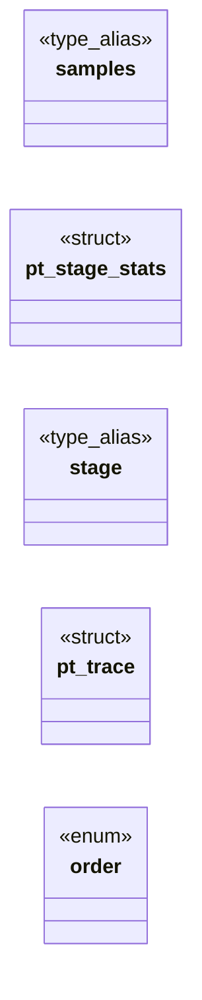

# `include/perf_trace.h`

> Source: [include/perf_trace.h:1](../../include/perf_trace.h#L1) | language `h` | coverage 52.9% | [API index](../index.md)

## Contents

- **Structs:** [`pt_stage_stats`](#pt_stage_stats), [`pt_trace`](#pt_trace)
- **Enums:** [`order`](#order)
- **Type Aliases:** [`samples`](#samples), [`stage`](#stage)
- **Functions:** [`pt_init`](#pt_init), [`pt_elapsed_us`](#pt_elapsed_us), [`pt_record`](#pt_record), [`pt_count`](#pt_count), [`pt_last_us`](#pt_last_us), [`pt_min_us`](#pt_min_us), [`pt_max_us`](#pt_max_us), [`pt_median_us`](#pt_median_us), [`pt_stage_name`](#pt_stage_name), [`pt_format`](#pt_format)
- **Macros:** [`PT_MAX_SAMPLES`](#pt_max_samples)

## Type Diagram



## Structs

<a id="pt_stage_stats"></a>

### `pt_stage_stats`

`struct` | [include/perf_trace.h:34](../../include/perf_trace.h#L34)

```c
typedef struct pt_stage_stats
```

---

<a id="pt_trace"></a>

### `pt_trace`

`struct` | [include/perf_trace.h:41](../../include/perf_trace.h#L41)

```c
typedef struct pt_trace
```

---

## Enums

<a id="order"></a>

### `order`

`enum` | [include/perf_trace.h:71](../../include/perf_trace.h#L71)

```c
/* Deterministic dump, one line per stage with count > 0, enum order:
```

---

## Type Aliases

<a id="samples"></a>

### `samples`

`type_alias` | [include/perf_trace.h:33](../../include/perf_trace.h#L33)

```c
typedef struct pt_stage_stats { uint64_t samples[PT_MAX_SAMPLES];
```

define PT_MAX_SAMPLES 256

---

<a id="stage"></a>

### `stage`

`type_alias` | [include/perf_trace.h:40](../../include/perf_trace.h#L40)

```c
typedef struct pt_trace { pt_stage_stats stage[PT_STAGE_COUNT];
```

---

## Functions

<a id="pt_init"></a>

### `pt_init`

`function` | [include/perf_trace.h:46](../../include/perf_trace.h#L46)

```c
void pt_init(pt_trace *t);
```

Reset all stages to empty.

NULL-safe (no-op).

**Parameters**

| Name | Type | Default | Description |
|---|---|---|---|
| `t` | `pt_trace *` |  |  |

---

<a id="pt_elapsed_us"></a>

### `pt_elapsed_us`

`function` | [include/perf_trace.h:50](../../include/perf_trace.h#L50)

```c
uint64_t pt_elapsed_us(uint64_t start_us, uint64_t end_us);
```

end_us - start_us with an anti-underflow guard: end < start yields 0 instead of wrapping to a huge uint64_t.

Pure.

**Parameters**

| Name | Type | Default | Description |
|---|---|---|---|
| `start_us` | `uint64_t` |  |  |
| `end_us` | `uint64_t` |  |  |

**Returns:** `uint64_t`

*Called by:* [`HL_JS_NAV_MAX`](src.freedom.c.md#hl_js_nav_max), [`parent`](src.freedom.c.md#parent)

---

<a id="pt_record"></a>

### `pt_record`

`function` | [include/perf_trace.h:54](../../include/perf_trace.h#L54)

```c
void pt_record(pt_trace *t, pt_stage stage, uint64_t elapsed_us);
```

Record one sample (microseconds) for the given stage.

NULL-safe and stage-bounds-safe: t==NULL or an out-of-range stage is a no-op.

**Parameters**

| Name | Type | Default | Description |
|---|---|---|---|
| `t` | `pt_trace *` |  |  |
| `stage` | `pt_stage` |  |  |
| `elapsed_us` | `uint64_t` |  |  |

*Called by:* [`HL_JS_NAV_MAX`](src.freedom.c.md#hl_js_nav_max), [`parent`](src.freedom.c.md#parent)

---

<a id="pt_count"></a>

### `pt_count`

`function` | [include/perf_trace.h:57](../../include/perf_trace.h#L57)

```c
size_t pt_count(const pt_trace *t, pt_stage stage);
```

Samples currently held in the stage's ring (<= PT_MAX_SAMPLES).

**Parameters**

| Name | Type | Default | Description |
|---|---|---|---|
| `t` | `pt_trace *` |  |  |
| `stage` | `pt_stage` |  |  |

**Returns:** `size_t`

---

<a id="pt_last_us"></a>

### `pt_last_us`

`function` | [include/perf_trace.h:60](../../include/perf_trace.h#L60)

```c
uint64_t pt_last_us(const pt_trace *t, pt_stage stage);
```

Most recently recorded sample; 0 if none or t==NULL.

**Parameters**

| Name | Type | Default | Description |
|---|---|---|---|
| `t` | `pt_trace *` |  |  |
| `stage` | `pt_stage` |  |  |

**Returns:** `uint64_t`

---

<a id="pt_min_us"></a>

### `pt_min_us`

`function` | [include/perf_trace.h:63](../../include/perf_trace.h#L63)

```c
uint64_t pt_min_us(const pt_trace *t, pt_stage stage);
```

Min / max / median over the samples currently in the ring.

0 if empty.

**Parameters**

| Name | Type | Default | Description |
|---|---|---|---|
| `t` | `pt_trace *` |  |  |
| `stage` | `pt_stage` |  |  |

**Returns:** `uint64_t`

---

<a id="pt_max_us"></a>

### `pt_max_us`

`function` | [include/perf_trace.h:64](../../include/perf_trace.h#L64)

```c
uint64_t pt_max_us(const pt_trace *t, pt_stage stage);
```

**Parameters**

| Name | Type | Default | Description |
|---|---|---|---|
| `t` | `pt_trace *` |  |  |
| `stage` | `pt_stage` |  |  |

**Returns:** `uint64_t`

---

<a id="pt_median_us"></a>

### `pt_median_us`

`function` | [include/perf_trace.h:65](../../include/perf_trace.h#L65)

```c
uint64_t pt_median_us(const pt_trace *t, pt_stage stage);
```

**Parameters**

| Name | Type | Default | Description |
|---|---|---|---|
| `t` | `pt_trace *` |  |  |
| `stage` | `pt_stage` |  |  |

**Returns:** `uint64_t`

---

<a id="pt_stage_name"></a>

### `pt_stage_name`

`function` `const` | [include/perf_trace.h:69](../../include/perf_trace.h#L69)

```c
const char *pt_stage_name(pt_stage stage);
```

Short lowercase stage name ("fetch".."shape"); "unknown" if out of range.

Static string, never NULL.

**Parameters**

| Name | Type | Default | Description |
|---|---|---|---|
| `stage` | `pt_stage` |  |  |

**Returns:** `char *`

---

<a id="pt_format"></a>

### `pt_format`

`function` | [include/perf_trace.h:76](../../include/perf_trace.h#L76)

```c
size_t pt_format(const pt_trace *t, char *buf, size_t cap);
```

Deterministic dump, one line per stage with count > 0, enum order: stage=<name> n=<total> last_us=<n> min_us=<n> max_us=<n> median_us=<n>\n snprintf fail-closed (V-004): truncates at a line boundary if buf fills, never overflows.

Returns bytes written (excluding the NUL). buf==NULL or cap==0 returns 0 without writing.

**Parameters**

| Name | Type | Default | Description |
|---|---|---|---|
| `t` | `pt_trace *` |  |  |
| `buf` | `char *` |  |  |
| `cap` | `size_t` |  |  |

**Returns:** `size_t`

---

## Macros

<a id="pt_max_samples"></a>

### `PT_MAX_SAMPLES`

`macro` | [include/perf_trace.h:32](../../include/perf_trace.h#L32)

```c
#define PT_MAX_SAMPLES
```

---
