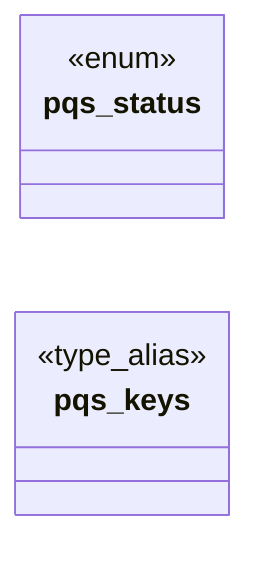

# `include/pq_seal.h`

> Source: [include/pq_seal.h:1](../../include/pq_seal.h#L1) | language `h` | coverage 12.5% | [API index](../index.md)

## Contents

- **Enums:** [`pqs_status`](#pqs_status)
- **Type Aliases:** [`pqs_keys`](#pqs_keys)
- **Functions:** [`pqs_free`](#pqs_free), [`pqs_buf_free`](#pqs_buf_free)
- **Macros:** [`PQS_MAGIC`](#pqs_magic), [`PQS_MAGIC_LEN`](#pqs_magic_len), [`PQS_CT_LEN`](#pqs_ct_len)

## Type Diagram



## Enums

<a id="pqs_status"></a>

### `pqs_status`

`enum` | [include/pq_seal.h:24](../../include/pq_seal.h#L24)

```c
typedef enum pqs_status
```

---

## Type Aliases

<a id="pqs_keys"></a>

### `pqs_keys`

`type_alias` | [include/pq_seal.h:33](../../include/pq_seal.h#L33)

```c
typedef struct pqs_keys pqs_keys;
```

---

## Functions

<a id="pqs_free"></a>

### `pqs_free`

`function` | [include/pq_seal.h:41](../../include/pq_seal.h#L41)

```c
void pqs_free(pqs_keys *k);
```

**Parameters**

| Name | Type | Default | Description |
|---|---|---|---|
| `k` | `pqs_keys *` |  |  |

*Called by:* [`hc_close`](src.http_cache.c.md#hc_close), [`hc_open`](src.http_cache.c.md#hc_open)

---

<a id="pqs_buf_free"></a>

### `pqs_buf_free`

`function` | [include/pq_seal.h:51](../../include/pq_seal.h#L51)

```c
void pqs_buf_free(uint8_t *buf, size_t len);
```

Zeroes then frees a buffer returned by this module.

**Parameters**

| Name | Type | Default | Description |
|---|---|---|---|
| `buf` | `uint8_t *` |  |  |
| `len` | `size_t` |  |  |

*Called by:* [`hc_open`](src.http_cache.c.md#hc_open)

---

## Macros

<a id="pqs_magic"></a>

### `PQS_MAGIC`

`macro` | [include/pq_seal.h:20](../../include/pq_seal.h#L20)

```c
#define PQS_MAGIC
```

---

<a id="pqs_magic_len"></a>

### `PQS_MAGIC_LEN`

`macro` | [include/pq_seal.h:21](../../include/pq_seal.h#L21)

```c
#define PQS_MAGIC_LEN
```

---

<a id="pqs_ct_len"></a>

### `PQS_CT_LEN`

`macro` | [include/pq_seal.h:22](../../include/pq_seal.h#L22)

```c
#define PQS_CT_LEN
```

---
