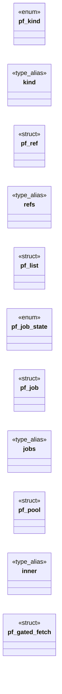

# `include/prefetch.h`

> Source: [include/prefetch.h:1](../../include/prefetch.h#L1) | language `h` | coverage 47.6% | [API index](../index.md)

## Contents

- **Structs:** [`pf_ref`](#pf_ref), [`pf_list`](#pf_list), [`pf_job`](#pf_job), [`pf_pool`](#pf_pool), [`pf_gated_fetch`](#pf_gated_fetch)
- **Enums:** [`pf_kind`](#pf_kind), [`pf_job_state`](#pf_job_state)
- **Type Aliases:** [`kind`](#kind), [`refs`](#refs), [`jobs`](#jobs), [`inner`](#inner)
- **Functions:** [`pf_scan`](#pf_scan), [`pf_list_free`](#pf_list_free), [`fetch`](#fetch), [`pf_pool_take`](#pf_pool_take), [`pf_pool_finish`](#pf_pool_finish), [`pool`](#pool), [`pf_pooled_fetch`](#pf_pooled_fetch)
- **Macros:** [`PF_MAX_REFS`](#pf_max_refs), [`PF_MAX_THREADS`](#pf_max_threads)

## Type Diagram



## Structs

<a id="pf_ref"></a>

### `pf_ref`

`struct` | [include/prefetch.h:42](../../include/prefetch.h#L42)

```c
typedef struct pf_ref
```

One scanned reference. url is the RAW attribute value (the policy-gated fetcher resolves and validates it, exactly as it does for the worker's own request).

---

<a id="pf_list"></a>

### `pf_list`

`struct` | [include/prefetch.h:50](../../include/prefetch.h#L50)

```c
typedef struct pf_list
```

---

<a id="pf_job"></a>

### `pf_job`

`struct` | [include/prefetch.h:77](../../include/prefetch.h#L77)

```c
typedef struct pf_job
```

---

<a id="pf_pool"></a>

### `pf_pool`

`struct` | [include/prefetch.h:87](../../include/prefetch.h#L87)

```c
typedef struct pf_pool
```

---

<a id="pf_gated_fetch"></a>

### `pf_gated_fetch`

`struct` | [include/prefetch.h:129](../../include/prefetch.h#L129)

```c
typedef struct pf_gated_fetch
```

Cache-first fetcher adapter, shared by every frontend (DRY): install pf_pooled_fetch as the tab fetcher with a pf_gated_fetch as its ctx.

A GET whose URL is pooled is served from the pool (a failed prefetch propagates the failure -- never refetched); everything else (POST, miss, pool == NULL) goes straight to the inner policy-gated fetcher. The pf_gated_fetch must outlive the tab_load_full call; reset the tab's fetcher to the inner one afterwards.

---

## Enums

<a id="pf_kind"></a>

### `pf_kind`

`enum` | [include/prefetch.h:35](../../include/prefetch.h#L35)

```c
typedef enum pf_kind
```

Subresource kinds the lookahead scanner recognizes.

Anything else (icons, preload hints, images) is deliberately NOT scanned: prefetch never widens what the page could request (images are pooled from the post-rd_build, policy-decided list instead).

---

<a id="pf_job_state"></a>

### `pf_job_state`

`enum` | [include/prefetch.h:70](../../include/prefetch.h#L70)

```c
typedef enum pf_job_state
```

---

## Type Aliases

<a id="kind"></a>

### `kind`

`type_alias` | [include/prefetch.h:42](../../include/prefetch.h#L42)

```c
typedef struct pf_ref { pf_kind kind;
```

One scanned reference. url is the RAW attribute value (the policy-gated fetcher resolves and validates it, exactly as it does for the worker's own request).

---

<a id="refs"></a>

### `refs`

`type_alias` | [include/prefetch.h:49](../../include/prefetch.h#L49)

```c
typedef struct pf_list { pf_ref refs[PF_MAX_REFS];
```

maximum simultaneous downloads

---

<a id="jobs"></a>

### `jobs`

`type_alias` | [include/prefetch.h:86](../../include/prefetch.h#L86)

```c
typedef struct pf_pool { pf_job jobs[PF_MAX_REFS];
```

---

<a id="inner"></a>

### `inner`

`type_alias` | [include/prefetch.h:129](../../include/prefetch.h#L129)

```c
typedef struct pf_gated_fetch { pf_fetch_fn inner;
```

Cache-first fetcher adapter, shared by every frontend (DRY): install pf_pooled_fetch as the tab fetcher with a pf_gated_fetch as its ctx.

A GET whose URL is pooled is served from the pool (a failed prefetch propagates the failure -- never refetched); everything else (POST, miss, pool == NULL) goes straight to the inner policy-gated fetcher. The pf_gated_fetch must outlive the tab_load_full call; reset the tab's fetcher to the inner one afterwards.

---

## Functions

<a id="pf_scan"></a>

### `pf_scan`

`function` | [include/prefetch.h:59](../../include/prefetch.h#L59)

```c
int pf_scan(const char *html, size_t len, pf_list *out);
```

Lookahead scan of hostile HTML.

Fills out (owns the URLs; free with pf_list_free). Comment, <script> and <style> contents are opaque; a <link> whose rel list lacks the "stylesheet" token is ignored (fail closed). Returns 0 (even with zero refs) or -1 on NULL arguments. Never performs I/O.

**Parameters**

| Name | Type | Default | Description |
|---|---|---|---|
| `html` | `char *` |  |  |
| `len` | `size_t` |  |  |
| `out` | `pf_list *` |  |  |

**Returns:** `int`

*Called by:* [`LLVMFuzzerTestOneInput`](fuzz.fuzz_prefetch.c.md#llvmfuzzertestoneinput)

---

<a id="pf_list_free"></a>

### `pf_list_free`

`function` | [include/prefetch.h:60](../../include/prefetch.h#L60)

```c
void pf_list_free(pf_list *l);
```

**Parameters**

| Name | Type | Default | Description |
|---|---|---|---|
| `l` | `pf_list *` |  |  |

*Called by:* [`LLVMFuzzerTestOneInput`](fuzz.fuzz_prefetch.c.md#llvmfuzzertestoneinput)

---

<a id="fetch"></a>

### `fetch`

`function` | [include/prefetch.h:102](../../include/prefetch.h#L102)

```c
* claiming jobs and running fetch(ctx, "GET", url, ...). Returns 0 on success or * -1 when no thread could start (the caller just falls back to serial fetching: * performance fails open, policy is una
```

**Parameters**

| Name | Type | Default | Description |
|---|---|---|---|
| `GET` |  |  |  |
| `...` |  |  |  |

**Returns:** `* claiming jobs and running`

---

<a id="pf_pool_take"></a>

### `pf_pool_take`

`function` | [include/prefetch.h:115](../../include/prefetch.h#L115)

```c
int pf_pool_take(pf_pool *p, const char *url, int *rc, int *status, char **body, size_t *len, char **ctype);
```

Cache-first take.

On a hit (url matches an unconsumed job) WAITS for that job and MOVES the result to the caller: *rc is the callback's return value and, when *rc == 0, the caller owns the returned body and ctype. Returns 1 on hit, 0 on miss (unknown or already-consumed URL, pool not started): the caller then fetches directly. A fetch failure is a hit with *rc != 0 -- the caller must NOT retry (same outcome as the serial path, without duplicating requests). Single owner: a second take of the same URL is a miss.

**Parameters**

| Name | Type | Default | Description |
|---|---|---|---|
| `p` | `pf_pool *` |  |  |
| `url` | `char *` |  |  |
| `rc` | `int *` |  |  |
| `status` | `int *` |  |  |
| `body` | `char **` |  |  |
| `len` | `size_t *` |  |  |
| `ctype` | `char **` |  |  |

**Returns:** `int`

---

<a id="pf_pool_finish"></a>

### `pf_pool_finish`

`function` | [include/prefetch.h:121](../../include/prefetch.h#L121)

```c
void pf_pool_finish(pf_pool *p);
```

Joins the worker threads and frees every unconsumed result.

Blocks until in-flight fetches end (bounded by the fetcher's timeouts). Idempotent; after finish, take always misses.

**Parameters**

| Name | Type | Default | Description |
|---|---|---|---|
| `p` | `pf_pool *` |  |  |

---

<a id="pool"></a>

### `pool`

`function` | [include/prefetch.h:125](../../include/prefetch.h#L125)

```c
* whose URL is pooled is served from the pool (a failed prefetch propagates the * failure -- never refetched);
```

**Parameters**

| Name | Type | Default | Description |
|---|---|---|---|
| `refetched` | `a failed prefetch propagates the * failure -- never` |  |  |

**Returns:** `* whose URL is`

---

<a id="pf_pooled_fetch"></a>

### `pf_pooled_fetch`

`function` | [include/prefetch.h:135](../../include/prefetch.h#L135)

```c
int pf_pooled_fetch(void *vctx, const char *method, const char *url, const char *body, size_t body_len, int *out_status, char **out_body, size_t *out_len, char **out_ctype);
```

**Parameters**

| Name | Type | Default | Description |
|---|---|---|---|
| `vctx` | `void *` |  |  |
| `method` | `char *` |  |  |
| `url` | `char *` |  |  |
| `body` | `char *` |  |  |
| `body_len` | `size_t` |  |  |
| `out_status` | `int *` |  |  |
| `out_body` | `char **` |  |  |
| `out_len` | `size_t *` |  |  |
| `out_ctype` | `char **` |  |  |

**Returns:** `int`

---

## Macros

<a id="pf_max_refs"></a>

### `PF_MAX_REFS`

`macro` | [include/prefetch.h:47](../../include/prefetch.h#L47)

```c
#define PF_MAX_REFS
```

---

<a id="pf_max_threads"></a>

### `PF_MAX_THREADS`

`macro` | [include/prefetch.h:48](../../include/prefetch.h#L48)

```c
#define PF_MAX_THREADS
```

anti-DoS cap for the scanner and the pool

---
