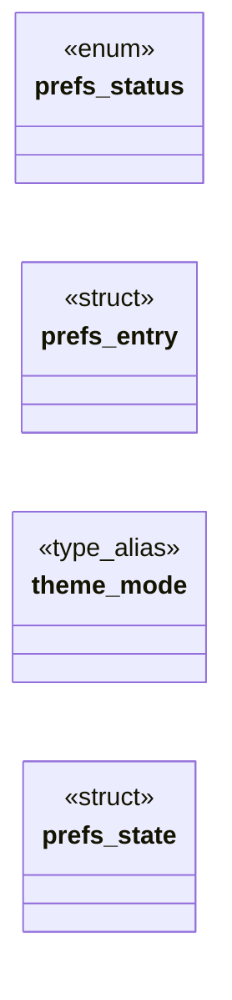

# `include/prefs.h`

> Source: [include/prefs.h:1](../../include/prefs.h#L1) | language `h` | coverage 38.9% | [API index](../index.md)

## Contents

- **Structs:** [`prefs_entry`](#prefs_entry), [`prefs_state`](#prefs_state)
- **Enums:** [`prefs_status`](#prefs_status)
- **Type Aliases:** [`theme_mode`](#theme_mode)
- **Functions:** [`prefs_init`](#prefs_init), [`prefs_free`](#prefs_free), [`free`](#free), [`prefs_bookmark_index`](#prefs_bookmark_index), [`prefs_suggest`](#prefs_suggest), [`anyway`](#anyway)
- **Macros:** [`PREFS_VERSION`](#prefs_version), [`PREFS_MAX_URL`](#prefs_max_url), [`PREFS_MAX_TITLE`](#prefs_max_title), [`PREFS_MAX_BOOKMARKS`](#prefs_max_bookmarks), [`PREFS_MAX_HISTORY`](#prefs_max_history), [`PREFS_MAX_TEXT`](#prefs_max_text), [`PREFS_PAGE_HISTORY`](#prefs_page_history)

## Type Diagram



## Structs

<a id="prefs_entry"></a>

### `prefs_entry`

`struct` | [include/prefs.h:45](../../include/prefs.h#L45)

```c
typedef struct prefs_entry
```

---

<a id="prefs_state"></a>

### `prefs_state`

`struct` | [include/prefs.h:50](../../include/prefs.h#L50)

```c
typedef struct prefs_state
```

---

## Enums

<a id="prefs_status"></a>

### `prefs_status`

`enum` | [include/prefs.h:36](../../include/prefs.h#L36)

```c
typedef enum prefs_status
```

---

## Type Aliases

<a id="theme_mode"></a>

### `theme_mode`

`type_alias` | [include/prefs.h:49](../../include/prefs.h#L49)

```c
typedef struct prefs_state { int theme_mode;
```

---

## Functions

<a id="prefs_init"></a>

### `prefs_init`

`function` | [include/prefs.h:65](../../include/prefs.h#L65)

```c
void prefs_init(prefs_state *p);
```

Safe defaults (a virgin session: everything private/off, zoom 100%, remember_history on).

NULL-safe.

**Parameters**

| Name | Type | Default | Description |
|---|---|---|---|
| `p` | `prefs_state *` |  |  |

---

<a id="prefs_free"></a>

### `prefs_free`

`function` | [include/prefs.h:68](../../include/prefs.h#L68)

```c
void prefs_free(prefs_state *p);
```

Releases owned lists.

Idempotent; NULL-safe.

**Parameters**

| Name | Type | Default | Description |
|---|---|---|---|
| `p` | `prefs_state *` |  |  |

---

<a id="free"></a>

### `free`

`function` | [include/prefs.h:71](../../include/prefs.h#L71)

```c
* free(). */ prefs_status prefs_format(const prefs_state *p, char **out, size_t *out_len);
```

**Returns:** `*`

*Called by:* [`FONT_STASH_MAX_BYTES`](gui.browser_ui.c.md#font_stash_max_bytes), [`arrives`](gui.browser_ui.c.md#arrives), [`first`](gui.browser_ui.c.md#first), [`offset`](gui.browser_ui.c.md#offset), [`only`](gui.browser_ui.c.md#only), [`strcmp`](gui.browser_ui.c.md#strcmp), [`prefs_bookmark_toggle`](src.prefs.c.md#prefs_bookmark_toggle), [`prefs_bookmarks_page`](src.prefs.c.md#prefs_bookmarks_page), [`prefs_free`](src.prefs.c.md#prefs_free), [`prefs_history_add`](src.prefs.c.md#prefs_history_add)

---

<a id="prefs_bookmark_index"></a>

### `prefs_bookmark_index`

`function` | [include/prefs.h:81](../../include/prefs.h#L81)

```c
int prefs_bookmark_index(const prefs_state *p, const char *url);
```

Index of the bookmark with exactly that URL, or -1.

NULL-safe.

**Parameters**

| Name | Type | Default | Description |
|---|---|---|---|
| `p` | `prefs_state *` |  |  |
| `url` | `char *` |  |  |

**Returns:** `int`

---

<a id="prefs_suggest"></a>

### `prefs_suggest`

`function` | [include/prefs.h:100](../../include/prefs.h#L100)

```c
int prefs_suggest(const prefs_state *p, const char *query, char *out, size_t row_len, int max_rows);
```

Omnibox autocomplete: up to max_rows distinct URLs matching query (case- insensitive) written to out (rows of row_len bytes, NUL-terminated).

Priority: bookmark-prefix, history-prefix, bookmark-substring (URL or title), history-substring; "prefix" also matches past the scheme and a leading "www.". Empty query matches everything (bookmarks first). Returns the count written. Pure.

**Parameters**

| Name | Type | Default | Description |
|---|---|---|---|
| `p` | `prefs_state *` |  |  |
| `query` | `char *` |  |  |
| `out` | `char *` |  |  |
| `row_len` | `size_t` |  |  |
| `max_rows` | `int` |  |  |

**Returns:** `int`

---

<a id="anyway"></a>

### `anyway`

`function` | [include/prefs.h:105](../../include/prefs.h#L105)

```c
* page is rendered by the normal confined pipeline anyway (defence in depth). * *out is owned (free());
```

**Parameters**

| Name | Type | Default | Description |
|---|---|---|---|
| `depth` | `defence in` |  |  |

**Returns:** `* page is rendered by the normal confined pipeline`

---

## Macros

<a id="prefs_version"></a>

### `PREFS_VERSION`

`macro` | [include/prefs.h:26](../../include/prefs.h#L26)

```c
#define PREFS_VERSION
```

---

<a id="prefs_max_url"></a>

### `PREFS_MAX_URL`

`macro` | [include/prefs.h:27](../../include/prefs.h#L27)

```c
#define PREFS_MAX_URL
```

---

<a id="prefs_max_title"></a>

### `PREFS_MAX_TITLE`

`macro` | [include/prefs.h:28](../../include/prefs.h#L28)

```c
#define PREFS_MAX_TITLE
```

mirrors BROWSER_URL_MAX

---

<a id="prefs_max_bookmarks"></a>

### `PREFS_MAX_BOOKMARKS`

`macro` | [include/prefs.h:29](../../include/prefs.h#L29)

```c
#define PREFS_MAX_BOOKMARKS
```

cleaned title bytes kept

---

<a id="prefs_max_history"></a>

### `PREFS_MAX_HISTORY`

`macro` | [include/prefs.h:30](../../include/prefs.h#L30)

```c
#define PREFS_MAX_HISTORY
```

---

<a id="prefs_max_text"></a>

### `PREFS_MAX_TEXT`

`macro` | [include/prefs.h:31](../../include/prefs.h#L31)

```c
#define PREFS_MAX_TEXT
```

---

<a id="prefs_page_history"></a>

### `PREFS_PAGE_HISTORY`

`macro` | [include/prefs.h:34](../../include/prefs.h#L34)

```c
#define PREFS_PAGE_HISTORY
```

Entries of the recent-history section of the bookmarks page.

---
