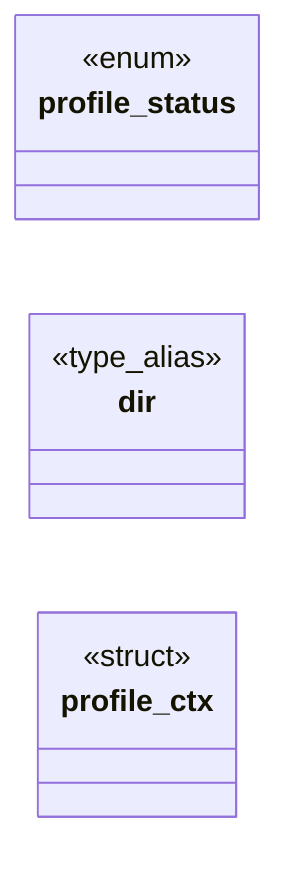

# `include/profile.h`

> Source: [include/profile.h:1](../../include/profile.h#L1) | language `h` | coverage 22.2% | [API index](../index.md)

## Contents

- **Structs:** [`profile_ctx`](#profile_ctx)
- **Enums:** [`profile_status`](#profile_status)
- **Type Aliases:** [`dir`](#dir)
- **Functions:** [`absent`](#absent), [`closed`](#closed), [`profile_close`](#profile_close)
- **Macros:** [`PROFILE_KEY_FILE`](#profile_key_file), [`PROFILE_PREFS_FILE`](#profile_prefs_file)

## Type Diagram



## Structs

<a id="profile_ctx"></a>

### `profile_ctx`

`struct` | [include/profile.h:46](../../include/profile.h#L46)

```c
typedef struct profile_ctx
```

---

## Enums

<a id="profile_status"></a>

### `profile_status`

`enum` | [include/profile.h:35](../../include/profile.h#L35)

```c
typedef enum profile_status
```

---

## Type Aliases

<a id="dir"></a>

### `dir`

`type_alias` | [include/profile.h:45](../../include/profile.h#L45)

```c
typedef struct profile_ctx { char dir[1024];
```

---

## Functions

<a id="absent"></a>

### `absent`

`function` | [include/profile.h:53](../../include/profile.h#L53)

```c
* the keyfile when absent (0600, atomic write);
```

**Parameters**

| Name | Type | Default | Description |
|---|---|---|---|
| `0600` |  |  |  |
| `write` | `atomic` |  |  |

**Returns:** `* the keyfile when`

---

<a id="closed"></a>

### `closed`

`function` | [include/profile.h:54](../../include/profile.h#L54)

```c
* wrong size fails closed (PROFILE_ERR_KEY, never overwritten). Derives the * AEAD key (Argon2id, per-device salt) and marks ctx ready. */ profile_status profile_open(profile_ctx *ctx, const char *dir
```

**Parameters**

| Name | Type | Default | Description |
|---|---|---|---|
| `overwritten` | `never` |  |  |

**Returns:** `* wrong size fails`

---

<a id="profile_close"></a>

### `profile_close`

`function` | [include/profile.h:67](../../include/profile.h#L67)

```c
void profile_close(profile_ctx *ctx);
```

Securely wipes the key in ctx.

Idempotent; NULL-safe.

**Parameters**

| Name | Type | Default | Description |
|---|---|---|---|
| `ctx` | `profile_ctx *` |  |  |

---

## Macros

<a id="profile_key_file"></a>

### `PROFILE_KEY_FILE`

`macro` | [include/profile.h:32](../../include/profile.h#L32)

```c
#define PROFILE_KEY_FILE
```

---

<a id="profile_prefs_file"></a>

### `PROFILE_PREFS_FILE`

`macro` `sealed` | [include/profile.h:33](../../include/profile.h#L33)

```c
#define PROFILE_PREFS_FILE
```

16B salt + 32B secret, 0600

---
