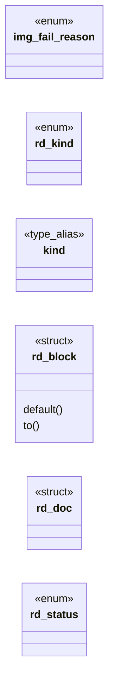
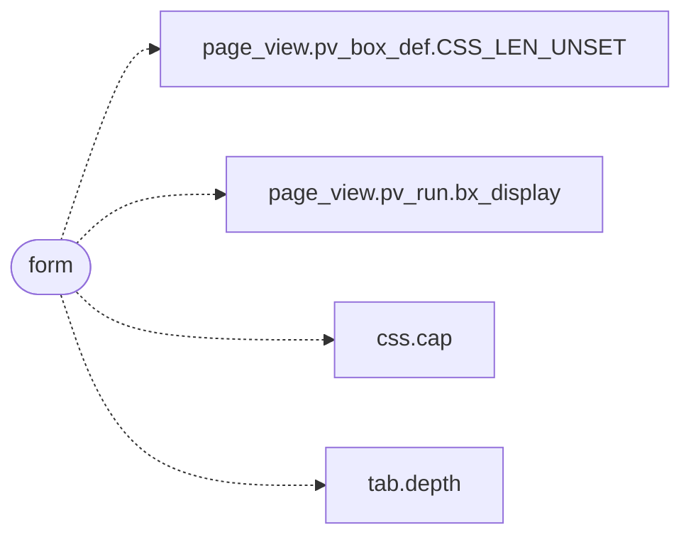

# `include/render_doc.h`

> Source: [include/render_doc.h:1](../../include/render_doc.h#L1) | language `h` | coverage 46.2% | [API index](../index.md)

## Contents

- **Structs:** [`rd_block`](#rd_block), [`rd_doc`](#rd_doc)
- **Enums:** [`img_fail_reason`](#img_fail_reason), [`rd_kind`](#rd_kind), [`rd_status`](#rd_status)
- **Type Aliases:** [`kind`](#kind)
- **Functions:** [`list`](#list), [`RD_IMAGE`](#rd_image), [`form`](#form), [`rdp_images_warning`](#rdp_images_warning), [`rd_free`](#rd_free), [`rd_count`](#rd_count), [`rd_at`](#rd_at), [`rd_box_count`](#rd_box_count), [`rd_box_at`](#rd_box_at), [`rd_cont_count`](#rd_cont_count), [`rd_cont_at`](#rd_cont_at), [`rd_kind_name`](#rd_kind_name), [`rd_block_tag`](#rd_block_tag), [`decision`](#decision), [`IMG_FAIL_OK`](#img_fail_ok), [`rd_input_label`](#rd_input_label), [`rd_input_invisible`](#rd_input_invisible)

## Type Diagram



## Call Graph

Solid arrows stay in this module, dashed arrows leave it.



## Structs

<a id="rd_block"></a>

### `rd_block`

`struct` | [include/render_doc.h:64](../../include/render_doc.h#L64)

```c
typedef struct rd_block
```

One paint-ready block in document order. text is owned, NUL-terminated and valid UTF-8. href is owned and NUL-terminated for RD_LINK (link target), RD_IMAGE (image src) and RD_INPUT (the owning form's action); NULL otherwise. img_decision is meaningful only for RD_IMAGE.

The input_* fields are meaningful only for RD_INPUT: input_type is a pv_input_type; name/value are owned (NULL when absent) and carry the submitted bytes verbatim; form_id groups controls of one form (-1 = none); form_method is a pv_form_method.

**Members**

| Member | Kind | Summary |
|---|---|---|
| [`default`](#rd_block-default) | method |  |
| [`to`](#rd_block-to) | method |  |

<a id="rd_block-default"></a>

#### `rd_block.default`

`method` | [include/render_doc.h:145](../../include/render_doc.h#L145)

```c
* default (layout is structure, not author styling, and leaks nothing to the * network) so the presentation layer can lay it out with box_tree/flex_layout. * cont_id groups blocks of one container (-1
```

**Parameters**

| Name | Type | Default | Description |
|---|---|---|---|
| `structure` | `layout is` |  |  |
| `styling` | `not author` |  |  |
| `network` | `and leaks nothing to the *` |  |  |

**Returns:** `*`

<a id="rd_block-to"></a>

#### `rd_block.to`

`method` | [include/render_doc.h:233](../../include/render_doc.h#L233)

```c
* belongs to (-1 = none);
```

**Parameters**

| Name | Type | Default | Description |
|---|---|---|---|
| `-1` |  | `none` |  |

**Returns:** `* belongs`

---

<a id="rd_doc"></a>

### `rd_doc`

`struct` | [include/render_doc.h:247](../../include/render_doc.h#L247)

```c
typedef struct rd_doc
```

---

## Enums

<a id="img_fail_reason"></a>

### `img_fail_reason`

`enum` | [include/render_doc.h:34](../../include/render_doc.h#L34)

```c
typedef enum img_fail_reason
```

Reason an ALLOWed image could not be loaded (post-decision failure).

Zero means no failure (loaded OK or not yet attempted). Fetched images that fail network/TLS get IMG_FAIL_FETCH; those that the worker cannot decode get IMG_FAIL_DECODE; local file reads that fail get IMG_FAIL_LOCAL_READ. Stored per block so the painter can give a diagnostic (e.g. "image (TLS/network error)") instead of a generic placeholder.

---

<a id="rd_kind"></a>

### `rd_kind`

`enum` | [include/render_doc.h:42](../../include/render_doc.h#L42)

```c
typedef enum rd_kind
```

---

<a id="rd_status"></a>

### `rd_status`

`enum` | [include/render_doc.h:273](../../include/render_doc.h#L273)

```c
typedef enum rd_status
```

---

## Type Aliases

<a id="kind"></a>

### `kind`

`type_alias` | [include/render_doc.h:64](../../include/render_doc.h#L64)

```c
typedef struct rd_block { rd_kind kind;
```

One paint-ready block in document order. text is owned, NUL-terminated and valid UTF-8. href is owned and NUL-terminated for RD_LINK (link target), RD_IMAGE (image src) and RD_INPUT (the owning form's action); NULL otherwise. img_decision is meaningful only for RD_IMAGE.

The input_* fields are meaningful only for RD_INPUT: input_type is a pv_input_type; name/value are owned (NULL when absent) and carry the submitted bytes verbatim; form_id groups controls of one form (-1 = none); form_method is a pv_form_method.

---

## Functions

<a id="list"></a>

### `list`

`function` | [include/render_doc.h:18](../../include/render_doc.h#L18)

```c
* inert display list (page_view) and the presentation orchestrator (the GUI and * the --headless writer). It decides WHAT to show and HOW to label it (a semantic * style plus, for images, the render_p
```

**Returns:** `* inert display`

---

<a id="rd_image"></a>

### `RD_IMAGE`

`function` | [include/render_doc.h:59](../../include/render_doc.h#L59)

```c
* RD_IMAGE (image src) and RD_INPUT (the owning form's action);
```

**Parameters**

| Name | Type | Default | Description |
|---|---|---|---|
| `src` | `image` |  |  |

**Returns:** `*`

---

<a id="form"></a>

### `form`

`function` | [include/render_doc.h:63](../../include/render_doc.h#L63)

```c
* form (-1 = none);
```

**Parameters**

| Name | Type | Default | Description |
|---|---|---|---|
| `-1` |  | `none` |  |

**Returns:** `*`

*Calls:* [`pv_box_def.CSS_LEN_UNSET`](include.page_view.h.md#pv_box_def-css_len_unset), [`pv_run.bx_display`](include.page_view.h.md#pv_run-bx_display), [`cap`](src.css.c.md#cap), [`depth`](src.tab.c.md#depth)

---

<a id="rdp_images_warning"></a>

### `rdp_images_warning`

`function` | [include/render_doc.h:282](../../include/render_doc.h#L282)

```c
* rdp_images_warning() is prepended so the user is always told. Each image * becomes an RD_IMAGE block whose img_decision is computed with * rdp_image_decision(caps, top_level_url, src, img_w, img_h)
```

Fixed warning shown when the user enables images.

Never NULL or empty.

**Returns:** `*`

> **Inherited:** Documentation from [`rdp_images_warning`](#rdp_images_warning) (include/render_policy.h:69).

*Called by:* [`rd_build`](src.render_doc.c.md#rd_build)

---

<a id="rd_free"></a>

### `rd_free`

`function` | [include/render_doc.h:292](../../include/render_doc.h#L292)

```c
void rd_free(rd_doc *d);
```

Idempotent; safe on NULL and safe to call twice.

**Parameters**

| Name | Type | Default | Description |
|---|---|---|---|
| `d` | `rd_doc *` |  |  |

---

<a id="rd_count"></a>

### `rd_count`

`function` | [include/render_doc.h:295](../../include/render_doc.h#L295)

```c
size_t rd_count(const rd_doc *d);
```

Read accessors.

NULL-safe.

**Parameters**

| Name | Type | Default | Description |
|---|---|---|---|
| `d` | `rd_doc *` |  |  |

**Returns:** `size_t`

*Called by:* [`inlines`](gui.browser_ui.c.md#inlines)

---

<a id="rd_at"></a>

### `rd_at`

`function` `const` | [include/render_doc.h:296](../../include/render_doc.h#L296)

```c
const rd_block *rd_at(const rd_doc *d, size_t i);
```

**Parameters**

| Name | Type | Default | Description |
|---|---|---|---|
| `d` | `rd_doc *` |  |  |
| `i` | `size_t` |  |  |

**Returns:** `rd_block *`

*Called by:* [`inlines`](gui.browser_ui.c.md#inlines), [`path`](gui.browser_ui.c.md#path), [`table`](gui.browser_ui.c.md#table)

---

<a id="rd_box_count"></a>

### `rd_box_count`

`function` | [include/render_doc.h:300](../../include/render_doc.h#L300)

```c
size_t rd_box_count(const rd_doc *d);
```

Box tree accessors (Step D). rd_box_count is the number of box definitions (0 when caps.css is off); rd_box_at returns boxes[i] (i == a block_id) or NULL.

**Parameters**

| Name | Type | Default | Description |
|---|---|---|---|
| `d` | `rd_doc *` |  |  |

**Returns:** `size_t`

*Called by:* [`TABLE`](gui.browser_ui.c.md#table), [`string`](gui.browser_ui.c.md#string)

---

<a id="rd_box_at"></a>

### `rd_box_at`

`function` `const` | [include/render_doc.h:301](../../include/render_doc.h#L301)

```c
const pv_box_def *rd_box_at(const rd_doc *d, size_t i);
```

**Parameters**

| Name | Type | Default | Description |
|---|---|---|---|
| `d` | `rd_doc *` |  |  |
| `i` | `size_t` |  |  |

**Returns:** `pv_box_def *`

*Called by:* [`string`](gui.browser_ui.c.md#string), [`table`](gui.browser_ui.c.md#table)

---

<a id="rd_cont_count"></a>

### `rd_cont_count`

`function` | [include/render_doc.h:305](../../include/render_doc.h#L305)

```c
size_t rd_cont_count(const rd_doc *d);
```

Container table accessors. rd_cont_count is the number of containers; rd_cont_at returns conts[i] (i == a run's cont_id) or NULL when out of range.

**Parameters**

| Name | Type | Default | Description |
|---|---|---|---|
| `d` | `rd_doc *` |  |  |

**Returns:** `size_t`

---

<a id="rd_cont_at"></a>

### `rd_cont_at`

`function` `const` | [include/render_doc.h:306](../../include/render_doc.h#L306)

```c
const pv_cont_def *rd_cont_at(const rd_doc *d, size_t i);
```

**Parameters**

| Name | Type | Default | Description |
|---|---|---|---|
| `d` | `rd_doc *` |  |  |
| `i` | `size_t` |  |  |

**Returns:** `pv_cont_def *`

---

<a id="rd_kind_name"></a>

### `rd_kind_name`

`function` `const` | [include/render_doc.h:310](../../include/render_doc.h#L310)

```c
const char *rd_kind_name(rd_kind k);
```

Stable, short English name of a block kind for structured/agent output.

Never NULL; an unknown enum value yields "block".

**Parameters**

| Name | Type | Default | Description |
|---|---|---|---|
| `k` | `rd_kind` |  |  |

**Returns:** `char *`

---

<a id="rd_block_tag"></a>

### `rd_block_tag`

`function` `const` | [include/render_doc.h:318](../../include/render_doc.h#L318)

```c
const char *rd_block_tag(const rd_block *b);
```

Canonical HTML tag name for a block, so the presentation layer can look up its user-agent box (box_style) without re-deriving the kind->tag mapping at the call site.

RD_HEADING -> "h1".."h6" (heading_level clamped to 1..6), RD_PARAGRAPH -> "p", RD_LINK -> "a", RD_IMAGE -> "img", RD_INPUT -> "textarea"/"button"/"input" by input_type. RD_NOTICE (a user-agent banner, not an HTML element) and a NULL block yield NULL. The returned string is a static literal (not owned).

**Parameters**

| Name | Type | Default | Description |
|---|---|---|---|
| `b` | `rd_block *` |  |  |

**Returns:** `char *`

---

<a id="decision"></a>

### `decision`

`function` | [include/render_doc.h:321](../../include/render_doc.h#L321)

```c
* decision (e.g. "image (allowed)" / "image blocked: tracking pixel"). Never * NULL. */ const char *rd_image_label(rdp_img_decision d);
```

**Parameters**

| Name | Type | Default | Description |
|---|---|---|---|
| `pixel` | `e.g. "image (allowed)" / "image blocked: tracking "` |  |  |

**Returns:** `*`

---

<a id="img_fail_ok"></a>

### `IMG_FAIL_OK`

`function` | [include/render_doc.h:327](../../include/render_doc.h#L327)

```c
* IMG_FAIL_OK (not a failure) or the reason is unknown. */ const char *rd_image_fail_label(img_fail_reason reason);
```

**Parameters**

| Name | Type | Default | Description |
|---|---|---|---|
| `failure` | `not a` |  |  |

**Returns:** `*`

---

<a id="rd_input_label"></a>

### `rd_input_label`

`function` `const` | [include/render_doc.h:332](../../include/render_doc.h#L332)

```c
const char *rd_input_label(int input_type);
```

Stable, short English name of a form control type (a pv_input_type value), e.g.

"text" / "password" / "submit". Never NULL; an unknown value yields "field".

**Parameters**

| Name | Type | Default | Description |
|---|---|---|---|
| `input_type` | `int` |  |  |

**Returns:** `char *`

---

<a id="rd_input_invisible"></a>

### `rd_input_invisible`

`function` | [include/render_doc.h:337](../../include/render_doc.h#L337)

```c
int rd_input_invisible(int input_type);
```

Nonzero iff a control of this type has no face of its own and is therefore never laid out or painted: a hidden field, or the submit proxy of a <button> whose face is its own content box.

Its data still takes part in form submission.

**Parameters**

| Name | Type | Default | Description |
|---|---|---|---|
| `input_type` | `int` |  |  |

**Returns:** `int`

---
