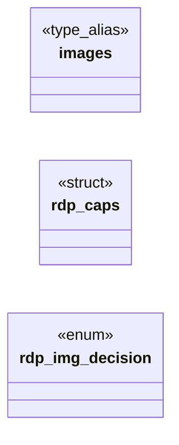

# `include/render_policy.h`

> Source: [include/render_policy.h:1](../../include/render_policy.h#L1) | language `h` | coverage 77.8% | [API index](../index.md)

## Contents

- **Structs:** [`rdp_caps`](#rdp_caps)
- **Enums:** [`rdp_img_decision`](#rdp_img_decision)
- **Type Aliases:** [`images`](#images)
- **Functions:** [`rdp_is_tracking_pixel`](#rdp_is_tracking_pixel), [`size`](#size), [`rdp_img_reason`](#rdp_img_reason), [`rdp_images_warning`](#rdp_images_warning)
- **Macros:** [`RDP_TRACKER_MAX_DIM`](#rdp_tracker_max_dim)

## Type Diagram



## Call Graph

Solid arrows stay in this module, dashed arrows leave it.


## Structs

<a id="rdp_caps"></a>

### `rdp_caps`

`struct` | [include/render_policy.h:32](../../include/render_policy.h#L32)

```c
typedef struct rdp_caps
```

Render capabilities for a page.

The zero value ({0}) is the safe baseline: every rich/risky capability off. The only way to opt in is to set a field to true explicitly, which keeps every opt-in auditable.

---

## Enums

<a id="rdp_img_decision"></a>

### `rdp_img_decision`

`enum` | [include/render_policy.h:39](../../include/render_policy.h#L39)

```c
typedef enum rdp_img_decision
```

Decision for one image subresource.

---

## Type Aliases

<a id="images"></a>

### `images`

`type_alias` | [include/render_policy.h:32](../../include/render_policy.h#L32)

```c
typedef struct rdp_caps { bool images;
```

Render capabilities for a page.

The zero value ({0}) is the safe baseline: every rich/risky capability off. The only way to opt in is to set a field to true explicitly, which keeps every opt-in auditable.

---

## Functions

<a id="rdp_is_tracking_pixel"></a>

### `rdp_is_tracking_pixel`

`function` | [include/render_policy.h:53](../../include/render_policy.h#L53)

```c
int rdp_is_tracking_pixel(int w, int h);
```

Tracking-pixel heuristic over an image's declared dimensions. w/h negative means "unknown".

Returns 1 for a tracking pixel (zero-area, or both dims <= RDP_TRACKER_MAX_DIM), 0 otherwise (including unknown dimensions).

**Parameters**

| Name | Type | Default | Description |
|---|---|---|---|
| `w` | `int` |  |  |
| `h` | `int` |  |  |

**Returns:** `int`

---

<a id="size"></a>

### `size`

`function` | [include/render_policy.h:56](../../include/render_policy.h#L56)

```c
* announced size (e.g. );
```

**Parameters**

| Name | Type | Default | Description |
|---|---|---|---|
| `height` | `e.g. ` |  |  |

**Returns:** `* announced`

---

<a id="rdp_img_reason"></a>

### `rdp_img_reason`

`function` `const` | [include/render_policy.h:66](../../include/render_policy.h#L66)

```c
const char *rdp_img_reason(rdp_img_decision d);
```

Stable, short, English reason string for structured/agent-friendly output.

Never NULL; an unknown enum value yields "unknown".

**Parameters**

| Name | Type | Default | Description |
|---|---|---|---|
| `d` | `rdp_img_decision` |  |  |

**Returns:** `char *`

---

<a id="rdp_images_warning"></a>

### `rdp_images_warning`

`function` `const` | [include/render_policy.h:69](../../include/render_policy.h#L69)

```c
const char *rdp_images_warning(void);
```

Fixed warning shown when the user enables images.

Never NULL or empty.

**Returns:** `char *`

---

## Macros

<a id="rdp_tracker_max_dim"></a>

### `RDP_TRACKER_MAX_DIM`

`macro` | [include/render_policy.h:27](../../include/render_policy.h#L27)

```c
#define RDP_TRACKER_MAX_DIM
```

Both declared dimensions at or below this are treated as a tracking pixel.

*Calls:* [`images`](#images)

---
