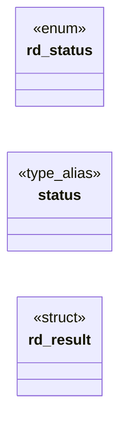

# `include/renderer.h`

> Source: [include/renderer.h:1](../../include/renderer.h#L1) | language `h` | coverage 14.3% | [API index](../index.md)

## Contents

- **Structs:** [`rd_result`](#rd_result)
- **Enums:** [`rd_status`](#rd_status)
- **Type Aliases:** [`status`](#status)
- **Functions:** [`rd_result_free`](#rd_result_free)
- **Macros:** [`RD_MAX_INPUT`](#rd_max_input), [`RD_MAX_FIELD`](#rd_max_field)

## Type Diagram



## Structs

<a id="rd_result"></a>

### `rd_result`

`struct` | [include/renderer.h:29](../../include/renderer.h#L29)

```c
typedef struct rd_result
```

---

## Enums

<a id="rd_status"></a>

### `rd_status`

`enum` | [include/renderer.h:20](../../include/renderer.h#L20)

```c
typedef enum rd_status
```

---

## Type Aliases

<a id="status"></a>

### `status`

`type_alias` | [include/renderer.h:28](../../include/renderer.h#L28)

```c
typedef struct rd_result { rd_status status;
```

---

## Functions

<a id="rd_result_free"></a>

### `rd_result_free`

`function` | [include/renderer.h:46](../../include/renderer.h#L46)

```c
void rd_result_free(rd_result *out);
```

Idempotent; safe on a zero-initialised struct and safe to call twice.

**Parameters**

| Name | Type | Default | Description |
|---|---|---|---|
| `out` | `rd_result *` |  |  |

---

## Macros

<a id="rd_max_input"></a>

### `RD_MAX_INPUT`

`macro` | [include/renderer.h:37](../../include/renderer.h#L37)

```c
#define RD_MAX_INPUT
```

---

<a id="rd_max_field"></a>

### `RD_MAX_FIELD`

`macro` | [include/renderer.h:38](../../include/renderer.h#L38)

```c
#define RD_MAX_FIELD
```

---
