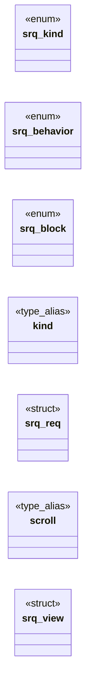

# `include/scroll_req.h`

> Source: [include/scroll_req.h:1](../../include/scroll_req.h#L1) | language `h` | coverage 35.7% | [API index](../index.md)

## Contents

- **Structs:** [`srq_req`](#srq_req), [`srq_view`](#srq_view)
- **Enums:** [`srq_kind`](#srq_kind), [`srq_behavior`](#srq_behavior), [`srq_block`](#srq_block)
- **Type Aliases:** [`kind`](#kind), [`scroll`](#scroll)
- **Functions:** [`srq_encode`](#srq_encode), [`srq_decode`](#srq_decode), [`srq_target`](#srq_target), [`srq_smooth`](#srq_smooth)
- **Macros:** [`SRQ_MAX_COORD`](#srq_max_coord), [`SRQ_WIRE_N`](#srq_wire_n)

## Type Diagram



## Call Graph

Solid arrows stay in this module, dashed arrows leave it.


## Structs

<a id="srq_req"></a>

### `srq_req`

`struct` | [include/scroll_req.h:37](../../include/scroll_req.h#L37)

```c
typedef struct srq_req
```

---

<a id="srq_view"></a>

### `srq_view`

`struct` | [include/scroll_req.h:47](../../include/scroll_req.h#L47)

```c
typedef struct srq_view
```

---

## Enums

<a id="srq_kind"></a>

### `srq_kind`

`enum` | [include/scroll_req.h:24](../../include/scroll_req.h#L24)

```c
typedef enum srq_kind
```

---

<a id="srq_behavior"></a>

### `srq_behavior`

`enum` | [include/scroll_req.h:31](../../include/scroll_req.h#L31)

```c
typedef enum srq_behavior { SRQ_AUTO = 0, SRQ_INSTANT = 1, SRQ_SMOOTH = 2 } srq_behavior;
```

---

<a id="srq_block"></a>

### `srq_block`

`enum` | [include/scroll_req.h:33](../../include/scroll_req.h#L33)

```c
typedef enum srq_block
```

---

## Type Aliases

<a id="kind"></a>

### `kind`

`type_alias` | [include/scroll_req.h:36](../../include/scroll_req.h#L36)

```c
typedef struct srq_req { int kind;
```

---

<a id="scroll"></a>

### `scroll`

`type_alias` | [include/scroll_req.h:46](../../include/scroll_req.h#L46)

```c
typedef struct srq_view { double scroll;
```

---

## Functions

<a id="srq_encode"></a>

### `srq_encode`

`function` | [include/scroll_req.h:58](../../include/scroll_req.h#L58)

```c
void srq_encode(const srq_req *r, int32_t out[SRQ_WIRE_N]);
```

Writes r as SRQ_WIRE_N int32: kind, behavior, block, y, margin_top, margin_bottom, n, nsub.

Doubles are rounded and clamped to [-SRQ_MAX_COORD, SRQ_MAX_COORD] (NaN => 0); a NULL argument writes nothing.

**Parameters**

| Name | Type | Default | Description |
|---|---|---|---|
| `r` | `srq_req *` |  |  |
| `SRQ_WIRE_N` | `int32_t out[ ]` |  |  |

*Called by:* [`LLVMFuzzerTestOneInput`](fuzz.fuzz_scroll_req.c.md#llvmfuzzertestoneinput), [`navigation`](src.tab.c.md#navigation)

---

<a id="srq_decode"></a>

### `srq_decode`

`function` | [include/scroll_req.h:64](../../include/scroll_req.h#L64)

```c
int srq_decode(const int32_t in[SRQ_WIRE_N], size_t max_handles, srq_req *out);
```

Reads a record written by srq_encode, validating EVERY field: enums in range, |coords| <= SRQ_MAX_COORD, n <= max_handles, nsub <= n, handles only (and always) for SRQ_ELEMENT.

Returns 0 on success, -1 otherwise (*out is then SRQ_NONE when out is not NULL). A record of kind SRQ_NONE with every other field 0 is valid.

**Parameters**

| Name | Type | Default | Description |
|---|---|---|---|
| `SRQ_WIRE_N` | `int32_t in[ ]` |  |  |
| `max_handles` | `size_t` |  |  |
| `out` | `srq_req *` |  |  |

**Returns:** `int`

*Called by:* [`LLVMFuzzerTestOneInput`](fuzz.fuzz_scroll_req.c.md#llvmfuzzertestoneinput)

---

<a id="srq_target"></a>

### `srq_target`

`function` | [include/scroll_req.h:71](../../include/scroll_req.h#L71)

```c
int srq_target(const srq_req *r, const srq_view *v, double el_top, double el_bottom, double *out);
```

The scroll offset r asks for, in [0, v->max_scroll]. el_top/el_bottom are the target's document box (SRQ_ELEMENT only; ignored otherwise).

The optimal viewing region is the viewport minus the root's scroll-padding (ignored when it would leave no room); the target's box grows by its scroll-margin. Returns 0 and *out; -1 (*out untouched) on NULL, SRQ_NONE, a non-finite input, view_h <= 0 or max_scroll < 0.

**Parameters**

| Name | Type | Default | Description |
|---|---|---|---|
| `r` | `srq_req *` |  |  |
| `v` | `srq_view *` |  |  |
| `el_top` | `double` |  |  |
| `el_bottom` | `double` |  |  |
| `out` | `double *` |  |  |

**Returns:** `int`

*Called by:* [`LLVMFuzzerTestOneInput`](fuzz.fuzz_scroll_req.c.md#llvmfuzzertestoneinput)

---

<a id="srq_smooth"></a>

### `srq_smooth`

`function` | [include/scroll_req.h:76](../../include/scroll_req.h#L76)

```c
int srq_smooth(const srq_req *r, int root_smooth);
```

1 when the scroll should animate: SRQ_SMOOTH, or SRQ_AUTO with the root's computed scroll-behavior smooth (root_smooth != 0).

0 otherwise or on NULL.

**Parameters**

| Name | Type | Default | Description |
|---|---|---|---|
| `r` | `srq_req *` |  |  |
| `root_smooth` | `int` |  |  |

**Returns:** `int`

*Called by:* [`LLVMFuzzerTestOneInput`](fuzz.fuzz_scroll_req.c.md#llvmfuzzertestoneinput)

---

## Macros

<a id="srq_max_coord"></a>

### `SRQ_MAX_COORD`

`macro` | [include/scroll_req.h:21](../../include/scroll_req.h#L21)

```c
#define SRQ_MAX_COORD
```

---

<a id="srq_wire_n"></a>

### `SRQ_WIRE_N`

`macro` | [include/scroll_req.h:22](../../include/scroll_req.h#L22)

```c
#define SRQ_WIRE_N
```

|px| a record may carry; beyond is a desync

*Calls:* [`view`](include.tab.h.md#view)

---
