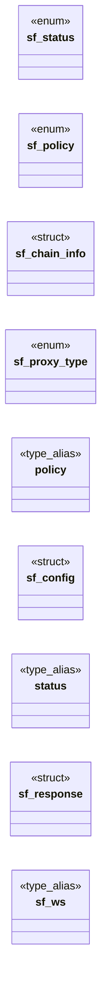

# `include/secure_fetch.h`

> Source: [include/secure_fetch.h:1](../../include/secure_fetch.h#L1) | language `h` | coverage 50.0% | [API index](../index.md)

## Contents

- **Structs:** [`sf_chain_info`](#sf_chain_info), [`sf_config`](#sf_config), [`sf_response`](#sf_response)
- **Enums:** [`sf_status`](#sf_status), [`sf_policy`](#sf_policy), [`sf_proxy_type`](#sf_proxy_type)
- **Type Aliases:** [`policy`](#policy), [`status`](#status), [`sf_ws`](#sf_ws)
- **Functions:** [`validators`](#validators), [`sf_global_init`](#sf_global_init), [`EXCLUDED`](#excluded), [`sf_cookie_put`](#sf_cookie_put), [`sf_cookie_line_matches`](#sf_cookie_line_matches), [`sf_user_agent_or_default`](#sf_user_agent_or_default), [`sf_impersonate_kex_groups`](#sf_impersonate_kex_groups), [`sf_impersonate_tls13_ciphers`](#sf_impersonate_tls13_ciphers), [`skipped`](#skipped), [`sf_is_redirect_code`](#sf_is_redirect_code), [`bits`](#bits), [`sf_ws_fd`](#sf_ws_fd), [`sf_ws_close`](#sf_ws_close), [`connection`](#connection), [`sf_get`](#sf_get), [`sf_response_free`](#sf_response_free), [`exhausted`](#exhausted), [`sf_rcache_put`](#sf_rcache_put), [`sf_rcache_get`](#sf_rcache_get), [`sf_rcache_clear`](#sf_rcache_clear)
- **Macros:** [`SF_DEFAULT_KEX_GROUPS`](#sf_default_kex_groups), [`SF_IMPERSONATE_KEX_GROUPS`](#sf_impersonate_kex_groups), [`SF_IMPERSONATE_TLS13_CIPHERS`](#sf_impersonate_tls13_ciphers), [`SF_IMPERSONATE_TLS12_CIPHERS`](#sf_impersonate_tls12_ciphers), [`SF_DEFAULT_USER_AGENT`](#sf_default_user_agent), [`SF_DEFAULT_MAX_BODY`](#sf_default_max_body), [`SF_DEFAULT_TIMEOUT_MS`](#sf_default_timeout_ms), [`SF_CONNECT_TIMEOUT_MS`](#sf_connect_timeout_ms), [`SF_SUBRESOURCE_TIMEOUT_MS`](#sf_subresource_timeout_ms), [`SF_DEFAULT_MAX_REDIRECTS`](#sf_default_max_redirects), [`SF_MAX_URL`](#sf_max_url), [`SF_WS_MAX_MESSAGE`](#sf_ws_max_message)

## Type Diagram



## Structs

<a id="sf_chain_info"></a>

### `sf_chain_info`

`struct` | [include/secure_fetch.h:61](../../include/secure_fetch.h#L61)

```c
typedef struct sf_chain_info
```

Minimal view of the verified certificate chain, used by sf_check_chain_policy.

Kept as plain data so the policy check is a pure, directly testable function.

---

<a id="sf_config"></a>

### `sf_config`

`struct` | [include/secure_fetch.h:76](../../include/secure_fetch.h#L76)

```c
typedef struct sf_config
```

---

<a id="sf_response"></a>

### `sf_response`

`struct` | [include/secure_fetch.h:118](../../include/secure_fetch.h#L118)

```c
typedef struct sf_response
```

---

## Enums

<a id="sf_status"></a>

### `sf_status`

`enum` | [include/secure_fetch.h:24](../../include/secure_fetch.h#L24)

```c
typedef enum sf_status
```

Result codes.

SF_OK == 0; every other value is a hard failure.

---

<a id="sf_policy"></a>

### `sf_policy`

`enum` | [include/secure_fetch.h:41](../../include/secure_fetch.h#L41)

```c
typedef enum sf_policy
```

Post-quantum enforcement policy.

---

<a id="sf_proxy_type"></a>

### `sf_proxy_type`

`enum` | [include/secure_fetch.h:70](../../include/secure_fetch.h#L70)

```c
typedef enum sf_proxy_type
```

Socket-level anonymity proxy (Privacy by Default, Principle 3).

The realm router (net_realm) decides which one to use per request; secure_fetch just applies it.

---

## Type Aliases

<a id="policy"></a>

### `policy`

`type_alias` | [include/secure_fetch.h:75](../../include/secure_fetch.h#L75)

```c
typedef struct sf_config { sf_policy policy;
```

---

<a id="status"></a>

### `status`

`type_alias` | [include/secure_fetch.h:117](../../include/secure_fetch.h#L117)

```c
typedef struct sf_response { sf_status status;
```

---

<a id="sf_ws"></a>

### `sf_ws`

`type_alias` | [include/secure_fetch.h:294](../../include/secure_fetch.h#L294)

```c
typedef struct sf_ws sf_ws;
```

per-message cap (anti-DoS)

---

## Functions

<a id="validators"></a>

### `validators`

`function` | [include/secure_fetch.h:18](../../include/secure_fetch.h#L18)

```c
* The security logic lives in pure validators (no I/O);
```

**Parameters**

| Name | Type | Default | Description |
|---|---|---|---|
| `O` | `no I/` |  |  |

**Returns:** `* The security logic lives in pure`

---

<a id="sf_global_init"></a>

### `sf_global_init`

`function` | [include/secure_fetch.h:205](../../include/secure_fetch.h#L205)

```c
void sf_global_init(void);
```

Initialises process-global transport state (libcurl/OpenSSL) once, from the main thread, before any concurrent sf_get/sf_post. libcurl's implicit init on first use is NOT thread-safe, so an orchestrator that fetches from worker threads MUST call this first.

Idempotent; safe to call more than once. A single-threaded caller need not call it. There is intentionally no cleanup: it would race in-flight fetches at shutdown, and the OS reclaims everything on exit.

---

<a id="excluded"></a>

### `EXCLUDED`

`function` | [include/secure_fetch.h:211](../../include/secure_fetch.h#L211)

```c
* cookies are EXCLUDED (network-only, never exposed to JS) and expired cookies skipped. * Only for a TRUSTED host (the caller gates on allow.conf AND js.conf). 0 on empty/error. */ size_t sf_cookie_he
```

**Parameters**

| Name | Type | Default | Description |
|---|---|---|---|
| `only` | `network-` |  |  |
| `JS` | `never exposed to` |  |  |

**Returns:** `* cookies are`

---

<a id="sf_cookie_put"></a>

### `sf_cookie_put`

`function` | [include/secure_fetch.h:218](../../include/secure_fetch.h#L218)

```c
void sf_cookie_put(const char *url, const char *namevalue);
```

Injects a JS-set cookie ("name=value") into the shared jar, scoped to url's host, as if it arrived via Set-Cookie -- so a trusted page's document.cookie writes reach the next request. namevalue past the first ';' (attributes) is ignored.

No-op on malformed input.

**Parameters**

| Name | Type | Default | Description |
|---|---|---|---|
| `url` | `char *` |  |  |
| `namevalue` | `char *` |  |  |

---

<a id="sf_cookie_line_matches"></a>

### `sf_cookie_line_matches`

`function` | [include/secure_fetch.h:223](../../include/secure_fetch.h#L223)

```c
int sf_cookie_line_matches(const char *line, const char *host, const char *path, long now, char *out, size_t outsz);
```

Pure: parses one CURLINFO_COOKIELIST Netscape line ("domain\\tflag\\tpath\\tsecure\\t expiry\\tname\\tvalue"); if the cookie applies to (host, path), is not HttpOnly and is unexpired at `now`, writes "name=value" to out (bounded) and returns 1, else 0.

**Parameters**

| Name | Type | Default | Description |
|---|---|---|---|
| `line` | `char *` |  |  |
| `host` | `char *` |  |  |
| `path` | `char *` |  |  |
| `now` | `long` |  |  |
| `out` | `char *` |  |  |
| `outsz` | `size_t` |  |  |

**Returns:** `int`

---

<a id="sf_user_agent_or_default"></a>

### `sf_user_agent_or_default`

`function` `const` | [include/secure_fetch.h:232](../../include/secure_fetch.h#L232)

```c
const char *sf_user_agent_or_default(const char *ua);
```

Returns ua when it is a non-empty string, else SF_DEFAULT_USER_AGENT.

Pure: the single place that resolves the effective User-Agent, so the orchestrator never sends an empty header and the default lives in one tested spot.

**Parameters**

| Name | Type | Default | Description |
|---|---|---|---|
| `ua` | `char *` |  |  |

**Returns:** `char *`

---

<a id="sf_impersonate_kex_groups"></a>

### `sf_impersonate_kex_groups`

`function` `const` | [include/secure_fetch.h:236](../../include/secure_fetch.h#L236)

```c
const char *sf_impersonate_kex_groups(void);
```

The interim impersonation ClientHello strings (pure; single source of truth so the shaping is unit-testable without a live handshake).

Both are classical (no MLKEM).

**Returns:** `char *`

---

<a id="sf_impersonate_tls13_ciphers"></a>

### `sf_impersonate_tls13_ciphers`

`function` `const` | [include/secure_fetch.h:237](../../include/secure_fetch.h#L237)

```c
const char *sf_impersonate_tls13_ciphers(void);
```

**Returns:** `char *`

---

<a id="skipped"></a>

### `skipped`

`function` | [include/secure_fetch.h:257](../../include/secure_fetch.h#L257)

```c
* skipped (a classical key exchange is accepted);
```

**Parameters**

| Name | Type | Default | Description |
|---|---|---|---|
| `accepted` | `a classical key exchange is` |  |  |

**Returns:** `*`

---

<a id="sf_is_redirect_code"></a>

### `sf_is_redirect_code`

`function` | [include/secure_fetch.h:268](../../include/secure_fetch.h#L268)

```c
int sf_is_redirect_code(long http_code);
```

Nonzero only for HTTP redirect status codes (301, 302, 303, 307, 308).

**Parameters**

| Name | Type | Default | Description |
|---|---|---|---|
| `http_code` | `long` |  |  |

**Returns:** `int`

---

<a id="bits"></a>

### `bits`

`function` | [include/secure_fetch.h:311](../../include/secure_fetch.h#L311)

```c
* *flags receives CURLWS_* bits (text/binary/close/cont);
```

**Parameters**

| Name | Type | Default | Description |
|---|---|---|---|
| `cont` | `text/binary/close/` |  |  |

**Returns:** `* *flags receives CURLWS_*`

---

<a id="sf_ws_fd"></a>

### `sf_ws_fd`

`function` | [include/secure_fetch.h:318](../../include/secure_fetch.h#L318)

```c
int sf_ws_fd(const sf_ws *ws);
```

The connection's socket for poll(), or -1.

**Parameters**

| Name | Type | Default | Description |
|---|---|---|---|
| `ws` | `sf_ws *` |  |  |

**Returns:** `int`

---

<a id="sf_ws_close"></a>

### `sf_ws_close`

`function` | [include/secure_fetch.h:321](../../include/secure_fetch.h#L321)

```c
void sf_ws_close(sf_ws *ws);
```

Sends a close frame when possible and frees the connection.

NULL is a no-op.

**Parameters**

| Name | Type | Default | Description |
|---|---|---|---|
| `ws` | `sf_ws *` |  |  |

---

<a id="connection"></a>

### `connection`

`function` | [include/secure_fetch.h:325](../../include/secure_fetch.h#L325)

```c
* on each connection (Zero Trust). Each target is re-validated and a downgrade * to http:// is refused. Exceeding max_redirects => SF_ERR_TOO_MANY_REDIRECTS. * On SF_OK, *out is the final response and
```

**Parameters**

| Name | Type | Default | Description |
|---|---|---|---|
| `Trust` | `Zero` |  |  |

**Returns:** `* on each`

---

<a id="sf_get"></a>

### `sf_get`

`function` | [include/secure_fetch.h:334](../../include/secure_fetch.h#L334)

```c
* sf_get (Zero Trust): an insecure POST is not representable. Does not follow * redirects (the caller inspects out->http_code / out->location and decides). * cfg == NULL => sf_config_default(). url ==
```

**Parameters**

| Name | Type | Default | Description |
|---|---|---|---|
| `Trust` | `Zero` |  |  |

**Returns:** `an insecure POST is not representable. Does not follow * redirects (the caller inspects out->http_code / out->location and decides). * cfg`

---

<a id="sf_response_free"></a>

### `sf_response_free`

`function` | [include/secure_fetch.h:345](../../include/secure_fetch.h#L345)

```c
void sf_response_free(sf_response *resp);
```

Idempotent; safe on a zero-initialised struct and safe to call twice.

**Parameters**

| Name | Type | Default | Description |
|---|---|---|---|
| `resp` | `sf_response *` |  |  |

*Called by:* [`HL_JS_NAV_MAX`](src.freedom.c.md#hl_js_nav_max), [`gets`](src.freedom.c.md#gets)

---

<a id="exhausted"></a>

### `exhausted`

`function` | [include/secure_fetch.h:356](../../include/secure_fetch.h#L356)

```c
* is exhausted (*next untouched). `allowlisted` enables the sovereignty rung. */ int sf_fallback_policy(sf_status failed, sf_policy tried, int allowlisted, sf_policy *next);
```

**Parameters**

| Name | Type | Default | Description |
|---|---|---|---|
| `untouched` | `*next` |  |  |

**Returns:** `* is`

---

<a id="sf_rcache_put"></a>

### `sf_rcache_put`

`function` | [include/secure_fetch.h:369](../../include/secure_fetch.h#L369)

```c
int sf_rcache_put(const char *from, const char *to, time_t now);
```

Permanent-redirect memory: a 301/308 seen by sf_get_follow is remembered in RAM only (never on disk) for a day, so the same URL is not asked twice.

Remembering changes WHEN a redirect is learned, never what policy the target is fetched under.

**Parameters**

| Name | Type | Default | Description |
|---|---|---|---|
| `from` | `char *` |  |  |
| `to` | `char *` |  |  |
| `now` | `time_t` |  |  |

**Returns:** `int`

---

<a id="sf_rcache_get"></a>

### `sf_rcache_get`

`function` | [include/secure_fetch.h:370](../../include/secure_fetch.h#L370)

```c
int sf_rcache_get(const char *from, time_t now, char *out, size_t cap);
```

**Parameters**

| Name | Type | Default | Description |
|---|---|---|---|
| `from` | `char *` |  |  |
| `now` | `time_t` |  |  |
| `out` | `char *` |  |  |
| `cap` | `size_t` |  |  |

**Returns:** `int`

---

<a id="sf_rcache_clear"></a>

### `sf_rcache_clear`

`function` | [include/secure_fetch.h:371](../../include/secure_fetch.h#L371)

```c
void sf_rcache_clear(void);
```

1 on hit

---

## Macros

<a id="sf_default_kex_groups"></a>

### `SF_DEFAULT_KEX_GROUPS`

`macro` | [include/secure_fetch.h:144](../../include/secure_fetch.h#L144)

```c
#define SF_DEFAULT_KEX_GROUPS
```

PQ-hybrid is preferred (listed first); classical groups are also offered so a non-PQ host completes the TLS 1.3 handshake and yields a clean SF_ERR_KEM_NOT_PQ under the strict policy (instead of an opaque handshake failure) — which lets the orchestrator offer the classical-KE navigability fallback.

Offering a classical group never weakens the strict policy: a classical *negotiated* group is still rejected by sf_check_group_is_pq.

---

<a id="sf_impersonate_kex_groups"></a>

### `SF_IMPERSONATE_KEX_GROUPS`

`macro` | [include/secure_fetch.h:153](../../include/secure_fetch.h#L153)

```c
#define SF_IMPERSONATE_KEX_GROUPS
```

Interim impersonation ClientHello shaping (OpenSSL, Hito TLS Fase 3).

A classical profile consistent with FP_USER_AGENT (Firefox): it DROPS X25519MLKEM768 (almost no shipping Firefox of our advertised version offers MLKEM, so offering it under that UA is the single loudest TLS tell) and orders the TLS 1.3 ciphersuites Firefox-style (AES-128-GCM, CHACHA20, AES-256-GCM). A Chrome ClientHello under a Firefox UA would be a NEW mismatch, so the interim matches the identity we already send; byte-exact Chrome JA3 is the BoringSSL helper (spec/tls_impersonate.md). Groups mirror Firefox 128's supported_groups order.

---

<a id="sf_impersonate_tls13_ciphers"></a>

### `SF_IMPERSONATE_TLS13_CIPHERS`

`macro` | [include/secure_fetch.h:154](../../include/secure_fetch.h#L154)

```c
#define SF_IMPERSONATE_TLS13_CIPHERS
```

---

<a id="sf_impersonate_tls12_ciphers"></a>

### `SF_IMPERSONATE_TLS12_CIPHERS`

`macro` | [include/secure_fetch.h:158](../../include/secure_fetch.h#L158)

```c
#define SF_IMPERSONATE_TLS12_CIPHERS
```

Firefox 128 TLS 1.2 ciphersuite list (OpenSSL names, in wire order).

OpenSSL's default advertises ~80 TLS 1.2 suites; Firefox advertises ~14, so restricting the list is the single biggest shrink of the JA3/JA4 cipher field toward the browser.

---

<a id="sf_default_user_agent"></a>

### `SF_DEFAULT_USER_AGENT`

`macro` | [include/secure_fetch.h:169](../../include/secure_fetch.h#L169)

```c
#define SF_DEFAULT_USER_AGENT
```

The default User-Agent IS the anti-fingerprinting identity (FP_USER_AGENT): it must match navigator.userAgent exactly and must not advertise "Freedom" (that is a unique fingerprint and a bot signal that breaks sites like Google).

Demoting the old "Freedom/0.1" to merely a brand string was deliberate; never reintroduce a product name here. The user can still override per session in the menu.

---

<a id="sf_default_max_body"></a>

### `SF_DEFAULT_MAX_BODY`

`macro` | [include/secure_fetch.h:170](../../include/secure_fetch.h#L170)

```c
#define SF_DEFAULT_MAX_BODY
```

---

<a id="sf_default_timeout_ms"></a>

### `SF_DEFAULT_TIMEOUT_MS`

`macro` | [include/secure_fetch.h:171](../../include/secure_fetch.h#L171)

```c
#define SF_DEFAULT_TIMEOUT_MS
```

---

<a id="sf_connect_timeout_ms"></a>

### `SF_CONNECT_TIMEOUT_MS`

`macro` | [include/secure_fetch.h:194](../../include/secure_fetch.h#L194)

```c
#define SF_CONNECT_TIMEOUT_MS
```

Connect deadline, and the shorter total budget a SUBRESOURCE gets.

These exist because a page is not one fetch. A document that names twenty
stylesheets, scripts and images pays the timeout of every one of them, and
with only a 30 s total timeout and NO connect deadline at all, a single
blackholed host burned the whole 30 s inside the TCP/TLS handshake -- twenty
of those is a page that takes minutes to appear. Measured on a real site:
1.5 s with no subresources, 32 s with author CSS, past 400 s with images.

SF_CONNECT_TIMEOUT_MS bounds only the handshake: a peer that has not
completed one in this long is not about to. It is deliberately generous
enough for a slow mobile link plus a Tor/I2P hop, which is why it is not
one or two seconds.

SF_SUBRESOURCE_TIMEOUT_MS is the total budget for a stylesheet, script or
image. A subresource is optional by construction -- the page renders without
it -- so waiting the document's full budget for one trades a guaranteed
delay for a possible improvement. The document itself keeps
SF_DEFAULT_TIMEOUT_MS: there is nothing to show without it.

---

<a id="sf_subresource_timeout_ms"></a>

### `SF_SUBRESOURCE_TIMEOUT_MS`

`macro` | [include/secure_fetch.h:195](../../include/secure_fetch.h#L195)

```c
#define SF_SUBRESOURCE_TIMEOUT_MS
```

---

<a id="sf_default_max_redirects"></a>

### `SF_DEFAULT_MAX_REDIRECTS`

`macro` | [include/secure_fetch.h:196](../../include/secure_fetch.h#L196)

```c
#define SF_DEFAULT_MAX_REDIRECTS
```

---

<a id="sf_max_url"></a>

### `SF_MAX_URL`

`macro` | [include/secure_fetch.h:197](../../include/secure_fetch.h#L197)

```c
#define SF_MAX_URL
```

---

<a id="sf_ws_max_message"></a>

### `SF_WS_MAX_MESSAGE`

`macro` | [include/secure_fetch.h:293](../../include/secure_fetch.h#L293)

```c
#define SF_WS_MAX_MESSAGE
```

---
