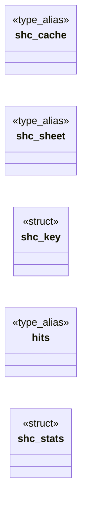

# `include/sheet_cache.h`

> Source: [include/sheet_cache.h:1](../../include/sheet_cache.h#L1) | language `h` | coverage 66.7% | [API index](../index.md)

## Contents

- **Structs:** [`shc_key`](#shc_key), [`shc_stats`](#shc_stats)
- **Type Aliases:** [`shc_cache`](#shc_cache), [`shc_sheet`](#shc_sheet), [`hits`](#hits)
- **Functions:** [`shc_new`](#shc_new), [`shc_free`](#shc_free), [`shc_acquire`](#shc_acquire), [`shc_css`](#shc_css), [`shc_release`](#shc_release), [`shc_stats_get`](#shc_stats_get)

## Type Diagram



## Structs

<a id="shc_key"></a>

### `shc_key`

`struct` | [include/sheet_cache.h:36](../../include/sheet_cache.h#L36)

```c
typedef struct shc_key
```

Every input of the parse.

`media` carries the @media gate and the optional root matcher, a callback into the live DOM. The module records each question the parse asks that matcher and the answer; a later acquire is a hit only when the static inputs are byte-identical AND the matcher passed in *that* key still gives every recorded answer. So the matcher must be a deterministic function of the selector and the caller's current DOM, free of side effects. All pointers are borrowed.

---

<a id="shc_stats"></a>

### `shc_stats`

`struct` | [include/sheet_cache.h:43](../../include/sheet_cache.h#L43)

```c
typedef struct shc_stats
```

---

## Type Aliases

<a id="shc_cache"></a>

### `shc_cache`

`type_alias` | [include/sheet_cache.h:26](../../include/sheet_cache.h#L26)

```c
typedef struct shc_cache shc_cache;
```

ifndef __STDC_VERSION__ error "sheet_cache requires C11" endif ifdef __cplusplus error "sheet_cache is C only" endif

---

<a id="shc_sheet"></a>

### `shc_sheet`

`type_alias` | [include/sheet_cache.h:28](../../include/sheet_cache.h#L28)

```c
typedef struct shc_sheet shc_sheet;
```

---

<a id="hits"></a>

### `hits`

`type_alias` | [include/sheet_cache.h:42](../../include/sheet_cache.h#L42)

```c
typedef struct shc_stats { unsigned long hits;
```

---

## Functions

<a id="shc_new"></a>

### `shc_new`

`function` | [include/sheet_cache.h:52](../../include/sheet_cache.h#L52)

```c
shc_cache *shc_new(size_t max_text_bytes);
```

max_text_bytes: texts longer than this are parsed but never retained; 0 selects FC_SHC_MAX_TEXT_BYTES.

NULL on OOM.

**Parameters**

| Name | Type | Default | Description |
|---|---|---|---|
| `max_text_bytes` | `size_t` |  |  |

**Returns:** `shc_cache *`

---

<a id="shc_free"></a>

### `shc_free`

`function` | [include/sheet_cache.h:55](../../include/sheet_cache.h#L55)

```c
void shc_free(shc_cache *c);
```

Drops the cache's own reference to its entry.

NULL-safe.

**Parameters**

| Name | Type | Default | Description |
|---|---|---|---|
| `c` | `shc_cache *` |  |  |

---

<a id="shc_acquire"></a>

### `shc_acquire`

`function` | [include/sheet_cache.h:60](../../include/sheet_cache.h#L60)

```c
shc_sheet *shc_acquire(shc_cache *cache, const shc_key *key);
```

The parsed sheet for *key: the retained one when every input matches, a fresh parse otherwise. cache == NULL parses without retaining.

Returns NULL on a NULL key, a NULL text with len > 0, len == SIZE_MAX, or OOM of the handle.

**Parameters**

| Name | Type | Default | Description |
|---|---|---|---|
| `cache` | `shc_cache *` |  |  |
| `key` | `shc_key *` |  |  |

**Returns:** `shc_sheet *`

---

<a id="shc_css"></a>

### `shc_css`

`function` `const` | [include/sheet_cache.h:64](../../include/sheet_cache.h#L64)

```c
const css_sheet *shc_css(const shc_sheet *s);
```

The read-only sheet behind a handle; NULL when the parse itself failed (the css module treats a NULL sheet as empty) or s is NULL.

**Parameters**

| Name | Type | Default | Description |
|---|---|---|---|
| `s` | `shc_sheet *` |  |  |

**Returns:** `css_sheet *`

*Called by:* [`pv_build_cached`](src.page_view.c.md#pv_build_cached)

---

<a id="shc_release"></a>

### `shc_release`

`function` | [include/sheet_cache.h:67](../../include/sheet_cache.h#L67)

```c
void shc_release(shc_sheet *s);
```

Drops one reference.

NULL-safe.

**Parameters**

| Name | Type | Default | Description |
|---|---|---|---|
| `s` | `shc_sheet *` |  |  |

---

<a id="shc_stats_get"></a>

### `shc_stats_get`

`function` | [include/sheet_cache.h:70](../../include/sheet_cache.h#L70)

```c
void shc_stats_get(const shc_cache *c, shc_stats *out);
```

Counters since shc_new; zeroes *out on a NULL cache.

**Parameters**

| Name | Type | Default | Description |
|---|---|---|---|
| `c` | `shc_cache *` |  |  |
| `out` | `shc_stats *` |  |  |

---
