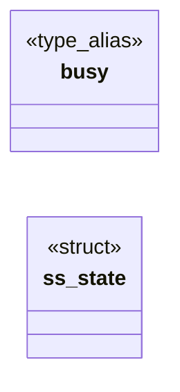

# `include/shm_slots.h`

> Source: [include/shm_slots.h:1](../../include/shm_slots.h#L1) | language `h` | coverage 42.9% | [API index](../index.md)

## Contents

- **Structs:** [`ss_state`](#ss_state)
- **Type Aliases:** [`busy`](#busy)
- **Functions:** [`ss_init`](#ss_init), [`ss_committed`](#ss_committed), [`ss_released`](#ss_released)
- **Macros:** [`SS_COUNT`](#ss_count)

## Type Diagram



## Structs

<a id="ss_state"></a>

### `ss_state`

`struct` | [include/shm_slots.h:19](../../include/shm_slots.h#L19)

```c
typedef struct ss_state
```

---

## Type Aliases

<a id="busy"></a>

### `busy`

`type_alias` | [include/shm_slots.h:18](../../include/shm_slots.h#L18)

```c
typedef struct ss_state { int busy[SS_COUNT];
```

define SS_COUNT 2

---

## Functions

<a id="ss_init"></a>

### `ss_init`

`function` `inline` `static` | [include/shm_slots.h:24](../../include/shm_slots.h#L24)

```c
static inline void ss_init(ss_state *s)
```

**Parameters**

| Name | Type | Default | Description |
|---|---|---|---|
| `s` | `ss_state *` |  |  |

---

<a id="ss_committed"></a>

### `ss_committed`

`function` `inline` `static` | [include/shm_slots.h:41](../../include/shm_slots.h#L41)

```c
static inline void ss_committed(ss_state *s, int i)
```

The painted slot was attached and committed.

**Parameters**

| Name | Type | Default | Description |
|---|---|---|---|
| `s` | `ss_state *` |  |  |
| `i` | `int` |  |  |

---

<a id="ss_released"></a>

### `ss_released`

`function` `inline` `static` | [include/shm_slots.h:49](../../include/shm_slots.h#L49)

```c
static inline int ss_released(ss_state *s, int i)
```

The compositor released slot i.

Returns 1 when it was busy.

**Parameters**

| Name | Type | Default | Description |
|---|---|---|---|
| `s` | `ss_state *` |  |  |
| `i` | `int` |  |  |

**Returns:** `int`

---

## Macros

<a id="ss_count"></a>

### `SS_COUNT`

`macro` | [include/shm_slots.h:17](../../include/shm_slots.h#L17)

```c
#define SS_COUNT
```

---
