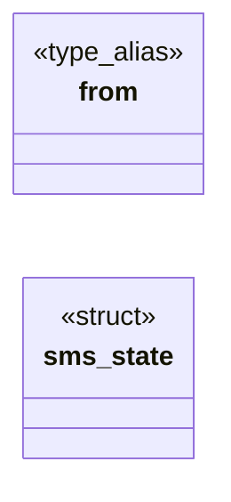

# `include/smooth_scroll.h`

> Source: [include/smooth_scroll.h:1](../../include/smooth_scroll.h#L1) | language `h` | coverage 11.1% | [API index](../index.md)

## Contents

- **Structs:** [`sms_state`](#sms_state)
- **Type Aliases:** [`from`](#from)
- **Functions:** [`sms_init`](#sms_init), [`sms_jump`](#sms_jump), [`sms_retarget`](#sms_retarget), [`sms_sample`](#sms_sample), [`sms_goal`](#sms_goal), [`sms_active`](#sms_active)

## Type Diagram



## Structs

<a id="sms_state"></a>

### `sms_state`

`struct` | [include/smooth_scroll.h:18](../../include/smooth_scroll.h#L18)

```c
typedef struct sms_state
```

---

## Type Aliases

<a id="from"></a>

### `from`

`type_alias` | [include/smooth_scroll.h:17](../../include/smooth_scroll.h#L17)

```c
typedef struct sms_state { double from;
```

smooth_scroll (sms_) -- pure arithmetic of the page's animated scroll: a cubic ease-out from the current position to a target, re-aimable mid-flight.

No I/O, no clock of its own (the caller passes milliseconds). Contract: spec/smooth_scroll.md.

Guarantees: pos is always finite and between from and to (never overshoots), monotone
within one animation, continuous across a retarget, and exactly [`to`](include.render_doc.h.md#rd_block-to) once finished.
Non-finite inputs leave the state unchanged; NULL is a no-op.

---

## Functions

<a id="sms_init"></a>

### `sms_init`

`function` | [include/smooth_scroll.h:27](../../include/smooth_scroll.h#L27)

```c
void sms_init(sms_state *s, double pos);
```

**Parameters**

| Name | Type | Default | Description |
|---|---|---|---|
| `s` | `sms_state *` |  |  |
| `pos` | `double` |  |  |

*Called by:* [`LLVMFuzzerTestOneInput`](fuzz.fuzz_smooth_scroll.c.md#llvmfuzzertestoneinput)

---

<a id="sms_jump"></a>

### `sms_jump`

`function` | [include/smooth_scroll.h:28](../../include/smooth_scroll.h#L28)

```c
void sms_jump(sms_state *s, double pos);
```

**Parameters**

| Name | Type | Default | Description |
|---|---|---|---|
| `s` | `sms_state *` |  |  |
| `pos` | `double` |  |  |

*Called by:* [`LLVMFuzzerTestOneInput`](fuzz.fuzz_smooth_scroll.c.md#llvmfuzzertestoneinput)

---

<a id="sms_retarget"></a>

### `sms_retarget`

`function` | [include/smooth_scroll.h:29](../../include/smooth_scroll.h#L29)

```c
void sms_retarget(sms_state *s, double target, double now_ms, double dur_ms);
```

**Parameters**

| Name | Type | Default | Description |
|---|---|---|---|
| `s` | `sms_state *` |  |  |
| `target` | `double` |  |  |
| `now_ms` | `double` |  |  |
| `dur_ms` | `double` |  |  |

*Called by:* [`LLVMFuzzerTestOneInput`](fuzz.fuzz_smooth_scroll.c.md#llvmfuzzertestoneinput)

---

<a id="sms_sample"></a>

### `sms_sample`

`function` | [include/smooth_scroll.h:30](../../include/smooth_scroll.h#L30)

```c
double sms_sample(sms_state *s, double now_ms);
```

**Parameters**

| Name | Type | Default | Description |
|---|---|---|---|
| `s` | `sms_state *` |  |  |
| `now_ms` | `double` |  |  |

**Returns:** `double`

*Called by:* [`LLVMFuzzerTestOneInput`](fuzz.fuzz_smooth_scroll.c.md#llvmfuzzertestoneinput)

---

<a id="sms_goal"></a>

### `sms_goal`

`function` | [include/smooth_scroll.h:31](../../include/smooth_scroll.h#L31)

```c
double sms_goal(const sms_state *s);
```

**Parameters**

| Name | Type | Default | Description |
|---|---|---|---|
| `s` | `sms_state *` |  |  |

**Returns:** `double`

*Called by:* [`LLVMFuzzerTestOneInput`](fuzz.fuzz_smooth_scroll.c.md#llvmfuzzertestoneinput)

---

<a id="sms_active"></a>

### `sms_active`

`function` | [include/smooth_scroll.h:32](../../include/smooth_scroll.h#L32)

```c
int sms_active(const sms_state *s);
```

**Parameters**

| Name | Type | Default | Description |
|---|---|---|---|
| `s` | `sms_state *` |  |  |

**Returns:** `int`

*Called by:* [`LLVMFuzzerTestOneInput`](fuzz.fuzz_smooth_scroll.c.md#llvmfuzzertestoneinput)

---
